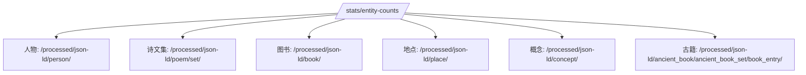

# 统计口径统一到 JSON-LD 目录方案

## 目标

将首页 `典藏概览` 的后端统计口径统一到 JSON-LD 主目录，避免一部分资源按 `collection`、另一部分资源按 `directory`，导致口径不一致、前后认知混乱。

## 当前问题

目前 `server/src/controllers/statsController.js` 中：

- 人物、诗文集、图书、地点、概念：按 `collection` 统计
- 古籍：按 `JSON-LD directory` 统计，并保留集合回退

这会带来两个问题：

| 问题 | 说明 |
|---|---|
| 口径不统一 | 首页统计来源混杂，难以解释和维护 |
| 易受历史集合污染 | `vector`、`rdf`、旧集合名容易干扰理解 |

## 统一后的口径

## 口径表

| 统计项 | 统一后路径 | 说明 |
|---|---|---|
| `person` | `/processed/json-ld/person/` | 人物主目录 |
| `poemSet` | `/processed/json-ld/poem/set/` | 诗文集合主目录 |
| `book` | `/processed/json-ld/book/` | 图书主目录 |
| `geography` | `/processed/json-ld/place/` | 地点主目录 |
| `concept` | `/processed/json-ld/concept/` | 概念主目录 |
| `ancientBook` | `/processed/json-ld/ancient_book/ancient_book_set/book_entry/` | 古籍条目主目录 |

## 特殊说明

### 为什么诗文不是 `/processed/json-ld/poem-set/`

仓库中实际 JSON-LD 主路径是：

- `/processed/json-ld/poem/set/`

而不是：

- `/processed/json-ld/poem-set/`

`poems-set` 主要出现在：

- collection 名：`/heluo/poems-set`
- vector 索引目录：`/processed/json-ld-vector/poems-set/`

## 实施策略

## 代码策略

1. `statsController` 改为优先读取 JSON-LD 主目录。
2. 人物、诗文集、图书、地点、概念统一通过目录配置获取主路径。
3. 古籍继续保留 `book_entry` 特例逻辑，不与普通实体混写。
4. 前端统计归一化逻辑保留，作为接口兼容层，不回退删除。

## 风险控制

| 风险 | 控制方式 |
|---|---|
| 目录统计与旧测试不一致 | 先改测试，再改实现 |
| 误统计到 legacy 路径 | 只取 primary 目录，不混入 legacy |
| 影响首页显示 | 保留前端兼容层，确保字段结构稳定 |
| 引入新问题 | 修改后执行 `typescript` 与定向测试 |
