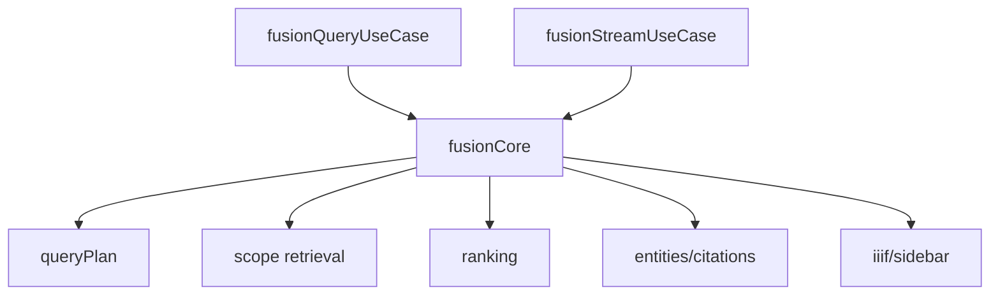

# P1 Fusion 共用核心收敛方案

## 1. 背景

当前 `fusionQueryUseCase` 与 `fusionStreamUseCase` 都在做几乎同一件事：

- 构建查询计划
- 多维检索
- 合并候选
- 拉取文档补全标题与摘要
- 重排
- 构建实体、证据、IIIF、侧边栏

差别主要只有两类：

1. **输出方式不同**
   - `fusionQueryUseCase`：一次性返回完整 JSON
   - `fusionStreamUseCase`：按 SSE 分阶段推送
2. **答案生成方式不同**
   - 非流式：`buildAnswer`
   - 流式：`generateStream`

换句话说：**两边的“检索与证据构建”高度重复，只有“回答如何发出去”不同。**

## 2. 当前问题

| 问题 | 现象 | 风险 |
|---|---|---|
| 逻辑重复 | 两个 usecase 都维护同一套检索编排 | 改一边容易漏另一边 |
| 结果结构重复 | entities / citations / iiif / sidebar 组装重复 | 字段口径可能慢慢漂移 |
| 修复成本高 | 改 ranking、uri 归一化、snippet 逻辑要改两处 | 测试与维护成本上升 |
| 心智负担高 | 问题排查要在 query/stream 两条线各看一遍 | 开发效率下降 |

## 3. P1 目标

### 3.1 目标

把 `Fusion` 的**检索与证据构建主流程**抽成一个共用核心模块，让：

- `fusionQueryUseCase` 负责“缓存 + 一次性回答”
- `fusionStreamUseCase` 负责“SSE 事件编排 + 流式回答”
- 共用核心负责“把候选、证据、IIIF、侧边栏准备好”

### 3.2 不做的事

- 不改 Fusion 的 API 契约
- 不改前端调用方式
- 不改排序算法本身
- 不引入新的外部依赖

## 4. 目标结构

## 5. 拆分方案

### 步骤 1：抽共用工具

把以下逻辑抽到新模块：

- 主实体 URI 归一化
- 图谱 IRI 候选构建
- IIIF 命中提取
- 多查询 RRF 融合
- 模板答案生成

### 步骤 2：抽检索准备流程

抽一个共用函数，输入：

- `query`
- `mode`
- `dims`
- `topK`
- `includeIiif`
- `gateways / retrievers / options`

输出：

- `queryPlan`
- `ranked`
- `entities`
- `citations`
- `iiifMatches`
- `sidebarItems`
- `trace` 所需中间信息

### 步骤 3：query/stream 两边改为消费共用核心

| 用例 | 保留职责 |
|---|---|
| `fusionQueryUseCase` | 缓存、非流式答案生成、响应包装 |
| `fusionStreamUseCase` | 状态事件、流式 chunk 推送、降级事件 |

## 6. 风险

| 风险 | 说明 | 应对 |
|---|---|---|
| 抽取时改变字段口径 | entities/citations 字段可能漂移 | 保持输出结构完全一致 |
| query/stream 行为不一致被放大 | 旧逻辑差异被抽取时暴露 | 先抽公共交集，不强行统一特殊分支 |
| 回归范围扩大 | 改两条主链路 | 改完后同时跑 query/stream/detail/search 测试 |

## 7. 本轮执行顺序

1. 先新增共用核心模块
2. 改 `fusionQueryUseCase`
3. 改 `fusionStreamUseCase`
4. 跑 `npm run typescript`
5. 跑 `fusion query / fusion stream / search / detail` 相关测试
6. 如有问题，当轮修复，不把问题留到下轮

## 8. 验收标准

| 维度 | 标准 |
|---|---|
| 功能 | query 与 stream 结果口径保持一致 |
| 类型 | `npm run typescript` 通过 |
| 回归 | Fusion 相关测试全部通过 |
| 结构 | query/stream 至少减少一处大段重复逻辑 |

## 9. 大白话总结

这次 P1 的核心不是“加功能”，而是把现在两份几乎一样的 Fusion 主流程合并成一个底盘。

这样后面你再改：

- 检索逻辑
- URI 归一化
- 排序
- 证据结构

就不用同时改两套，出错概率会明显下降。
