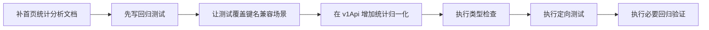

# 首页典藏概览统计归一化修复方案

## 问题概述

当前首页 `典藏概览` 区域中，`诗文集` 与 `概念` 显示为 `0`。结合现有代码检查，前端卡片键名使用 `poemSet` 与 `concept`，后端代码中也声称返回同名字段。但用户现场仍出现 `0`，说明问题更可能出在“运行时统计返回口径与前端读取键名不完全一致”。

这类问题不应该继续依赖单一字段名假设，而应在前端 API 层做统一归一化，屏蔽后端统计口径调整带来的页面回归。

## 现状分析

```mermaid
flowchart TD
    A[首页 HomePageClassic] --> B[fetchEntityCounts]
    B --> C[fetchEntityCountsRepo]
    C --> D[/stats/entity-counts]
    D --> E[运行时返回统计字段]
    E --> F{字段名是否完全匹配?}
    F -- 是 --> G[首页正常展示]
    F -- 否 --> H[poemSet/concept 读不到]
    H --> I[页面按 0 渲染]
```

## 根因判断

### 已确认

| 项目 | 当前代码状态 |
|---|---|
| 首页卡片键名 | `poemSet` / `concept` |
| 首页渲染方式 | `counts[card.key] || 0` |
| 仓储层返回类型 | `EntityCountsResponse` |
| 后端控制器代码 | 返回 `poemSet` / `concept` |

### 风险点

| 风险点 | 说明 |
|---|---|
| 运行时返回字段漂移 | 后端口径优化后，现场接口可能返回 `poem`、`poems`、`poem_count` 等别名 |
| 前端缺少归一化 | 当前 `fetchEntityCounts()` 直接透传仓储层结果 |
| 缺少首页回归测试 | 目前没有覆盖首页统计展示的前端测试 |

## 优化目标

1. 前端对统计接口做统一字段归一化。
2. 首页不再直接依赖后端单一键名。
3. 增加首页回归测试，覆盖诗文集与概念显示。
4. 每一步都执行类型检查与测试验证，避免引入新问题。

## 实施步骤



## 拆分任务

| 步骤 | 内容 | 验收标准 |
|---|---|---|
| 1 | 新增首页统计修复文档 | 文档说明根因、方案、步骤 |
| 2 | 新增首页统计回归测试 | 能复现并覆盖 `poemSet` / `concept` 兼容逻辑 |
| 3 | 修改 `src/lib/api/v1Api.ts` | `fetchEntityCounts()` 输出稳定结构 |
| 4 | 运行类型检查 | `npm run typescript` 通过 |
| 5 | 运行相关测试 | 首页测试通过，已有 API 测试不回归 |

## 兼容策略

前端归一化输出统一保持：

| 输出键 | 兼容输入候选 |
|---|---|
| `person` | `person`, `persons` |
| `poemSet` | `poemSet`, `poem`, `poems`, `poemCount` |
| `book` | `book`, `books` |
| `ancientBook` | `ancientBook`, `ancient_book`, `ancientBooks` |
| `geography` | `geography`, `place`, `places` |
| `concept` | `concept`, `concepts`, `conceptCount` |

## 边界条件

- 统计字段缺失时，兜底为 `0`
- 统计字段为字符串数字时，转为数值
- 统计字段为非法值时，兜底为 `0`
- 不修改首页组件展示逻辑，优先在 API 层解决

## 风险控制

- 只在前端 API 层做兼容，不扩大改动范围
- 先补测试，再改实现
- 改动后执行类型检查与定向测试
