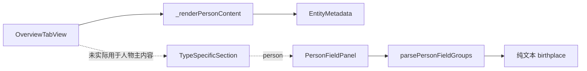

# 人物旧字段面板清理分析

## 背景

当前人物详情页的出生地点跳转已经走结构化元数据链路：

```mermaid
flowchart TD
  A[人物详情接口 /api/v1/persons/:id] --> B[返回原始 doc]
  B --> C[EntityParser.getBirthPlace]
  C --> D[EntityMetadata]
  D --> E[/details?uri=/place/:id]
  E --> F[地点详情页]
```

旧的人物字段面板并不在当前人物详情主视图中生效，但仍保留纯文本 `birthplace` 展示逻辑。

## 当前状态



## 问题判断

| 项目 | 现状 | 风险 |
| --- | --- | --- |
| 人物主展示 | 使用 `EntityMetadata` | 正常 |
| 旧人物字段面板 | 依赖 `birthplace` 纯文本 | 后续若误接回会复发“只能显示不能跳转” |
| API 兼容字段 `birthplace` | 仍保留 | 暂不删除，避免影响其他调用方 |

## 清理目标

1. 移除未生效的人物字段面板组件与解析逻辑
2. 保留当前结构化出生地点跳转主链路
3. 保留 API 兼容字段 `birthplace`
4. 通过类型检查确认未引入新错误

## 计划

1. 删除 `OverviewTabView` 中 `PersonFieldPanel` 的接线
2. 删除 `PersonFieldPanel` 组件文件
3. 删除 `parsePersonFieldGroups` 及对应测试
4. 运行类型检查验证

## 边界说明

- 不修改 `EntityParser.getBirthPlace`
- 不修改 `EntityMetadata`
- 不删除后端 `birthplace` 字段
- 不调整人物详情 API 契约
