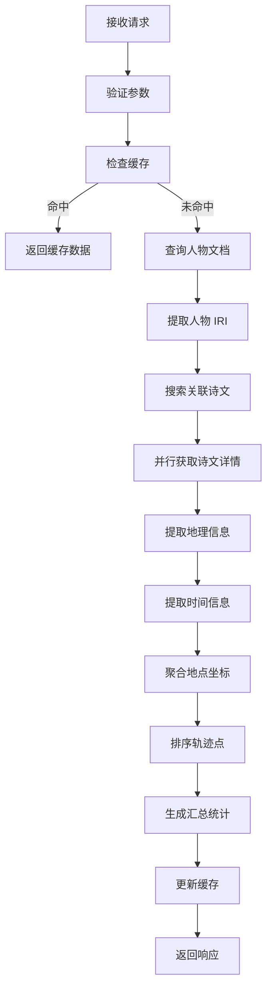
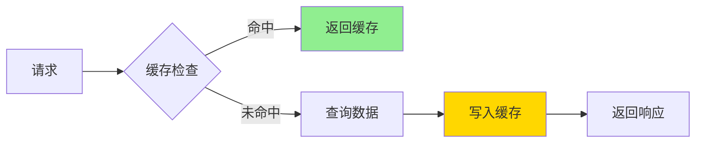

# 人物诗文地理轨迹 API 设计文档

## 1. 概述

本文档定义"人物诗文地理轨迹地图"功能的 API 设计，用于高德地图展示某个人物所有诗文的地理轨迹。

**设计原则**
- RESTful 风格
- 与现有 `/api/v1/` API 规范一致
- 支持地理坐标聚合和轨迹排序
- 性能优先，使用缓存策略

---

## 2. API 端点设计

### 2.1 主端点

```
GET /api/v1/persons/:id/poem-geo-trace
```

**路径参数**
| 参数 | 类型 | 必填 | 说明 |
|------|------|------|------|
| `id` | string | 是 | 人物标识符（如 person-123） |

**查询参数**
| 参数 | 类型 | 必填 | 默认值 | 说明 |
|------|------|------|--------|------|
| `includePlaceless` | boolean | 否 | false | 是否包含无地理坐标的诗文 |
| `sortBy` | string | 否 | 'date' | 排序字段：date（时间）| place（地点）|
| `order` | string | 否 | 'asc' | 排序方向：asc（升序）| desc（降序）|

### 2.2 响应格式

#### 成功响应 (200 OK)

```json
{
  "success": true,
  "data": {
    "person": {
      "id": "person-123",
      "name": "杜甫",
      "dynasty": "唐代"
    },
    "tracePoints": [
      {
        "id": "poem-456",
        "title": "春望",
        "place": {
          "id": "place-789",
          "name": "长安",
          "geo": {
            "lng": 108.9398,
            "lat": 34.3416
          }
        },
        "date": {
          "year": 757,
          "dynasty": "唐",
          "era": "至德二载"
        },
        "content": "国破山河在，城春草木深..."
      }
    ],
    "summary": {
      "totalPoems": 1200,
      "geoTaggedPoems": 850,
      "uniquePlaces": 120,
      "dateRange": {
        "earliest": { "year": 712, "title": "唐睿宗太极元年" },
        "latest": { "year": 770, "title": "唐代宗大历五年" }
      }
    }
  },
  "meta": {
    "requestId": "req_abc123",
    "timestamp": "2025-02-28T10:30:00Z"
  }
}
```

#### 数据结构说明

```typescript
// 地理坐标
interface GeoCoordinates {
  lng: number  // 经度 (WKT POINT x)
  lat: number  // 纬度 (WKT POINT y)
}

// 地点信息
interface PlaceInfo {
  id: string
  name: string
  geo: GeoCoordinates
}

// 日期信息
interface DateInfo {
  year?: number
  dynasty?: string
  era?: string
}

// 轨迹点
interface TracePoint {
  id: string          // 诗文 ID
  title: string       // 诗文标题
  place?: PlaceInfo   // 关联地点（可选，当诗文无地理信息时为空）
  date?: DateInfo     // 创作日期（可选）
  content?: string    // 诗文内容片段（可选，用于预览）
}

// 汇总统计
interface TraceSummary {
  totalPoems: number        // 总诗文数
  geoTaggedPoems: number    // 有地理坐标的诗文数
  uniquePlaces: number      // 独特地点数
  dateRange: {
    earliest?: DateInfo     // 最早作品
    latest?: DateInfo       // 最晚作品
  }
}

// API 响应
interface PoemGeoTraceResponse {
  success: true
  data: {
    person: {
      id: string
      name: string
      dynasty?: string
    }
    tracePoints: TracePoint[]
    summary: TraceSummary
  }
  meta: {
    requestId: string
    timestamp: string
  }
}
```

---

## 3. 服务层设计

### 3.1 函数签名

```typescript
/**
 * 获取人物诗文的地理轨迹
 *
 * @param personId - 人物 ID
 * @param options - 可选参数
 * @returns 地理轨迹数据
 */
async function fetchPersonPoemGeoTrace(
  personId: string,
  options?: {
    includePlaceless?: boolean
    sortBy?: 'date' | 'place'
    order?: 'asc' | 'desc'
  }
): Promise<PoemGeoTraceResponse>
```

### 3.2 数据查询流程



### 3.3 核心查询逻辑

#### 步骤 1: 获取人物文档

```javascript
// 查询人物文档
const personUri = `/processed/json-ld/person/${personId}.json`
const personDoc = await mlGetDoc(personUri)
if (!personDoc) {
  throw apiV1Error('NOT_FOUND', `未找到人物 ${personId}`, { personId }, 404)
}
```

#### 步骤 2: 搜索关联诗文

```javascript
// 通过人物 IRI 搜索诗文
const personIri = personDoc.id || personUri

// 方法 A: 使用 MarkLogic 搜索 API
const searchData = await searchWithFallback({
  query: `carried_out_by:"${personIri}"`,
  pageLength: 1000,
  directories: ['/processed/json-ld/poem/set/', '/processed/json-ld/poem/txt/'],
  collections: []
})

// 方法 B: 如果结果过多，使用组合查询
// 先获取诗文集合，再按 created_by.carried_out_by 过滤
```

#### 步骤 3: 批量获取诗文详情

```javascript
// 并行获取诗文文档（控制并发数）
const CONCURRENCY = 10
const poemDocs = await Promise.all(
  searchData.results
    .slice(0, 1000)  // 限制最大数量
    .map(async (row) => {
      const doc = await mlGetDoc(row.uri)
      return { uri: row.uri, doc }
    })
)
```

#### 步骤 4: 提取地理信息

```javascript
function extractPoemPlaceInfo(poemDoc) {
  // 1. 检查 direct 字段
  if (poemDoc.about_place && typeof poemDoc.about_place === 'object') {
    const place = extractPlaceFromNode(poemDoc.about_place)
    if (place) return place
  }

  // 2. 检查 referred_to_by 中的地点引用
  const referredToBy = Array.isArray(poemDoc.referred_to_by)
    ? poemDoc.referred_to_by
    : [poemDoc.referred_to_by]

  for (const ref of referredToBy) {
    if (!ref || typeof ref !== 'object') continue
    if (ref.classification === '地点关联' || ref.type === 'about_place') {
      const place = extractPlaceFromNode(ref)
      if (place) return place
    }
  }

  // 3. 检查 subject_of 中的地点
  const subjectOf = Array.isArray(poemDoc.subject_of)
    ? poemDoc.subject_of
    : [poemDoc.subject_of]

  for (const subject of subjectOf) {
    if (!subject || typeof subject !== 'object') continue
    if (subject.id && subject.id.includes('/place/')) {
      const place = await fetchPlaceByIri(subject.id)
      if (place) return place
    }
  }

  return null
}

function extractPlaceFromNode(node) {
  const placeId = node.id || node['@id']
  const placeName = pickNodeLabel(node) || node.name

  // 检查是否有直接坐标
  const geo = parseWktPoint(node.defined_by || node['crm:P168_place_is_defined_by'])

  if (geo) {
    return { id: placeId, name: placeName, geo }
  }

  // 如果没有坐标，尝试查询地点详情
  if (placeId && placeId.includes('/place/')) {
    return fetchPlaceByIri(placeId)
  }

  return null
}
```

#### 步骤 5: 提取时间信息

```javascript
function extractPoemDateInfo(poemDoc) {
  // 1. 检查 timespan
  const timespan = poemDoc.timespan || poemDoc.created_by?.timespan
  if (timespan && typeof timespan === 'object') {
    const year = extractYear(timespan.begin_of_the_begin || timespan.begin)
    const era = pickNodeLabel(timespan)
    return { year, era }
  }

  // 2. 检查 referred_to_by 中的时间标注
  const referredToBy = Array.isArray(poemDoc.referred_to_by)
    ? poemDoc.referred_to_by
    : [poemDoc.referred_to_by]

  for (const ref of referredToBy) {
    if (ref?.classification === '时间' || ref?.type === 'timespan') {
      const year = extractYear(ref.begin_of_the_begin || ref.begin)
      const era = pickNodeLabel(ref)
      if (year || era) return { year, era }
    }
  }

  return null
}

function extractYear(value) {
  if (!value) return null
  const text = String(value).trim()
  const match = text.match(/\d{3,4}/)
  return match ? parseInt(match[0], 10) : null
}
```

#### 步骤 6: 聚合与排序

```javascript
function buildTracePoints(poemDocs, options) {
  const points = []

  for (const { uri, doc } of poemDocs) {
    const poemId = extractIdFromUri(uri)
    const title = pickRowTitle({ uri }, doc)
    const content = extractPoemFullText(doc)?.slice(0, 100)  // 前100字预览

    const place = extractPoemPlaceInfo(doc)
    const date = extractPoemDateInfo(doc)

    // 根据参数决定是否包含无地点的诗文
    if (!place && !options.includePlaceless) continue

    points.push({
      id: poemId,
      title,
      place: place || undefined,
      date: date || undefined,
      content
    })
  }

  // 排序
  const { sortBy = 'date', order = 'asc' } = options
  points.sort((a, b) => {
    if (sortBy === 'date') {
      const aYear = a.date?.year ?? 9999
      const bYear = b.date?.year ?? 9999
      return order === 'asc' ? aYear - bYear : bYear - aYear
    }
    if (sortBy === 'place') {
      const aName = a.place?.name ?? ''
      const bName = b.place?.name ?? ''
      return order === 'asc'
        ? aName.localeCompare(bName, 'zh')
        : bName.localeCompare(aName, 'zh')
    }
    return 0
  })

  return points
}
```

---

## 4. 性能考虑

### 4.1 查询优化

| 策略 | 说明 |
|------|------|
| **并行查询** | 诗文详情获取使用 Promise.all 并行，控制并发数为 10 |
| **结果限制** | 默认最多返回 1000 个轨迹点，超过返回统计摘要 |
| **索引利用** | 利用 MarkLogic 的 collection 和 directory 索引 |
| **字段投影** | 只查询必要字段，减少传输量 |

### 4.2 缓存策略



**缓存配置**
```javascript
const CACHE_TTL_MS = 10 * 60 * 1000  // 10 分钟
const CACHE_MAX_SIZE = 100            // 最多缓存 100 个人物

const traceCache = new Map()
```

**缓存键格式**
```
poem-geo-trace:{personId}:{includePlaceless}:{sortBy}:{order}
```

---

## 5. 错误处理

### 5.1 错误码定义

| 错误码 | HTTP状态 | 说明 |
|--------|----------|------|
| `INVALID_PARAMS` | 400 | 请求参数无效 |
| `NOT_FOUND` | 404 | 人物不存在 |
| `INTERNAL_ERROR` | 500 | 服务器内部错误 |

### 5.2 错误响应格式

```json
{
  "success": false,
  "error": {
    "code": "NOT_FOUND",
    "message": "未找到人物 person-123",
    "details": {
      "personId": "person-123"
    }
  },
  "meta": {
    "requestId": "req_xyz789",
    "timestamp": "2025-02-28T10:30:00Z"
  }
}
```

### 5.3 现有错误处理函数（复用）

```javascript
// app.js:4962
function apiV1Error(code, message, details = null, statusCode = 400) {
  const error = {
    code,
    message,
    ...(details != null && { details })
  }
  return {
    response: { success: false, error },
    statusCode
  }
}
```

---

## 6. 实现文件结构

```
server/src/
├── app.js                           # 添加新端点 (约 150 行)
└── services/
    └── poemGeoTraceService.js       # 新建服务层 (约 300 行)
```

### 6.1 端点代码位置

```javascript
// app.js: 约 5043 行后添加
/**
 * GET /api/v1/persons/:id/poem-geo-trace
 * 获取人物诗文的地理轨迹
 */
app.get('/api/v1/persons/:id/poem-geo-trace', async (req, res) => {
  // 实现代码
})
```

### 6.2 服务层模块结构

```javascript
// services/poemGeoTraceService.js
export async function fetchPersonPoemGeoTrace(personId, options)
export function extractPoemPlaceInfo(poemDoc)
export function extractPoemDateInfo(poemDoc)
export function buildTracePoints(poemDocs, options)
export function buildTraceSummary(tracePoints)
export function generateTraceCacheKey(personId, options)
```

---

## 7. 测试用例

### 7.1 单元测试场景

| 场景 | 预期结果 |
|------|----------|
| 人物不存在 | 返回 404 NOT_FOUND |
| 人物无诗文 | 返回空 tracePoints，summary.totalPoems = 0 |
| 诗文有地点 | tracePoints 包含 place.geo |
| 诗文无地点 | 根据 includePlaceless 决定是否包含 |
| 诗文有时间 | tracePoints 包含 date.year |
| 诗文无时间 | tracePoints.date = undefined |
| 缓存命中 | 直接返回缓存数据，不查询数据库 |

### 7.2 集成测试场景

| 场景 | 预期结果 |
|------|----------|
| 杜甫诗文轨迹 | 返回大量轨迹点，涵盖长安、成都等地 |
| 轨迹按时间排序 | 返回结果按 date.year 升序排列 |
| 轨迹按地点排序 | 返回结果按 place.name 拼音排序 |

---

## 8. 后续扩展

### 8.1 可能的功能增强

| 功能 | 说明 |
|------|------|
| **时间范围过滤** | 支持 dateStart/dateEnd 参数 |
| **地点过滤** | 支持 placeId 参数，只返回特定地点的诗文 |
| **轨迹简化** | 使用 Douglas-Peucker 算法简化轨迹 |
| **路径插值** | 在相邻轨迹点之间生成推测路径 |

### 8.2 性能监控

```javascript
// 建议添加的性能指标
const metrics = {
  queryTimeMs: Date.now() - startAt,
  docCount: poemDocs.length,
  cacheHit: !!cached,
  tracePointCount: tracePoints.length
}
console.info(`[poem-geo-trace] personId=${personId} ${JSON.stringify(metrics)}`)
```

---

## 9. 附录：现有相关代码位置

| 功能 | 文件:行号 |
|------|-----------|
| 人物详情端点 | `app.js:4962` |
| 诗文详情端点 | `app.js:5097` |
| 地理坐标解析 | `app.js:2653-2661` |
| 地点详情提取 | `app.js:2635-2687` |
| 人物详情提取 | `app.js:2534-2587` |
| 缓存模式参考 | `app.js:122-128` (MVP_DETAIL_CACHE) |
| 高德地图前端 | `PlaceCoordinateMapPanel.tsx:1-213` |
