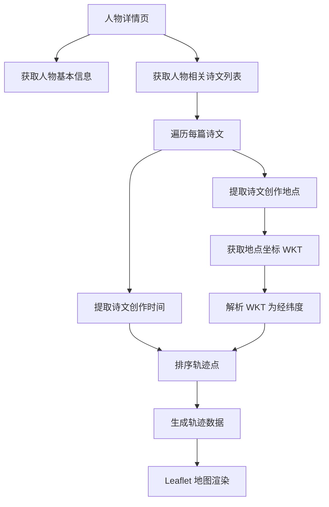
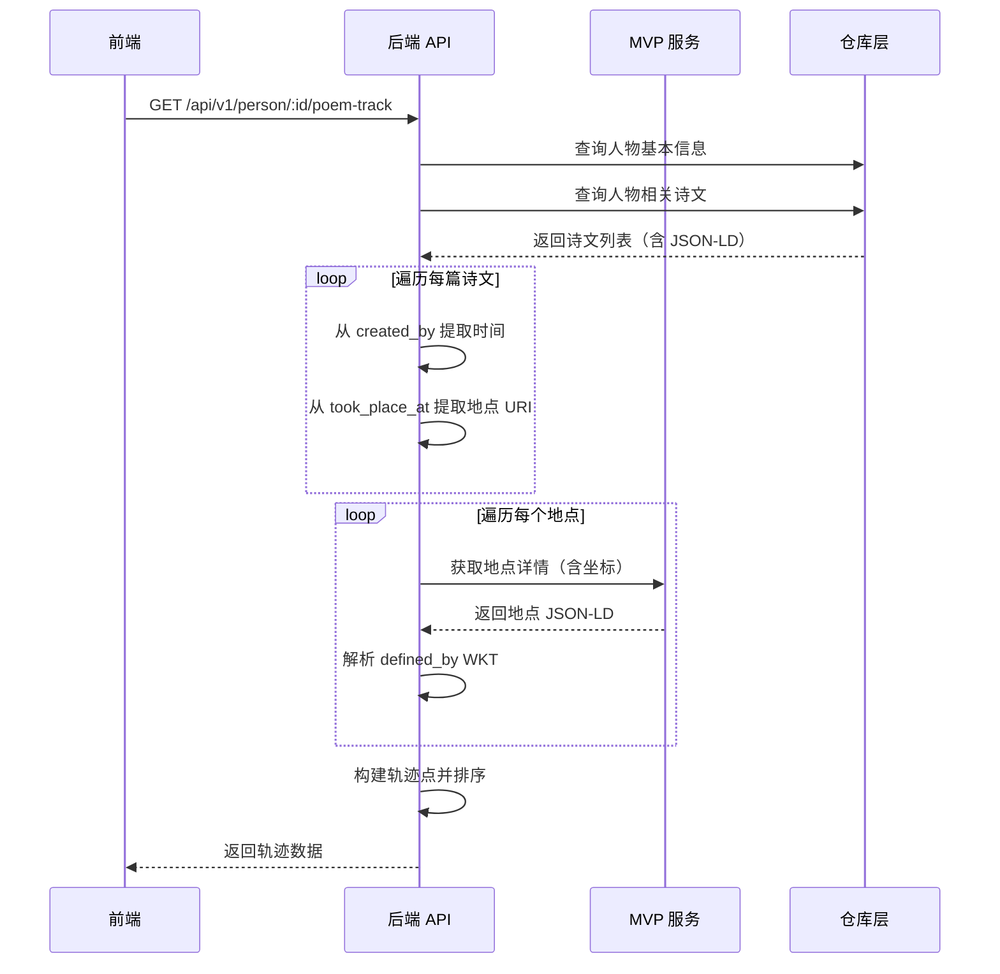

# 人物诗文地理轨迹数据模型分析

> 历史设计稿。当前字段、接口路径和坐标约定以 [`../reference/person-poem-track-contract.md`](../reference/person-poem-track-contract.md) 为准。

## 1. 概述

本文档分析"人物诗文地理轨迹地图"功能的数据模型，包括 TypeScript 接口定义、数据提取逻辑、WKT POINT 解析方案及边界情况处理。

## 2. 数据流架构图



## 3. 现有 JSON-LD 数据结构

### 3.1 诗文 JSON-LD 结构

```json
{
  "_label": "雕赋",
  "classified_as": [{ "_label": "唐朝" }],
  "created_by": {
    "timespan": {
      "_label": "754年",
      "begin_of_the_begin": "0754-01-01T00:00:00Z",
      "end_of_the_end": "0754-12-31T23:59:59Z"
    },
    "carried_out_by": [{
      "_label": "杜甫",
      "id": "http://localhost:8003/person/17270"
    }],
    "took_place_at": [{
      "_label": "西安市",
      "id": "http://localhost:8003/place/CN6101"
    }]
  }
}
```

**字段提取路径：**
| 数据项 | JSON-LD 路径 |
|--------|-------------|
| 诗文标题 | `_label` |
| 创作时间 | `created_by.timespan._label` 或 `begin_of_the_begin` |
| 创作地点 | `created_by.took_place_at[]._label` |
| 地点 URI | `created_by.took_place_at[].id` |

### 3.2 地点 JSON-LD 结构

```json
{
  "_label": "西安市",
  "defined_by": "POINT(108.946306 34.347436)",
  "attributed_by": [
    {
      "_label": "长安",
      "timespan": { "_label": "c. 202 BCE-581 CE" }
    }
  ]
}
```

**字段提取路径：**
| 数据项 | JSON-LD 路径 |
|--------|-------------|
| 地点名称 | `_label` |
| 坐标 WKT | `defined_by` |
| 历史名称 | `attributed_by[]._label` |

## 4. TypeScript 接口定义

### 4.1 核心轨迹数据模型

```typescript
/**
 * 人物诗文地理轨迹数据模型
 * 文件位置: src/types/contracts/geoTrackContracts.ts
 */

// ============================================================
// 基础类型
// ============================================================

/** 轨迹点状态 */
export type TrackPointStatus = 'valid' | 'missing_coords' | 'missing_time' | 'missing_place'

/** 时间精度 */
export type TimePrecision = 'year' | 'month' | 'day' | 'exact'

// ============================================================
// 坐标相关
// ============================================================

/** WKT POINT 解析结果 */
export interface ParsedCoordinate {
  /** 经度 */
  lng: number
  /** 纬度 */
  lat: number
  /** 原始 WKT 字符串 */
  raw: string
}

/** 地理坐标 */
export interface GeoCoordinate {
  lng: number
  lat: number
}

// ============================================================
// 时间相关
// ============================================================

/** 解析后的时间信息 */
export interface ParsedTime {
  /** ISO 格式开始时间 */
  begin: string
  /** ISO 格式结束时间 */
  end: string
  /** 格式化的时间标签 */
  label: string
  /** 时间精度 */
  precision: TimePrecision
  /** 原始年份（用于排序） */
  year?: number
}

// ============================================================
// 地点相关
// ============================================================

/** 轨迹地点信息 */
export interface TrackPlace {
  /** 地点 URI */
  uri: string
  /** 地点名称（现代名称） */
  label: string
  /** 历史名称列表 */
  historicalNames?: string[]
  /** 解析后的坐标 */
  coordinate?: ParsedCoordinate
  /** 原始 JSON-LD 文档 */
  doc?: Record<string, unknown>
}

// ============================================================
// 诗文轨迹点
// ============================================================

/** 单个诗文轨迹点 */
export interface TrackPoint {
  /** 诗文 ID */
  poemId: string
  /** 诗文 URI */
  poemUri: string
  /** 诗文标题 */
  poemTitle: string
  /** 创作时间信息 */
  time: ParsedTime
  /** 创作地点信息 */
  place: TrackPlace
  /** 轨迹点状态 */
  status: TrackPointStatus
  /** 诗文内容片段（可选，用于 Tooltip） */
  snippet?: string
}

// ============================================================
// 人物轨迹数据
// ============================================================

/** 人物诗文地理轨迹 */
export interface PersonPoemTrack {
  /** 人物 ID */
  personId: string
  /** 人物 URI */
  personUri: string
  /** 人物姓名 */
  personName: string
  /** 轨迹点列表（按时间排序） */
  points: TrackPoint[]
  /** 统计信息 */
  stats: TrackStats
  /** 地点聚合（同一地点的多次创作） */
  placeAggregation?: Map<string /* placeUri */, TrackPoint[]>
}

/** 轨迹统计信息 */
export interface TrackStats {
  /** 总轨迹点数 */
  totalPoints: number
  /** 有效坐标点数 */
  validCoords: number
  /** 缺失坐标点数 */
  missingCoords: number
  /** 缺失时间点数 */
  missingTime: number
  /** 涉及地点总数 */
  uniquePlaces: number
  /** 最早年份 */
  earliestYear?: number
  /** 最晚年份 */
  latestYear?: number
}

// ============================================================
// API 响应类型
// ============================================================

/** 轨迹数据 API 响应 */
export interface PersonPoemTrackResponse {
  success: true
  data: PersonPoemTrack
}

/** 轨迹数据 API 错误 */
export interface PersonPoemTrackError {
  success: false
  error: {
    code: 'PERSON_NOT_FOUND' | 'POEMS_NOT_FOUND' | 'INTERNAL_ERROR'
    message: string
  }
}

/** 轨迹数据 API 联合类型 */
export type PersonPoemTrackApiResponse = PersonPoemTrackResponse | PersonPoemTrackError
```

### 4.2 地图组件类型

```typescript
/**
 * 轨迹地图展示组件类型
 * 文件位置: src/types/view/geoTrackModels.ts
 */

import type { PersonPoemTrack, TrackPoint } from '@/types/contracts/geoTrackContracts'

// ============================================================
// 地图配置
// ============================================================

/** 地图视图配置 */
export interface MapViewConfig {
  /** 中心点坐标 */
  center?: [number, number]  // [lng, lat]
  /** 缩放级别 */
  zoom?: number
  /** 地图样式 */
  mapStyle?: 'normal' | 'satellite' | 'dark'
}

/** 时间线配置 */
export interface TimelineConfig {
  /** 动画总时长（毫秒） */
  duration?: number
  /** 是否自动播放 */
  autoPlay?: boolean
  /** 播放速度倍数 */
  playSpeed?: number
  /** 显示年份刻度 */
  showYearTicks?: boolean
}

/** 标记点样式 */
export interface MarkerStyle {
  /** 标记点图标 */
  icon?: string
  /** 标记点大小（像素） */
  size?: number
  /** 标记点颜色 */
  color?: string
}

// ============================================================
// 视图模型
// ============================================================

/** 地理轨迹视图模型 */
export interface GeoTrackViewModel {
  /** 轨迹数据 */
  track: PersonPoemTrack
  /** 地图配置 */
  mapConfig: MapViewConfig
  /** 时间线配置 */
  timelineConfig: TimelineConfig
  /** 标记点样式 */
  markerStyle: MarkerStyle
}

/** 轨迹动画状态 */
export interface TrackAnimationState {
  /** 当前播放索引 */
  currentIndex: number
  /** 是否正在播放 */
  isPlaying: boolean
  /** 播放进度（0-1） */
  progress: number
  /** 当前高亮的轨迹点 */
  currentPoint?: TrackPoint
}
```

## 5. 数据提取逻辑

### 5.1 从诗文 JSON-LD 提取轨迹点

```typescript
/**
 * 诗文轨迹点提取器
 * 文件位置: src/lib/parse/track/poemTrackExtractor.ts
 */

import { pickNodeText, forceArray } from '@/lib/utils/text'
import { parsePointWkt } from '@/features/details/components/entity-fields/utils'
import type { TrackPoint, TrackPlace, ParsedTime, ParsedCoordinate } from '@/types/contracts/geoTrackContracts'

// ============================================================
// 时间解析
// ============================================================

/**
 * 从 timespan 对象解析时间信息
 *
 * @param timespan - created_by.timespan 对象
 * @returns 解析后的时间信息
 */
export function parseTimespan(timespan: unknown): ParsedTime | null {
  if (!timespan || typeof timespan !== 'object') return null

  const ts = timespan as Record<string, unknown>
  const label = pickNodeText(ts._label || ts.label || ts)
  const begin = pickNodeText(ts.begin_of_the_begin || ts.begin)
  const end = pickNodeText(ts.end_of_the_end || ts.end)

  if (!label && !begin) return null

  // 提取年份用于排序
  const year = extractYear(label || begin || end)

  // 判断时间精度
  let precision: ParsedTime['precision'] = 'year'
  if (begin && begin.includes('T')) {
    precision = 'exact'
  } else if (label && /^\\d{4}-\\d{1,2}$/.test(label)) {
    precision = 'month'
  }

  return {
    begin: begin || '',
    end: end || begin || '',
    label: label || '',
    precision,
    year,
  }
}

/**
 * 从时间字符串提取年份
 */
function extractYear(timeStr: string): number | undefined {
  if (!timeStr) return undefined
  const match = timeStr.match(/(\\d{4})/)
  return match ? parseInt(match[1], 10) : undefined
}

// ============================================================
// 地点解析
// ============================================================

/**
 * 从 took_place_at 数组提取地点信息
 *
 * @param tookPlaceAt - created_by.took_place_at 数组
 * @returns 地点信息数组
 */
export function parseTookPlaceAt(tookPlaceAt: unknown): TrackPlace[] {
  const places = forceArray(tookPlaceAt)
  const result: TrackPlace[] = []

  for (const item of places) {
    if (!item || typeof item !== 'object') continue

    const place = item as Record<string, unknown>
    const uri = pickNodeText(place.id || place.uri || place['@id'])
    const label = pickNodeText(place._label || place.label || place.name)

    if (!uri && !label) continue

    result.push({
      uri: uri || '',
      label: label || '',
      // 坐标需要从地点详情获取
      // coordinate: parseCoordinateFromPlaceDoc(place),
      doc: place,
    })
  }

  return result
}

// ============================================================
// 坐标解析（WKT POINT）
// ============================================================

/**
 * 解析 WKT POINT 格式坐标
 *
 * WKT 格式: POINT(lng lat)
 * 注意：WKT 中经度在前，纬度在后
 *
 * @param wktString - WKT 字符串
 * @returns 解析后的坐标，失败返回 null
 */
export function parseWktPoint(wktString: unknown): ParsedCoordinate | null {
  const text = pickNodeText(wktString)
  if (!text) return null

  // 匹配 POINT(lng lat) 格式
  const match = text.match(/POINT\\s*\\(\\s*([\\d.-]+)\\s+([\\d.-]+)\\s*\\)/i)
  if (!match) return null

  const lng = parseFloat(match[1])
  const lat = parseFloat(match[2])

  // 验证坐标范围
  if (isNaN(lng) || isNaN(lat)) return null
  if (lng < -180 || lng > 180) return null
  if (lat < -90 || lat > 90) return null

  return {
    lng,
    lat,
    raw: text,
  }
}

/**
 * 从地点文档提取坐标
 *
 * @param placeDoc - 地点 JSON-LD 文档
 * @returns 解析后的坐标
 */
export function parseCoordinateFromPlaceDoc(placeDoc: Record<string, unknown>): ParsedCoordinate | null {
  // 尝试多个可能的字段路径
  const definedBy = placeDoc.defined_by || placeDoc['crm:P168_place_is_defined_by']
  return parseWktPoint(definedBy)
}

// ============================================================
// 轨迹点构建
// ============================================================

/**
 * 从诗文 JSON-LD 构建轨迹点
 *
 * @param poemDoc - 诗文 JSON-LD 文档
 * @returns 轨迹点数组
 */
export function buildTrackPointsFromPoem(poemDoc: Record<string, unknown>): TrackPoint[] {
  const points: TrackPoint[] = []

  // 基本信息
  const poemId = extractIdFromUri(pickNodeText(poemDoc.id || poemDoc.uri || poemDoc['@id']))
  const poemUri = pickNodeText(poemDoc.id || poemDoc.uri || poemDoc['@id'])
  const poemTitle = pickNodeText(poemDoc._label || poemDoc.title || poemDoc.name)

  if (!poemId) return points

  // 提取 created_by 信息
  const createdBy = poemDoc.created_by
  if (!createdBy || typeof createdBy !== 'object') return points

  const created = createdBy as Record<string, unknown>

  // 解析时间
  const timespan = created.timespan
  const parsedTime = parseTimespan(timespan)

  // 解析地点
  const tookPlaceAt = created.took_place_at
  const places = parseTookPlaceAt(tookPlaceAt)

  // 为每个地点创建一个轨迹点
  for (const place of places) {
    const status: TrackPoint['status'] = parsedTime ? 'valid' : 'missing_time'

    points.push({
      poemId,
      poemUri: poemUri || '',
      poemTitle: poemTitle || '未命名',
      time: parsedTime || { begin: '', end: '', label: '未知时间', precision: 'year' },
      place,
      status,
    })
  }

  return points
}

/**
 * 从 URI 提取 ID
 */
function extractIdFromUri(uri: string): string {
  if (!uri) return ''
  const segments = uri.split('/').filter(Boolean)
  return segments[segments.length - 1] || ''
}
```

### 5.2 轨迹数据聚合与排序

```typescript
/**
 * 轨迹数据处理
 * 文件位置: src/lib/parse/track/trackProcessor.ts
 */

import type { TrackPoint, PersonPoemTrack, TrackStats } from '@/types/contracts/geoTrackContracts'

// ============================================================
// 排序
// ============================================================

/**
 * 按时间对轨迹点排序
 *
 * @param points - 轨迹点数组
 * @returns 排序后的轨迹点数组
 */
export function sortTrackPointsByTime(points: TrackPoint[]): TrackPoint[] {
  return [...points].sort((a, b) => {
    // 按年份排序
    const aYear = a.time.year ?? 0
    const bYear = b.time.year ?? 0

    if (aYear !== bYear) {
      return aYear - bYear
    }

    // 年份相同时，按开始时间排序
    const aBegin = a.time.begin
    const bBegin = b.time.begin

    if (aBegin && bBegin) {
      return aBegin.localeCompare(bBegin)
    }

    // 按诗文标题排序
    return a.poemTitle.localeCompare(b.poemTitle)
  })
}

// ============================================================
// 统计
// ============================================================

/**
 * 计算轨迹统计信息
 *
 * @param points - 轨迹点数组
 * @returns 统计信息
 */
export function calculateTrackStats(points: TrackPoint[]): TrackStats {
  const stats: TrackStats = {
    totalPoints: points.length,
    validCoords: 0,
    missingCoords: 0,
    missingTime: 0,
    uniquePlaces: 0,
  }

  const placeUris = new Set<string>()
  const years: number[] = []

  for (const point of points) {
    // 统计坐标
    if (point.place.coordinate) {
      stats.validCoords++
    } else {
      stats.missingCoords++
    }

    // 统计时间
    if (!point.time.year) {
      stats.missingTime++
    }

    // 收集地点和年份
    if (point.place.uri) {
      placeUris.add(point.place.uri)
    }
    if (point.time.year) {
      years.push(point.time.year)
    }
  }

  stats.uniquePlaces = placeUris.size

  if (years.length > 0) {
    stats.earliestYear = Math.min(...years)
    stats.latestYear = Math.max(...years)
  }

  return stats
}

// ============================================================
// 聚合
// ============================================================

/**
 * 按地点聚合轨迹点
 *
 * @param points - 轨迹点数组
 * @returns 地点到轨迹点的 Map
 */
export function aggregatePointsByPlace(points: TrackPoint[]): Map<string, TrackPoint[]> {
  const aggregation = new Map<string, TrackPoint[]>()

  for (const point of points) {
    const key = point.place.uri || point.place.label
    if (!key) continue

    const existing = aggregation.get(key) || []
    existing.push(point)
    aggregation.set(key, existing)
  }

  return aggregation
}

// ============================================================
// 过滤
// ============================================================

/**
 * 过滤有效轨迹点（有坐标且有时间）
 *
 * @param points - 轨迹点数组
 * @returns 有效轨迹点数组
 */
export function filterValidPoints(points: TrackPoint[]): TrackPoint[] {
  return points.filter(
    (point) => point.place.coordinate && point.time.year,
  )
}
```

## 6. 边界情况处理

### 6.1 数据缺失处理

| 场景 | 处理策略 |
|------|---------|
| **诗文无创作时间** | `status: 'missing_time'`，排序时置于末尾，时间轴上标记"未知" |
| **诗文无创作地点** | 跳过该轨迹点，不计入统计 |
| **地点无坐标** | `status: 'missing_coords'`，可在地图上用特殊图标标记，或提示用户 |
| **坐标无效** | WKT 解析失败或超出范围时，视为缺失坐标 |
| **多个地点** | 一篇诗文关联多个地点时，创建多个轨迹点 |
| **时间跨度大** | 使用 `begin_of_the_begin` 和 `end_of_the_end` 的中间值 |

### 6.2 数据质量验证

```typescript
/**
 * 数据验证工具
 * 文件位置: src/lib/parse/track/trackValidator.ts
 */

import type { TrackPoint, ParsedCoordinate } from '@/types/contracts/geoTrackContracts'

// ============================================================
// 坐标验证
// ============================================================

/**
 * 验证坐标是否有效
 */
export function isValidCoordinate(coord: ParsedCoordinate | null | undefined): boolean {
  if (!coord) return false
  if (isNaN(coord.lng) || isNaN(coord.lat)) return false
  if (coord.lng < -180 || coord.lng > 180) return false
  if (coord.lat < -90 || coord.lat > 90) return false
  return true
}

// ============================================================
// 时间验证
// ============================================================

/**
 * 验证时间是否有效
 */
export function isValidTime(year: number | undefined): boolean {
  if (!year) return false
  // 假设合理的历史年份范围：公元前 2000 年至公元 2025 年
  return year >= -2000 && year <= 2025
}

// ============================================================
// 轨迹点验证
// ============================================================

/**
 * 获取轨迹点状态
 */
export function determineTrackPointStatus(point: TrackPoint): TrackPoint['status'] {
  if (!point.place.coordinate) {
    return 'missing_coords'
  }
  if (!point.time.year) {
    return 'missing_time'
  }
  return 'valid'
}
```

### 6.3 用户体验降级策略

| 场景 | 降级方案 |
|------|---------|
| **全部缺失坐标** | 显示"暂无地理数据"提示，隐藏地图组件 |
| **部分缺失坐标** | 地图上只显示有效点，在列表中标注缺失 |
| **轨迹点过少（< 2）** | 禁用连线，仅显示散点 |
| **轨迹点过多（> 100）** | 启用聚合，同一地点只显示一个点 |
| **时间跨度过大（> 100 年）** | 时间轴使用世纪刻度而非年份 |

## 7. API 设计建议

### 7.1 后端 API 端点

```typescript
/**
 * 建议的后端 API 设计
 */

/**
 * GET /api/v1/person/:id/poem-track
 *
 * 查询参数：
 * - includeCoords: boolean - 是否包含坐标（默认 true）
 * - sortBy: 'time' | 'place' - 排序方式（默认 time）
 * - aggregateByPlace: boolean - 是否按地点聚合（默认 false）
 *
 * 响应：
 * {
 *   success: true,
 *   data: {
 *     personId: string,
 *     personName: string,
 *     points: TrackPoint[],
 *     stats: TrackStats
 *   }
 * }
 */
```

### 7.2 数据获取流程



## 8. 现有代码复用

### 8.1 可直接复用的工具函数

| 函数 | 文件位置 | 功能 |
|------|---------|------|
| `parsePointWkt()` | `src/features/details/components/entity-fields/utils.ts:53` | 解析 WKT POINT |
| `pickNodeText()` | `src/features/details/components/entity-fields/utils.ts:19` | 提取节点文本 |
| `forceArray()` | `src/lib/utils/text` | 强制转换为数组 |
| `normalizeText()` | `src/lib/utils/text` | 文本规范化 |
| `fetchPersonByIdRepo()` | `src/lib/api/repositories/v1Repository.ts` | 获取人物详情 |
| `fetchPoemByIdRepo()` | `src/lib/api/repositories/v1Repository.ts` | 获取诗文详情 |

### 8.2 需要新建的模块

| 模块 | 功能 |
|------|------|
| `src/types/contracts/geoTrackContracts.ts` | 轨迹数据类型定义 |
| `src/types/view/geoTrackModels.ts` | 轨迹视图模型 |
| `src/lib/parse/track/poemTrackExtractor.ts` | 诗文轨迹点提取 |
| `src/lib/parse/track/trackProcessor.ts` | 轨迹数据处理 |
| `src/lib/api/services/geoTrackService.ts` | 轨迹数据服务层 |
| `src/lib/api/repositories/geoTrackRepository.ts` | 轨迹数据仓库层 |

## 9. 总结

本文档定义了完整的人物诗文地理轨迹数据模型：

1. **类型定义完整**：包含轨迹点、坐标、时间、地点等核心类型
2. **数据提取路径清晰**：明确 JSON-LD 字段到业务模型的映射
3. **WKT 解析方案**：复用现有 `parsePointWkt()` 函数
4. **边界情况考虑全面**：覆盖数据缺失、验证、降级等场景
5. **API 设计建议**：提供后端接口设计思路

下一步可与后端开发同事协作，设计具体的 API 接口规范。
