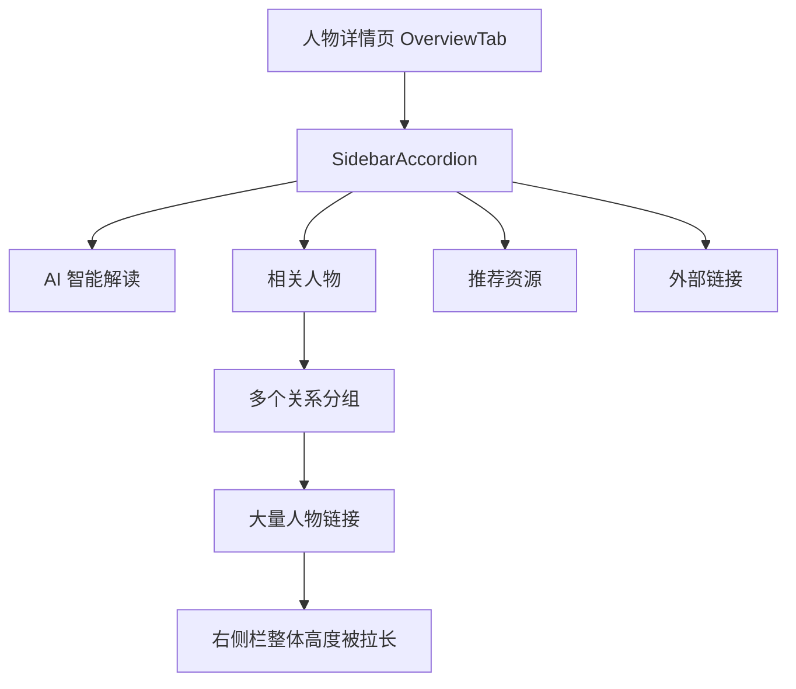
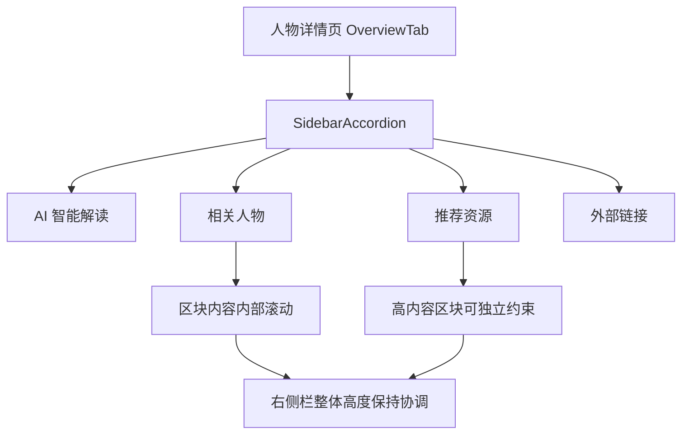

# 人物详情页右侧栏多开与高度协调分析

## 问题描述

人物详情页右侧栏包含多个可展开区块：

- AI 智能解读
- 相关人物
- 推荐资源
- 外部链接

当前顶层折叠逻辑已经支持多开，但人物页的“相关人物”在展开后内容非常长，会显著拉高整个右侧栏高度，造成视觉上失衡，也让用户误以为栏目仍应保持互斥。

## 复现结论

在人物详情页 `/details?uri=/person/17270` 中：

1. 顶层栏目可以同时展开
2. `相关人物` 区块会因为包含大量人物卡片与关系分组，迅速占满整列高度
3. 右侧栏虽然有整体滚动，但单个区块内容没有被约束，页面重心会明显偏向右侧

## 当前结构

## 目标结构

## 根因

问题不在于顶层 `SidebarAccordion` 的展开状态，而在于人物详情页没有给高内容量区块提供单独的高度约束。

当前 `SidebarAccordion` 的内容体只负责统一 padding，不区分：

- 普通短内容区块
- 人物详情页中的长列表区块

因此“相关人物”会直接把整个区块高度无限撑开。

## 修复方向

为 `SidebarAccordion` 增加可选的内容体样式钩子，让页面级调用者可以为特定区块声明“受约束的滚动内容体”。

人物详情页中优先处理：

1. `相关人物`
2. `推荐资源`
3. 必要时为 AI 解读保留较温和的高度上限

## 测试策略

新增人物详情页侧栏回归测试，覆盖：

1. AI 智能解读、相关人物、外部链接可以同时保持展开
2. `相关人物` 区块会挂上人物页专用的高度协调类名
3. 右侧栏的受约束区块由组件显式渲染，不依赖运行时偶然样式

## 风险点

| 风险 | 说明 | 控制方式 |
| --- | --- | --- |
| 通用组件被页面特化污染 | `SidebarAccordion` 被多页复用 | 只新增可选样式钩子，不改默认行为 |
| 内容滚动影响可访问性 | 键盘导航仍需可用 | 保持按钮层级与 aria 属性不变 |
| 人物页信息被裁切 | 高度约束过严会影响可读性 | 使用 `clamp`/视口相关上限，允许区块内部滚动 |
