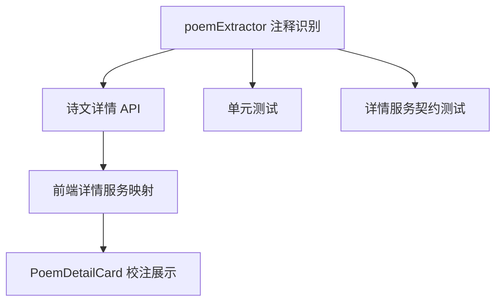

# 诗文校注分类兼容根因修复方案

## 问题概述

当前诗文详情页的“校注”区块并不是前端渲染失败，而是后端在抽取诗文注释时规则过窄，导致部分真实存在的注释被过滤掉。

已确认案例：

- 诗文：《李监宅》
- 诗句：`且食双鱼美，`
- 原始文档：`/processed/json-ld/poem/txt/poem_30790_05.json`

该文档包含 `referred_to_by` 注释内容，但其 `classified_as._label` 为 `Biography Statement`，而不是当前代码唯一识别的 `Comment`，因此未进入详情接口返回的 `comments` 字段。

## 当前链路

```mermaid
flowchart LR
    A[MarkLogic 诗句 txt 文档] --> B[extractPoemComments]
    B --> C{classified_as 是否为 Comment}
    C -- 是 --> D[加入 comments]
    C -- 否 --> E[直接丢弃]
    D --> F[buildPoemSetDetail / buildPoemDetailForLegacy]
    F --> G[/api/v1/poems/:id]
    G --> H[detailService 映射 poemDetail.comments]
    H --> I[PoemDetailCard 渲染校注]
```

## 根因分析

### 1. 注释语义来源并不统一

诗文逐句文档中的 `referred_to_by` 并不是统一使用 `Comment` 分类。

当前数据至少存在两类：

| 分类标签 | 当前状态 | 说明 |
| --- | --- | --- |
| `Comment` | 能显示 | 当前逻辑唯一支持的类型 |
| `Biography Statement` | 不能显示 | 实际承载训诂/引文说明，属于被误杀的真实注释 |

### 2. 当前逻辑把“分类标签”误当成“注释真值”

现有实现只要不是 `Comment` 就跳过，这等于把“注释是否存在”绑定到了单一元数据标签，抗数据波动能力很差。

### 3. 同类问题会持续出现

如果后续数据中出现新的注释归类方式，例如：

- `Description`
- `Brief Text`
- 嵌套分类表达
- 只有文本内容但无明确顶层标签

当前实现仍会继续漏掉。

## 修复目标

1. 不再把诗文注释识别绑定到单一 `Comment` 标签。
2. 对同类 `referred_to_by` 注释分类做兼容识别，优先保证真实注释不漏。
3. 保持最小影响，只扩展诗文注释识别，不改变前端展示契约。
4. 用测试覆盖“`Comment` + `Biography Statement` + 非注释噪音”三类场景。

## 修复策略

### 策略一：引入“可接受注释分类”统一判定

在 `poemExtractor` 内新增注释分类判定辅助函数，统一识别：

- 顶层分类标签
- 嵌套分类标签
- 大小写和空白差异

首批兼容集合：

- `Comment`
- `Biography Statement`

### 策略二：保留保守边界，避免误收

不是所有 `referred_to_by` 都应视为校注，因此仍需保留边界：

- 必须存在可提取文本内容
- 必须命中允许的注释分类集合
- 不扩大到全文任意描述字段

这样可以避免把来源说明、无关摘要、元信息混进“校注”区块。

### 策略三：将分类兼容逻辑集中到一个地方

不要在 `extractPoemComments` 里继续散落条件判断，而是抽成独立辅助函数，后续如果还要兼容更多分类，只改一个入口即可。

## 影响范围



实际代码改动预计集中在：

- `server/src/domain/detail/poemExtractor.js`
- `tests/` 下与诗文详情/抽取相关测试文件

## 边界情况

| 场景 | 预期 |
| --- | --- |
| `referred_to_by` 为 `Comment` | 正常显示 |
| `referred_to_by` 为 `Biography Statement` | 也应显示 |
| `referred_to_by` 无文本内容 | 跳过 |
| `referred_to_by` 分类为空 | 跳过 |
| `referred_to_by` 为无关说明类型 | 跳过 |
| 一首诗多个片段分别带注释 | 应全部汇总 |
| 同一句多个注释 | 均保留，不静默丢弃 |

## 验证方案


## TODO LIST

- [ ] 为诗文注释提取补充分类兼容分析测试用例
- [ ] 覆盖 `Comment` 分类正常命中
- [ ] 覆盖 `Biography Statement` 分类正常命中
- [ ] 覆盖无关 `referred_to_by` 不应误命中
- [ ] 实现统一的诗文注释分类判定函数
- [ ] 运行相关 Vitest 用例并确认全部通过
- [ ] 抽样验证《李监宅》详情接口已返回 `comments`

## 预期结果

修复后，像《李监宅》这样“注释真实存在，但分类不是 `Comment`”的诗文将正常显示校注信息，同类数据差异不再需要逐条补丁修复。
