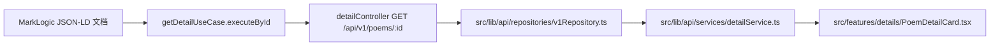
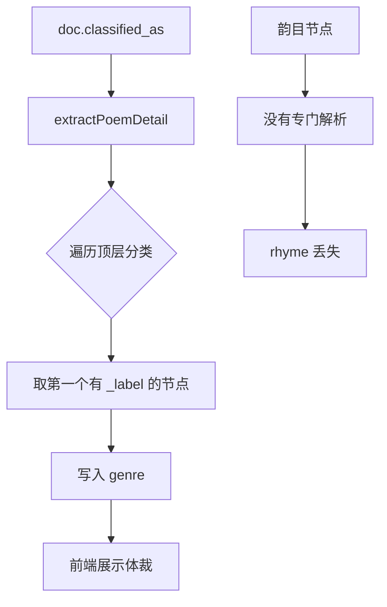
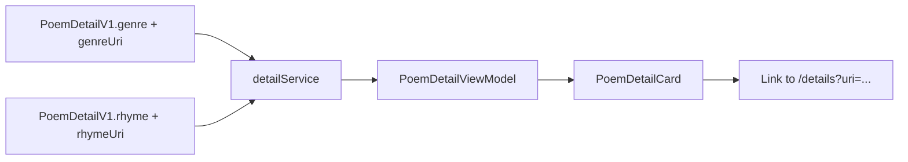

# 诗文详情页体裁与韵目解析修复方案

## 背景

当前诗文详情页对 `classified_as` 的解析过于粗糙，直接取第一个存在标签的分类项作为体裁。这会把朝代错误展示为体裁，也无法识别韵目。

用户提供的原始 JSON-LD 说明：

- 朝代与体裁、韵目都放在顶层 `classified_as`
- 体裁节点本身还带有二级 `classified_as`
- 韵目节点本身也带有二级 `classified_as`

因此，正确做法不是“取第一个标签”，而是“先识别分类节点的分类类型，再决定写入哪个字段”。

## 现状链路

当前问题点：

## 目标行为

### 1. 体裁解析

从顶层 `classified_as` 中找到“其自身被标注为 poems 的 Type 节点”，取该节点的 `_label` 作为体裁。

示例：

- 顶层节点 `_label = 绝句-五绝`
- 该节点的 `classified_as[*]._label = poems`

则：

- `genre = 绝句-五绝`

### 2. 韵目解析

从顶层 `classified_as` 中找到“其自身被标注为 Rhyme 的 Type 节点”，取该节点的 `_label` 作为韵目。

示例：

- 顶层节点 `_label = 七虞`
- 该节点的 `classified_as[*]._label = Rhyme`

则：

- `rhyme = 七虞`

### 3. 朝代保持独立

朝代不能再复用 `genre` 字段。若现有朝代来源不足，可先保持现状；但体裁提取必须排除仅代表朝代的分类项。

## 解析规则

建议为诗文详情增加一个专用分类解析函数，输入为 `doc.classified_as`，输出：

- `genre`
- `genreUri`
- `rhyme`
- `rhymeUri`

判定规则：

| 顶层节点条件 | 二级分类条件 | 目标字段 |
| --- | --- | --- |
| 节点存在可读标签 | 存在 `poems` 或 `aat/300026451` | `genre` |
| 节点存在可读标签 | 存在 `Rhyme` 或 `aat/300438590` | `rhyme` |

补充要求：

- 同时保留原节点 `id`，供前端生成详情链接
- 如果同一类命中多个节点，优先第一个有效节点
- 仅在命中明确语义时写入，避免把朝代误写入体裁

## 前端展示目标

诗文详情卡片中：

- `体裁` 需要展示为可点击链接
- `韵目` 需要新增展示，并且也为可点击链接

展示链路：

点击行为：

- 体裁跳转到对应概念详情页
- 韵目跳转到对应概念详情页
- 若 URI 缺失，则回退为纯文本，不渲染为链接

## 数据模型调整

后端接口 `PoemDetailV1` 建议新增：

- `genreUri?: string`
- `rhymeUri?: string`

前端视图模型 `PoemDetailViewModel` 同步新增：

- `genreUri?: string`
- `rhyme?: string`
- `rhymeUri?: string`

## 测试策略

先补测试，再改实现。

### 后端测试

覆盖场景：

1. 顶层 `classified_as` 第一个元素为朝代，第二个元素为 poems 分类
2. 顶层存在 rhyme 分类
3. 同时存在朝代、体裁、韵目时，三者不串位
4. 体裁/韵目缺少 URI 时仍可展示文本

### 前端测试

覆盖场景：

1. 体裁存在 `genreUri` 时渲染为链接
2. 韵目存在 `rhymeUri` 时渲染为链接
3. URI 缺失时回退为普通文本

## 实施步骤

| 步骤 | 文件 | 目标 |
| --- | --- | --- |
| 1 | `tests/...` | 补齐失败用例 |
| 2 | `server/src/domain/detail/poemExtractor.js` | 修正体裁/韵目解析 |
| 3 | `src/types/contracts/apiContracts.ts` | 扩展接口契约 |
| 4 | `src/types/view/models.ts` | 扩展前端视图模型 |
| 5 | `src/lib/api/services/detailService.ts` | 透传体裁/韵目及链接 |
| 6 | `src/features/details/PoemDetailCard.tsx` | 体裁/韵目可点击展示 |

## 风险与边界

| 风险 | 说明 | 处理方式 |
| --- | --- | --- |
| 分类标签多语言 | 有些数据可能没有 `_label`，只有 `id` | 先使用统一标签提取函数 |
| 概念 URI 不是前端相对路径 | 原始值可能是完整 URL | 详情页统一走 `/details?uri=${encodeURIComponent(uri)}` |
| 老数据没有韵目 | 不能影响已有详情展示 | `rhyme` 为空时不渲染链接 |
