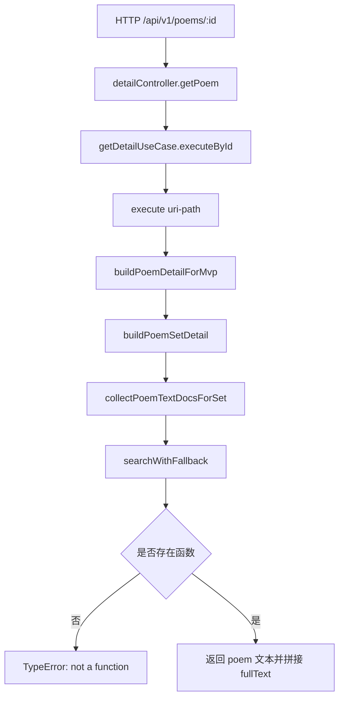

# poem 详情 500（searchWithFallback 丢失）修复方案

## 背景
当前 `GET /api/v1/poems/:id` 在特定路径会返回 500，错误为 `TypeError: searchWithFallback is not a function`。

已复现：
- 文件：`tests/server/api/v1DetailScopeAlignment.integration.test.ts`
- 失败用例：
  - `poem search 结果进入 details 不应 404`
  - `poem details 应能回填 json-ld 文本正文`

## 根因分析
`buildPoemDetailForMvp` 需要依赖 `mlGetDoc + searchWithFallback`。

但 `getDetailUseCase` 在两处调用时未传入 `searchWithFallback`：
- `execute()` 内：传入的是 `gateways`（缺少 `searchWithFallback`）
- `executeById()` 内：未传第三个参数

## 结构规划
- 保持 `poemExtractor` 纯领域职责不变。
- 在 `getDetailUseCase` 内新增统一依赖对象 `detailDependencies`：
  - `...gateways`
  - `searchWithFallback`
- 所有 `buildPoemDetailForMvp` 调用统一改为传 `detailDependencies`。

## 实施步骤 TODO
1. [x] 复现失败并确认堆栈。
2. [ ] 在 `getDetailUseCase` 构建统一依赖对象。
3. [ ] 替换两处 `buildPoemDetailForMvp` 调用入参。
4. [ ] 运行 `tests/server/api/v1DetailScopeAlignment.integration.test.ts`，确认两条 poem 用例恢复。
5. [ ] 运行一次相关回归测试，确认未引入其他回归。

## 边界与风险
- 风险：`detailDependencies` 透传可能影响其它提取器入参。
- 控制：仅改 poem 分支调用，不改其它提取器逻辑。
- 边界：当 `searchWithFallback` 搜索结果为空时，应保持降级逻辑，不应抛错。
