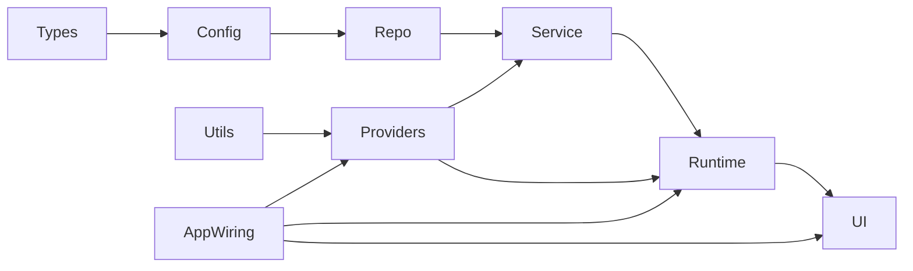
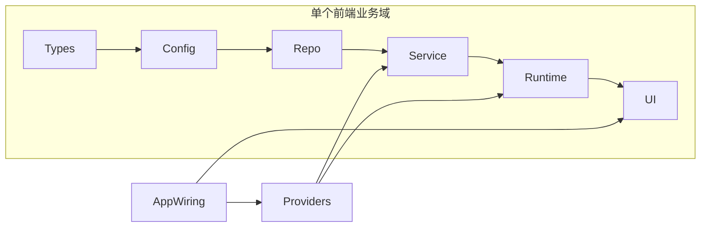

# Providers 单入口与单向分层评估

## 1. 背景

这次探索对应 OpenAI 文章《[工程技术：在智能体优先的世界中利用 Codex](https://openai.com/zh-Hans-CN/index/harness-engineering/)》中“规范架构与品味”一节。文章明确提出：

- 业务域内部只能沿固定方向依赖：`Types -> Config -> Repo -> Service -> Runtime -> UI`
- 认证、连接器、遥测、功能标志等横切关注点只能通过一个显式入口进入：`Providers`
- 这些规则不能只写在文档里，而要通过自定义 lint 和结构测试机械执行

对智能体开发来说，这套约束的目标不是“看起来整齐”，而是把允许出现的依赖边收缩到极少数，让代码仓库对人和智能体都足够可推理。

## 2. 如何理解这条规则

### 2.1 它约束的不是目录名，而是依赖边

核心问题不是“有没有 `service/` 目录”，而是：

| 层 | 允许知道什么 | 不该知道什么 |
|---|---|---|
| `Types` | 纯类型、纯契约 | 配置、网络、运行时、UI |
| `Config` | 常量、默认值、纯配置映射 | HTTP、DOM、业务流程 |
| `Repo` | 数据来源读写细节 | React 状态、界面、浏览器行为 |
| `Service` | 业务编排、归一化、回退、策略 | 具体横切实现细节 |
| `Runtime` | React hooks、状态机、适配器、生命周期 | 基础设施直连、散落的外部 SDK |
| `UI` | 展示、交互、事件绑定 | 数据源细节、横切系统接入 |
| `Providers` | 横切关注点的唯一注入入口 | 业务域内部规则本身 |

也就是说，`UI` 不应该直接摸 `http`，`Runtime` 不应该自己去连认证或遥测 SDK，`Service` 也不应该随手读取功能标志实现。

### 2.2 `Providers` 的真正含义

`Providers` 不是“React Context 越多越好”，而是：

- 把横切关注点收束成一个稳定、显式、可替换的接口面
- 让业务域只依赖抽象后的能力，不依赖具体实现
- 让自动化可以检查“横切能力只能从这里进入”

一个更接近文章精神的结构是：

要点有两个：

1. 业务主链只能向前
2. 横切能力不允许从链路中途“钻进来”

## 3. 当前项目是否已经实现

结论：**只实现了“局部分层雏形”，没有实现文章要求的“受限依赖图 + Providers 单入口 + 自动化守卫”。**

### 3.1 已经具备的部分

前端已有一些接近目标的分层：

| 现状 | 说明 |
|---|---|
| `src/types` | 有独立类型层 |
| `src/lib/config` | 有配置常量层 |
| `src/lib/api/repositories` | 有 API 仓储层 |
| `src/lib/api/services` | 有服务层 |
| `src/lib/runtime` | 有运行时配置层 |
| `src/features/*`、`src/app` | 有运行时/UI 承载层 |

后端也已有“装配层”意识：

| 现状 | 说明 |
|---|---|
| `server/src/bootstrap` | 已开始抽离配置与依赖拼装 |
| `server/src/usecases` | 有用例层 |
| `server/src/domain` | 有领域逻辑层 |
| `server/src/infra` | 有网关/检索器基础设施层 |

这说明项目不是从零开始，已经有可收敛的基础。

### 3.2 关键差距

#### 差距 A：前端存在跨层直连

典型例子：

| 文件 | 现象 | 问题 |
|---|---|---|
| `src/features/details/hooks/useAiServices.ts` | 直接 `import { http }` | Runtime/Hook 直接碰基础设施 |
| `src/lib/config/iiif.ts` | 直接读取 `runtimeConfig` | Config 反向依赖 Runtime |
| `src/lib/api/v1Api.ts` | 同时依赖 repo 和 service | Facade 跨过固定层次拼装 |

这些边说明当前依赖图不是“只能向前”，而是存在跨层穿透。

#### 差距 B：横切关注点还没有 Providers 单入口

当前仓库没有统一的 `providers/` 架构边界，也没有把这些能力集中注入：

- 运行时配置
- AI/HTTP 客户端
- 功能开关
- 遥测
- 认证
- 外部连接器

结果是横切能力散落在：

- `src/lib/runtime/runtimeConfig.ts`
- `src/lib/api/http.ts`
- 各种 hook / feature 组件
- 后端 `bootstrap`、`services`、`infra` 之间

这和文章里“横切关注点只从一个显式接口进入”的要求还有明显距离。

#### 差距 C：后端分层方向还不稳定

后端目前同时存在两种风格：

1. 正在建设中的 `bootstrap -> usecases -> domain / infra`
2. 历史遗留的“模块随手直连”

典型例子：

| 文件 | 现象 | 问题 |
|---|---|---|
| `server/src/domain/track/poemTrackService.js` | domain 直接调用 `infra/gateways` | 领域层反向依赖基础设施 |
| `server/src/infra/gateways/embeddingGateway.js` | infra 直接包裹 `services/embeddingService` | infra 与 service 角色重叠、方向不清 |
| `server/src/app.js` | 入口直接 import service/domain/infra 多层 | 装配层尚未成为唯一接线点 |

这意味着后端还没真正进入“有限边集”的状态。

#### 差距 D：没有自动化强制执行

当前 `package.json` 和 `eslint.config.js` 中没有看到以下守卫：

- `eslint-plugin-boundaries`
- `dependency-cruiser`
- `madge`
- 自定义 no-restricted-imports 分层规则
- 结构测试脚本

这意味着即使口头达成一致，约束也很容易被后续改动冲破。

## 4. 证据摘录

以下证据直接支持上面的判断：

| 证据 | 说明 |
|---|---|
| `src/features/details/hooks/useAiServices.ts:12` | runtime hook 直接依赖 `@/lib/api/http` |
| `src/lib/config/iiif.ts:5` | config 层直接依赖 `@/lib/runtime/runtimeConfig` |
| `src/lib/api/v1Api.ts:20-30` | facade 同时依赖 repository 与 service |
| `server/src/domain/track/poemTrackService.js:12` | domain 直接依赖 infra gateway |
| `server/src/infra/gateways/embeddingGateway.js:10-17` | infra 直接包裹 service |
| `server/src/app.js:35-71` | 入口直接连接 service / domain / infra / bootstrap |

## 5. 该如何弥补差距

建议不要一次性全仓大迁移，而是分四步推进。

### 5.1 第一步：先写清楚“允许的依赖图”

先在前端明确一个最小可执行版本：

这里最重要的不是目录调整，而是先冻结规则：

| 规则 | 说明 |
|---|---|
| `Config` 不能依赖 `Runtime` | 运行时输入应由上层注入 |
| `UI` / `hooks` 不能直接依赖 `http` | 只能走 runtime/service 接口 |
| `Service` 不能直接接认证/遥测 SDK | 必须通过 providers 暴露能力 |
| `app` 是 wiring，不是业务实现层 | 负责接 Providers 和页面树 |

### 5.2 第二步：先补一个最小 Providers 面

建议先只抽四类能力：

| Provider | 先包什么 |
|---|---|
| `RuntimeConfigProvider` | 后端地址、环境运行时配置 |
| `ApiClientProvider` | `axios/http` 实例 |
| `FeatureFlagProvider` | 功能开关读取 |
| `TelemetryProvider` | 结构化日志 / 指标上报 |

前端短期目标不是“全部 React Context 化”，而是先把直接 `import http`、直接摸运行时配置、直接读 flag 的路径收敛起来。

### 5.3 第三步：挑一个业务域做试点

最适合试点的是 `details` 域，因为它已经暴露出明显的跨层穿透。

建议试点顺序：

1. `useAiServices` 不再直接依赖 `http`
2. `iiif.ts` 不再直接读取 `runtimeConfig`
3. `details` 相关 hook 只依赖 runtime/service 接口
4. 把域内依赖图跑通后，再复制到 `fusion`、`results`

### 5.4 第四步：最后上自动化

自动化建议分两层：

| 层次 | 工具建议 | 目的 |
|---|---|---|
| 静态 lint | `no-restricted-imports` 或 `eslint-plugin-boundaries` | 禁止非法 import |
| 结构测试 | 自定义 Vitest / Node 脚本 或 `dependency-cruiser` | 审计整个依赖图 |

最低可行自动化应覆盖：

- `features/**` 不得直接 import `@/lib/api/http`
- `config/**` 不得直接 import `runtime/**`
- `domain/**` 不得直接 import `infra/**`
- `app` 以外模块不得直接接横切 providers 实现

## 6. 对你项目的建议判断

### 6.1 现在不适合直接全仓强推

原因不是理念不对，而是当前仓库还处于“历史结构 + 新分层并存”的阶段。直接全量强推很容易：

- 改动面过大
- 回归成本高
- 自动化规则一上来就报海量违例

### 6.2 现在非常适合做“worktree 架构试验”

因为这次目标不是马上大改业务，而是验证三件事：

1. 这套规则放到 `details` 或 `fusion` 域后，目录和调用是不是更清晰
2. 哪些现有模块最难收敛，真正的阻力在哪里
3. 自动化规则应该怎么设计，才能既严格又不过度折腾

## 7. 本次 worktree 探索建议产物

本次 worktree 不建议直接追求“大重构完成”，而应优先产出：

| 产物 | 目的 |
|---|---|
| 本文档 | 对齐规则与现状 |
| 一个域级试点方案 | 验证 `Providers + 单向分层` 是否顺手 |
| 一份依赖守卫清单 | 明确 lint / 结构测试该拦什么 |
| 一组最小结构测试 | 证明规则可自动执行 |

## 8. 结论

你的项目已经有分层基础，但还没有达到文章里的那种“严格受控的依赖图”。

最准确的判断是：

- **有雏形**
- **未落地完整模型**
- **还没有 Providers 单入口**
- **还没有自动化强制执行**

所以这次探索的正确方向不是“再解释一遍分层”，而是：

1. 先把规则写成仓库内可引用的架构文档
2. 选一个业务域做 Providers 试点
3. 再用 lint + 结构测试把合法依赖边锁死

只有这样，这个 idea 才会从“理念”变成“不会被后续改动破坏的工程约束”。
