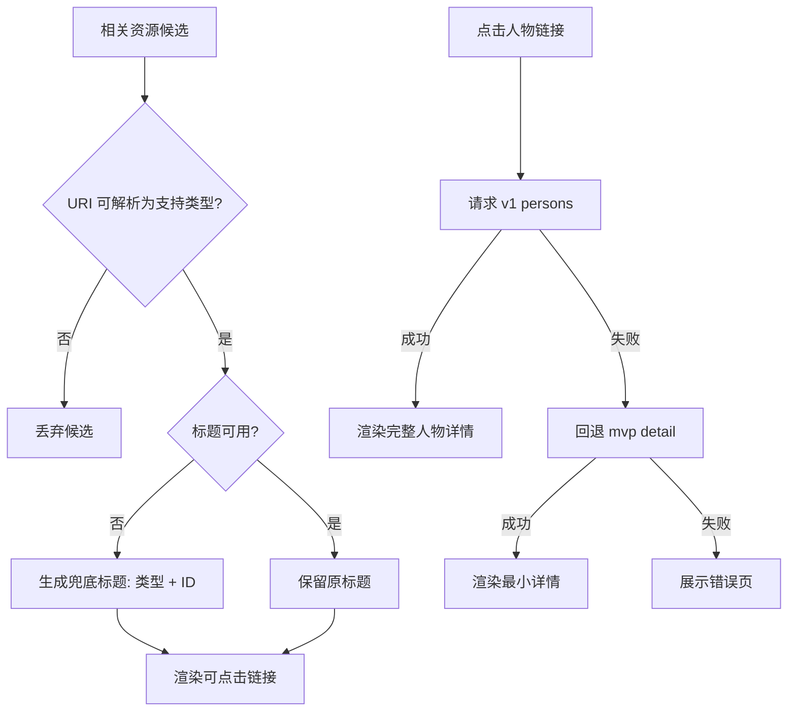

# 相关资源稳定性最小修复方案（第一性原理）

## 1. 问题定义
目标不是“最聪明推荐”，而是“稳定可用”：
- 始终能看到可读名称。
- 点击后应进入可处理页面（而不是 404 / 未知资源类型）。
- 在可接受时间内完成渲染。

## 2. 现象拆解
当前不稳定主要来自两条链路：
- 链路A：相关资源由向量检索直接驱动，返回结果中夹杂不可识别 URI（如 IIIF manifest）。
- 链路B：部分人物 URI（如 `/person/17170`）可被路由识别，但下游详情接口返回缺失，前端直接报错页。

## 3. 第一性原理约束
- 必要条件1：可点击前必须可路由、可处理。
- 必要条件2：名称必须可读，不能默认退化为“未命名条目”。
- 必要条件3：失败要降级，不应把用户带入硬错误。

## 4. 最小修复策略
仅做三件事：
1. 相关资源结果过滤
- 过滤掉无法被详情路由识别的 URI（unknown）。
- 保留能解析为 person/poem/book/ancient_book/place/concept 的结果。

2. 相关资源名称兜底
- 若标题为空或“未命名条目”，使用“类型 + ID”生成稳定展示名。

3. 人物详情降级
- 当 `/api/v1/persons/:id` 不可用时，回退到 `/api/mvp/detail?uri=...`。
- 回退成功则渲染最小详情，不再抛 404 错误页。

## 5. 流程图（mermaid）

## 6. TODO LIST
- [ ] 在 `OverviewTab` 对相关资源做 URI 支持性过滤。
- [ ] 在 `OverviewTab` 增加标题兜底生成逻辑。
- [ ] 在 `detailService` 增加人物详情 fallback（v1 -> mvp）。
- [ ] 为 `detailService` 增加“人物 fallback 成功”单元测试。
- [ ] 执行定向测试并记录结果。
