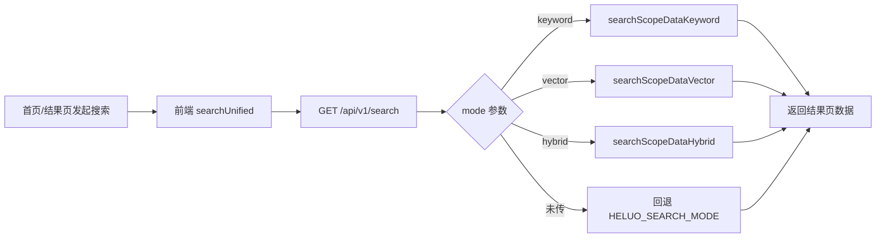

# 结果页禁用向量检索实施方案

## 1. 背景与问题

当前首页进入结果页后，结果页通过 `GET /api/v1/search` 拉取数据。  
后端在 `HELUO_SEARCH_MODE=hybrid` 时会执行“关键字 + 向量”混合检索，诗文范围检索耗时显著，前端 `20s` 超时后直接失败，造成“结果页无法正常显示”。

## 2. 目标

- 结果页检索链路不使用向量检索，仅使用关键字检索。
- 保持融合问答等其它场景不受影响（仍可按既有模式运行）。
- 保持类型系统完整，避免 `any`/隐式类型退化。
- 同步更新接口文档，明确 `mode` 参数语义。

## 3. 方案总览

## 4. 详细改造点

1. 前端结果页固定传 `mode=keyword`
- 修改 `ResultsPage` 对 `searchUnified` 的调用参数。
- 保证只影响结果页，不影响其它调用方。

2. 前端 API/类型链路透传 `mode`
- 在 `apiContracts` 增加 `SearchModeV1 = 'keyword' | 'vector' | 'hybrid'`。
- `searchUnified`、`searchUnifiedService`、`searchUnifiedRepo` 增加可选 `mode` 参数并透传给 `/api/v1/search`。

3. 后端 `/api/v1/search` 支持显式 `mode`
- 新增模式解析逻辑：优先使用请求参数 `mode`，未传时回退 `HELUO_SEARCH_MODE`。
- 非法值自动回退，避免破坏兼容。

4. 文档同步
- 更新 `docs/reference/api-contract-v1.md` 的 `/api/v1/search` 参数表与示例，补充 `mode`。

## 5. 测试策略（先测后改）

- `tests/lib/api/repositories/v1Repository.test.ts`
  - 新增用例：`searchUnifiedRepo` 传入 `mode` 时应正确拼接查询参数。
- `tests/lib/api/services/searchService.test.ts`
  - 新增用例：`searchUnifiedService` 应透传 `mode`。
- `tests/lib/api/v1Api.test.ts`
  - 新增用例：`searchUnified` 第三个参数 `mode` 应透传到 HTTP 请求。

## 6. TODO LIST

- [x] 补充/更新测试（仓库层、服务层、API facade）。
- [x] 实现前端 `mode` 参数透传与结果页固定 `keyword`。
- [x] 实现后端 `/api/v1/search` 的 `mode` 参数解析。
- [x] 更新接口文档。
- [x] 运行测试与类型检查并修正问题。

## 7. 风险与边界

- 风险：`mode` 参数若缺少约束，可能被传入非法值导致行为不确定。
  - 处理：后端统一白名单校验并回退默认模式。
- 风险：函数签名变更影响已有调用。
  - 处理：参数设计为可选参数，保持向后兼容。
- 边界：本次仅约束“结果页搜索”不走向量，不调整融合问答与详情增强链路。
