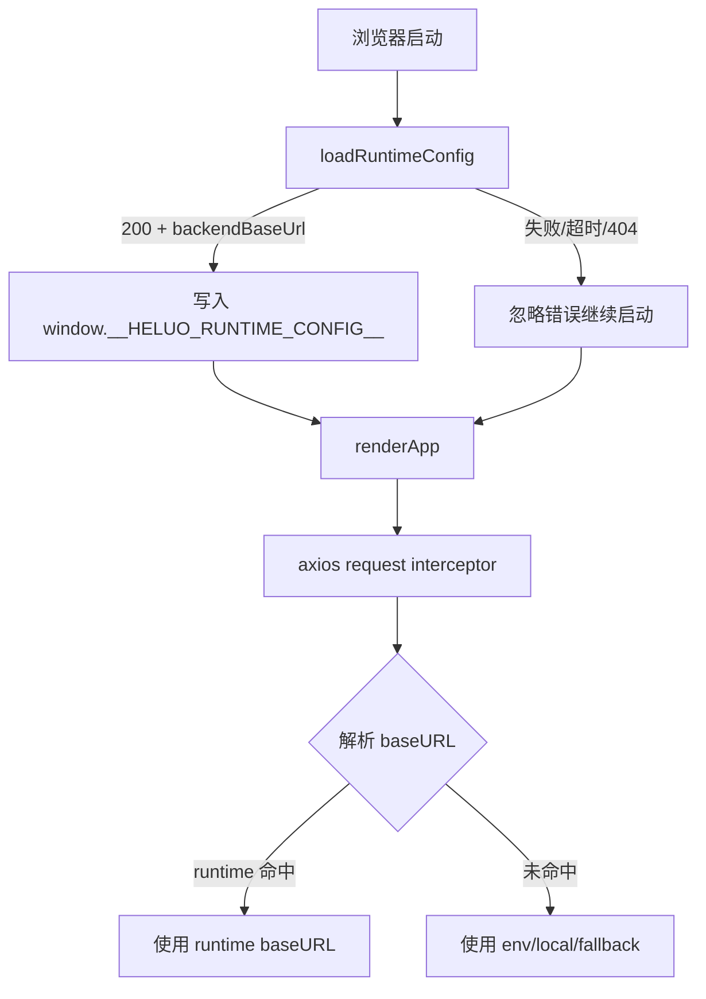

# 运行时 `/env` 配置最小侵入落地方案

## 目标

- 在不改变现有业务接口行为的前提下，为前端提供运行时后端地址能力。
- 保障兼容性：`/env` 不可用时自动回退到现有 `import.meta.env + 本地兜底 + "/"` 逻辑。
- 验证范围聚焦在新链路，不扩大改动面。

## 现状与风险

- 现有前端 `src/lib/api/http.ts` 在模块初始化阶段确定 `baseURL`。
- 现有后端无 `/env` 端点，前端无法运行时读取后端地址。
- 风险点：
  - 前端开发态未代理 `/env` 时可能 404。
  - 运行时配置读取失败不能阻塞页面首屏。

## 方案概述

1. 后端新增 `GET /env`，返回 `backendBaseUrl`。
2. 前端新增运行时配置模块，启动时“尽力加载” `/env`。
3. `http` 客户端在请求前动态解析 `baseURL`，优先级：
   - 运行时 `/env`
   - `REACT_BACKEND_URL`
   - 本地 `localhost/127.0.0.1` 兜底
   - `/`
4. 保留旧逻辑全部分支，确保无配置场景行为不变。

## 架构图



## 伪代码

```text
function loadRuntimeConfig():
  if not browser: return
  try fetch("/env", timeout=1.5s, no-store)
  if response.ok and payload.backendBaseUrl valid:
    window.__HELUO_RUNTIME_CONFIG__.backendBaseUrl = normalized
  catch:
    ignore

function resolveBaseUrl():
  if runtime backendBaseUrl exists: return it
  if env backend exists: return it
  if window.hostname in [localhost, 127.0.0.1]: return local backend
  return "/"
```

## 验证策略

- 后端集成测试：
  - `/env` 返回 200 与 `backendBaseUrl`。
  - 显式环境变量优先级正确。
- 前端单元测试：
  - runtime 配置模块成功与失败分支。
  - `http` 在 runtime 存在时优先采用 runtime 地址。
  - 旧测试 `http.baseURL === "/"`（无 window）继续通过。

