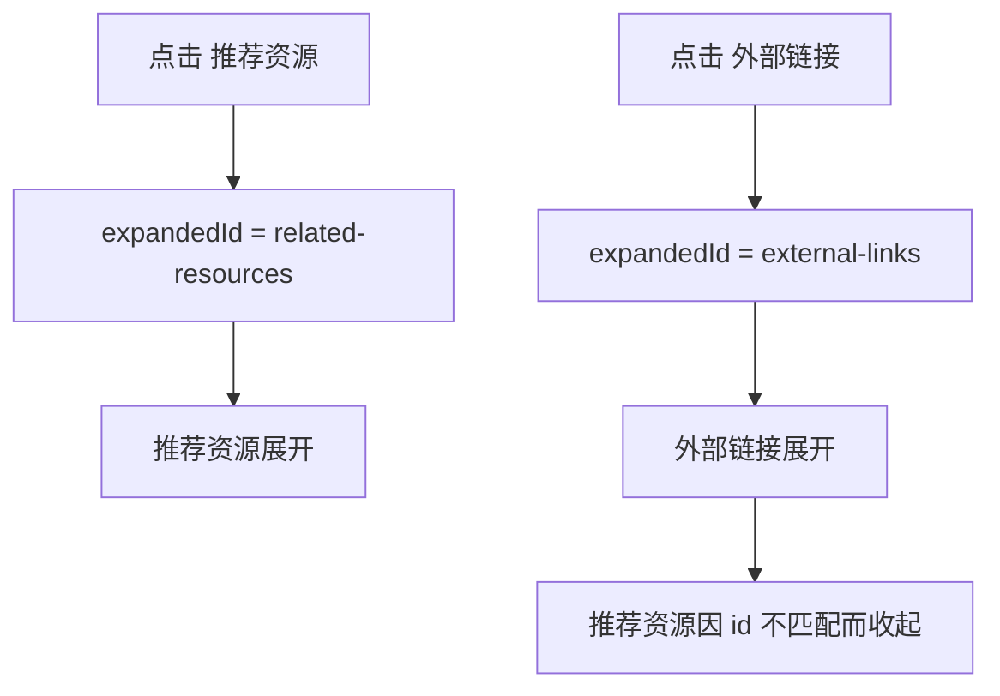
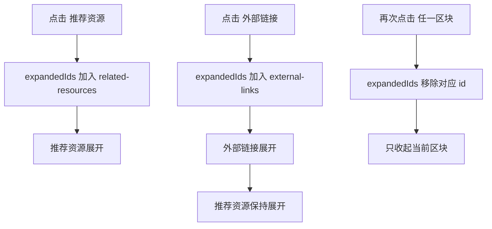

# 左侧侧栏折叠面板互斥展开问题分析

## 问题描述

详情页左侧侧栏中的“推荐资源”和“外部链接”当前共用同一套折叠状态。

用户点击其中一个区块后，另一个区块会被自动收起，无法同时展开查看。

## 现象范围

- 古籍详情页中同时存在“推荐资源”和“外部链接”时可稳定复现
- 其它复用 `SidebarAccordion` 的详情页侧栏也会受到相同状态模型影响

## 根因定位

问题集中在 `src/features/details/components/overview/SidebarAccordion.tsx`。

当前组件只维护一个 `expandedId`：

- 展开某个面板时，将 `expandedId` 设为该面板 `id`
- 再展开另一个面板时，会直接覆盖上一个 `expandedId`
- 因此天然表现为“单选模式”

## 当前状态流

## 目标状态流

## 修复方向

将侧栏折叠状态从“单个字符串”调整为“已展开 id 集合”。

修复后需要满足：

1. 多个区块可以同时展开
2. 再次点击某个区块时，只影响当前区块
3. `defaultExpanded` 仍然生效，默认展开项在首屏保持打开
4. 不影响键盘交互与可访问性属性

## 测试策略

先补一个针对 `SidebarAccordion` 的回归测试，覆盖以下场景：

1. 两个默认收起的面板被依次点击后，应同时保持展开
2. 关闭其中一个面板时，另一个面板仍保持展开
3. 默认展开项初始化时仍可见

## 风险点

| 风险 | 说明 | 控制方式 |
| --- | --- | --- |
| 默认展开逻辑回归 | 现有逻辑会响应 `defaultExpanded` | 保留默认展开收集逻辑并补测试 |
| 可访问性回归 | `aria-expanded` / `aria-hidden` 需同步 | 测试中直接断言 aria 状态 |
| 其它详情页联动 | 组件被多处复用 | 在组件层修复，避免页面级重复补丁 |
