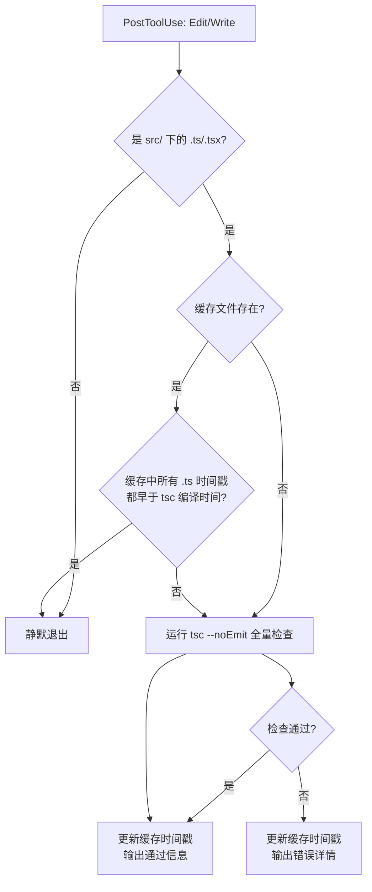
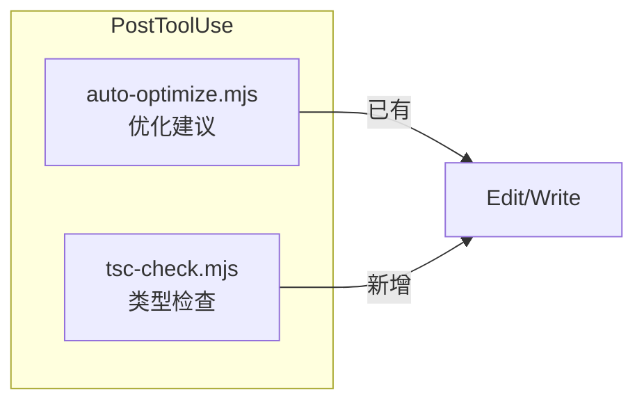

# TypeScript 增量编译验证 Hook 设计

## 背景

前端代码（`src/`）每次被 Edit/Write 修改后，自动运行 TypeScript 类型检查，
及时发现类型错误，避免问题累积。

## 核心机制

## 缓存策略

- **缓存文件**: `.claude/cache/tsc-check.json`
- **内容**: `{ lastCheckTime: <epoch_ms>, lastExitCode: <number> }`
- **失效条件**: `src/` 下任意 `.ts`/`.tsx` 文件的 mtime > lastCheckTime
- **首次运行**: 缓存不存在，强制全量检查

### 为什么用文件时间戳而非 git status

- 能捕获未暂存的修改（工作区脏状态）
- 不依赖 git 状态，hook 在 git 操作前也能工作
- 性能开销极小（仅 stat 调用）

## 超时策略

| 场景 | 超时 |
|------|------|
| 首次全量检查 | 60s |
| 增量检查（缓存命中后不触发） | 不执行，0 开销 |
| tsc 进程被 kill | 视为失败，不更新缓存 |

## 与现有 hooks 的关系

两个 hook 并行运行，互不依赖。tsc-check 始终 exit(0) 不阻塞。
