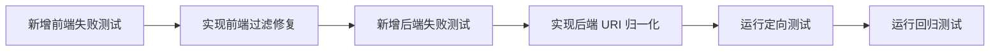

# 详情页推荐资源向量检索修复实施方案

## 1. 问题现象
- 详情页“推荐资源”在 `mode=vector` 下经常显示“暂无推荐资源”。
- 后端向量检索链路可用，但前端展示链路存在大量过滤。

## 2. 根因分析

```mermaid
flowchart TD
  A[OverviewTab 触发 searchUnified mode=vector] --> B[/api/v1/search 返回向量结果]
  B --> C{结果 URI 可被前端识别?}
  C -- 否 --> D[normalizeRelatedSearchItems 过滤掉]
  C -- 是 --> E[进入推荐卡片]
  D --> F[推荐资源为空]
```

### 2.1 前端过滤过严
- `v1Api.ts` 中 `isSupportedDetailUri` 使用固定 URI 片段白名单。
- 向量结果常见 URI（如 `/processed/json-ld-vector/persons/*.json`）不一定匹配白名单。
- 结果在进入详情页推荐组件前被过滤为 `[]`。

### 2.2 后端实体 URI 归一化不足
- `searchUnifiedUseCase` 仅对部分诗文路径做主实体 URI 映射。
- 其他实体在向量模式下可能保留分片 URI，增加前端过滤风险。

## 3. 修复策略
1. 前端：将“推荐资源可用性”判定改为“能否构建详情路由”。
2. 后端：增强向量 URI 到实体主 URI 的归一化映射。
3. 测试：补充真实向量 URI 场景，避免回归。

## 4. 变更范围
- `src/lib/api/v1Api.ts`
- `server/src/usecases/searchUnifiedUseCase.js`
- `tests/lib/api/v1Api.test.ts`
- `tests/server/usecases/searchUnifiedUseCase.test.js`（如不存在则新建）

## 5. 实施步骤



## 6. TODO LIST
- [ ] 前端测试：向量 URI 不应被误过滤。
- [ ] 前端实现：`isSupportedDetailUri` 改为 `buildDetailsRouteFromUri` 判定。
- [ ] 后端测试：向量 URI 需映射到主实体 URI。
- [ ] 后端实现：扩展 `resolvePrimaryEntityUri` 的向量路径映射规则。
- [ ] 执行并记录测试结果。
