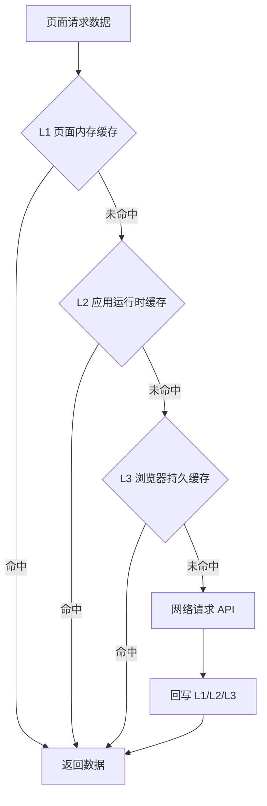

# 统一缓存方案（检索结果 / 推荐资源 / 地理轨迹）

## 1. 目标与范围

本方案用于统一前端缓存设计，优先覆盖以下三类高频能力：

1. 检索结果（Search Result）
2. 推荐资源（Related Resources）
3. 地理轨迹（Geo Track）

目标：
- 提升答辩演示稳定性与响应速度；
- 统一缓存键、缓存值、失效策略，降低维护复杂度；
- 在不改 UI 提示文案的前提下，提升可用性。

## 0. 当前落地状态（2026-03-04）

已完成本方案最小落地，覆盖三类业务：

| 业务域 | 代码接入点 | 缓存层次 | TTL | 容量上限 |
|---|---|---|---|---|
| 检索结果 | `src/features/results/ResultsPage.tsx` | 内存 + localStorage | 10 分钟 | 240 |
| 推荐资源 | `src/features/details/OverviewTab.tsx` | 内存 + localStorage | 15 分钟 | 240 |
| 地理轨迹 | `src/lib/api/services/poemTrackService.ts` | 内存 + localStorage | 30 分钟 | 120 |

统一缓存底座：
- `src/lib/cache/unifiedCache.ts`

## 2. 统一架构（3 层缓存）



说明：
- L1：组件生命周期内缓存（最快，页面级）。
- L2：前端进程内缓存（Map + TTL + LRU，标签页刷新失效）。
- L3：浏览器持久缓存（localStorage，跨刷新保留）。

## 3. 三类业务缓存域设计

### 3.1 检索结果（已落地）

缓存对象：
- `/api/v1/search` 的统一检索返回（keyword/vector/hybrid）。

缓存键参数：
- `q`、`type`、`mode`、`page`、`pageSize`。

当前 TTL：
- `10 分钟`（演示场景下兼顾命中率与新鲜度）。

失效策略：
- TTL 过期自动失效；
- 搜索模式或过滤条件变化视为新键；
- 升级 `CACHE_VERSION` 强制失效。

### 3.2 推荐资源（已落地）

缓存对象：
- 详情页侧栏推荐资源结果（向量与关键词回退后的最终结果）。

缓存键参数：
- `currentUri`、`relatedQuery`、`mode`、`type`、`page`、`pageSize`。

当前 TTL：
- `15 分钟`（详情页切换频繁，保证命中同时减少过时风险）。

失效策略：
- TTL；
- 当前资源 URI 改变自动换键；
- `CACHE_VERSION` 失效。

### 3.3 地理轨迹（已落地）

缓存对象：
- 人物诗文地理轨迹接口结果（例如 `/api/v1/persons/:id/poem-track`）；
- 轨迹相关地点解析结果（若前端有二次处理，可单独缓存）。

缓存键参数：
- `personId`（可附带过滤参数，如时间范围时再扩展）。

当前 TTL：
- `30 分钟`（轨迹数据变更较少，适合持久缓存）。

失效策略：
- TTL；
- 人物切换自动换键；
- `CACHE_VERSION` 失效。

## 4. 统一键规范

统一格式：

```text
heluo:{domain}:{version}:{hash(normalizedParams)}
```

示例：
- `heluo:search:v1:abc123...`
- `heluo:related:v1:def456...`
- `heluo:track:v1:ghi789...`

规范要求：
- 参数先标准化（trim、lowercase、默认值补齐）再哈希；
- 哈希前参数按固定字段顺序序列化；
- 禁止把随机值（requestId）放入 key。

## 5. 统一缓存值结构

```json
{
  "version": "v1",
  "domain": "search|related|track",
  "createdAt": 1700000000000,
  "expiresAt": 1700003600000,
  "payload": {}
}
```

要求：
- `payload` 仅存业务必要字段；
- 禁止写入敏感信息；
- 解析失败视为坏数据并立即删除。

## 6. 容量与清理策略

### 6.1 L2（运行时）

- 每域最大条目数建议：
  - search: 200
  - related: 150
  - track: 80
- 超限按 LRU 淘汰。

### 6.2 L3（localStorage）

- 启动时轻清理：删除过期项 + 非当前 version 项。
- 写入失败（QuotaExceeded）时：
  1. 先删最旧条目；
  2. 重试 1 次；
  3. 仍失败则放弃持久化，不影响主流程。

## 7. 读写与降级流程

读取顺序：
1. L1 -> 2. L2 -> 3. L3 -> 4. 网络。

写入顺序：
1. 先写 L1/L2；
2. 异步写 L3；
3. L3 失败不抛出到 UI 层。

错误处理：
- 缓存读取异常：记录 warn，走网络；
- 缓存写入异常：记录 warn，不影响返回。

## 8. 与现状映射（当前代码）

已完成：
- 新增统一缓存模块：`src/lib/cache/unifiedCache.ts`；
- 检索结果已接入统一缓存：`src/features/results/ResultsPage.tsx`；
- 推荐资源已迁移到统一缓存：`src/features/details/OverviewTab.tsx`；
- 地理轨迹已接入统一缓存：`src/lib/api/services/poemTrackService.ts`。

保留项（非本次必改）：
- `src/lib/api/v1Api.ts` 内仍有 relatedResourceCache（API 层缓存）；
- 后端缓存仍按既有策略运行，不影响前端统一缓存。

## 9. 实施计划（分阶段）

### 阶段 1：基础设施（已完成）
1. 新增前端统一缓存模块（cache client）：
   - `get/set/has/delete/clear/prune`；
   - 支持域配置（TTL、maxEntries）。
2. 定义统一常量：
   - `CACHE_VERSION`；
   - 各域 TTL 与容量。

### 阶段 2：业务接入（本次范围，已完成）
1. 检索结果接入统一缓存。
2. 推荐资源迁移到统一缓存（保留现有逻辑，替换存储实现）。
3. 地理轨迹请求接入统一缓存。

### 阶段 3：验证与回归（进行中）
1. 命中率与功能回归测试。
2. 断网/后端短时不可用演练。
3. 清理策略与版本切换验证。

## 10. 验收标准

满足以下条件即视为达标：

1. 三类业务均按统一键规范缓存；
2. 页面刷新后可从持久缓存快速回显（在 TTL 内）；
3. 过期与版本失效生效；
4. 缓存异常不影响主流程；
5. UI 不新增缓存标注。

## 11. 答辩模式建议参数（当前代码默认）

- `CACHE_VERSION=v1`
- `search TTL=10m`
- `related TTL=15m`
- `track TTL=30m`
- 分域容量上限：`240 / 240 / 120`

> 若答辩前一天数据有更新，建议仅提升 `CACHE_VERSION`，不改业务代码。
