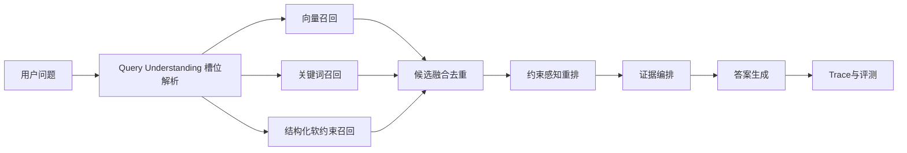

# 融合问答通用化方案（纯 RAG 增强版）

## 1. 决策结论

本阶段**不引入 GraphRAG**，避免系统复杂度和维护成本上升。

当前目标：在现有 RAG 架构内，提升“模糊问题”与“综合问题（时间+地理+诗文）”的召回质量与回答稳定性。

## 2. 现状问题

| 问题 | 表现 | 根因 |
|---|---|---|
| 语义漂移 | 问杜甫晚年心境，命中无关人物大段信息 | 召回与重排缺少主体/时空约束 |
| 解释困难 | 答错时难定位 | 缺少分项 trace（解析、召回、重排） |
| 策略碎片化 | 单题补丁多，泛化差 | 缺少统一约束驱动框架 |

## 3. 总体方案（纯 RAG）

### 3.1 统一槽位 Schema

所有问题统一抽取：

- `who`：主体（人物/地点/组织）
- `when`：时间约束（朝代/阶段，如“晚年”）
- `where`：地理约束
- `what`：对象约束（诗文/事件/关系）
- `how`：分析视角（心境/风格/影响）

### 3.2 统一召回策略

- 保留多通道并行：向量 + 关键词。
- 增加结构化软约束通道（不先硬过滤）。
- 合并时保留来源与分项得分，便于解释与调参。

### 3.3 统一重排公式

`final = semantic + lexical + whoScore + whenScore + whereScore + topicScore - driftPenalty`

原则：

- `whoScore` 权重最高，优先保证“问谁答谁”。
- `when/where` 采用软约束，避免漏召回。
- `driftPenalty` 惩罚主体错位但相似度高的候选。

### 3.4 回答编排模板

按证据维度生成：

1. 时间线结论
2. 地理线索
3. 诗文证据（标题+关键片段）
4. 综合判断 + 不确定性声明

## 4. 风险与控制

| 风险 | 影响 | 控制 |
|---|---|---|
| 槽位误判 | 全链路偏航 | 槽位置信度，低置信度宽召回 |
| 约束过强 | 漏召回 | 先软约束后硬过滤 |
| 字段异构 | 打分失真 | 证据标准化层 |
| 权重过拟合 | 泛化差 | 配置化权重 + 离线评测 |
| 会话干扰 | 误判为缓存 | 新对话按钮 + 历史长度 trace |
| 时延上升 | 体验变差 | 两阶段检索 + 并发预算 + 超时降级 |

## 5. 实施路线

### P0（1周）：可观测与标准化

- 新增 trace：槽位、通道命中、重排分项。
- 建证据标准化层：作者/朝代/时间/地理统一字段。

### P1（1-2周）：通用约束重排

- 接入 `who/when/where/topic` 分项打分。
- 权重外置配置，支持 A/B 调优。

### P2（1周）：回答编排增强

- 输出改为“时间+地理+诗文”综合结构。
- 缺证据时明确降级，不强编造。

## 6. 评测与验收

| 指标 | 说明 | 门槛 |
|---|---|---|
| Top10 相关率 | 前10候选相关占比 | >= 75% |
| 首条命中率 | Top1 可用占比 | >= 55% |
| 漂移率 | 主体错位占比 | <= 12% |
| 回答可用率 | 直接可用回答占比 | >= 70% |
| P95 时延 | 95分位响应耗时 | <= 6s |

## 7. 代码落点

- 查询理解：`server/src/domain/fusion/queryPlanner.js`
- 检索编排：`server/src/domain/retrieval/searchOrchestrator.js`
- 重排：`server/src/domain/fusion/candidateReranker.js`
- 回答编排：`server/src/services/llmService.js`
- 用例编排：`server/src/usecases/fusionQueryUseCase.js`、`server/src/usecases/fusionStreamUseCase.js`
- 会话交互：`src/features/fusion/FusionChat.tsx`

## 8. 执行建议

1. 立即执行 P0 + P1。
2. P2 在 P1 指标达标后上线。
3. 全程不引入 GraphRAG 依赖，保持架构和运维复杂度可控。
