# 河洛历史名人发现平台系统设计与实现

> **文档性质**: 硕士学位论文学术素材
> **版本**: v1.0
> **日期**: 2026-03-02

---

## 目录

- [概述](#概述)
- [第一章 数据与知识层](#第一章-数据与知识层)
- [第二章 知识服务层](#第二章-知识服务层)
- [第三章 知识交互层](#第三章-知识交互层)
- [附录](#附录)

### 三层架构总览

系统采用三层知识架构设计，将原始数据转化为可交互的知识服务：

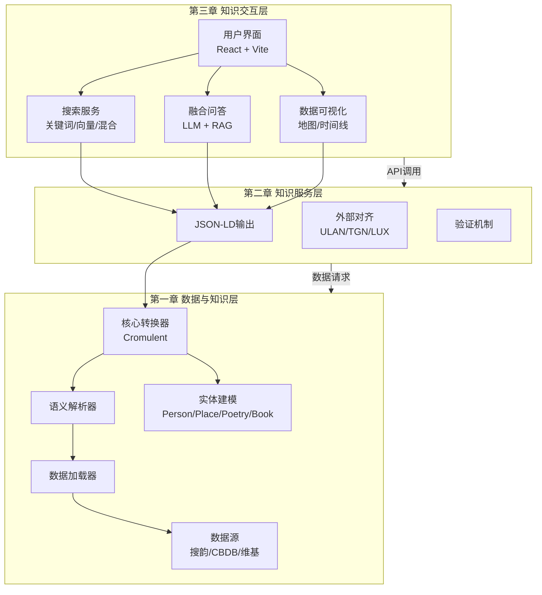

**架构设计理念**：

- **高内聚低耦合**：各层职责清晰，通过标准接口协调
- **标准化互操作**：完全遵循Linked Art 1.0数据模型规范
- **模型驱动转换**：通过语义映射实现数据模型的精准转换
- **外部权威对齐**：与Getty、LUX等权威词汇表进行实体对齐

---

## 第一章 数据与知识层

数据与知识层是系统的底层基础，负责将多源异构的原始数据转化为结构化的语义知识。本章详细阐述数据源整合、语义解析、核心转换和实体建模的实现机制。

### 本章流程总览

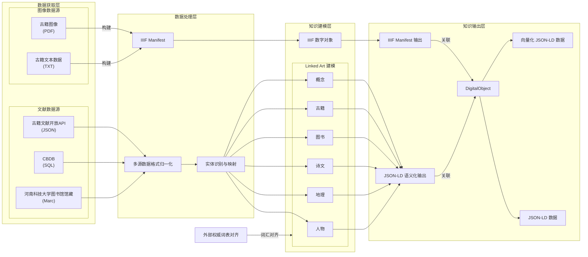

### 1.1 数据源与数据加载

#### 1.1.1 多源异构数据

系统整合四类主要数据源，形成完整的河洛历史名人知识基础：

| 数据源 | 数据类型 | 格式 | 用途 |
|-------|---------|------|------|
| **搜韵API** | 人物、地点、诗词 | JSON | 核心数据源，提供基础实体信息 |
| **CBDB数据库** | 人物关系 | CSV/JSON | 补充人物关系网络 |
| **维基百科** | 人物补充信息 | HTML/API | 增强人物传记内容 |
| **本地数据** | 古籍、图书 | JSON/MARC | 结构化文档数据 |

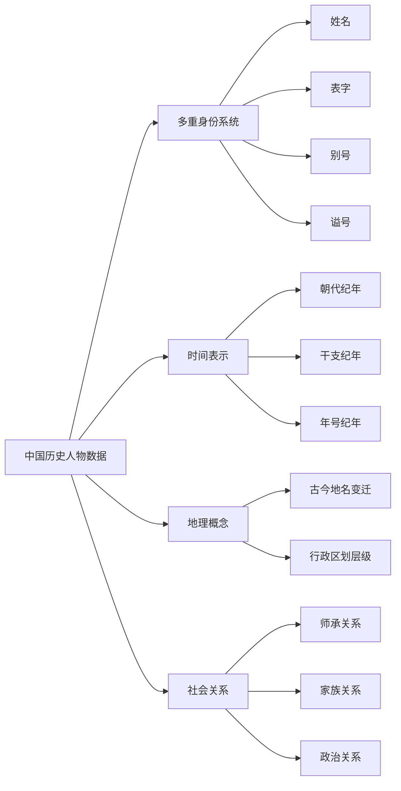

#### 1.1.2 数据加载器架构

所有数据加载器继承自统一的基类，实现标准化的数据获取接口：

| 加载器类 | 文件位置 | 处理数据类型 |
|---------|---------|-------------|
| `PersonDataLoader` | `person_data_loader.py` | 人物数据 |
| `PlaceDataLoader` | `place_data_loader.py` | 地点数据 |
| `PoetryDataLoader` | `poetry_data_loader.py` | 诗词数据 |
| `AncientBookLoader` | `ancient_book_data_loader.py` | 古籍数据 |

**搜韵API字段映射图**：

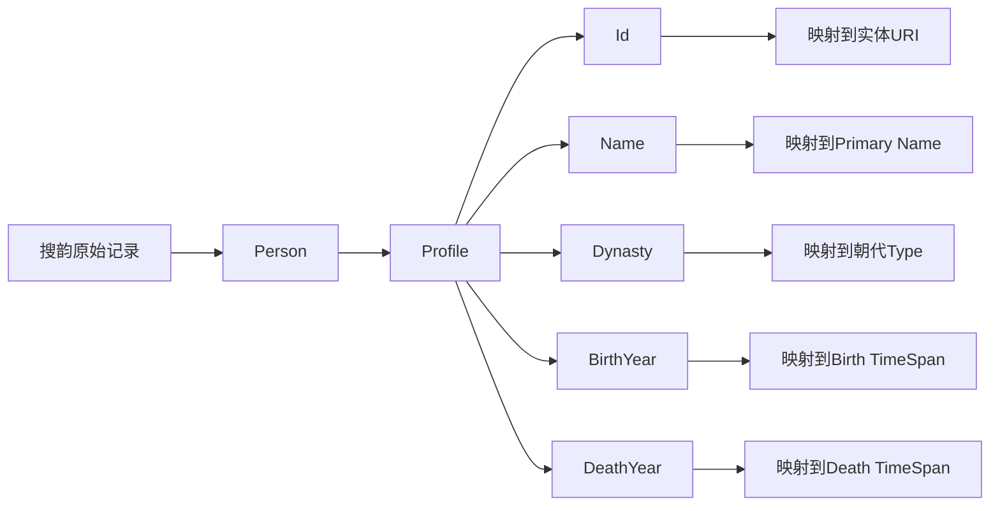

#### 1.1.3 数据源与加载时序图

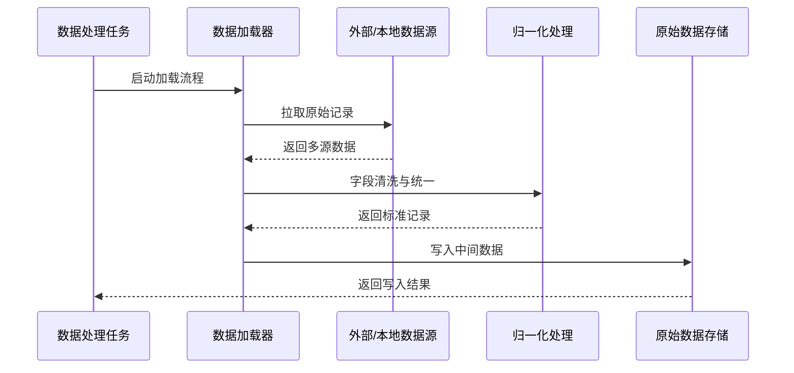

### 1.2 语义解析与概念映射

#### 1.2.1 概念识别

语义解析层负责从原始数据中识别核心概念实体：

- **姓名识别**：区分主名称（姓名）与变体名称（表字、别号、谥号）
- **地名识别**：识别地理位置及其历史变迁
- **作品识别**：识别诗文作品及其元数据

#### 1.2.2 词汇对齐

将中国传统文化概念与国际标准词汇表进行对齐：

| 中国传统概念 | 国际标准概念 | 说明 |
|-------------|-------------|------|
| 姓名 | Name (Primary Name) | 主要名称标识 |
| 字、号、谥号 | Name Variant | 名称变体 |
| 生年、卒年 | Birth / Death + Timespan | 生命事件与时间跨度 |
| 籍贯 | Birth.took_place_at | 出生地 |
| 官职、头衔 | Activity (Occupation) | 职业活动 |
| 朝代 | Type (ULAN) | 时期分类 |
| 诗文 | Set + LinguisticObject | 集合与文本对象 |
| 古籍 | HumanMadeObject + Set | 人造物与集合 |

#### 1.2.3 时间规范化

中国古代纪年方式的规范化处理：

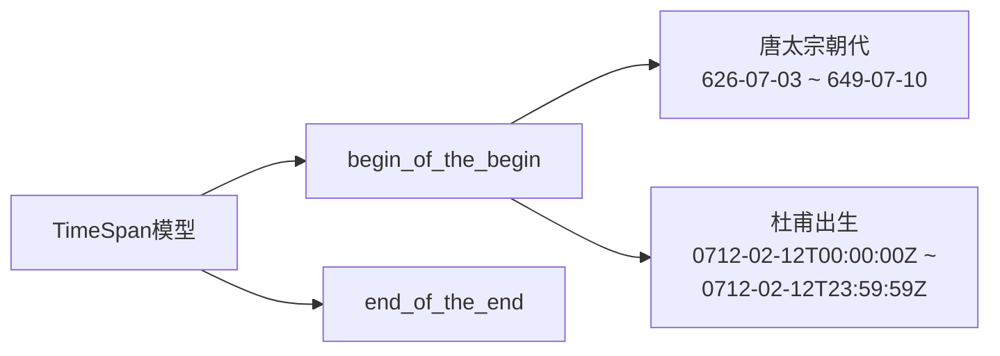

时间规范化支持：
- 精确表达具体日期（如"712年2月12日"）
- 模糊表达年代范围（如"盛唐时期"）
- 处理不确定性（如"约8世纪中叶"）

#### 1.2.4 语义解析时序图

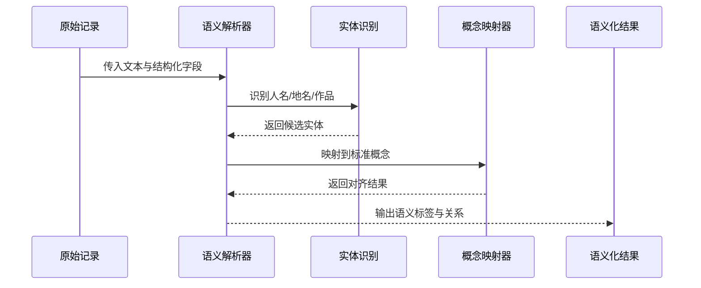

### 1.3 核心转换层

#### 1.3.1 Cromulent库

Cromulent是Linked Art数据模型的官方Python实现库，提供类型安全的模型构建API。系统通过该库将原始字段映射为事件导向实体结构：

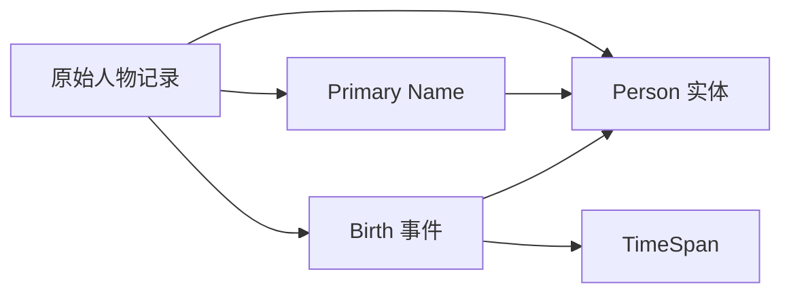

#### 1.3.2 实体转换器架构

各实体转换器继承自统一的`CromulentConverter`基类：

| 转换器类 | 输出实体类型 | 文件位置 |
|---------|-------------|---------|
| `PersonConverterCromulent` | Person | `person_converter_cromulent.py` |
| `PlaceConverterCromulent` | Place | `place_converter_cromulent.py` |
| `PoetryConverterCromulent` | Set + LinguisticObject | `poetry_converter_cromulent.py` |
| `AncientBookConverterCromulent` | HumanMadeObject + Set | `ancient_book_converter_cromulent.py` |

转换器依赖关系：

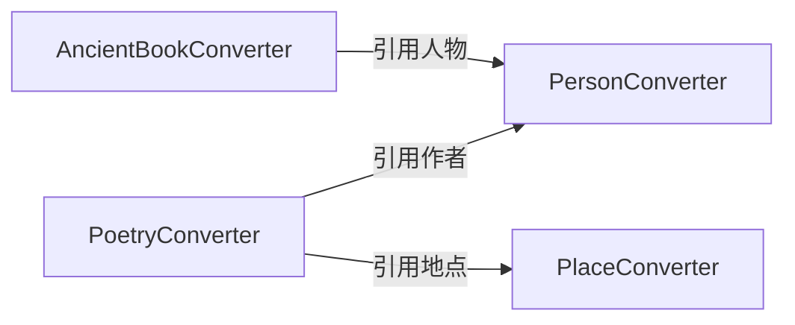

#### 1.3.3 核心转换时序图

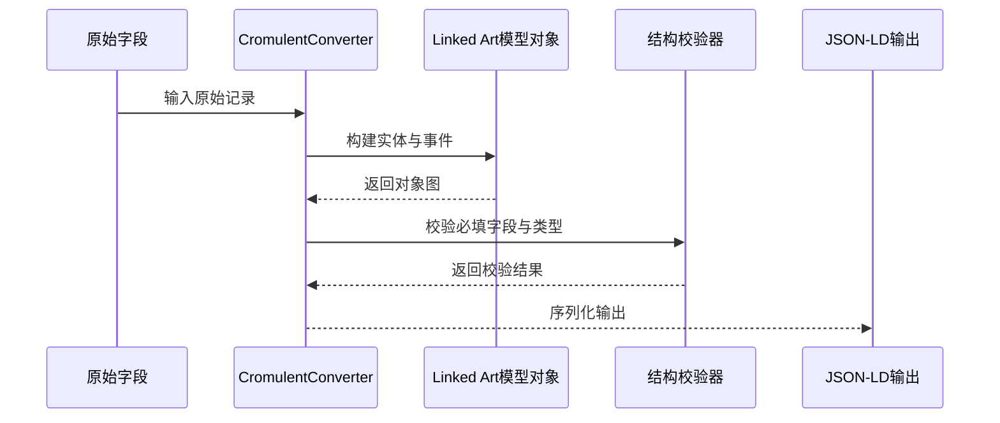

### 1.4 实体建模

#### 1.4.1 Person实体转换

**转换流程图**：

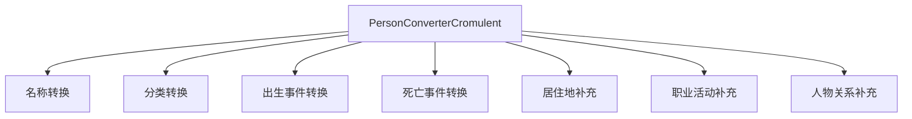

**输出结构视图**：

| 结构层 | 关键字段 | 语义作用 |
|------|---------|---------|
| 顶层元数据 | `@context`, `id`, `type`, `_label` | 声明标准上下文与实体身份 |
| 身份标识 | `identified_by` | 记录主名称与变体名称 |
| 类型分类 | `classified_as` | 映射朝代、性别等类型信息 |
| 生命事件 | `born`, `died` | 通过事件表达生命周期 |
| 时间范围 | `timespan` | 表达精确或模糊时间边界 |

#### 1.4.2 Place实体转换

Place实体支持地名历史变迁的记录，通过`AttributeAssignment`模式关联不同历史时期的名称：

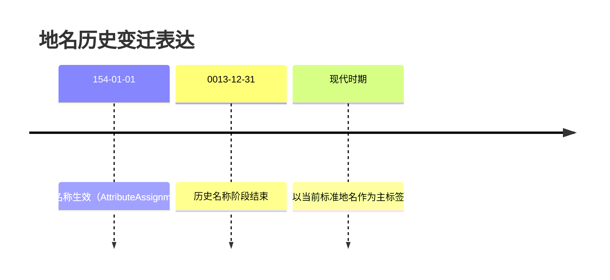

#### 1.4.3 Poetry实体转换

诗文数据采用**Set + LinguisticObject**双层实体表示：

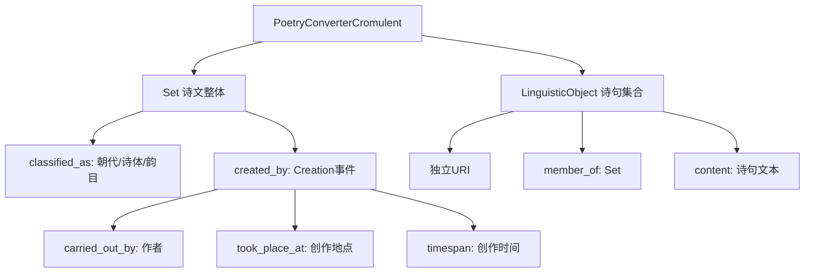

#### 1.4.4 Ancient Book实体转换

古籍数据采用**Set + LinguisticObject + HumanMadeObject**三层结构：

| 层级 | 实体类型 | URI模板 | 说明 |
|------|---------|---------|------|
| 根集合 | Set | `/set/ancient_book/siku` | 四库根分类 |
| 部门集合 | Set | `/set/ancient_book/siku/{dept}` | 经史子集部门 |
| 目录条目 | Set | `/set/ancient_book/siku/{dept}/{id}` | 书名条目 |
| 书籍文本 | LinguisticObject | `/txt/ancient_book/{id}` | 全书文本 |
| 分卷文本 | LinguisticObject | `/txt/ancient_book/{id}/{vol}` | 单卷文本 |
| 实体卷册 | HumanMadeObject | `/object/ancient_book/{id}/{vol}` | 载体对象 |

#### 1.4.5 实体建模时序图

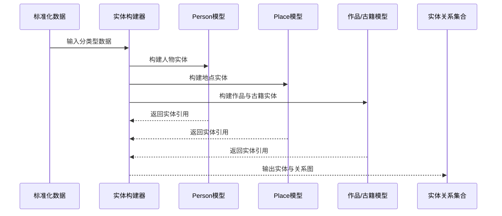

### 1.5 关系建模

#### 1.5.1 时间关联

通过`born`、`died`和`timespan`属性建立时间关联：

| 关系类型 | Linked Art属性 | 示例 |
|---------|---------------|------|
| 出生时间 | `born.timespan` | 杜甫生于712年 |
| 死亡时间 | `died.timespan` | 杜甫卒于770年 |
| 活动时间 | `carried_out.timespan` | 任左拾遗期间 |
| 创作时间 | `created_by.timespan` | 诗作创作年代 |

#### 1.5.2 空间关联

通过`took_place_at`属性建立空间关联：

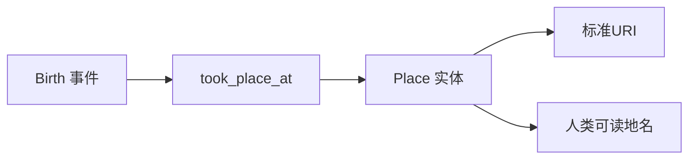

#### 1.5.3 人物关联

通过`AttributeAssignment`模式建立人物间关系：

| 关系类型 | 实现方式 | 示例 |
|---------|---------|------|
| 友谊 | AttributeAssignment | 李白与杜甫 |
| 师承 | AttributeAssignment | 韩愈与柳宗元 |
| 家族 | AttributeAssignment | 苏轼与苏辙 |

#### 1.5.4 关系建模时序图

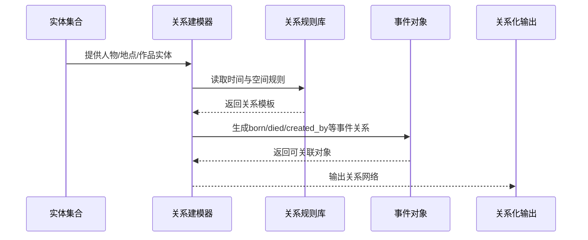

### 1.6 词汇表规范

#### 1.6.1 Getty AAT（概念类型）

用于描述艺术与建筑领域的概念类型：

| AAT概念 | 用于 | 示例 |
|---------|------|------|
| `300404670` | Primary Name | 主要名称 |
| `300404672` | Alternate Name | 别名、表字 |
| `300435422` | Biography Statement | 传记陈述 |
| `300263369` | Occupation | 职业分类 |

#### 1.6.2 Getty ULAN（时期分类）

用于艺术家和历史人物的时期分类：

| ULAN概念 | 表示 |
|---------|------|
| `500373092` | 唐朝 |
| `500373093` | 宋朝 |
| `500373094` | 元朝 |

#### 1.6.3 Getty TGN（地名标准化）

用于地名标准化与古今对照：

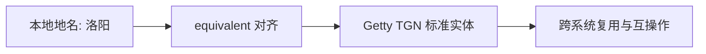

#### 1.6.4 词汇对齐时序图

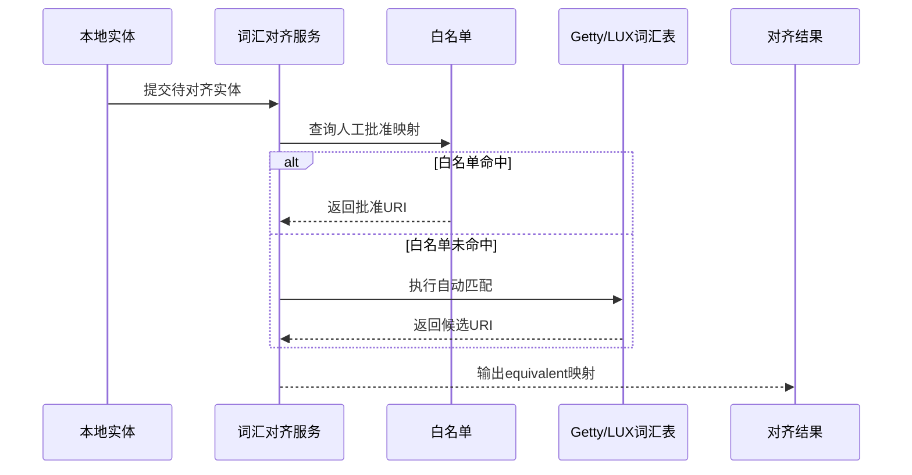

---

## 第二章 知识服务层

知识服务层负责将数据与知识层的结构化实体转化为标准化的知识服务，实现数据的输出、对齐和验证。本章详细阐述JSON-LD输出、外部对齐机制和标准化验证的实现。

### 本章流程总览

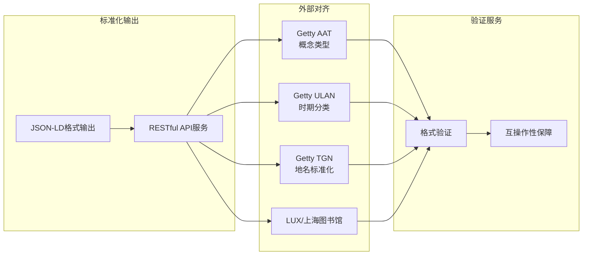

### 2.1 输出层设计

#### 2.1.1 JSON-LD输出格式

系统输出采用JSON-LD（JSON for Linking Data）格式，这是将JSON数据转换为关联数据的W3C标准：

**核心概念**：
- **上下文（@context）**：定义术语到标准URI的映射
- **标识符（id）**：使用HTTP URI作为全球唯一标识
- **类型（type）**：明确声明每个实体的类型
- **链接**：通过URI链接到其他资源

**传统JSON与JSON-LD对比**：

| 特性 | 传统JSON | JSON-LD |
|------|---------|---------|
| 语义表达 | 无 | 有 |
| 全局标识 | 无 | HTTP URI |
| 类型声明 | 隐式 | 显式 |
| 跨系统链接 | 不支持 | 支持 |

#### 2.1.2 输出目录结构

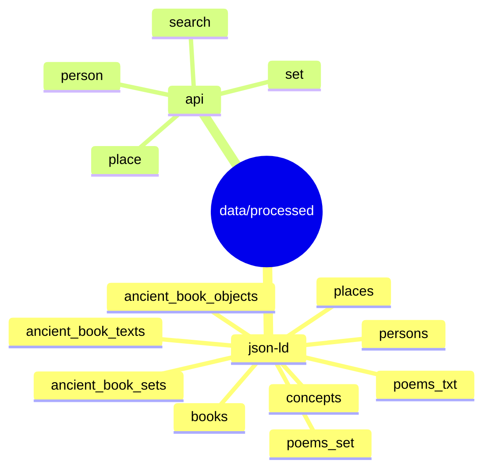

#### 2.1.3 输出层时序图

```mermaid
sequenceDiagram
    participant Producer as 实体转换层
    participant Output as 输出服务
    participant Serializer as JSON-LD序列化器
    participant File as 文件系统
    participant API as REST接口

    Producer->>Output: 提交实体对象
    Output->>Serializer: 序列化为JSON-LD
    Serializer-->>Output: 返回结构化文档
    Output->>File: 写入data/processed目录
    Output->>API: 发布可访问资源
    API-->>Producer: 返回发布状态
```

### 2.2 外部对齐服务

#### 2.2.1 白名单优先模式

对齐过程采用**白名单优先模式**，确保关键实体的对齐质量：

```mermaid
flowchart TB
    START[本地实体] --> CHECK{白名单检查}
    CHECK -->|已批准| APPROVED[添加equivalent]
    CHECK -->|未配置| MATCH[自动匹配]
    MATCH -->|高质量| APPROVED
    MATCH -->|低置信度| REVIEW[待审核]
    REVIEW --> NO_MATCH[仅本地标识]

    style APPROVED fill:#c5e1a5
    style NO_MATCH fill:#ffccbc
```

**白名单配置字段说明**：

| 字段 | 含义 | 作用 |
|------|------|------|
| `local_id` | 本地实体ID | 对齐主键 |
| `local_name` | 本地实体名 | 人工核验参考 |
| `approved_uri` | 批准的外部URI | 对齐目标 |
| `approved_source` | 批准来源 | 审计与可追溯 |

#### 2.2.2 Getty ULAN/TGN对齐

| 对齐客户端 | 目标词汇表 | 对齐实体 | 文件位置 |
|-----------|-----------|---------|---------|
| **ULAN Client** | Getty ULAN | Person | `align_getty_ulan.py` |
| **TGN Client** | Getty TGN | Place | `align_getty_tgn.py` |

#### 2.2.3 LUX Linked Open对齐

LUX Linked Open提供高质量的中文历史数据：

| LUX数据集 | 对齐实体 | 特点 |
|----------|---------|------|
| PeopleGroups | Person | 中国历史人物群组 |
| Locations | Place | 中国历史地点 |

#### 2.2.4 上海图书馆对齐

| 对齐客户端 | 目标词汇表 | 对齐实体 |
|-----------|-----------|---------|
| **上海图书馆 Client** | SHL Persons | Person |

#### 2.2.5 外部对齐时序图

```mermaid
sequenceDiagram
    participant Job as 对齐任务
    participant Align as 对齐客户端
    participant Local as 本地实体库
    participant External as 外部词汇服务
    participant Review as 审核队列

    Job->>Align: 启动批量对齐
    Align->>Local: 读取待对齐实体
    Local-->>Align: 返回实体批次
    Align->>External: 查询候选标准实体
    External-->>Align: 返回候选与置信度
    Align->>Review: 低置信度入审核队列
    Align-->>Job: 输出最终对齐结果
```

### 2.3 标准化输出与验证

#### 2.3.1 必填字段验证

所有JSON-LD输出必须包含以下必填字段：

| 字段 | 说明 | 示例 |
|------|------|------|
| `@context` | JSON-LD 上下文 | `https://linked.art/ns/v1/linked-art.json` |
| `id` | 实体 URI | `https://api.heluo.site/person/15188` |
| `type` | 实体类型 | `Person`, `Place`, `Set` |
| `_label` | 人类可读标签 | `"李白"` |

#### 2.3.2 JSON-LD格式验证

使用在线验证工具和本地验证器进行格式验证：

```mermaid
flowchart LR
    Input[JSON-LD输出文件] --> Validator[JsonLdValidator]
    Validator --> Check{是否通过}
    Check -->|是| Pass[进入发布流程]
    Check -->|否| Error[输出错误清单]
    Error --> Fix[修复后重新验证]
    Fix --> Validator
```

#### 2.3.3 标准化验证时序图

```mermaid
sequenceDiagram
    participant Pipeline as 发布流程
    participant Checker as 字段校验器
    participant Validator as JSON-LD验证器
    participant Report as 错误报告
    participant Publish as 发布步骤

    Pipeline->>Checker: 校验必填字段
    Checker-->>Pipeline: 返回字段结果
    Pipeline->>Validator: 校验JSON-LD规范
    Validator-->>Pipeline: 返回格式结果
    alt 校验通过
        Pipeline->>Publish: 执行发布
        Publish-->>Pipeline: 发布成功
    else 校验失败
        Pipeline->>Report: 生成错误清单
        Report-->>Pipeline: 返回修复建议
    end
```

### 2.4 互操作性实现

#### 2.4.1 与全球文化遗产数据互联

采用Linked Art数据模型实现与全球文化遗产机构的互联：

```mermaid
graph TD
    A[中国历史人物数据] --> B[Linked Art模型]
    C[欧美博物馆数据] --> B
    D[日本文化遗产数据] --> B
    E[澳大利亚艺术数据] --> B

    B --> F[全球文化遗产数据网络]
```

#### 2.4.2 关联数据原则遵循

系统遵循关联数据的四项原则：

1. **使用URI作为事物的名称**
2. **使用HTTP URI，使人们可以查找这些名称**
3. **当有人查找URI时，提供有用的信息（使用标准格式）**
4. **包含指向其他URI的链接，使人们可以发现更多事物**

#### 2.4.3 互操作访问时序图

```mermaid
sequenceDiagram
    participant Client as 外部系统
    participant API as Heluo API
    participant Resolver as URI解析器
    participant Data as JSON-LD资源
    participant Link as 关联资源

    Client->>API: 请求实体URI
    API->>Resolver: 解析URI到内部资源
    Resolver-->>API: 返回资源定位
    API->>Data: 读取实体JSON-LD
    Data-->>API: 返回实体数据
    API->>Link: 加载关联URI资源
    Link-->>API: 返回关联实体
    API-->>Client: 返回可互操作数据
```

---

## 第三章 知识交互层

知识交互层是系统的顶层，负责向用户提供知识发现、探索和使用的界面与服务。本章详细阐述系统整体架构、前端设计、后端设计、搜索服务和融合问答服务的实现。

### 本章流程总览

```mermaid
flowchart LR
    subgraph 用户界面["用户界面"]
        A1["页面展示与交互"]
    end

    subgraph 服务网关["服务网关"]
        B1["请求路由"]
        B2["业务编排"]
    end

    subgraph 智能服务["智能服务"]
        C1["关键词搜索"]
        C2["向量语义搜索"]
        C3["RAG融合问答"]
    end

    subgraph 可视化["可视化"]
        D2["足迹地图"]
        D3["时间线"]
    end

    A1 --> B1
    B1 --> B2
    B2 --> C1
    B2 --> C2
    B2 --> C3
    C3 --> D2
    C3 --> D3
```

### 3.1 系统整体架构

#### 3.1.1 技术栈总览

| 层级 | 技术选型 | 说明 |
|------|---------|------|
| **前端服务** | React + Vite | 单页应用，组件化开发 |
| **后端API** | Express (Node.js) | RESTful API服务 |
| **Python微服务** | FastAPI | Embedding生成 + LLM调用 |
| **数据存储** | MarkLogic | 多模型数据库，支持向量检索 |

#### 3.1.2 系统架构图

```mermaid
flowchart TB
    subgraph FRONTEND["前端服务"]
        UI["React + Vite<br/>用户界面"]
    end

    subgraph BACKEND["后端API"]
        EXPRESS["Express API<br/>RESTful服务"]
    end

    subgraph PYTHON["Python微服务"]
        EMBED["Embedding服务<br/>向量生成"]
        LLM["LLM服务<br/>融合问答"]
    end

    subgraph DATABASE["数据存储"]
        ML["MarkLogic<br/>JSON-LD + 向量"]
    end

    UI -->|HTTP请求| EXPRESS
    EXPRESS -->|查询| ML
    EXPRESS -->|嵌入请求| EMBED
    EXPRESS -->|问答请求| LLM
    EMBED -->|向量存储| ML
    LLM -->|上下文检索| ML
```

#### 3.1.3 系统整体时序图

```mermaid
sequenceDiagram
    participant User as 用户
    participant FE as 前端应用
    participant BE as 后端API
    participant EMB as Embedding服务
    participant LLM as LLM服务
    participant DB as MarkLogic

    User->>FE: 发起检索/问答请求
    FE->>BE: 发送统一API请求
    BE->>DB: 执行关键词检索
    BE->>EMB: 生成查询向量
    EMB-->>BE: 返回向量结果
    BE->>DB: 执行向量检索
    BE->>LLM: 请求融合生成
    LLM-->>BE: 返回答案与上下文
    BE-->>FE: 返回结果
    FE-->>User: 渲染页面与答案
```

### 3.2 前端架构设计

#### 3.2.1 分层架构

前端采用**Pages → Hooks → API**三层架构：

| 层级 | 职责 | 说明 |
|------|------|------|
| **Pages** | 页面组件 | 路由与布局 |
| **Hooks** | 业务逻辑 | 状态管理与数据获取 |
| **API** | 接口调用 | HTTP请求封装 |

#### 3.2.2 功能模块化

采用**Feature-Based**模块化设计，每个功能模块包含独立的组件、状态和API：

- **人物模块**：人物详情、人物列表、人物关系
- **诗文模块**：诗文详情、诗文检索、诗文展示
- **古籍模块**：古籍详情、IIIF阅读器（详见 3.7 节 IIIF 图像服务）
- **搜索模块**：关键词搜索、语义搜索

#### 3.2.3 外观模式

通过**v1Api Facade**统一封装API调用，简化前端与后端的交互：

```mermaid
flowchart TB
    UI[页面与Hooks] --> Facade[v1Api Facade]
    Facade --> PersonAPI[person.get / person.search]
    Facade --> PlaceAPI[place.get]
    Facade --> PoemAPI[poems.get]
    PersonAPI --> Backend[统一后端入口]
    PlaceAPI --> Backend
    PoemAPI --> Backend
```

#### 3.2.4 路由分发模式

通过**DetailsRouter**实现详情页的统一路由分发：

```mermaid
flowchart LR
    Route[详情路由入口] --> P[/person/:id]
    Route --> L[/place/:id]
    Route --> W[/set/poems/:id]
    P --> PView[PersonDetail]
    L --> LView[PlaceDetail]
    W --> WView[PoemDetail]
```

#### 3.2.5 前端模块时序图

```mermaid
sequenceDiagram
    participant User as 用户
    participant UI as 页面组件
    participant Hook as 业务Hooks
    participant Facade as v1Api Facade
    participant API as 后端API

    User->>UI: 输入关键词并触发查询
    UI->>Hook: 调用查询动作
    Hook->>Facade: search(scope,q)
    Facade->>API: GET /v1/search
    API-->>Facade: 返回结构化结果
    Facade-->>Hook: 归一化数据
    Hook-->>UI: 更新状态
    UI-->>User: 渲染结果列表
```

### 3.3 后端架构设计

#### 3.3.1 分层架构

后端采用**控制器-用例-领域-基础设施**四层架构：

```mermaid
flowchart TB
    subgraph CONTROLLER["控制器层"]
        CTRL["Route Handlers<br/>请求处理"]
    end

    subgraph USECASE["用例层"]
        UC["Business Logic<br/>业务逻辑"]
    end

    subgraph DOMAIN["领域层"]
        RETRIEVE["检索领域"]
        FUSION["融合领域"]
        DETAIL["详情领域"]
        FOOTPRINT["足迹领域"]
    end

    subgraph INFRA["基础设施层"]
        GATEWAY["Gateway<br/>外部服务网关"]
        SEARCHER["Searcher<br/>检索器"]
        CACHE["Cache<br/>缓存"]
    end

    CTRL --> UC
    UC --> DOMAIN
    DOMAIN --> INFRA
```

#### 3.3.2 各层职责

| 层级 | 职责 | 示例组件 |
|------|------|---------|
| **控制器层** | 请求处理、参数验证 | Route Handlers |
| **用例层** | 业务逻辑编排 | SearchUseCase, DetailUseCase |
| **领域层** | 核心业务规则 | RetrieveDomain, FusionDomain |
| **基础设施层** | 外部资源访问 | MarkLogicGateway, CacheService |

#### 3.3.3 后端模块时序图

```mermaid
sequenceDiagram
    participant Client as 前端客户端
    participant Route as 路由层
    participant Controller as 控制器层
    participant UseCase as 用例层
    participant Domain as 领域层
    participant Infra as 基础设施层
    participant DB as MarkLogic

    Client->>Route: GET /v1/search
    Route->>Controller: 转发请求
    Controller->>UseCase: 执行业务编排
    UseCase->>Domain: 调用检索规则
    Domain->>Infra: 请求网关查询
    Infra->>DB: 执行检索
    DB-->>Infra: 返回原始结果
    Infra-->>Domain: 返回数据
    Domain-->>UseCase: 返回领域结果
    UseCase-->>Controller: 返回响应DTO
    Controller-->>Client: 返回JSON结果
```

### 3.4 搜索服务

#### 3.4.1 关键词搜索

基于MarkLogic的全文检索能力，支持：
- 中英文混合搜索
- 繁简体兼容
- 模糊匹配

**API调用结构图**：

```mermaid
flowchart LR
    Req[GET /v1/search] --> P1[format=json]
    Req --> P2[directory=/processed/entities/person/]
    Req --> P3[q=杜甫]
    P1 --> Engine[检索引擎]
    P2 --> Engine
    P3 --> Engine
```

#### 3.4.2 向量语义搜索

基于Embedding的语义检索，实现语义级别的相似度匹配：

```mermaid
flowchart LR
    Q[用户查询] --> EMBED[Embedding生成]
    EMBED --> VECTOR[向量表示]
    VECTOR --> SEARCH[向量检索]
    SEARCH --> RESULT[相似文档]
```

**向量检索流程**：
1. 用户输入查询文本
2. Embedding服务生成查询向量
3. MarkLogic执行向量相似度搜索
4. 返回语义最相关的结果

#### 3.4.3 混合检索

结合关键词搜索和向量语义搜索的优势：

| 搜索方式 | 优势 | 劣势 |
|---------|------|------|
| 关键词搜索 | 精确匹配、响应快 | 语义理解有限 |
| 向量搜索 | 语义理解强 | 计算开销大 |
| **混合检索** | 兼顾精确与语义 | 实现复杂 |

#### 3.4.4 搜索模块时序图

```mermaid
sequenceDiagram
    participant User as 用户
    participant FE as 前端搜索页
    participant SearchAPI as /v1/search
    participant Keyword as 关键词检索器
    participant Vector as 向量检索器
    participant Fusion as 结果融合器

    User->>FE: 提交查询词
    FE->>SearchAPI: 发起搜索请求
    par 关键词通道
        SearchAPI->>Keyword: 执行全文检索
        Keyword-->>SearchAPI: 返回候选结果
    and 语义通道
        SearchAPI->>Vector: 执行向量检索
        Vector-->>SearchAPI: 返回候选结果
    end
    SearchAPI->>Fusion: 合并并重排结果
    Fusion-->>SearchAPI: 返回最终列表
    SearchAPI-->>FE: 响应结果
    FE-->>User: 展示检索结果
```

### 3.5 融合问答服务

#### 3.5.1 LLM集成

系统集成本地部署的大语言模型（如DeepSeek），提供自然语言问答能力：

```mermaid
flowchart TD
    Q[用户问题] --> RAG[RAGEngine.query]
    RAG --> VR[VectorRetriever.search_with_context]
    VR --> EG[EmbeddingGenerator.generate_embedding]
    VR --> VC[VectorClient.vector_search]
    VC --> ML[(MarkLogic 文档库)]
    VR --> CTX[构建上下文]

    CTX -->|use_llm| LLM[DeepSeek API]
    CTX -->|no llm| SIMPLE[简化回答]
    LLM --> A[答案]
    SIMPLE --> A
```

#### 3.5.2 RAG架构

采用检索增强生成（Retrieval-Augmented Generation）架构：

| 组件 | 职责 |
|------|------|
| **VectorRetriever** | 向量检索与上下文构建 |
| **RAGEngine** | 检索结果融合与答案生成 |

#### 3.5.3 流式响应

支持Server-Sent Events（SSE）实现流式响应，提升用户体验：

```mermaid
sequenceDiagram
    participant Client as 前端客户端
    participant SSE as /v1/rag/stream
    participant RAG as RAG服务

    Client->>SSE: 发起流式请求(q=杜甫的生平)
    SSE->>RAG: 构建上下文并生成答案
    RAG-->>SSE: start/context/token/end 事件流
    SSE-->>Client: 按事件持续推送
```

#### 3.5.4 融合问答模块时序图

```mermaid
sequenceDiagram
    participant User as 用户
    participant FE as 前端问答页
    participant API as /v1/fusion/query
    participant Retriever as 检索器
    participant Rerank as 融合重排
    participant LLM as 大模型服务

    User->>FE: 提交自然语言问题
    FE->>API: 发起问答请求
    API->>Retriever: 获取关键词/向量候选
    Retriever-->>API: 返回候选上下文
    API->>Rerank: 融合并重排上下文
    Rerank-->>API: 返回高质量上下文
    API->>LLM: 生成回答
    LLM-->>API: 返回答案与证据
    API-->>FE: 返回问答结果
    FE-->>User: 展示回答
```

### 3.6 数据可视化

#### 3.6.1 足迹地图

基于GIS技术展示历史人物的活动轨迹：

- 出生地标注
- 活动轨迹线
- 作品创作地点

#### 3.6.2 时间线

展示历史人物的生平事件时间线：

- 出生、死亡事件
- 重要活动事件
- 作品创作时间

#### 3.6.3 可视化模块时序图

```mermaid
sequenceDiagram
    participant User as 用户
    participant View as 可视化页面
    participant DetailAPI as 详情接口
    participant Transform as 可视化数据转换
    participant Chart as 地图/时间线组件

    User->>View: 打开人物详情页
    View->>DetailAPI: 请求人物与事件数据
    DetailAPI-->>View: 返回结构化数据
    View->>Transform: 提取地点与时间信息
    Transform-->>Chart: 输出坐标点与事件序列
    Chart-->>User: 渲染足迹地图与时间线
```

### 3.7 IIIF 图像服务

IIIF（International Image Interoperability Framework，国际图像互操作框架）是一套开放标准，用于提供高质量图像的互操作访问。本系统采用 IIIF 技术实现古籍图像的深度阅读与跨平台共享。

#### 3.7.1 技术栈概述

| 组件 | 技术 | 版本 | 说明 |
|------|------|------|------|
| **图像服务器** | Cantaloupe | 5.x | IIIF Image API 3.0 兼容 |
| **图像查看器** | Mirador | 4.0.0 | IIIF Presentation API 3.0 兼容 |
| **前端组件** | IIIFSection | React | 内嵌/跳转双模式 |
| **后端服务** | iiifRoutes | Express | 卷首导航 API |
| **Manifest 解析** | iiifExtractor | Node.js | 卷次匹配与元数据提取 |

#### 3.7.2 架构设计

```mermaid
flowchart TB
    subgraph 前端["前端展示层"]
        A1["IIIFSection<br/>详情页组件"]
        A2["IiifPage<br/>独立阅读页面"]
    end

    subgraph 后端["后端服务层"]
        B1["iiifRoutes<br/>卷首 API"]
        B2["iiifExtractor<br/>Manifest 解析"]
    end

    subgraph 图像服务["IIIF 服务层"]
        C1["Cantaloupe<br/>图像服务器"]
        C2["Mirador<br/>查看器"]
    end

    subgraph 数据["数据源"]
        D1["古籍图像文件"]
        D2["IIIF Manifest"]
    end

    A1 --> B1
    A2 --> B1
    B1 --> B2
    B2 --> D2
    D1 --> C1
    D2 --> C2
    A1 --> C2
    A2 --> C2
```

#### 3.7.3 卷次导航服务

系统提供古籍卷次导航功能，通过解析 IIIF Manifest 自动识别各卷卷首：

**卷标签匹配模式**：

```mermaid
flowchart LR
    A["Canvas Label"] --> B{匹配正则}
    B -->|"卷[〇零一二三四五六七八九十百千万两壹贰叁肆伍陆柒捌玖拾佰仟0-9]+"| C["识别为卷首"]
    B -->|其他| D["普通页面"]
    C --> E["提取 volumeLabel"]
    C --> F["记录 canvasId"]
    C --> G["记录 pageIndex"]
```

**卷次导航数据结构**：

| 字段 | 类型 | 说明 |
|------|------|------|
| `volumeLabel` | string | 卷标签（如"卷一"） |
| `canvasId` | string | Canvas URI |
| `canvasLabel` | string | 完整页面标签 |
| `pageIndex` | number | 页面索引（从1开始） |

#### 3.7.4 前端组件设计

IIIFSection 组件支持两种展示模式：

```mermaid
flowchart TB
    A["IIIFSection"] --> B{embedded?}
    B -->|true| C["内嵌模式"]
    B -->|false| D["跳转模式"]

    C --> C1["iframe 嵌入 Mirador"]
    C --> C2["卷次定位按钮"]
    C --> C3["全屏切换"]
    C --> C4["新窗口打开链接"]

    D --> D1["跳转至 Mirador 链接"]
    D --> D2["显示 Manifest 数量"]
```

**组件属性表**：

| 属性 | 类型 | 默认值 | 说明 |
|------|------|--------|------|
| `manifests` | string[] | - | IIIF Manifest URL 列表 |
| `embedded` | boolean | false | 是否内嵌显示 |
| `autoLoadEmbedded` | boolean | false | 内嵌模式自动加载 |
| `showVolumeHeadNavigator` | boolean | false | 显示卷次定位 |
| `height` | string | '400px' | 内嵌高度 |

#### 3.7.5 API 端点

| 端点 | 方法 | 说明 |
|------|------|------|
| `/api/v1/iiif/volume-heads` | GET | 获取卷首 Canvas 列表 |

**请求参数**：

| 参数 | 类型 | 必填 | 说明 |
|------|------|------|------|
| `manifest` | string | 是 | IIIF Manifest URL |

**响应结构**：

```json
{
  "success": true,
  "data": {
    "volumeHeads": [
      {
        "volumeLabel": "卷一",
        "canvasId": "/iiif/canvases/12345/1",
        "canvasLabel": "卷一 序",
        "pageIndex": 1
      }
    ]
  }
}
```

#### 3.7.6 多语言支持

IIIF Presentation API 3.0 支持多语言标签，系统按以下优先级提取文本：

| 优先级 | 语言代码 | 说明 |
|--------|----------|------|
| 1 | `zh-Hans` | 简体中文（最高优先） |
| 2 | `zh` | 中文通用 |
| 3 | `none` | 无语言标记 |
| 4 | `en` | 英文 |

#### 3.7.7 IIIF 服务时序图

```mermaid
sequenceDiagram
    participant User as 用户
    participant Section as IIIFSection
    participant API as /api/v1/iiif/volume-heads
    participant Extractor as iiifExtractor
    participant Cantaloupe as Cantaloupe
    participant Mirador as Mirador 查看器

    User->>Section: 打开古籍详情页
    Section->>Section: 判断展示模式

    alt 内嵌模式
        Section->>Section: 显示加载按钮
        User->>Section: 点击加载
        Section->>Mirador: iframe 加载 Mirador
        Mirador->>Cantaloupe: 请求图像
        Cantaloupe-->>Mirador: 返回图像

        opt 卷次定位
            Section->>API: 请求 volume-heads
            API->>Extractor: 解析 Manifest
            Extractor-->>API: 返回卷首列表
            API-->>Section: 卷次按钮数据
            Section-->>User: 显示卷次导航
        end

    else 跳转模式
        Section->>Section: 构建 Mirador URL
        Section-->>User: 显示跳转链接
    end
```

---

## 附录

### A. 术语表

| 术语 | 定义 |
|------|------|
| **CIDOC-CRM** | 国际博物馆理事会概念参考模型，文化遗产领域的核心本体 |
| **Linked Art** | 基于CIDOC-CRM的艺术与文化遗产数据交换标准 |
| **JSON-LD** | JSON for Linking Data，将JSON转换为关联数据的W3C标准 |
| **关联数据** | 一种通过HTTP URI连接分布式数据的方法 |
| **URI** | 统一资源标识符，用于唯一标识网络资源 |
| **AAT** | Getty艺术与建筑术语表 |
| **ULAN** | Getty艺术家联合名录 |
| **TGN** | Getty地理名称词汇表 |
| **语义互操作性** | 不同系统之间能够理解和使用彼此数据的能力 |
| **Cromulent** | Linked Art数据模型的官方Python实现库 |
| **RAG** | Retrieval-Augmented Generation，检索增强生成 |
| **Embedding** | 向量嵌入，将文本转化为向量表示 |
| **IIIF** | International Image Interoperability Framework，国际图像互操作框架，提供图像资源的标准化访问与互操作 |
| **Manifest** | IIIF Presentation API 核心文档，描述数字对象的元数据、结构和呈现方式 |
| **Canvas** | IIIF 虚拟画布，代表 Manifest 中的一个展示单元，可承载图像等资源 |
| **Cantaloupe** | 开源 IIIF Image API 3.0 兼容图像服务器，支持动态图像处理与分发 |
| **Mirador** | 开源 IIIF 兼容图像查看器，支持多窗口、标注和插件扩展 |

### B. 参考资料

#### 官方文档

1. **Linked Art Data Model** - https://linked.art/
2. **CIDOC-CRM官方规范** - https://cidoc-crm.org/
3. **Cromulent库文档** - https://github.com/linked-art/cromulent
4. **Getty词汇表** - https://vocab.getty.edu/
5. **LUX Linked Open** - https://lux.mappings.tools/

#### 项目内部文档

1. `docs/数据模型/河洛历史名人的API设计规范.md` - API端点详细规范
2. `docs/best_practices/cromulent_library_best_practices.md` - Cromulent库最佳实践
3. `docs/河洛历史名人数据转换方法论与流程规范.md` - 数据转换方法论

### C. 技术栈总览

| 类别 | 技术 | 版本 | 用途 |
|------|------|------|------|
| **前端框架** | React | 18.x | 用户界面 |
| **前端构建** | Vite | 5.x | 开发与构建 |
| **后端框架** | Express | 4.x | RESTful API |
| **Python框架** | FastAPI | 0.100+ | 微服务 |
| **数据库** | MarkLogic | 11.x | 多模型存储 |
| **向量模型** | text-embedding | - | 向量生成 |
| **LLM** | DeepSeek | - | 问答生成 |

---

## 文档维护说明

**文档版本**: v1.0
**最后更新**: 2026-03-02
**维护者**: Heluo Historical Figures Project Team

**生成说明**：本文档基于以下源文档重组生成：
- `docs/河洛历史名人数据转换方法论与流程规范.md`
- `docs/数据模型/河洛历史名人的API设计规范.md`
- `docs/grag/grag_mvp_overview.md`
- `docs/frontend/heluo_frontend_mvp_pdd_2026-02-08.md`
