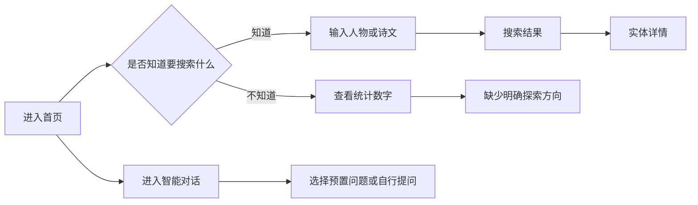
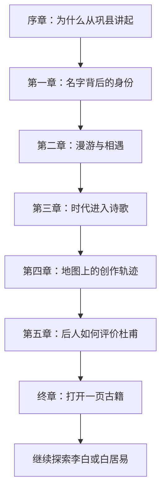

# 河洛历史名人专题策划方案

## 1. 策划结论

网站当前不缺实体数量，缺少的是把人物、诗文、地点、关系与古籍组织成连续体验的“叙事入口”。

首期不同时建设多个专题栏目，只完成一个可复用专题模板，并用杜甫资料验证模板。首发专题建议为：

> **杜甫：从巩县出发的诗史人生**

核心问题：一个出生在河洛的人，如何在时代动荡与漫游中成为“诗圣”？

首期目标不是编写一篇更长的人物百科，而是让访客沿着“地点—时间—诗文—人物—原始文献”的证据链完成一次 5～8 分钟的探索。

## 2. 当前体验判断

### 2.1 当前用户路径



### 2.2 主要断点

1. 首页依赖搜索和统计，要求用户预先知道人物或作品名称。
2. 全局导航没有提供“专题”“地图”“人物关系”等探索入口。
3. 搜索空结果无法区分“确实没有内容”和“数据服务没有连接”。
4. 详情页能力丰富，但人物轨迹、推荐资源、AI 解读和原始来源彼此分散。
5. AI 对话提供工具能力，却没有替代编辑策划；用户仍需要先知道应该问什么。

## 3. 数据可行性

本次策划使用当前本地文件做只读统计，未将 AI 生成内容作为史实依据。

| 人物 | 传记来源 | 作品数 | 带地点作品 | 带时间作品 | 古籍相关文件 | 首期判断 |
| --- | ---: | ---: | ---: | ---: | ---: | --- |
| 杜甫 | 46 | 1289 | 1270 | 1271 | 2719 | 首发，数据链最完整 |
| 白居易 | 72 | 35 | 26 | 26 | 87 | 第二期，适合洛阳生活专题 |
| 李白 | 91 | 32 | 31 | 31 | 52 | 适合作为杜甫专题关系人物 |
| 欧阳修 | 待复核 | 26 | 19 | 19 | 236 | 适合龙门游历专题 |
| 司马光 | 4 | 21 | 0 | 0 | 288 | 文献丰富，但时空数据需补齐 |
| 苏轼 | 待复核 | 158 | 146 | 146 | 167 | 数据较完整，但河洛主题边界需复核 |

### 3.1 为什么选择杜甫

- 出生地资料明确指向河南巩县，可自然建立河洛入口。
- 作品的时间和地点字段覆盖率高，适合直接复用现有轨迹地图。
- 传记来源多，可展示“不同文献如何描述同一个人”。
- 古籍文件数量显著高于其他人物，适合延伸到 IIIF 原图和版本阅读。
- 李白、元稹等人物可以作为关系节点，形成后续专题之间的连接。

## 4. 首发专题设计

### 4.1 专题标题

主标题：**杜甫：从巩县出发的诗史人生**

副标题：**沿着地点、诗歌与文献，重走一个河洛诗人的时代旅程**

### 4.2 叙事结构



### 4.3 各章节内容

#### 序章：为什么从巩县讲起

- 用一张河洛区域地图标出河南巩县。
- 只用 80～120 字回答“杜甫与河洛有什么关系”。
- 提供“开始旅程”按钮，不先铺陈完整生平。

#### 第一章：名字背后的身份

- 展示杜甫、子美、少陵野老、杜工部、诗圣等名称。
- 每个名称配一句来源解释。
- 把现有名称字段转换成可点击的小卡片，避免长元数据列表。

#### 第二章：漫游与相遇

- 选择 3～5 个关键地点，不展示全部轨迹点。
- 李白作为首个关系人物出现。
- 每个地点只回答三件事：何时到达、遇见谁、留下什么作品。

#### 第三章：时代进入诗歌

- 从作品中选择 3 首代表不同阶段的诗文。
- 采用“原文节选—发生了什么—证据来源”的三层结构。
- AI 赏析只能作为辅助解释，并明确标记为“AI 辅助解读”。

#### 第四章：地图上的创作轨迹

- 复用人物诗文轨迹地图与时间播放能力。
- 默认只播放策划选中的关键年份。
- 允许用户切换到“查看全部作品”，但不把全部数据作为默认视图。

#### 第五章：后人如何评价杜甫

- 并列展示不同文献中的评价，例如“诗史”“集大成”等主题。
- 每条评价必须指向具体传记来源或古籍来源。
- 不把不同来源合并成一段无出处的 AI 总结。

#### 终章：打开一页古籍

- 选择 1～3 个视觉质量可靠的古籍页面。
- 使用 IIIF 查看原图，并提供“看原图”“看释文”“看出处”三个动作。
- 不使用与河洛主题无关的默认外部样例 Manifest。

## 5. 页面模块

| 模块 | 默认内容 | 复用能力 | 新增工作 |
| --- | --- | --- | --- |
| 专题 Hero | 标题、副标题、河洛关系、开始旅程 | 现有经典学术视觉 | 专题封面与入口组件 |
| 章节导航 | 7 个章节、阅读进度 | 面包屑 | 专题目录与锚点 |
| 人物名片 | 名称、年代、出生地 | 人物详情解析 | 策划字段筛选 |
| 叙事地图 | 关键年份和地点 | 人物诗文轨迹 | 策划点位配置 |
| 诗文卡片 | 原文、背景、地点、来源 | 诗文详情、AI 赏析 | 专题短文案 |
| 关系人物 | 李白等人物连接 | 内部关系、推荐资源 | 人工排序与说明 |
| 文献证据 | 传记来源、古籍页面 | Biography、IIIF | 来源选择与引用格式 |
| 继续探索 | 下一人物或下一专题 | 详情路由 | 专题间关系配置 |

## 6. 专题配置模型

专题内容应以配置驱动，不把每个专题写成一套新页面。

```text
Topic
├── slug
├── title
├── subtitle
├── heroImage
├── thesis
├── chapters[]
│   ├── title
│   ├── narrative
│   ├── entityUris[]
│   ├── poemUris[]
│   ├── mapPoints[]
│   ├── sourceUris[]
│   └── iiifCanvases[]
└── nextTopics[]
```

原则：配置只引用已有实体 URI，专题短文案单独维护；人物、诗文和古籍详情仍以原数据为唯一事实源。

## 7. 后续专题队列

### P1：白居易的洛阳晚年

核心问题：白居易为何选择洛阳，又如何在这里重新定义晚年生活？

可串联：白居易、元稹、刘禹锡、洛阳地点、唱和诗、古籍。

### P1：李杜相逢

核心问题：李白与杜甫的相遇为何成为文学史上的著名瞬间？

可串联：人物关系、同游地点、互赠诗文、后世评价。

### P2：龙门的一次文学旅行

核心问题：龙门为什么不断出现在文人的旅行与创作中？

可串联：欧阳修、白居易、龙门地点、游记和诗文。

### P2：洛阳的北宋朋友圈

核心问题：司马光、程颢、程颐等人如何在洛阳形成思想与交游网络？

发布前置：补齐司马光作品的地点与时间字段，复核二程人物资料。

### P3：一页古籍如何讲述一个人

核心问题：同一个历史人物在不同版本、传记和评论中如何变化？

可串联：IIIF、人物传记来源、版本对照、原文与释文。

## 8. 首页接入方式

首页新增一个“从这里开始探索”区块，放在 Hero 搜索框之后、典藏数字之前。

首期只展示三张卡：

1. 主卡：杜甫——从巩县出发的诗史人生。
2. 次卡：白居易——洛阳晚年生活。
3. 次卡：随机探索一个河洛人物。

全局导航增加：`专题`、`人物`、`地图`、`智能对话`。其中只有已完成的入口可点击，避免先制造空栏目。

## 9. 内容与可信度规范

1. 每个专题必须有一个明确问题，不能只是人物资料拼盘。
2. 每个关键叙述至少关联一个本地来源 URI。
3. AI 生成内容必须标注，不得伪装成原始史料。
4. 有争议的时间、地点和人物关系应并列展示来源差异。
5. 地图点位没有可靠来源时不展示精确坐标。
6. 原文节选不超过支持阅读所需长度，并保留出处信息。
7. “服务不可用”和“没有检索结果”使用不同空状态。

## 10. MVP 范围

### 必须完成

- 一个 `/topics/dufu-from-gongxian` 专题路由。
- 首页一张真实专题入口卡。
- 5～7 个章节和阅读进度。
- 3～5 个策划地图节点。
- 3 首诗文卡片。
- 至少 6 个可回读的文献来源。
- 至少 1 个可正常打开的 IIIF 页面。
- 移动端可阅读，键盘可完成章节导航。

### 暂不实施

- 3D 地图。
- 用户账号、收藏和评论。
- 大规模自动生成专题。
- 复杂知识图谱可视化。
- 同时上线五个半成品专题。

## 11. 验收标准

| 维度 | 标准 |
| --- | --- |
| 首次理解 | 新访客 10 秒内知道专题讲什么、从哪里开始 |
| 连续阅读 | 从 Hero 到终章存在清晰的下一步动作 |
| 证据 | 关键叙述均可回到人物、诗文或古籍来源 |
| 地图 | 每个策划点位有时间、地点、作品或事件依据 |
| 空状态 | 服务异常不会显示为“命中 0 条” |
| 可访问性 | 标题层级、键盘导航、焦点状态和图片替代文字完整 |
| 性能 | 首屏不等待地图、AI 或 IIIF 资源即可阅读 |

## 12. 建议执行顺序


先保证“即使地图、AI、IIIF 暂时失败，专题正文仍然可读”，再叠加互动能力。
