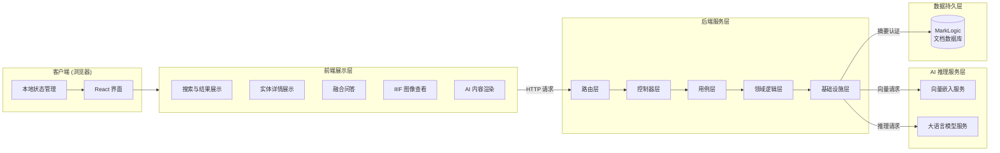
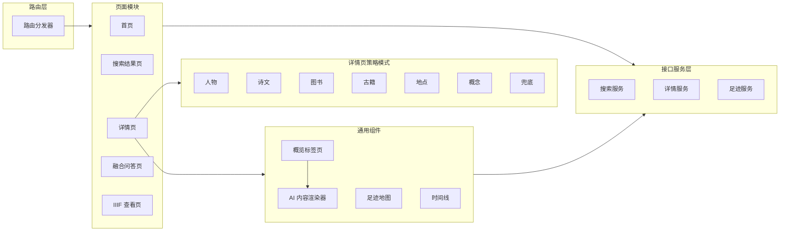
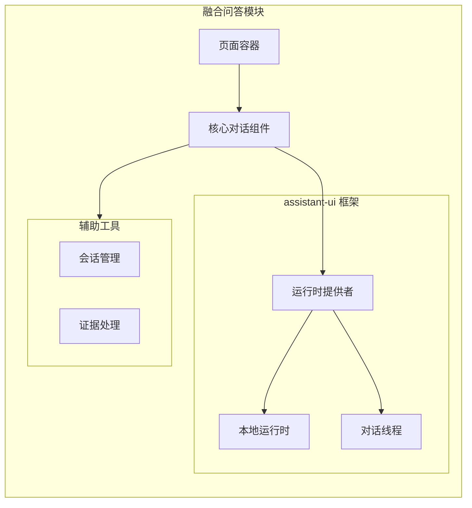
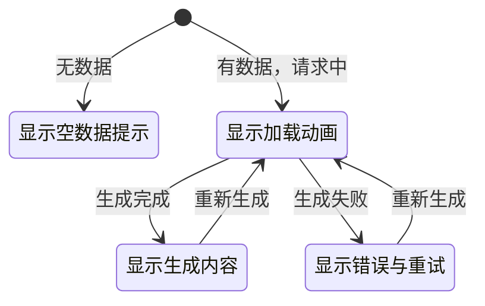
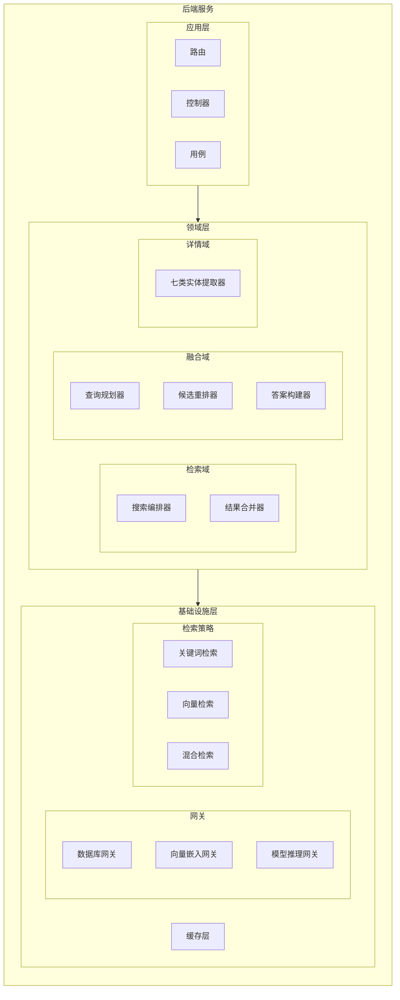
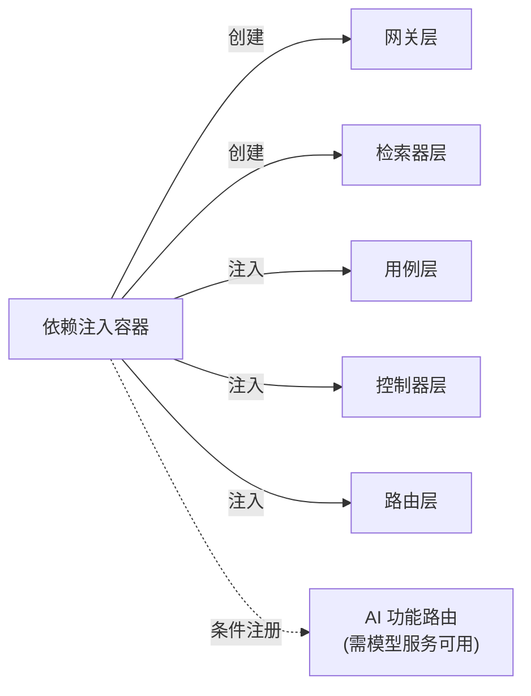
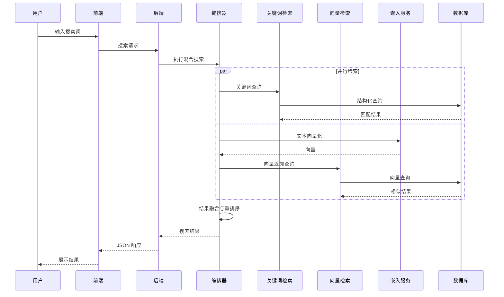
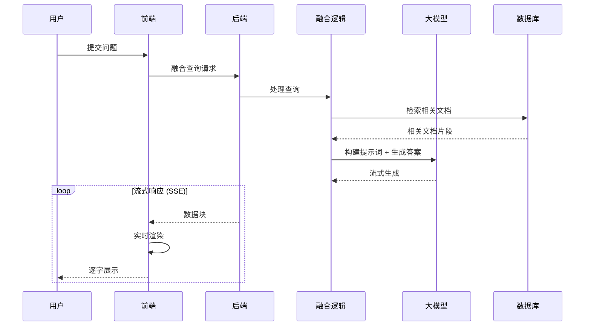

# 河洛历史名人发现平台 - 系统架构设计

## 1. 系统概述

河洛历史名人发现平台面向河洛地区文化遗产的数字化保护与传播需求，构建了一套集文化遗产数据检索、智能问答与可视化展示于一体的全栈应用系统。系统围绕历史名人、诗文、古籍、地点等七类实体，提供关键词检索、向量语义检索、混合检索以及基于检索增强生成（RAG）的融合问答等多种智能交互方式。

系统采用前后端分离架构，由前端展示层、后端服务层、AI 推理服务层和数据持久层四部分组成，各层通过标准 HTTP 协议通信，整体架构如图 1 所示。

后端服务采用经典的分层架构（Layered Architecture），各层职责如表 1 所示。

| 层级 | 职责 | 核心关注点 |
|------|------|-----------|
| 路由层 | 请求路由与中间件处理 | 跨域、日志、请求解析 |
| 控制器层 | 请求参数校验与响应格式化 | 输入验证、错误码映射 |
| 用例层 | 编排业务流程 | 搜索、详情获取、融合查询 |
| 领域逻辑层 | 核心业务规则 | 实体提取、搜索编排、融合推理 |
| 基础设施层 | 外部服务通信与数据访问 | 数据库网关、检索器、缓存 |

---

## 2. 前端架构设计

前端采用 React 单页应用架构，以功能模块（Feature-based）组织代码结构，实现关注点分离。每个功能模块独立管理自身的组件、状态钩子和类型定义，避免跨模块耦合。

### 2.1 模块架构

详情页采用策略模式（Strategy Pattern）实现多态路由分发：路由分发器根据 URI 前缀（如 `/person/`、`/poem/`）识别实体类型，动态加载对应的详情页组件与实体提取器，实现开放-封闭原则——新增实体类型时只需添加提取器与页面组件，无需修改路由分发逻辑。

### 2.2 融合问答模块

融合问答功能采用 assistant-ui 开源框架实现对话式交互界面，通过本地运行时管理对话线程状态，支持服务端推送事件（SSE）流式展示 AI 生成内容。

### 2.3 AI 内容状态机

AI 生成内容的展示采用有穷状态自动机（FSA）模式管理，统一处理四种渲染状态的转换。状态转换图如图所示：

该状态机的设计确保了异步 AI 内容在任意时刻都有明确的展示状态，避免用户面对空白或不确定的界面反馈。所有有数据的状态下均提供"重新生成"操作，支持用户对不满意的 AI 输出进行迭代优化。

---

## 3. 后端架构设计

### 3.1 领域驱动设计

后端核心业务逻辑按领域子域（Subdomain）组织，遵循领域驱动设计（DDD）原则，将业务知识封装在领域层中，与基础设施层解耦：

| 子域 | 职责 | 关键组件 |
|------|------|----------|
| 检索域 | 多策略检索与结果融合 | 搜索编排器、结果合并器 |
| 融合域 | 检索增强生成（RAG）全流程 | 查询规划器、候选重排器、答案构建器 |
| 详情域 | JSON-LD 文档解析与实体提取 | 七类实体提取器 |
| 足迹域 | 人物行迹时空数据管理 | 足迹数据服务 |

检索策略采用策略模式实现可插拔切换：关键词检索（Keyword）基于精确匹配，响应速度快；向量检索（Vector）基于语义相似度，能理解用户查询意图；混合检索（Hybrid）并行执行上述两种策略后对结果进行融合与重排序，兼顾查全率与查准率。

### 3.2 依赖注入

后端通过依赖注入容器管理组件生命周期，实现各层解耦。容器在应用启动时按依赖拓扑顺序创建组件，将底层依赖注入上层，并支持条件注册——仅在对应 AI 推理服务可用时，才注册相关功能路由（如 AI 人物介绍、AI 诗文赏析），保证系统在 AI 服务不可用时仍可降级运行。

---

## 4. 关键数据流

### 4.1 混合检索数据流

系统核心的混合检索流程采用并行检索策略，同时执行关键词检索和向量语义检索，最后对结果进行融合与重排序。该流程通过搜索编排器（Search Orchestrator）统一调度，利用 JavaScript 异步并发能力实现两种检索策略的并行执行，减少用户等待时间。

### 4.2 融合问答数据流

融合问答采用检索增强生成（RAG）范式，先从知识库中检索与用户问题相关的文档片段，再将检索结果作为上下文注入大语言模型的提示词（Prompt），由模型基于事实生成答案。该机制有效降低了纯参数化知识带来的幻觉风险。

该流程通过服务端推送事件（SSE）实现流式传输，前端每接收到一个数据块即增量渲染到对话线程中，使用户在模型生成过程中就能看到逐步展开的答案，显著改善了交互体验。

---

## 5. 技术选型与依据

### 5.1 前端技术选型

| 类别 | 技术 | 选型依据 |
|------|------|----------|
| UI 框架 | React 18 | 组件化开发，生态成熟，Hooks 支持函数式编程范式 |
| 类型系统 | TypeScript | 编译期类型检查，提升大型项目的可维护性与重构安全性 |
| 构建工具 | Vite | 基于 ES Module 的快速热更新，显著提升开发迭代效率 |
| AI 对话框架 | assistant-ui | 开源对话 UI 框架，支持自定义运行时与流式渲染 |
| 国际图像标准 | IIIF / Mirador | 国际图像互操作框架标准，满足古籍高清图像的标准化展示需求 |
| 地图服务 | 高德地图 | 提供历史人物行迹的地理空间可视化 |
| 测试框架 | Vitest + MSW | 与 Vite 原生集成，支持接口级别的 Mock 隔离测试 |

### 5.2 后端技术选型

| 类别 | 技术 | 选型依据 |
|------|------|----------|
| Web 框架 | Express | 轻量灵活，中间件生态丰富，适合分层架构实现 |
| 数据库 | MarkLogic | 原生支持 JSON-LD 文档存储与向量索引，无需额外引入向量数据库 |
| 向量嵌入 | sentence-transformers | text2vec-base-chinese 模型，针对中文文本优化，输出 768 维向量 |
| 大语言模型 | DeepSeek | 具备较强的中文理解与生成能力，通过 API 调用降低本地算力需求 |

### 5.3 数据格式选型

系统采用 JSON-LD（JSON for Linking Data）作为核心数据格式，该格式是 W3C 推荐的关联数据序列化标准。选择 JSON-LD 的原因在于：

- **语义互操作**：通过 `@context` 和 `@type` 字段为数据赋予明确语义，支持跨数据源的实体关联
- **结构灵活性**：文档数据库天然适配半结构化数据，七类实体无需共享统一表结构
- **链接能力**：`@id` 和 `@type` 字段支持实体间的引用关系，是实现关联检索的基础

---

## 6. 架构设计模式

本系统在架构设计中应用了以下经典设计模式，以实现关注点分离、降低耦合、提升可扩展性：

| 设计模式 | 应用场景 | 设计意图 |
|----------|----------|----------|
| 分层架构 | 前后端整体架构 | 关注点分离，各层可独立演进与测试 |
| 领域驱动设计 | 后端业务逻辑组织 | 将业务知识封装在领域层，隔离技术实现细节 |
| 策略模式 | 检索策略可插拔切换 | 关键词/向量/混合检索算法可独立替换，不影响上层逻辑 |
| 外观模式 | 前端接口兼容层 | 屏蔽底层接口差异，为上层提供统一调用方式 |
| 网关模式 | 外部服务访问 | 隔离外部协议细节（摘要认证、HTTP 等），统一异常处理 |
| 仓储模式 | 数据访问层 | 解耦领域逻辑与数据持久化，便于替换存储实现 |
| 依赖注入 | 组件生命周期管理 | 降低组件间耦合，支持条件注册与测试替身 |
| 状态机 | AI 内容渲染 | 有穷状态自动机管理异步内容生命周期，确保界面状态一致性 |
| 模块模式 | 足迹地图子模块 | 高内聚低耦合的子模块封装，隐藏内部实现细节 |
