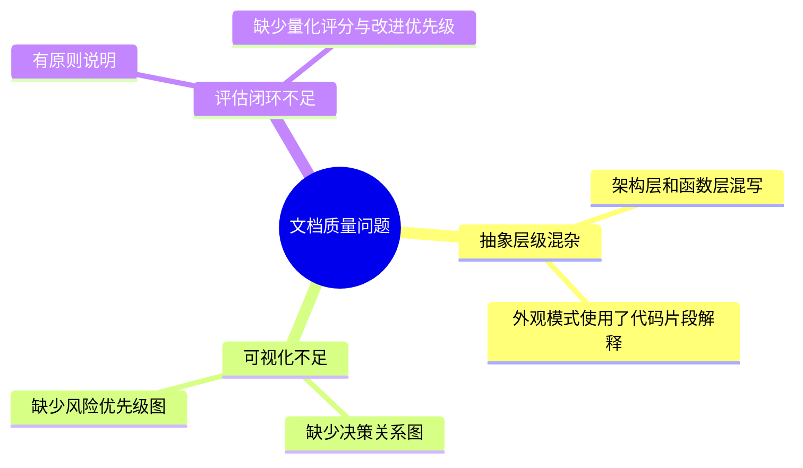
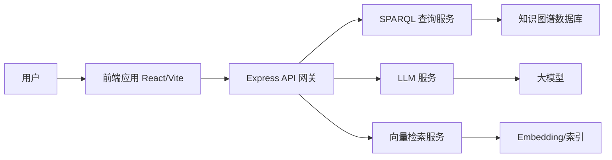
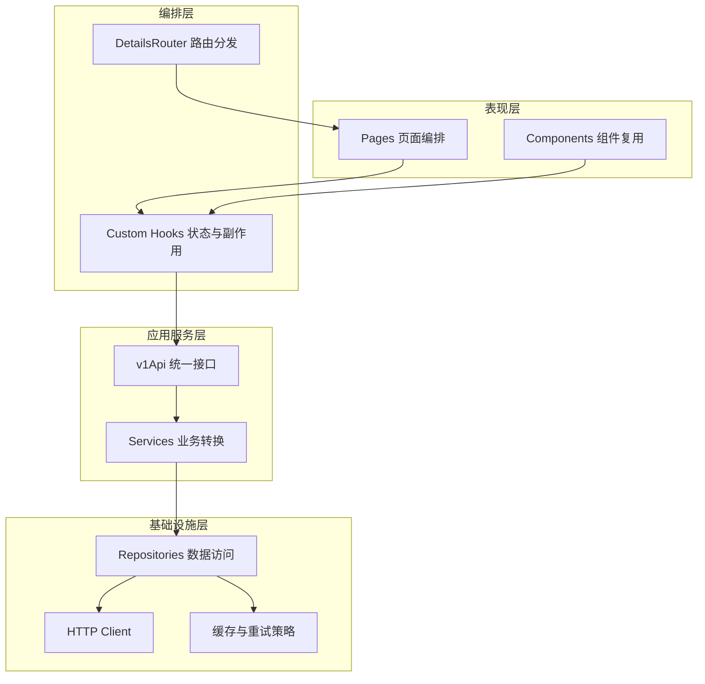
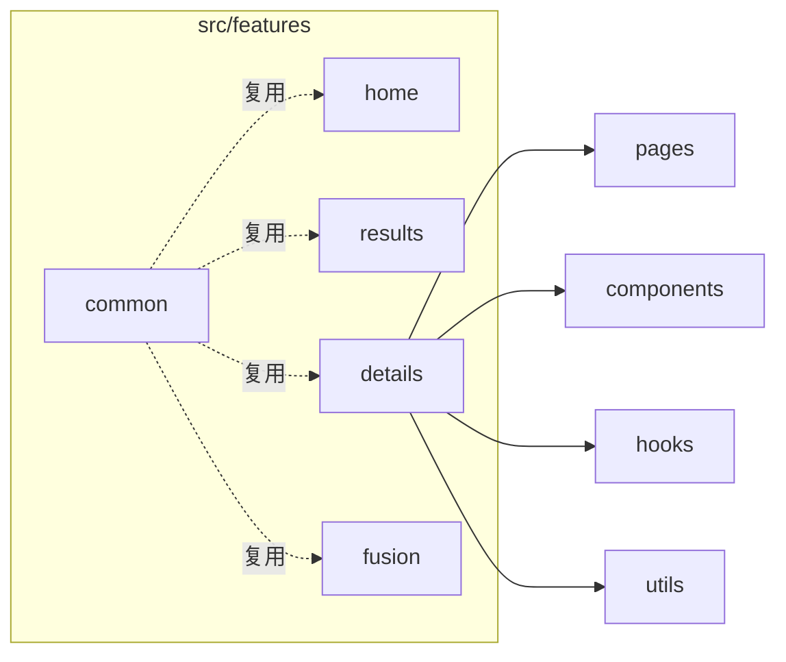
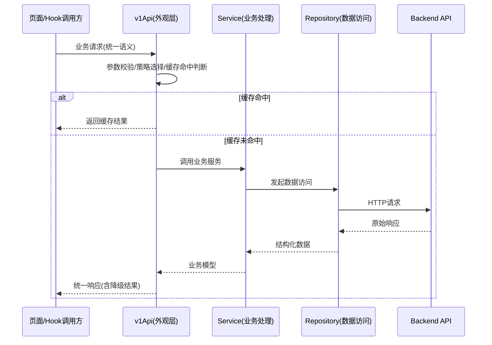
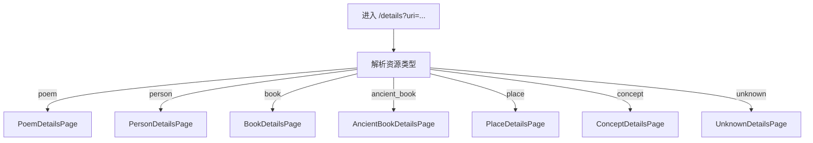
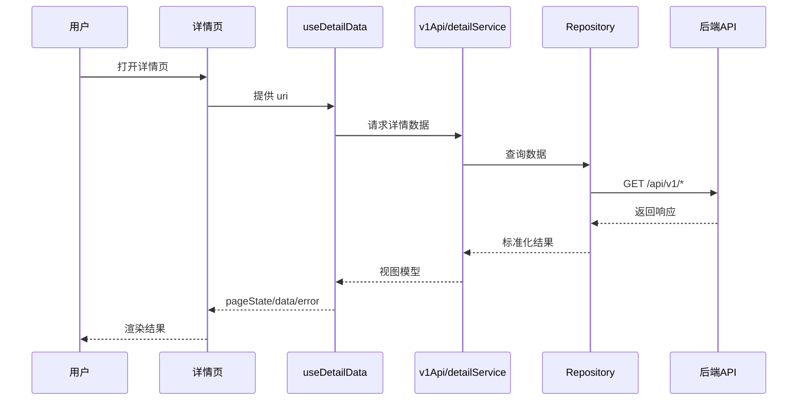
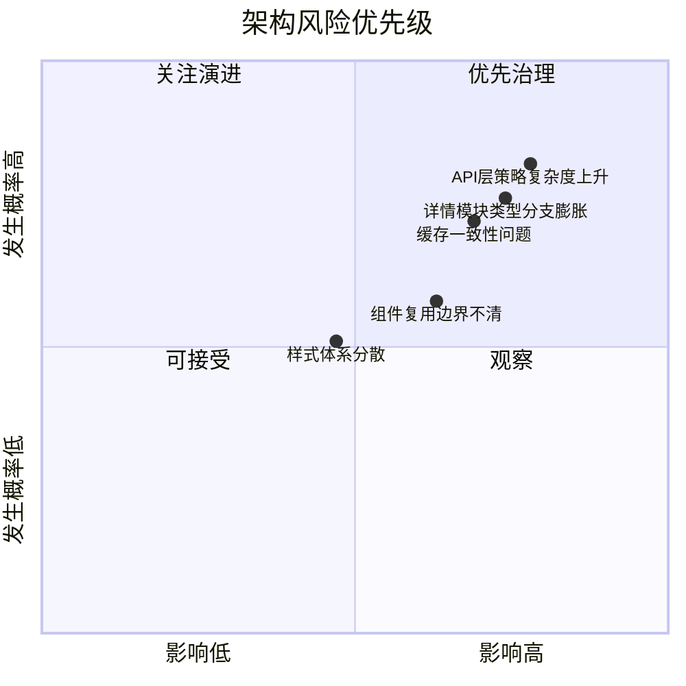

# 河洛文化知识图谱前端架构模式分析（质量评估版）

> 分析日期：2026-03-03
> 评估对象：`docs/paper/architecture-patterns.md`

## 一、质量评估结论

| 评估维度 | 得分（10分制） | 主要结论 |
|---|---:|---|
| 结构完整性 | 8 | 关键架构模式覆盖较全，但章节目标与优先级不够清晰。 |
| 可读性 | 7 | 图表基础较好，但存在代码化表达，阅读节奏被打断。 |
| 抽象层级一致性 | 6 | 同时混入“架构说明”和“函数级细节”，层级跳跃明显。 |
| 决策可追踪性 | 7 | 有原则说明，但缺少“问题-模式-收益-风险”的闭环。 |
| 沟通效率 | 6 | 适合开发者精读，不够适合跨角色快速对齐。 |

**综合评分：6.8 / 10**

## 二、核心问题定位

## 三、架构全景图（图表优先）

### 1. 系统上下文图

### 2. 前端分层职责图

| 层级 | 核心职责 | 代表位置 |
|---|---|---|
| 表现层 | 负责页面结构和交互呈现 | `src/features/*/pages`, `src/features/*/components` |
| 编排层 | 负责状态流转、参数解释、页面选择 | `src/features/details/hooks`, `DetailsRouter` |
| 应用服务层 | 统一业务语义，隔离底层调用差异 | `src/lib/api/v1Api.ts`, `src/lib/api/services` |
| 基础设施层 | 负责通信、重试、缓存、错误边界 | `src/lib/api/repositories`, `src/lib/api/http.ts` |

### 3. 功能模块边界图

### 4. 外观模式协作图（替代代码细节）

### 5. 详情路由分发图

### 6. 关键链路时序图（详情页）

## 四、架构决策与风险矩阵

| 决策点 | 当前模式 | 收益 | 主要风险 | 建议 |
|---|---|---|---|---|
| API 统一入口 | 外观模式 | 上层调用一致、可控扩展 | 策略堆叠后可维护性下降 | 将策略拆为可组合策略节点 |
| 详情页入口统一 | 路由分发模式 | 新实体可按类型扩展 | 分支变多导致认知负担增加 | 引入类型映射注册表 |
| 数据获取与页面分离 | Custom Hook | 页面更薄、可测试性更好 | Hook 变成“巨型控制器” | 限制 Hook 职责，拆分衍生 Hook |
| 业务按 feature 划分 | 模块化结构 | 高内聚、团队协作友好 | 横切能力重复建设 | 建立 common 能力准入规范 |

## 五、优化后文档规范（后续沿用）

| 规范项 | 约束 |
|---|---|
| 叙述粒度 | 以“模块/层级/协作关系”为主，不进入函数实现细节 |
| 图文比例 | 图表优先，建议不低于 60% |
| 代码片段 | 仅保留接口级伪代码，不出现具体实现逻辑 |
| 评估闭环 | 必须包含评分、问题定位、改进优先级 |
| 读者视角 | 面向架构评审、研发协作、跨角色沟通 |

## 六、结论

本次改版将文档从“实现细节导向”调整为“架构沟通导向”：

1. 保留关键模式，但弱化代码级表达。
2. 增加全景图、协作图、决策图、风险矩阵，提升阅读效率。
3. 形成可复用的评估闭环，便于后续持续迭代。
