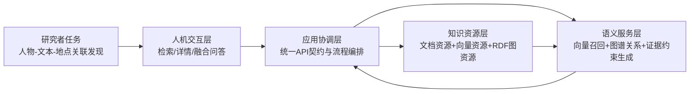
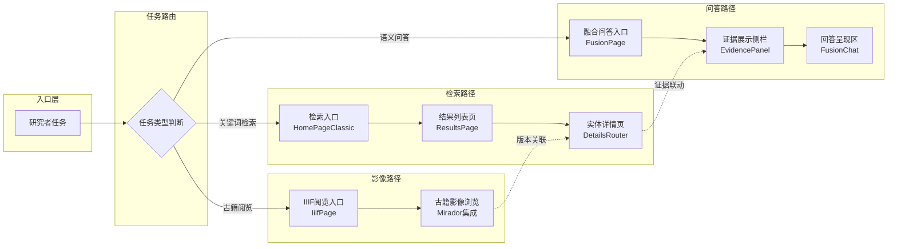
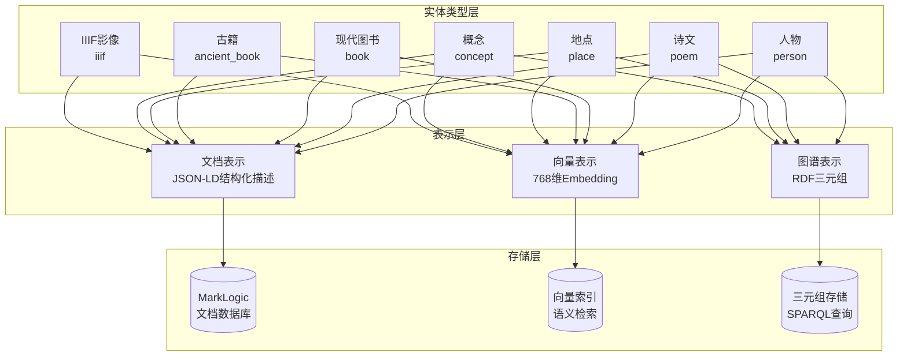
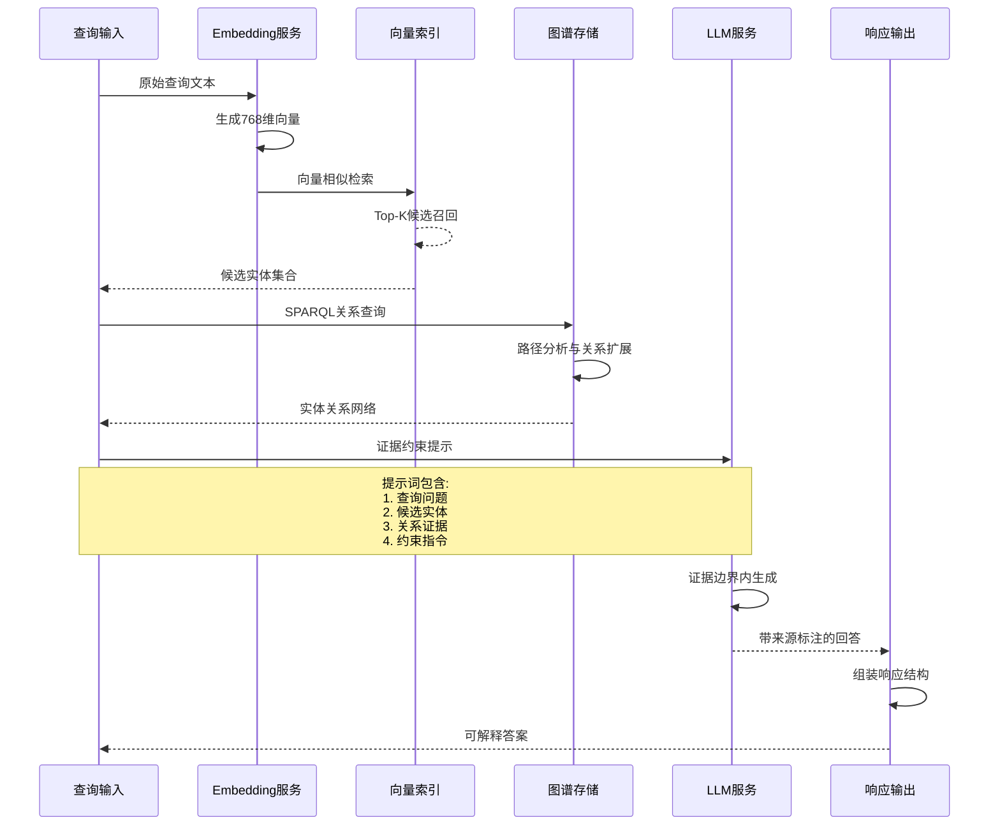
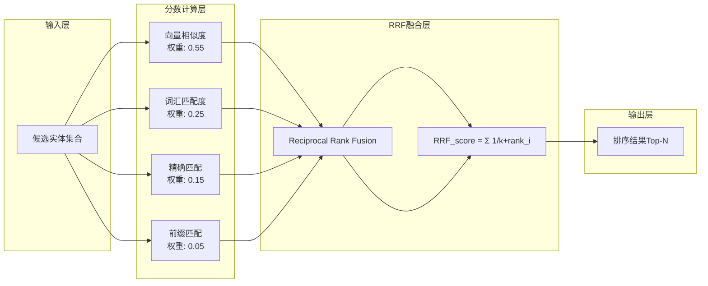
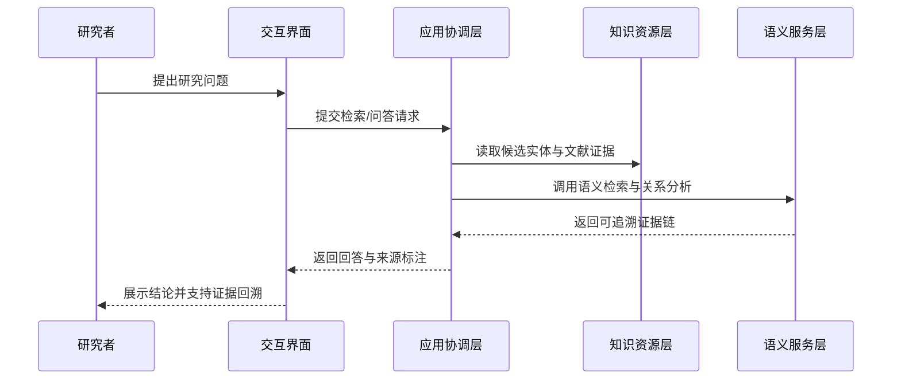

# 第四章 平台设计

## 4.1 设计目标与分层思路

本章的核心任务是说明平台如何在数字人文研究场景中实现“可解释、可复核、可持续”的知识服务。平台面向人物、诗文、古籍、地点与概念等异构资源，既要支持统一检索与语义关联分析，又要保证问答结果能够回溯至证据来源。基于这一目标，本章采用“人机交互层—应用协调层—知识资源层—语义服务层”的四层架构作为总体分析框架。

上述分层并非形式化拆分，而是围绕研究流程中的真实任务链路组织系统能力。研究者通常经历“提出问题—发现线索—核验证据—形成解释”的连续过程，这一过程要求系统同时具备交互友好性、服务稳定性与语义表达力。由此可见，四层架构的意义在于将技术能力转化为可被学术工作流直接使用的研究基础设施。

## 4.2 整体架构设计

本节关注四层架构之间的协同关系，而不是孤立描述单一模块。平台以应用协调层为中介，将交互需求、知识资源与语义服务连接为闭环，避免上层直接依赖底层实现细节。该设计使系统能够在资源扩展或算法迭代时保持外部使用方式稳定。

### 图4-1 平台四层架构



图4-1的重点在于展示“任务驱动”而非“技术堆叠”的结构逻辑。交互层承接研究问题输入，协调层将请求分发到资源层与语义层，语义层再把计算结果回注到协调层生成统一输出。因而，平台形成了从问题提出到结果解释的可闭合工作回路。

### 表4-1 四层职责划分

| 层次 | 主要职责 | 对研究场景的价值 |
|---|---|---|
| 人机交互层 | 组织检索、详情浏览、融合问答等任务入口 | 降低复杂数据使用门槛，提升研究效率 |
| 应用协调层 | 统一接口契约、参数规范、错误隔离与流程编排 | 保证功能演进时上层交互稳定 |
| 知识资源层 | 管理文档、向量与图谱等多表示知识资源 | 同时支持精确检索与语义关联分析 |
| 语义服务层 | 提供向量检索、关系推理与证据约束生成 | 形成可解释的智能问答能力 |

表4-1进一步明确了“职责边界”与“研究价值”的对应关系。每一层都承担独立职责，但最终都服务于证据发现、关系解释与结论复核三个学术目标。由此，分层设计不仅提升工程可维护性，也提升了研究过程的可控性。

## 4.3 人机交互层设计

人机交互层的设计目标是把复杂系统能力转译为研究者可直接操作的任务入口。平台以检索、详情和融合问答三类界面覆盖“找资料—读资料—解释资料”的连续行为，并通过统一导航降低跨页面认知负担。于是，交互层不再是被动展示界面，而成为研究流程的主动组织者。

从学术可用性看，交互层强调”过程可见、结果可证、路径可回溯”三项原则。系统在问答过程中持续返回状态与来源线索，使研究者能够同步判断结论的证据充分性，并可从回答反向跳转到实体详情进行核验。最终，交互层有效降低了”黑盒式结论”带来的学术风险。

### 图4-3 人机交互层任务入口流程



图4-3展示了三类任务入口的路由分发与页面流转关系。检索路径覆盖”首页→结果→详情”的经典学术搜索模式，问答路径实现证据驱动的融合回答，影像路径提供古籍版本的直观阅览。三类路径并非孤立，而是通过证据联动与版本关联形成跨路径导航。

## 4.4 应用协调层设计

应用协调层是四层架构中的编排中枢，其核心作用是稳定对外契约并吸收对内差异。对上层界面而言，它提供统一调用接口与参数规范；对下层能力而言，它协调关键词检索、向量检索、图谱查询与生成服务的执行顺序。由此，系统在能力扩展时能够保持用户侧使用方式不变。

在稳健性方面，应用协调层通过参数约束、失败隔离与降级机制保障服务连续性。并行请求与错误边界控制可避免单个子服务异常向全链路扩散，而降级路径可在模型不可用或部分数据缺失时维持基本服务输出。因而，平台在高复杂度语义任务下仍具备可预期的运行稳定性。

### 图4-4 应用协调层编排逻辑

```mermaid
flowchart TB
    A[HTTP请求<br/>GET/POST]
    B{参数合法性检查}
    C[路由匹配]
    E[并行服务编排]
    G{服务健康检查}

    subgraph 参数校验层
        B -->|scope无效| B1[400 错误响应]
        B -->|q为空| B2[400 错误响应]
    end

    subgraph 路由分发
        C --> D1[/api/v1/search<br/>统一检索]
        C --> D2[/api/v1/fusion<br/>融合问答]
        C --> D3[/api/v1/:entity<br/>实体详情]
        C --> D4[/api/v1/iiif<br/>影像服务]
    end

    subgraph 服务调用
        E --> F1[关键词检索]
        E --> F2[向量召回]
        E --> F3[图谱查询]
    end

    subgraph 容错机制
        G -->|单服务失败| H[失败隔离<br/>跳过异常服务]
        G -->|全部失败| I[降级响应<br/>返回基础数据]
        G -->|正常| J[聚合响应]
        H --> J
    end

    A --> B -->|校验通过| C --> E --> G
```

图4-4呈现了应用协调层从请求入口到服务聚合的完整编排链路。参数校验层确保请求合法性，路由分发层根据URL模式选择处理逻辑，服务调用层并行执行多源检索，容错机制保障单点故障不影响整体可用性。由此，协调层实现了"统一入口、差异处理、稳健输出"的设计目标。

## 4.5 知识资源层设计

知识资源层采用“同库多表示”的组织策略，以支撑不同类型的研究问题。文档资源承担事实描述与字段检索，向量资源承担语义相似召回，图谱资源承担关系建模与路径分析。这样，平台能够在“精确检索”与“语义发现”之间形成互补能力。

从图书馆与数字人文视角看，该资源模型延续了传统知识组织的可解释性要求。结构化描述保证了编目语义的稳定表达，图谱与向量机制则扩展了跨文本、跨实体的关联发现能力，并保持结果可回溯至原始线索。由此，知识资源层同时满足了”组织规范性”与”研究探索性”的双重需求。

### 图4-5 知识资源层多表示模型



图4-5展示了”同库多表示”的资源组织策略。七类实体均可生成文档表示与向量表示，其中人物、诗文、地点、概念等核心实体还具备图谱表示。三种表示形式对应不同的查询场景：文档表示支持精确字段检索，向量表示支持语义相似召回，图谱表示支持关系路径分析。由此，知识资源层实现了”一源多用、多表示协同”的设计目标。

## 4.6 语义服务层设计

语义服务层负责把“资源可用”转化为“解释可用”，其关键是形成证据驱动的语义计算链。平台先通过向量召回与结构化过滤构建候选集，再通过图谱关系分析补足实体间语义联系，最后在证据边界内完成自然语言组织。因此，语义服务层的价值不在于生成文本本身，而在于生成过程与证据之间的一致性。

该层还通过显式降级策略控制模型风险并维护学术可信度。系统在证据不足或模型不可用时不输出伪确定性结论，而是回退到保守响应并保留来源上下文，避免“无依据生成”影响研究判断。结果上，语义能力增强与学术审慎性在同一机制中实现了平衡。

### 表4-2 语义服务能力与学术价值映射

| 语义能力 | 功能作用 | 学术价值 |
|---|---|---|
| 向量召回 | 捕获词面不一致但语义相关的候选 | 提升历史语料中的隐性关联发现能力 |
| 图谱关系分析 | 构建实体关系网络与路径线索 | 支持人物-地点-文本的关联研究 |
| 证据约束生成 | 在证据边界内组织自然语言回答 | 提高结论可解释性与可复核性 |

表4-2显示，语义能力与学术价值之间并非一一割裂，而是构成由”发现”到”解释”的连续链路。向量召回主要扩大线索覆盖，图谱分析主要强化关系结构，证据约束生成主要提升结论表达质量。综合来看，三者协同决定了平台的知识服务深度。

### 图4-6 语义服务层计算链时序



图4-6展示了语义服务层的核心计算链路。查询首先经过Embedding编码转化为向量表示，在向量索引中召回语义相似候选；继而通过SPARQL查询在图谱中扩展实体关系网络；最终将候选实体、关系证据与约束指令一同送入LLM，生成带来源标注的可解释回答。三条子链路并行执行后聚合，形成”召回-分析-生成”的闭环。

### 图4-7 混合排序算法流程



图4-7呈现了混合排序算法的权重分配与融合逻辑。四种分数来源覆盖语义相似、词汇匹配、精确命中与前缀匹配四个维度，通过RRF（Reciprocal Rank Fusion）公式融合为统一排序分数。权重分配体现了”语义优先、词汇兜底”的策略：向量分数占比最高（55%），确保语义相关候选优先呈现；精确匹配与前缀匹配合计占20%，保障已知实体的精确命中。

## 4.7 端到端工作流程

本节将前述分层设计转化为可观察的证据闭环流程，以验证架构的可执行性。平台从研究问题出发，经由协调层触发多源检索与语义分析，再以来源标注的形式回到交互层完成结果呈现。因此，流程设计的重点是“每一步都有可追溯输入与输出”。

### 图4-2 证据闭环流程



图4-2展示了从问题提出到证据回溯的完整执行路径。该路径通过“状态反馈+来源联动”把系统内部计算过程转化为用户可验证的研究线索，避免仅给出结论而缺乏依据。换言之，平台输出的是“可解释答案”，而非“不可追问答案”。

## 4.8 设计原则与非功能目标

本节从非功能视角总结平台设计的质量约束，以说明架构选择的长期意义。可解释性、可复核性、互操作性、稳健性与可扩展性并非附加属性，而是数字人文基础设施的核心评价维度。基于这些维度，平台在设计阶段即将学术需求前置到系统能力定义中。

### 表4-3 设计原则

| 设计原则 | 目标内涵 | 关键实现机制 |
|---|---|---|
| 可解释性 | 回答过程与依据对用户可见 | 证据侧栏、状态反馈、来源联动 |
| 可复核性 | 结论可回溯至实体与文献线索 | 详情联动与证据链展示 |
| 互操作性 | 支持跨系统与跨资源协同 | IIIF、RDF/SPARQL 等标准化接口 |
| 稳健性 | 在异常场景下保持可用 | 重试机制、失败隔离、降级策略 |
| 可扩展性 | 新资源类型可持续接入 | 分层架构与统一契约编排 |

表4-3说明，设计原则与实现机制之间存在明确映射关系。原则提供评价标准，机制提供落地路径，两者共同决定系统能否在真实研究环境中长期运行。因而，这组原则既是本章总结，也是后续评测章节的判据基础。

## 4.9 本章小结

本章的结论是：四层架构能够把复杂语义技术组织为可被数字人文研究直接利用的服务体系。通过应用协调层的编排作用，知识资源层与语义服务层形成稳定协同，并在交互层呈现为可解释、可回溯的证据闭环。由此，平台在学术可信度与系统工程性之间建立了可持续的平衡结构。
