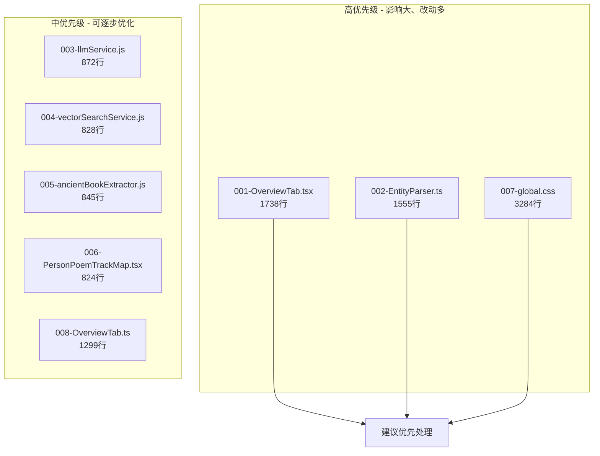
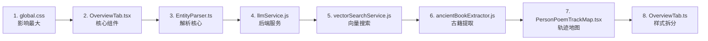

# 重构方案索引

## 概述

本文档汇总了项目中所有单文件过大文件的重构方案，旨在提升代码的可维护性、可测试性和复用性。

## 重构文件清单

| 序号 | 文件 | 行数 | 大小 | 风险等级 | 优先级 | 预计工时 |
|------|------|------|------|----------|--------|----------|
| 001 | `src/features/details/OverviewTab.tsx` | 1738 | 64KB | 高 | 高 | 18小时 |
| 002 | `src/lib/parse/data/EntityParser.ts` | 1555 | 52KB | 高 | 高 | 8小时 |
| 003 | `server/src/services/llmService.js` | 872 | 28KB | 中 | 中 | 3小时 |
| 004 | `server/src/services/vectorSearchService.js` | 828 | 28KB | 中 | 中 | 3.5小时 |
| 005 | `server/src/domain/detail/ancientBookExtractor.js` | 845 | 28KB | 中 | 中 | 3.5小时 |
| 006 | `src/features/details/components/PersonPoemTrackMap.tsx` | 824 | 28KB | 中 | 中 | 4小时 |
| 007 | `src/styles/global.css` | 3284 | 64KB | 高 | 高 | 8小时 |
| 008 | `src/styles/features/details/OverviewTab.ts` | 1299 | 32KB | 中 | 中 | 4.5小时 |

## 重构优先级建议

## 重构策略总结

### 前端组件重构策略

| 策略 | 适用文件 | 核心思路 |
|------|----------|----------|
| **实体类型拆分** | OverviewTab.tsx | 按实体类型（person/book/place/poem/concept/ancient_book）拆分为独立组件 |
| **解析器模式** | EntityParser.ts | 使用解析器注册中心，按实体类型拆分解析器 |
| **CSS 模块化** | global.css, OverviewTab.ts | 按职责拆分：base/layout/components/utilities |
| **功能拆分** | PersonPoemTrackMap.tsx | 拆分：地图服务、样式模块、Hooks |

### 后端服务重构策略

| 策略 | 适用文件 | 核心思路 |
|------|----------|----------|
| **配置分离** | llmService.js | 提取配置、提示词、降级策略为独立模块 |
| **缓存分离** | vectorSearchService.js | 提取缓存、策略、增强器为独立模块 |
| **功能拆分** | ancientBookExtractor.js | 拆分：工具函数、URI解析、层次结构、详情提取 |

## 总体时间估算

| 类别 | 文件数 | 预计工时 |
|------|--------|----------|
| 高优先级 | 3 | 32小时 |
| 中优先级 | 5 | 16.5小时 |
| **总计** | **8** | **约 48.5小时** |

## 推荐实施顺序

## 文档列表

| 文档 | 路径 |
|------|------|
| 001 - OverviewTab.tsx 重构方案 | `docs/refactor/001-OverviewTab-refactor-plan.md` |
| 002 - EntityParser.ts 重构方案 | `docs/refactor/002-EntityParser-refactor-plan.md` |
| 003 - llmService.js 重构方案 | `docs/refactor/003-llmService-refactor-plan.md` |
| 004 - vectorSearchService.js 重构方案 | `docs/refactor/004-vectorSearchService-refactor-plan.md` |
| 005 - ancientBookExtractor.js 重构方案 | `docs/refactor/005-ancientBookExtractor-refactor-plan.md` |
| 006 - PersonPoemTrackMap.tsx 重构方案 | `docs/refactor/006-PersonPoemTrackMap-refactor-plan.md` |
| 007 - global.css 重构方案 | `docs/refactor/007-global-css-refactor-plan.md` |
| 008 - OverviewTab.ts 重构方案 | `docs/refactor/008-OverviewTab-css-refactor-plan.md` |

## 注意事项

1. **渐进式重构**：每个文件重构后需完整测试
2. **API 兼容性**：保持原有导出接口不变
3. **依赖关系**：注意重构顺序
4. **文档更新**：重构完成后更新相关文档

---

*创建时间: 2026年*
*状态: 待评审*
