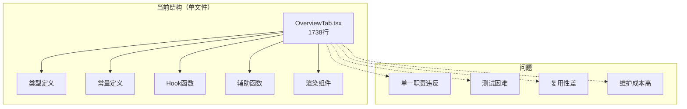
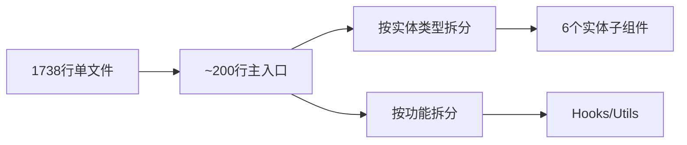
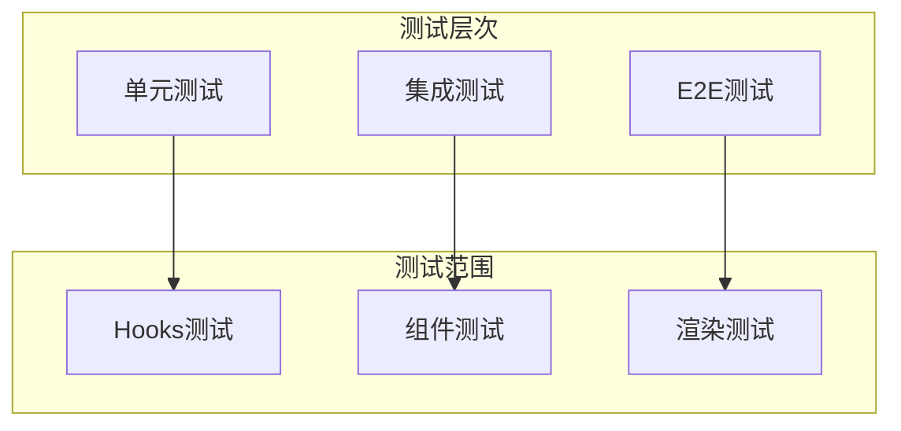

# OverviewTab.tsx 重构方案

## 一、文件概况

| 指标 | 数值 |
|------|------|
| **文件路径** | `src/features/details/OverviewTab.tsx` |
| **当前行数** | 1738 行 |
| **文件大小** | 64KB |
| **风险等级** | 高 |

## 二、问题分析

### 2.1 代码结构分析



### 2.2 具体问题

1. **职责过多**：同时处理 6 种实体类型（person、book、place、poem、concept、ancient_book）
2. **逻辑混杂**：数据获取、状态管理、渲染逻辑耦合
3. **组件膨胀**：主组件包含大量条件渲染逻辑
4. **可测试性差**：难以对单个实体类型的逻辑进行单元测试

## 三、重构目标



## 四、重构方案

### 4.1 目标目录结构

```
src/features/details/
├── OverviewTab.tsx              # 主入口组件（~200行）
├── OverviewTab.module.css       # 样式文件
├── components/
│   ├── OverviewSummary.tsx      # 摘要区块
│   ├── OverviewSidebar.tsx      # 侧边栏
│   └── entity-panels/           # 按实体类型拆分
│       ├── PersonOverviewPanel.tsx
│       ├── BookOverviewPanel.tsx
│       ├── PlaceOverviewPanel.tsx
│       ├── PoemOverviewPanel.tsx
│       ├── ConceptOverviewPanel.tsx
│       └── AncientBookOverviewPanel.tsx
├── hooks/
│   ├── useOverviewData.ts       # 数据获取 Hook
│   ├── useBookCover.ts          # 封面获取 Hook
│   ├── useRelatedResources.ts   # 关联资源 Hook
│   └── useAiSummary.ts          # AI 摘要 Hook
├── utils/
│   ├── entityRenderHelpers.ts   # 实体渲染辅助函数
│   └── linkBuilders.ts          # 链接构建函数
└── types/
    └── OverviewTab.types.ts     # 类型定义
```

### 4.2 主入口组件设计

```typescript
// OverviewTab.tsx - 重构后的主入口（示意）
interface OverviewTabProps {
  entity: EnrichedEntityDetail
  entityType: EntityType
  externalLinks: ExternalLink[]
  relatedResources: RelatedResource[]
}

export function OverviewTab({ entity, entityType, externalLinks, relatedResources }: OverviewTabProps) {
  // 根据实体类型选择对应的面板组件
  const EntityPanel = ENTITY_PANEL_MAP[entityType]

  return (
    <div className="yale-overview-tab">
      <div className="yale-overview-tab__main">
        <OverviewSummary entity={entity} />
        <EntityPanel entity={entity} />
      </div>
      <div className="yale-overview-tab__sidebar">
        <OverviewSidebar
          externalLinks={externalLinks}
          relatedResources={relatedResources}
        />
      </div>
    </div>
  )
}

const ENTITY_PANEL_MAP = {
  person: PersonOverviewPanel,
  book: BookOverviewPanel,
  place: PlaceOverviewPanel,
  poem: PoemOverviewPanel,
  concept: ConceptOverviewPanel,
  ancient_book: AncientBookOverviewPanel,
}
```

### 4.3 实体面板组件示例

```typescript
// components/entity-panels/PersonOverviewPanel.tsx
interface PersonOverviewPanelProps {
  entity: PersonEntityDetail
}

export function PersonOverviewPanel({ entity }: PersonOverviewPanelProps) {
  const { aiSummary, isLoading, refresh } = useAiSummary(entity.uri)

  return (
    <>
      <AiSummaryCard
        summary={aiSummary}
        isLoading={isLoading}
        onRefresh={refresh}
      />
      <BiographySection biography={entity.biography} />
      <PersonFieldPanel fields={entity.fields} />
      <PersonPoemTrackMap personId={entity.id} />
    </>
  )
}
```

### 4.4 Hooks 拆分设计

```typescript
// hooks/useAiSummary.ts
export function useAiSummary(personUri: string) {
  const [summary, setSummary] = useState<string>('')
  const [isLoading, setIsLoading] = useState(false)
  const [error, setError] = useState<Error | null>(null)

  const fetchSummary = useCallback(async () => {
    // AI 摘要获取逻辑
  }, [personUri])

  return {
    aiSummary: summary,
    isLoading,
    error,
    refresh: fetchSummary,
  }
}

// hooks/useBookCover.ts
export function useBookCover(isbn: string | null) {
  const [coverUrl, setCoverUrl] = useState<string | null>(null)
  // 封面获取逻辑
  return { coverUrl, isLoading }
}
```

## 五、重构步骤

### 阶段一：准备工作（低风险）

1. 提取类型定义到 `types/OverviewTab.types.ts`
2. 提取常量定义
3. 提取辅助函数到 `utils/`

### 阶段二：拆分 Hooks（中风险）

1. 提取 `useAiSummary` Hook
2. 提取 `useBookCover` Hook
3. 提取 `useRelatedResources` Hook
4. 编写 Hook 单元测试

### 阶段三：拆分组件（中风险）

1. 提取 `OverviewSummary` 组件
2. 提取 `OverviewSidebar` 组件
3. 为每个组件编写测试

### 阶段四：按实体类型拆分面板（高风险）

1. 创建 `entity-panels/` 目录
2. 逐个提取实体面板组件
3. 重构主组件使用面板映射
4. 全面回归测试

## 六、测试策略



### 测试文件规划

```
tests/features/details/
├── OverviewTab.test.tsx
├── hooks/
│   ├── useAiSummary.test.ts
│   ├── useBookCover.test.ts
│   └── useRelatedResources.test.ts
└── components/
    ├── PersonOverviewPanel.test.tsx
    ├── BookOverviewPanel.test.tsx
    └── ...
```

## 七、风险评估

| 风险项 | 影响程度 | 缓解措施 |
|--------|----------|----------|
| 重构过程中功能回归 | 高 | 每阶段完成后进行回归测试 |
| 组件间通信复杂化 | 中 | 使用 Context 或 props drilling 最小化 |
| 性能下降 | 低 | 使用 React.memo 优化渲染 |

## 八、预期收益

| 指标 | 重构前 | 重构后 |
|------|--------|--------|
| 主文件行数 | 1738 | ~200 |
| 单个组件最大行数 | 1738 | ~300 |
| 可测试性 | 困难 | 容易 |
| 复用性 | 低 | 高 |
| 维护成本 | 高 | 低 |

## 九、时间估算

| 阶段 | 工作量 | 建议执行时机 |
|------|--------|--------------|
| 阶段一 | 2小时 | 可立即开始 |
| 阶段二 | 4小时 | 阶段一完成后 |
| 阶段三 | 4小时 | 阶段二完成后 |
| 阶段四 | 8小时 | 需充分测试后 |

**总计：约 18 小时**

## 十、参考

- [React 组件设计原则](https://react.dev/learn/thinking-in-react)
- [单一职责原则](https://en.wikipedia.org/wiki/Single-responsibility_principle)

---

*创建时间: 2026年*
*状态: 待评审*
