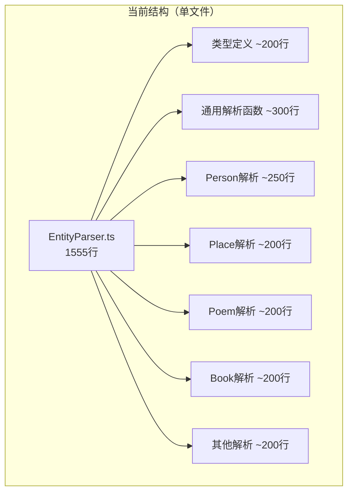
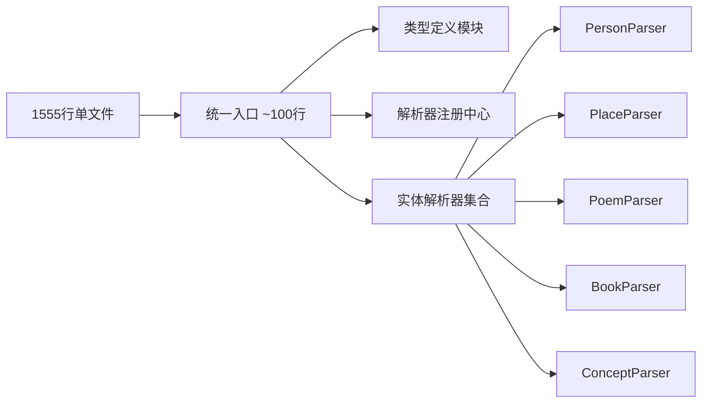
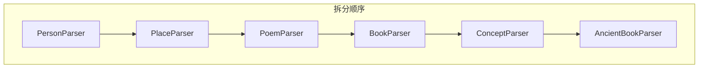

# EntityParser.ts 重构方案

## 一、文件概况

| 指标 | 数值 |
|------|------|
| **文件路径** | `src/lib/parse/data/EntityParser.ts` |
| **当前行数** | 1555 行 |
| **文件大小** | 52KB |
| **风险等级** | 高 |

## 二、问题分析

### 2.1 代码结构分析



### 2.2 具体问题

1. **单一职责违反**：所有实体类型的解析逻辑集中在一个文件
2. **难以扩展**：添加新实体类型需要修改核心文件
3. **代码导航困难**：1555行代码中定位特定逻辑非常困难
4. **测试隔离困难**：无法独立测试单个实体解析器

## 三、重构目标



## 四、重构方案

### 4.1 目标目录结构

```
src/lib/parse/
├── index.ts                    # 统一导出入口
├── types/
│   ├── index.ts               # 类型统一导出
│   ├── common.ts              # 公共类型定义
│   ├── person.ts              # 人物相关类型
│   ├── place.ts               # 地点相关类型
│   ├── poem.ts                # 诗文相关类型
│   ├── book.ts                # 书籍相关类型
│   └── ancient-book.ts        # 古籍相关类型
├── core/
│   ├── index.ts               # 核心工具导出
│   ├── helper.ts              # 通用解析辅助函数
│   ├── jsonldParser.ts        # JSON-LD 解析基础
│   └── constants.ts           # 常量定义
├── parsers/
│   ├── index.ts               # 解析器注册中心
│   ├── BaseParser.ts          # 解析器基类
│   ├── PersonParser.ts        # 人物解析器
│   ├── PlaceParser.ts         # 地点解析器
│   ├── PoemParser.ts          # 诗文解析器
│   ├── BookParser.ts          # 书籍解析器
│   ├── ConceptParser.ts       # 概念解析器
│   └── AncientBookParser.ts   # 古籍解析器
└── utils/
    ├── dateUtils.ts           # 日期处理工具
    ├── uriUtils.ts            # URI 处理工具
    └── textUtils.ts           # 文本处理工具
```

### 4.2 核心模块设计

#### 4.2.1 解析器基类

```typescript
// parsers/BaseParser.ts
interface ParserResult<T> {
  success: boolean
  data?: T
  errors?: string[]
}

abstract class BaseParser<TEntity> {
  abstract readonly entityType: string
  abstract parse(data: unknown): ParserResult<TEntity>

  // 共享的辅助方法
  protected extractLabel(node: unknown): string { /* ... */ }
  protected forceArray(value: unknown): unknown[] { /* ... */ }
  protected normalizeText(value: unknown): string { /* ... */ }
}
```

#### 4.2.2 解析器注册中心

```typescript
// parsers/index.ts
type EntityParserMap = Map<string, BaseParser<any>>

class ParserRegistry {
  private parsers: EntityParserMap = new Map()

  register(parser: BaseParser<any>): void
  get(type: string): BaseParser<any> | undefined
  parse(type: string, data: unknown): ParserResult<any>
}

export const parserRegistry = new ParserRegistry()
```

#### 4.2.3 具体解析器示例

```typescript
// parsers/PersonParser.ts
class PersonParser extends BaseParser<PersonEntity> {
  readonly entityType = 'person'

  parse(data: unknown): ParserResult<PersonEntity> {
    if (!this.isValidPersonData(data)) {
      return { success: false, errors: ['Invalid person data'] }
    }

    return {
      success: true,
      data: {
        type: 'person',
        label: this.extractLabel(data),
        birthDate: this.extractBirthDate(data),
        deathDate: this.extractDeathDate(data),
        dynasty: this.extractDynasty(data),
        // ... 其他字段
      }
    }
  }

  private isValidPersonData(data: unknown): data is PersonJsonLd { /* ... */ }
  private extractBirthDate(data: PersonJsonLd): string | undefined { /* ... */ }
  private extractDeathDate(data: PersonJsonLd): string | undefined { /* ... */ }
  private extractDynasty(data: PersonJsonLd): string | undefined { /* ... */ }
}
```

## 五、迁移步骤

### 阶段一：创建目录结构和类型定义（30分钟）


1. 创建 `src/lib/parse/` 子目录结构
2. 提取所有接口和类型定义到 `types/` 目录
3. 确保类型导出正确

### 阶段二：提取核心工具函数（1小时）

1. 创建 `core/helper.ts`，迁移通用辅助函数
2. 创建 `core/jsonldParser.ts`，迁移 JSON-LD 解析逻辑
3. 创建 `core/constants.ts`，迁移常量定义
4. 更新导入路径

### 阶段三：创建解析器基类和注册中心（1小时）

1. 实现 `BaseParser` 抽象类
2. 实现 `ParserRegistry` 注册中心
3. 编写单元测试

### 阶段四：按实体类型拆分解析器（3小时）



1. 依次创建各实体解析器
2. 每个解析器独立测试
3. 注册到 ParserRegistry

### 阶段五：创建统一入口和迁移（1小时）

1. 创建 `src/lib/parse/index.ts` 统一导出
2. 更新所有引用路径
3. 删除原 `EntityParser.ts`
4. 进行全量回归测试

## 六、测试策略

### 6.1 测试文件结构

```
tests/lib/parse/
├── core/
│   ├── helper.test.ts
│   └── jsonldParser.test.ts
├── parsers/
│   ├── BaseParser.test.ts
│   ├── PersonParser.test.ts
│   ├── PlaceParser.test.ts
│   ├── PoemParser.test.ts
│   ├── BookParser.test.ts
│   ├── ConceptParser.test.ts
│   └── AncientBookParser.test.ts
└── integration/
    └── EntityParser.integration.test.ts
```

### 6.2 测试用例示例

```typescript
// parsers/PersonParser.test.ts
describe('PersonParser', () => {
  const parser = new PersonParser()

  it('should parse valid person data', () => {
    const result = parser.parse(mockPersonData)
    expect(result.success).toBe(true)
    expect(result.data?.label).toBe('李白')
  })

  it('should handle missing birth date', () => {
    const result = parser.parse({ /* 无 birth date */ })
    expect(result.success).toBe(true)
    expect(result.data?.birthDate).toBeUndefined()
  })

  it('should return errors for invalid data', () => {
    const result = parser.parse(null)
    expect(result.success).toBe(false)
    expect(result.errors).toBeDefined()
  })
})
```

## 七、API 兼容性

### 7.1 保持原有 API

```typescript
// src/lib/parse/index.ts
// 保持与原 EntityParser.ts 兼容的导出
export {
  extractEntityInfo,
  extractLabel,
  forceArray,
  // ... 其他原有导出
} from './core/helper'

export { parserRegistry } from './parsers'
export { PersonParser } from './parsers/PersonParser'
// ... 其他解析器导出
```

## 八、风险评估

| 风险项 | 影响程度 | 缓解措施 |
|--------|----------|----------|
| 导入路径变更 | 中 | 使用 re-export 保持兼容 |
| 类型定义变更 | 低 | 保持接口签名不变 |
| 解析逻辑遗漏 | 高 | 完整的单元测试覆盖 |
| 性能影响 | 低 | 解析器实例可复用 |

## 九、预期收益

| 指标 | 重构前 | 重构后 |
|------|--------|--------|
| 主文件行数 | 1555 | ~100 |
| 单个解析器最大行数 | 1555 | ~250 |
| 可测试性 | 困难 | 容易 |
| 扩展新实体类型 | 修改核心文件 | 新增解析器文件 |
| 代码导航 | 困难 | 直观 |

## 十、时间估算

| 阶段 | 工作量 | 依赖 |
|------|--------|------|
| 阶段一 | 0.5小时 | 无 |
| 阶段二 | 1小时 | 阶段一 |
| 阶段三 | 1小时 | 阶段二 |
| 阶段四 | 3小时 | 阶段三 |
| 阶段五 | 1小时 | 阶段四 |
| **总计** | **6.5小时** | - |

## 十一、参考资料

- [策略模式](https://refactoring.guru/design-patterns/strategy)
- [单一职责原则](https://en.wikipedia.org/wiki/Single-responsibility_principle)
- [TypeScript 模块解析](https://www.typescriptlang.org/docs/handbook/module-resolution.html)

---

*创建时间: 2026年*
*状态: 待评审*
