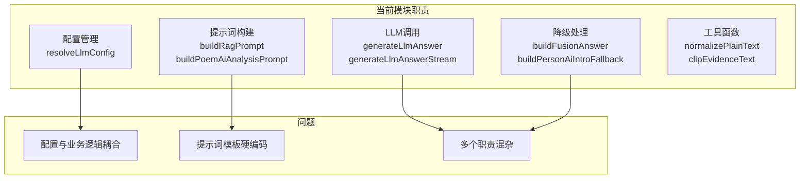
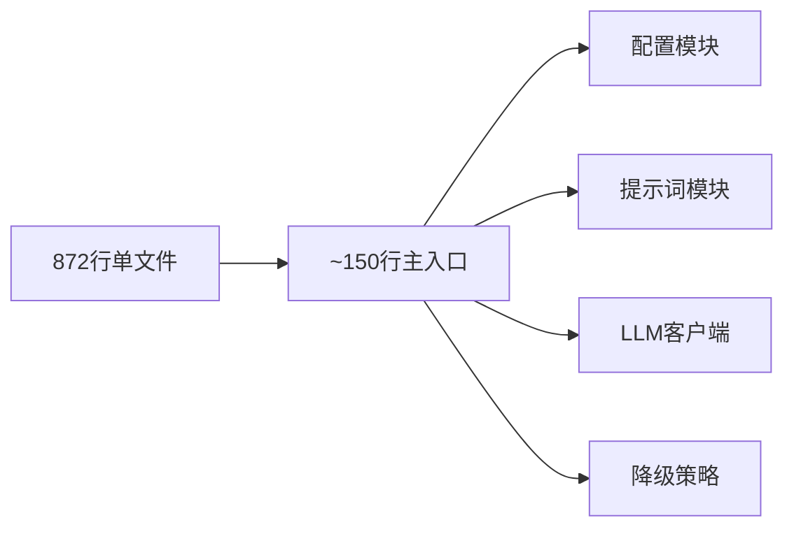
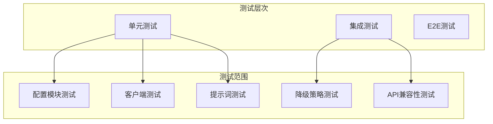

# llmService.js 重构方案

## 一、文件概况

| 指标 | 数值 |
|------|------|
| **文件路径** | `server/src/services/llmService.js` |
| **当前行数** | 872 行 |
| **文件大小** | 28KB |
| **风险等级** | 中 |

## 二、问题分析

### 2.1 代码结构分析



### 2.2 职责分布

| 职责 | 行数占比 | 问题 |
|------|----------|------|
| 配置解析 | ~50行 (6%) | 配置逻辑与业务混杂 |
| 提示词构建 | ~200行 (23%) | 硬编码在服务文件中 |
| LLM 调用 | ~250行 (29%) | 多个相似函数重复 |
| 降级处理 | ~100行 (11%) | 与主逻辑耦合 |
| 工具函数 | ~150行 (17%) | 可复用性差 |

## 三、重构目标



## 四、重构方案

### 4.1 目标目录结构

```
server/src/services/llm/
├── index.js                    # 统一导出入口 (~100行)
├── config.js                   # LLM 配置管理 (~80行)
├── client.js                   # LLM API 客户端 (~150行)
├── prompts/
│   ├── index.js               # 提示词统一导出
│   ├── ragPrompt.js           # RAG 提示词构建 (~100行)
│   ├── poemAnalysisPrompt.js  # 诗文分析提示词 (~80行)
│   └── templates.js           # 提示词模板常量 (~60行)
├── fallback/
│   ├── index.js               # 降级策略统一导出
│   ├── fusionFallback.js      # 融合问答降级 (~50行)
│   └── personIntroFallback.js # 人物介绍降级 (~40行)
└── utils/
    ├── index.js               # 工具函数统一导出
    ├── textNormalizer.js      # 文本规范化 (~60行)
    └── evidenceFormatter.js   # 证据格式化 (~50行)
```

### 4.2 模块拆分详情

#### 4.2.1 配置模块 (config.js)

```javascript
// 提取配置逻辑
export function resolveLlmConfig() { /* ... */ }
export function isLlmEnabled() { /* ... */ }
export function getLlmConfig() { /* ... */ }

// 新增：配置验证
export function validateLlmConfig(config) { /* ... */ }
```

#### 4.2.2 LLM 客户端 (client.js)

```javascript
// 统一 LLM 调用逻辑
export class LlmClient {
  constructor(config) { /* ... */ }

  async generate(messages, options) { /* ... */ }
  async generateStream(messages, options, onChunk) { /* ... */ }

  // 私有方法
  #buildHeaders() { /* ... */ }
  #buildBody() { /* ... */ }
  #parseSseLine() { /* ... */ }
}
```

#### 4.2.3 提示词模块 (prompts/)

```javascript
// prompts/ragPrompt.js
export function buildRagPrompt({ query, entities, citations, conversationHistory }) {
  // RAG 提示词构建逻辑
}

// prompts/poemAnalysisPrompt.js
export function buildPoemAiAnalysisPrompt(input) { /* ... */ }
export function normalizePoemAnalysisInput(input) { /* ... */ }
```

#### 4.2.4 降级策略模块 (fallback/)

```javascript
// fallback/fusionFallback.js
export function buildFusionAnswer({ query, entities, citations, dims }) { /* ... */ }
export function ensurePoemListCoverage({ query, entities, answerText }) { /* ... */ }

// fallback/personIntroFallback.js
export function buildPersonAiIntroFallback(name, referredContents) { /* ... */ }
```

#### 4.2.5 工具函数模块 (utils/)

```javascript
// utils/textNormalizer.js
export function normalizePlainText(value, maxLength) { /* ... */ }
export function extractPersonReferredContents(input, maxItems) { /* ... */ }

// utils/evidenceFormatter.js
export function clipEvidenceText(value, maxLength) { /* ... */ }
export function formatEntityEvidence(entity) { /* ... */ }
export function formatCitationEvidence(citation) { /* ... */ }
```

### 4.3 主入口重构 (index.js)

```javascript
// 统一导出入口
export { resolveLlmConfig, isLlmEnabled, getLlmConfig } from './config.js'
export { LlmClient } from './client.js'
export { buildRagPrompt, buildPoemAiAnalysisPrompt } from './prompts/index.js'
export { buildFusionAnswer, buildPersonAiIntroFallback } from './fallback/index.js'
export { normalizePlainText, clipEvidenceText } from './utils/index.js'

// 保持原有 API 兼容性
import { LlmClient } from './client.js'
import { buildRagPrompt } from './prompts/index.js'
import { buildFusionAnswer } from './fallback/index.js'

// 默认客户端实例
const defaultClient = new LlmClient()

export async function generateLlmAnswer(params) {
  return defaultClient.generate(buildRagPrompt(params), params)
}

export async function generateLlmAnswerStream(params, onChunk) {
  return defaultClient.generateStream(buildRagPrompt(params), params, onChunk)
}

export async function generateLlmTextByPrompt({ systemPrompt, userPrompt, maxTokens, temperature }) {
  return defaultClient.generate([
    { role: 'system', content: systemPrompt },
    { role: 'user', content: userPrompt }
  ], { maxTokens, temperature })
}
```

## 五、实施步骤

### 阶段一：创建基础设施（0.5小时）
1. 创建 `server/src/services/llm/` 目录结构
2. 提取配置模块 `config.js`
3. 提取工具函数 `utils/`

### 阶段二：提取核心模块（1小时）
1. 实现 `LlmClient` 类
2. 提取提示词模块 `prompts/`
3. 提取降级策略 `fallback/`

### 阶段三：重构主入口（0.5小时）
1. 重写 `llmService.js` 主入口
2. 保持 API 向后兼容
3. 更新导入路径

### 阶段四：测试与验证（1小时）
1. 单元测试各模块
2. 集成测试 API 兼容性
3. 性能回归测试

## 六、测试策略



### 测试文件规划

```
tests/server/services/llm/
├── config.test.js
├── client.test.js
├── prompts/
│   ├── ragPrompt.test.js
│   └── poemAnalysisPrompt.test.js
├── fallback/
│   ├── fusionFallback.test.js
│   └── personIntroFallback.test.js
└── integration/
    └── llmService.test.js
```

## 七、风险评估

| 风险项 | 影响程度 | 缓解措施 |
|--------|----------|----------|
| API 兼容性破坏 | 高 | 使用 re-export 保持原有导出 |
| 配置加载顺序 | 中 | 配置模块优先初始化 |
| 缓存失效 | 中 | 保持缓存逻辑不变 |
| 流式响应中断 | 中 | 统一 SSE 解析逻辑 |

## 八、预期收益

| 指标 | 重构前 | 重构后 |
|------|--------|--------|
| 主文件行数 | 872 | ~150 |
| 单个模块最大行数 | 872 | ~150 |
| 可测试性 | 中等 | 容易 |
| 提示词可维护性 | 低 | 高 |
| 降级策略可扩展性 | 低 | 高 |

## 九、时间估算

| 阶段 | 工作量 | 建议执行时机 |
|------|--------|--------------|
| 阶段一 | 0.5小时 | 可立即开始 |
| 阶段二 | 1小时 | 阶段一完成后 |
| 阶段三 | 0.5小时 | 阶段二完成后 |
| 阶段四 | 1小时 | 阶段三完成后 |

**总计：约 3 小时**

## 十、参考

- [模块化设计原则](https://nodejs.org/api/modules.html)
- [策略模式](https://refactoring.guru/design-patterns/strategy)
- [单一职责原则](https://en.wikipedia.org/wiki/Single-responsibility_principle)

---

*创建时间: 2026年*
*状态: 待评审*
