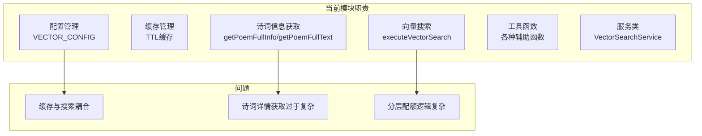
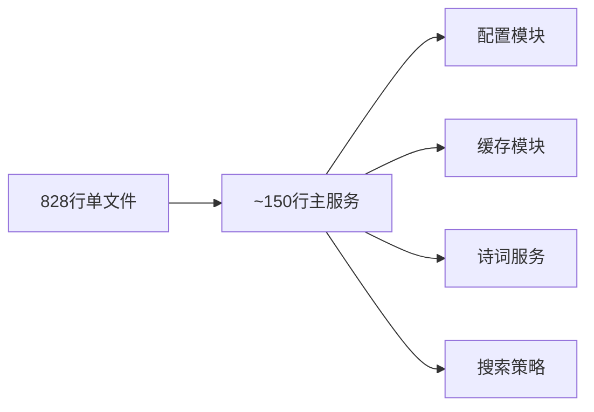
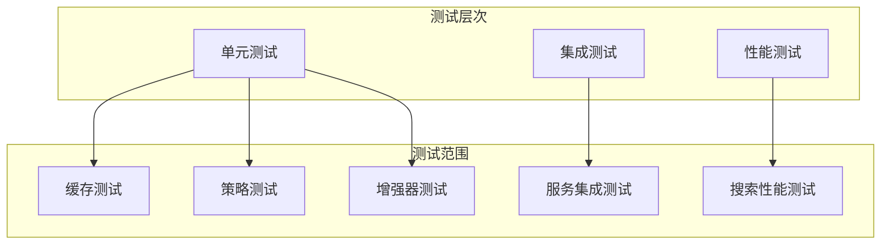

# vectorSearchService.js 重构方案

## 一、文件概况

| 指标 | 数值 |
|------|------|
| **文件路径** | `server/src/services/vectorSearchService.js` |
| **当前行数** | 828 行 |
| **文件大小** | 28KB |
| **风险等级** | 中 |

## 二、问题分析

### 2.1 代码结构分析



### 2.2 职责分布

| 职责 | 行数占比 | 问题 |
|------|----------|------|
| 配置常量 | ~60行 (7%) | 配置分散 |
| TTL 缓存 | ~50行 (6%) | 可复用 |
| 向量搜索核心 | ~180行 (22%) | 逻辑复杂 |
| 诗词信息获取 | ~150行 (18%) | 应独立服务 |
| 分层配额 | ~100行 (12%) | 可抽象 |
| 工具函数 | ~200行 (24%) | 可复用 |

## 三、重构目标



## 四、重构方案

### 4.1 目标目录结构

```
server/src/services/vector/
├── index.js                    # 统一导出入口 (~80行)
├── config.js                   # 向量搜索配置 (~60行)
├── cache.js                    # TTL 缓存管理 (~50行)
├── VectorSearchService.js      # 核心服务类 (~150行)
├── strategies/
│   ├── index.js               # 策略统一导出
│   ├── poemLayeredQuota.js    # 诗词分层配额 (~60行)
│   └── candidateMerging.js    # 候选合并策略 (~40行)
├── enrichers/
│   ├── index.js               # 信息增强器导出
│   ├── poemEnricher.js        # 诗词信息增强 (~100行)
│   └── documentFetcher.js     # 文档获取 (~60行)
└── utils/
    ├── index.js               # 工具函数导出
    ├── similarity.js          # 相似度计算 (~30行)
    └── normalization.js       # 数据规范化 (~40行)
```

### 4.2 模块拆分详情

#### 4.2.1 配置模块 (config.js)

```javascript
/**
 * 向量搜索配置
 */
export const VECTOR_CONFIG = {
  indexPaths: { /* ... */ },
  defaultTopK: 20,
  similarityThreshold: 0.3,
  // ...
}

export function resolveCandidatePoolSize(options, topK) { /* ... */ }
export function clampRatio(rawValue, fallbackValue) { /* ... */ }
```

#### 4.2.2 缓存模块 (cache.js)

```javascript
/**
 * 通用 TTL 缓存工厂
 */
export function createTtlCache(maxSize, ttlMs) {
  const storage = new Map()
  // ...
  return { get, set, clear, size }
}

/**
 * 预配置缓存实例
 */
export const vectorDocCache = createTtlCache(VECTOR_CONFIG.docCacheMaxSize, VECTOR_CONFIG.docCacheTtlMs)
export const poemInfoCache = createTtlCache(VECTOR_CONFIG.poemInfoCacheMaxSize, VECTOR_CONFIG.poemInfoCacheTtlMs)
export const poemTextCache = createTtlCache(VECTOR_CONFIG.poemTextCacheMaxSize, VECTOR_CONFIG.poemTextCacheTtlMs)
```

#### 4.2.3 核心服务类 (VectorSearchService.js)

```javascript
import { VECTOR_CONFIG } from './config.js'
import { applyPoemLayeredQuota } from './strategies/poemLayeredQuota.js'
import { PoemEnricher } from './enrichers/poemEnricher.js'

export class VectorSearchService {
  constructor(config = VECTOR_CONFIG) {
    this.config = config
    this.poemEnricher = new PoemEnricher()
  }

  getIndexPaths(scope) { /* ... */ }

  async search(scope, queryVector, options, marklogicFetch, marklogicBaseUrl) {
    // 1. 获取候选文档
    // 2. 计算相似度
    // 3. 应用分层配额
    // 4. 增强信息
  }

  isEnabled() { /* ... */ }
  getConfig() { /* ... */ }
}
```

#### 4.2.4 诗词分层配额策略 (strategies/poemLayeredQuota.js)

```javascript
/**
 * 诗文分层配额策略
 */
export function applyPoemLayeredQuota(sortedRows, topK, config) {
  // 提取 poems-set 和 poems-txt
  // 按配额比例选取
  // 剩余名额按相似度回填
}

function getPoemResultBucket(row) { /* ... */ }
function toResultDedupKey(row) { /* ... */ }
```

#### 4.2.5 诗词信息增强器 (enrichers/poemEnricher.js)

```javascript
import { poemInfoCache, poemTextCache } from '../cache.js'

export class PoemEnricher {
  async enrich(row, marklogicFetch, marklogicBaseUrl) {
    // 获取诗词完整信息
    // 获取诗词全文
    // 合并结果
  }

  async getPoemFullInfo(poemId, marklogicFetch, marklogicBaseUrl) { /* ... */ }
  async getPoemFullText(poemId, marklogicFetch, marklogicBaseUrl) { /* ... */ }
}
```

#### 4.2.6 工具函数 (utils/)

```javascript
// utils/similarity.js
export { cosineSimilarity } from '../embeddingService.js'

// utils/normalization.js
export function normalizeLexicalQuery(rawQueryText) { /* ... */ }
export function resolveVectorTypeByIndexPath(indexPath) { /* ... */ }
export function buildVectorResultBase({ result, doc, indexPath, similarity }) { /* ... */ }
```

### 4.3 主入口重构 (index.js)

```javascript
// 统一导出入口
export { VECTOR_CONFIG } from './config.js'
export { VectorSearchService } from './VectorSearchService.js'
export { createTtlCache, vectorDocCache, poemInfoCache, poemTextCache } from './cache.js'

// 便捷函数
import { VectorSearchService } from './VectorSearchService.js'
const vectorSearchService = new VectorSearchService()

export const mlVectorSearch = (scope, queryVector, options, marklogicFetch, marklogicBaseUrl) =>
  vectorSearchService.search(scope, queryVector, options, marklogicFetch, marklogicBaseUrl)

export const isVectorSearchEnabled = () => vectorSearchService.isEnabled()
export const getVectorSearchConfig = () => vectorSearchService.getConfig()

export default vectorSearchService
```

## 五、实施步骤

### 阶段一：创建基础设施（0.5小时）
1. 创建 `server/src/services/vector/` 目录结构
2. 提取配置模块 `config.js`
3. 提取缓存模块 `cache.js`

### 阶段二：提取工具和策略（1小时）
1. 提取工具函数 `utils/`
2. 提取分层配额策略 `strategies/`
3. 提取信息增强器 `enrichers/`

### 阶段三：重构核心服务（1小时）
1. 重写 `VectorSearchService` 类
2. 实现依赖注入
3. 保持 API 向后兼容

### 阶段四：测试与验证（1小时）
1. 单元测试各模块
2. 集成测试搜索功能
3. 性能回归测试

## 六、测试策略



### 测试文件规划

```
tests/server/services/vector/
├── config.test.js
├── cache.test.js
├── strategies/
│   ├── poemLayeredQuota.test.js
│   └── candidateMerging.test.js
├── enrichers/
│   └── poemEnricher.test.js
├── utils/
│   ├── similarity.test.js
│   └── normalization.test.js
└── integration/
    └── vectorSearch.test.js
```

## 七、风险评估

| 风险项 | 影响程度 | 缓解措施 |
|--------|----------|----------|
| 缓存状态丢失 | 中 | 保持缓存实例单例 |
| 搜索结果不一致 | 高 | 完整回归测试 |
| 性能下降 | 中 | 基准测试对比 |
| MarkLogic 连接问题 | 低 | 保持 fetch 接口不变 |

## 八、预期收益

| 指标 | 重构前 | 重构后 |
|------|--------|--------|
| 主文件行数 | 828 | ~150 |
| 单个模块最大行数 | 828 | ~150 |
| 缓存可复用性 | 低 | 高 |
| 策略可扩展性 | 低 | 高 |
| 测试覆盖率 | 中等 | 容易提升 |

## 九、时间估算

| 阶段 | 工作量 | 建议执行时机 |
|------|--------|--------------|
| 阶段一 | 0.5小时 | 可立即开始 |
| 阶段二 | 1小时 | 阶段一完成后 |
| 阶段三 | 1小时 | 阶段二完成后 |
| 阶段四 | 1小时 | 阶段三完成后 |

**总计：约 3.5 小时**

## 十、参考

- [策略模式](https://refactoring.guru/design-patterns/strategy)
- [依赖注入](https://en.wikipedia.org/wiki/Dependency_injection)
- [缓存模式](https://martinfowler.com/bliki/CachingPattern.html)

---

*创建时间: 2026年*
*状态: 待评审*
