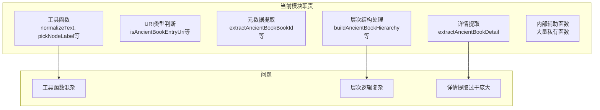
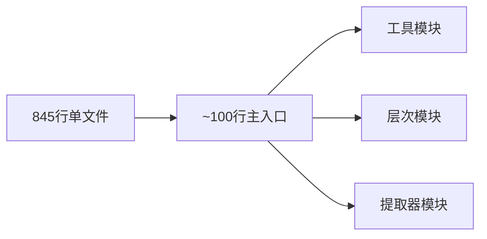

# ancientBookExtractor.js 重构方案

## 一、文件概况

| 指标 | 数值 |
|------|------|
| **文件路径** | `server/src/domain/detail/ancientBookExtractor.js` |
| **当前行数** | 845 行 |
| **文件大小** | 28KB |
| **风险等级** | 中 |

## 二、问题分析

### 2.1 代码结构分析



### 2.2 职责分布

| 职责 | 行数占比 | 问题 |
|------|----------|------|
| 工具函数 | ~150行 (18%) | 应独立模块 |
| URI 处理 | ~80行 (9%) | 可复用 |
| 元数据提取 | ~100行 (12%) | 可拆分 |
| 层次结构 | ~150行 (18%) | 逻辑复杂 |
| 详情提取 | ~200行 (24%) | 主函数过大 |
| 内部辅助 | ~160行 (19%) | 可复用 |

## 三、重构目标



## 四、重构方案

### 4.1 目标目录结构

```
server/src/domain/detail/ancientBook/
├── index.js                    # 统一导出入口 (~80行)
├── utils.js                    # 通用工具函数 (~100行)
├── uriParser.js                # URI 解析 (~80行)
├── metadata.js                 # 元数据提取 (~80行)
├── hierarchy.js                # 层次结构处理 (~100行)
├── extractor.js                # 主提取器 (~150行)
├── textExtractor.js            # 文本提取 (~80行)
└── manifestResolver.js         # Manifest 解析 (~80行)
```

### 4.2 模块拆分详情

#### 4.2.1 工具模块 (utils.js)

```javascript
/**
 * 通用工具函数
 */
export function normalizeText(value) { /* ... */ }
export function extractIdFromUri(uri) { /* ... */ }
export function extractMarkText(raw, limit) { /* ... */ }
export function pickNodeLabel(node) { /* ... */ }
export function extractDocText(doc) { /* ... */ }
export function pickRowTitle(row, doc) { /* ... */ }
export function extractCandidateUris(raw, limit) { /* ... */ }
```

#### 4.2.2 URI 解析模块 (uriParser.js)

```javascript
/**
 * URI 类型判断和解析
 */
export function isAncientBookEntryUri(uri) { /* ... */ }
export function isIiifManifestUri(uri) { /* ... */ }
export function classifyAncientBookHierarchyLevel(uri, docId) { /* ... */ }

/**
 * 元数据提取
 */
export function extractAncientBookBookId(uri, doc) { /* ... */ }
export function extractAncientBookVolumeMeta(uri) { /* ... */ }
export function extractAncientBookTxtBookMeta(uri) { /* ... */ }
```

#### 4.2.3 层次结构模块 (hierarchy.js)

```javascript
/**
 * 古籍层次结构处理
 */
export function resolveAncientBookSetUriByDocId(docId) { /* ... */ }
export function pickAncientBookHierarchyParentNode(doc) { /* ... */ }
export function dedupeAncientBookHierarchy(nodes) { /* ... */ }

export async function buildAncientBookHierarchy(uri, doc, title, dependencies) {
  // 构建层次结构
}
```

#### 4.2.4 文本提取模块 (textExtractor.js)

```javascript
/**
 * 古籍文本提取
 */
export function extractAncientBookVolumeText(doc, volumeLabel) { /* ... */ }
export function collectNestedTextFragments(raw, output, depth, visited) { /* ... */ }

export async function resolveAncientBookVolumeText(uri, doc, volumeMeta, volumeLabel, dependencies) {
  // 解析卷文本
}
```

#### 4.2.5 Manifest 解析模块 (manifestResolver.js)

```javascript
/**
 * IIIF Manifest 解析
 */
export function buildAncientBookCollectionManifestUri(bookId, origin) { /* ... */ }
export function normalizeAncientBookManifestIdToken(token) { /* ... */ }
export function normalizeAncientBookManifestUri(uri, bookId) { /* ... */ }
export function resolveAncientBookManifestUris(rawManifests, bookId) { /* ... */ }
export function extractIiifManifestUris(raw, limit) { /* ... */ }
```

#### 4.2.6 主提取器 (extractor.js)

```javascript
import { normalizeText, pickNodeLabel, extractDocText } from './utils.js'
import { extractAncientBookBookId, extractAncientBookVolumeMeta } from './uriParser.js'
import { buildAncientBookHierarchy } from './hierarchy.js'
import { resolveAncientBookVolumeText } from './textExtractor.js'
import { resolveAncientBookManifestUris, extractIiifManifestUris } from './manifestResolver.js'

/**
 * 从文档中提取古籍详细信息
 */
export async function extractAncientBookDetail(uri, doc, dependencies) {
  if (!doc) return null

  const { mlGetDoc, mlSearchByDirectory, searchWithFallback } = dependencies
  const title = pickRowTitle({ uri }, doc)

  // 1. 提取编纂者
  const compiler = extractCompiler(doc)

  // 2. 提取元数据
  const bookId = extractAncientBookBookId(uri, doc)
  const volumeMeta = extractAncientBookVolumeMeta(uri)
  const isVolume = Boolean(volumeMeta)

  // 3. 解析 Manifest
  const manifests = resolveAncientBookManifestUris([...extractIiifManifestUris(doc)], bookId)

  // 4. 构建层次结构
  const hierarchy = await buildAncientBookHierarchy(uri, doc, title, { mlGetDoc })

  // 5. 提取卷册项目
  const volumeItems = await collectAncientBookVolumeItems(bookId, { mlSearchByDirectory })

  // 6. 解析卷文本
  const { volumeText, volumeTextSourceUri } = isVolume
    ? await resolveAncientBookVolumeText(uri, doc, volumeMeta, title, dependencies)
    : { volumeText: '', volumeTextSourceUri: '' }

  return {
    id: extractIdFromUri(uri),
    title: title || '未命名古籍',
    compiler,
    hierarchy,
    manifests,
    texts: volumeItems,
    volumeText,
    // ...
  }
}

// 私有辅助函数
function extractCompiler(doc) { /* ... */ }
async function collectAncientBookVolumeItems(bookId, dependencies) { /* ... */ }
```

### 4.3 主入口 (index.js)

```javascript
// 统一导出入口
export {
  extractAncientBookDetail,
  extractAncientBookBookId,
  extractAncientBookVolumeMeta,
  classifyAncientBookHierarchyLevel,
  buildAncientBookHierarchy,
  isAncientBookEntryUri
} from './extractor.js'

export {
  normalizeText,
  pickNodeLabel,
  extractDocText
} from './utils.js'

// 默认导出保持兼容
export { default } from './extractor.js'
```

## 五、实施步骤

### 阶段一：提取基础模块（0.5小时）
1. 创建 `server/src/domain/detail/ancientBook/` 目录
2. 提取工具模块 `utils.js`
3. 提取 URI 解析 `uriParser.js`

### 阶段二：提取复杂模块（1小时）
1. 提取层次结构 `hierarchy.js`
2. 提取文本提取 `textExtractor.js`
3. 提取 Manifest 解析 `manifestResolver.js`

### 阶段三：重构主提取器（1小时）
1. 重写 `extractor.js`
2. 简化主提取函数
3. 保持 API 兼容

### 阶段四：测试验证（1小时）
1. 单元测试各模块
2. 集成测试 API
3. 回归测试

## 六、测试策略

```
tests/server/domain/detail/ancientBook/
├── utils.test.js
├── uriParser.test.js
├── hierarchy.test.js
├── textExtractor.test.js
├── manifestResolver.test.js
├── extractor.test.js
└── integration/
    └── ancientBookDetail.test.js
```

## 七、风险评估

| 风险项 | 影响程度 | 缓解措施 |
|--------|----------|----------|
| API 兼容性 | 中 | 使用 re-export |
| 层次结构逻辑 | 高 | 完整测试覆盖 |
| 文本提取遗漏 | 中 | 对比测试 |
| Manifest 解析 | 低 | 保持原逻辑 |

## 八、预期收益

| 指标 | 重构前 | 重构后 |
|------|--------|--------|
| 主文件行数 | 845 | ~150 |
| 单个模块最大行数 | 845 | ~150 |
| 可测试性 | 困难 | 容易 |
| 代码导航 | 困难 | 直观 |

## 九、时间估算

| 阶段 | 工作量 |
|------|--------|
| 阶段一 | 0.5小时 |
| 阶段二 | 1小时 |
| 阶段三 | 1小时 |
| 阶段四 | 1小时 |

**总计：约 3.5 小时**

---

*创建时间: 2026年*
*状态: 待评审*
