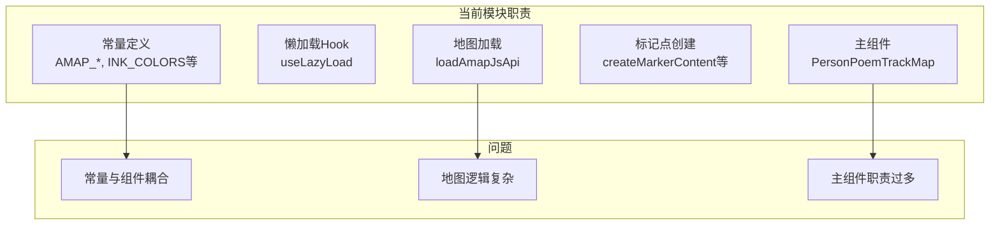
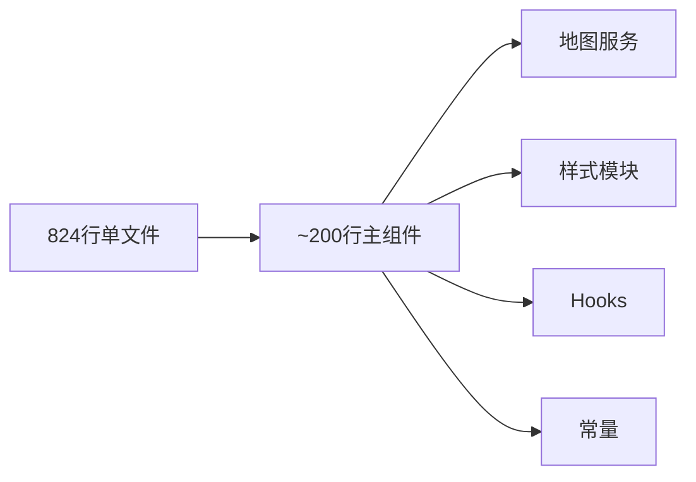
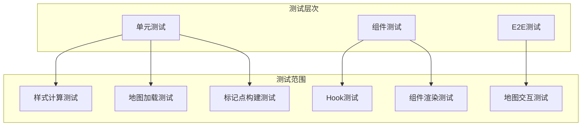

# PersonPoemTrackMap.tsx 重构方案

## 一、文件概况

| 指标 | 数值 |
|------|------|
| **文件路径** | `src/features/details/components/PersonPoemTrackMap.tsx` |
| **当前行数** | 824 行 |
| **文件大小** | 28KB |
| **风险等级** | 中 |

## 二、问题分析

### 2.1 代码结构分析



### 2.2 职责分布

| 职责 | 行数占比 | 问题 |
|------|----------|------|
| 常量定义 | ~80行 (10%) | 可独立 |
| 懒加载 Hook | ~40行 (5%) | 可复用 |
| 地图加载逻辑 | ~80行 (10%) | 应独立模块 |
| 标记点样式 | ~100行 (12%) | 可独立 |
| 主组件 | ~400行 (49%) | 职责过多 |
| 辅助函数 | ~120行 (14%) | 可复用 |

## 三、重构目标



## 四、重构方案

### 4.1 目标目录结构

```
src/features/details/components/PersonPoemTrackMap/
├── index.tsx                    # 主组件导出入口 (~200行)
├── PersonPoemTrackMap.tsx       # 主组件实现 (~200行)
├── constants.ts                 # 常量定义 (~60行)
├── hooks/
│   ├── index.ts                # Hooks 统一导出
│   ├── useLazyLoad.ts          # 懒加载 Hook (~40行)
│   └── useMapState.ts          # 地图状态 Hook (~50行)
├── services/
│   ├── index.ts                # 服务统一导出
│   ├── amapLoader.ts           # 地图加载服务 (~80行)
│   └── markerBuilder.ts        # 标记点构建服务 (~80行)
├── styles/
│   ├── index.ts                # 样式统一导出
│   ├── inkColors.ts            # 墨色配色 (~40行)
│   └── markerStyles.ts         # 标记点样式 (~50行)
└── utils/
    ├── index.ts                # 工具函数统一导出
    └── trackUtils.ts           # 轨迹工具函数 (~40行)
```

### 4.2 模块拆分详情

#### 4.2.1 常量模块 (constants.ts)

```typescript
/**
 * 高德地图相关常量
 */
export const AMAP_JS_API_VERSION = '2.0'
export const AMAP_JS_API_URL = 'https://webapi.amap.com/maps'
export const AMAP_SCRIPT_ID = 'heluo-amap-jsapi-v2-track'
export const AMAP_DEFAULT_ZOOM = 10

/**
 * 动画配置
 */
export const DEFAULT_ANIMATION_INTERVAL = 1500

/**
 * 从环境变量获取配置
 */
export const AMAP_KEY = String(import.meta.env.REACT_AMAP_KEY || '').trim()
export const AMAP_SECURITY_JS_CODE = String(import.meta.env.REACT_AMAP_SECURITY_JS_CODE || '').trim()
```

#### 4.2.2 样式模块 (styles/)

```typescript
// styles/inkColors.ts
/**
 * 墨色渐变配色常量
 */
export const INK_COLORS = {
  dark: '#1a1a1a',
  light: '#7a7a7a',
  vermilion: '#c0392b',
  line: '#4a4a4a',
} as const

/**
 * 根据年份计算墨色
 */
export function calculateInkColor(
  year: number,
  yearRange: { start: number; end: number }
): string { /* ... */ }

// styles/markerStyles.ts
/**
 * 标记点基础样式
 */
export const MARKER_BASE_STYLE = `...`

/**
 * 水墨晕染动画样式
 */
export const INK_HALO_ANIMATION = `...`

/**
 * 创建水墨晕染效果的标记点
 */
export function createInkHaloMarker(inkColor: string, number: number): string { /* ... */ }
```

#### 4.2.3 服务模块 (services/)

```typescript
// services/amapLoader.ts
/**
 * 高德地图加载服务
 */
let amapLoadPromise: Promise<any> | null = null

export function buildAmapJsApiUrl(): string { /* ... */ }

export function loadAmapJsApi(): Promise<any> {
  // 单例模式加载高德地图 API
}

// services/markerBuilder.ts
/**
 * 标记点构建服务
 */
export function createMarkerContent(
  number: number,
  year: number,
  yearRange: { start: number; end: number },
  isCurrent: boolean
): string { /* ... */ }

export function createMarkers(
  AMap: any,
  map: any,
  trackPoints: PoemTrackPoint[],
  yearRange: { start: number; end: number },
  currentYear: number | null,
  onMarkerClick: (year: number) => void
): void { /* ... */ }
```

#### 4.2.4 Hooks 模块 (hooks/)

```typescript
// hooks/useLazyLoad.ts
/**
 * 懒加载 Hook
 */
export function useLazyLoad<T extends Element>(
  options: { threshold?: number; rootMargin?: string } = {}
): { ref: React.RefObject<T>; isInView: boolean } { /* ... */ }

// hooks/useMapState.ts
/**
 * 地图状态管理 Hook
 */
export function useMapState(
  trackData: PersonPoemTrack | null,
  currentYear: number | null
): {
  mapStatus: MapLoadStatus
  mapRef: React.MutableRefObject<any>
  markersRef: React.MutableRefObject<any[]>
  polylineRef: React.MutableRefObject<any>
} { /* ... */ }
```

#### 4.2.5 主组件重构 (PersonPoemTrackMap.tsx)

```typescript
/**
 * PersonPoemTrackMap 主组件
 */
export function PersonPoemTrackMap({
  personId,
  trackData: externalTrackData,
  initialYear,
  animationInterval = DEFAULT_ANIMATION_INTERVAL,
  onPoemClick,
  onLoadingChange,
}: PersonPoemTrackMapProps): JSX.Element | null {
  // 使用拆分后的 Hooks 和 Services
  const { ref: lazyLoadRef, isInView } = useLazyLoad<HTMLDivElement>()
  const { mapStatus, mapRef, markersRef } = useMapState(trackData, currentYear)

  // 简化的渲染逻辑
  // ...

  return (
    <Card ref={lazyLoadRef}>
      {/* 使用拆分后的子组件 */}
      <MapContainer
        ref={mapContainerRef}
        status={mapStatus}
      />
      <BottomTimeline
        yearRange={yearRange}
        currentYear={currentYear}
        onYearChange={handleYearChange}
      />
      <PoemListPanel
        trackPoint={currentTrackPoint}
        onPoemClick={handlePoemClick}
      />
    </Card>
  )
}
```

### 4.3 工具函数模块 (utils/)

```typescript
// utils/trackUtils.ts
/**
 * 提取轨迹点坐标数组
 */
export function extractTrackPoints(trackPoints: PoemTrackPoint[]): Array<{ lng: number; lat: number }> { /* ... */ }

/**
 * 获取可用年份列表
 */
export function getAvailableYears(trackPoints: PoemTrackPoint[]): number[] { /* ... */ }

/**
 * 获取年份范围
 */
export function getYearRange(
  trackData: PersonPoemTrack | null,
  availableYears: number[]
): { start: number; end: number } { /* ... */ }
```

## 五、实施步骤

### 阶段一：创建目录结构（0.5小时）
1. 创建 `PersonPoemTrackMap/` 目录
2. 提取常量 `constants.ts`
3. 提取样式模块 `styles/`

### 阶段二：提取服务和 Hooks（1小时）
1. 提取地图加载服务 `services/amapLoader.ts`
2. 提取标记点构建 `services/markerBuilder.ts`
3. 提取懒加载 Hook `hooks/useLazyLoad.ts`
4. 提取地图状态 Hook `hooks/useMapState.ts`

### 阶段三：重构主组件（1.5小时）
1. 简化主组件逻辑
2. 使用拆分后的模块
3. 保持 API 兼容

### 阶段四：测试验证（1小时）
1. 单元测试各模块
2. 组件测试
3. E2E 测试地图交互

## 六、测试策略



### 测试文件规划

```
tests/features/details/components/PersonPoemTrackMap/
├── constants.test.ts
├── styles/
│   ├── inkColors.test.ts
│   └── markerStyles.test.ts
├── services/
│   ├── amapLoader.test.ts
│   └── markerBuilder.test.ts
├── hooks/
│   ├── useLazyLoad.test.ts
│   └── useMapState.test.ts
├── utils/
│   └── trackUtils.test.ts
└── integration/
    └── PersonPoemTrackMap.test.tsx
```

## 七、风险评估

| 风险项 | 影响程度 | 缓解措施 |
|--------|----------|----------|
| 高德地图加载时机 | 中 | 保持单例模式 |
| 标记点点击事件 | 中 | 事件代理统一管理 |
| 样式注入顺序 | 低 | 确保动画样式先注入 |
| 组件状态同步 | 中 | 使用 useEffect 依赖数组 |

## 八、预期收益

| 指标 | 重构前 | 重构后 |
|------|--------|--------|
| 主组件行数 | 824 | ~200 |
| 单个模块最大行数 | 824 | ~80 |
| 可测试性 | 困难 | 容易 |
| 样式复用性 | 低 | 高 |
| Hook 复用性 | 无 | 高 |

## 九、时间估算

| 阶段 | 工作量 |
|------|--------|
| 阶段一 | 0.5小时 |
| 阶段二 | 1小时 |
| 阶段三 | 1.5小时 |
| 阶段四 | 1小时 |

**总计：约 4 小时**

## 十、参考

- [React 组件拆分最佳实践](https://react.dev/learn/thinking-in-react)
- [自定义 Hook](https://react.dev/learn/reusing-logic-with-custom-hooks)
- [高德地图 JS API](https://lbs.amap.com/api/javascript-api/summary)

---

*创建时间: 2026年*
*状态: 待评审*
