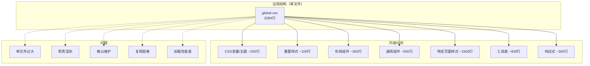
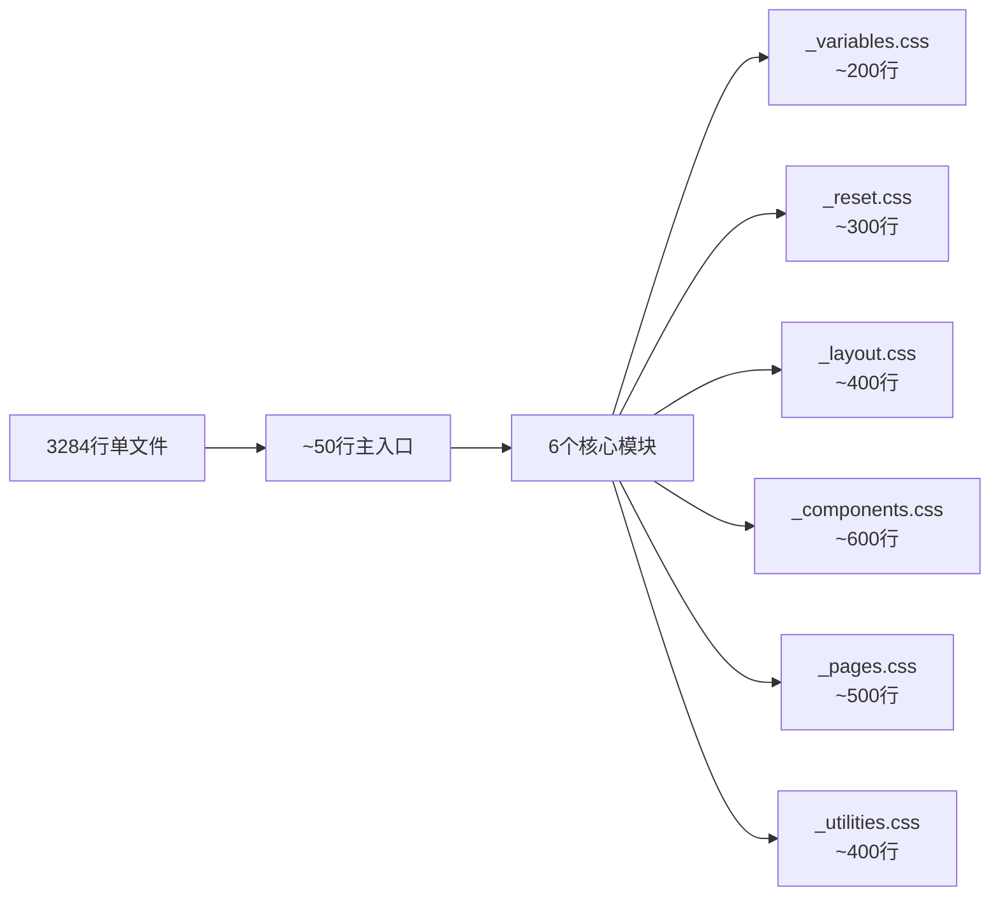
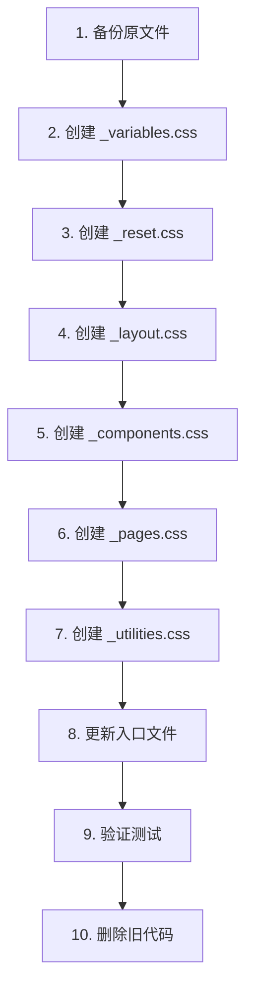

# global.css 重构方案

## 一、文件概况

| 指标 | 数值 |
|------|------|
| **文件路径** | `src/styles/global.css` |
| **当前行数** | 3284 行 |
| **文件大小** | 64KB |
| **风险等级** | 高 |

## 二、问题分析

### 2.1 代码结构分析



### 2.2 具体问题

1. **文件过大**：3284 行代码，加载和解析开销大
2. **职责混乱**：变量、重置、组件、页面样式混杂
3. **难以维护**：修改样式需要在巨大文件中定位
4. **复用困难**：样式块难以独立复用
5. **Tree-shaking 失效**：所有样式打包在一起

## 三、重构目标



## 四、重构方案

### 4.1 目标目录结构（精简版）

> **设计原则**：遵循 ITCSS 架构思想，但避免过度拆分。保持 6-7 个核心文件，每个文件 200-600 行，平衡可维护性与管理成本。

```
src/styles/
├── global.css                   # 主入口文件 (~50行)
├── _variables.css               # CSS 变量定义 (~200行)
├── _reset.css                   # 重置 + 字体 + 动画 (~300行)
├── _layout.css                  # 布局（网格 + Flex + 容器）(~400行)
├── _components.css              # 组件样式（合并所有通用组件）(~600行)
├── _pages.css                   # 页面特定样式（合并所有页面）(~500行)
├── _utilities.css               # 工具类（间距 + 文本 + 响应式）(~400行)
│
└── features/                    # 功能模块（保留现有结构）
    ├── common/
    │   └── EntityMetadata.css
    └── details/
        ├── OverviewTab.css
        └── ...
```

### 4.2 文件职责对比

| 文件 | 行数 | 职责 | 包含内容 |
|------|------|------|----------|
| `_variables.css` | ~200 | 设计令牌 | 颜色、间距、圆角、阴影、字体变量 |
| `_reset.css` | ~300 | 基础样式 | 重置样式、字体排版、全局动画 |
| `_layout.css` | ~400 | 布局系统 | Grid、Flexbox、容器、响应式断点 |
| `_components.css` | ~600 | UI组件 | 按钮、卡片、表单、表格、模态框、提示框、加载状态 |
| `_pages.css` | ~500 | 页面样式 | 首页、详情页、搜索页、聊天页特定样式 |
| `_utilities.css` | ~400 | 工具类 | 间距、文本、显示/隐藏、响应式工具 |

### 4.3 主入口文件重构 (global.css)

```css
/* ========================================
   全局样式入口
   按层次导入各模块（精简版）
   ======================================== */

/* ===== 基础层 ===== */
@import './_variables.css';
@import './_reset.css';

/* ===== 布局层 ===== */
@import './_layout.css';

/* ===== 组件层 ===== */
@import './_components.css';

/* ===== 页面层 ===== */
@import './_pages.css';

/* ===== 工具层 ===== */
@import './_utilities.css';
```

### 4.4 CSS 变量文件示例 (_variables.css)

```css
/* ========================================
   CSS 变量定义
   基于 Yale LUX 设计系统风格
   ======================================== */

:root {
  /* ===== 主色调 ===== */
  --primary: #003366;
  --primary-light: #004d99;
  --primary-dark: #002244;

  /* ===== 链接色 ===== */
  --link: #007bff;
  --link-hover: #0056b3;
  --link-visited: #551a8b;

  /* ===== 中性色 ===== */
  --text: #333333;
  --muted: #666666;
  --border: #d9d9d9;
  --bg: #f8f9fa;
  --panel: #ffffff;

  /* ===== 状态色 ===== */
  --success: #28a745;
  --warning: #ffc107;
  --error: #dc3545;
  --info: #17a2b8;

  /* ===== 间距 ===== */
  --spacing-xs: 4px;
  --spacing-sm: 8px;
  --spacing-md: 16px;
  --spacing-lg: 24px;
  --spacing-xl: 32px;

  /* ===== 圆角 ===== */
  --radius-sm: 4px;
  --radius-md: 8px;
  --radius-lg: 12px;
  --radius-full: 999px;

  /* ===== 阴影 ===== */
  --shadow-card: 0 2px 8px rgba(0, 0, 0, 0.1);
  --shadow-card-hover: 0 4px 16px rgba(0, 0, 0, 0.15);
  --shadow-panel: 0 1px 4px rgba(0, 0, 0, 0.08);
}
```

### 4.5 重置文件示例 (_reset.css)

```css
/* ========================================
   基础样式重置 + 字体排版 + 全局动画
   ======================================== */

/* ===== Reset ===== */
* {
  box-sizing: border-box;
}

body {
  margin: 0;
  color: var(--text);
  background: linear-gradient(180deg, #eef2ff 0%, var(--bg) 25%);
  font-family: 'Microsoft YaHei', 'PingFang SC', 'Noto Sans SC', sans-serif;
}

/* ===== Typography ===== */
h1, h2, h3, h4, h5, h6 { /* ... */ }
p { /* ... */ }
a { /* ... */ }

/* ===== Animations ===== */
@keyframes fadeIn { /* ... */ }
@keyframes slideUp { /* ... */ }
```

### 4.6 组件文件示例 (_components.css)

```css
/* ========================================
   组件样式（合并文件）
   ======================================== */

/* ===== Buttons ===== */
.btn { /* ... */ }
.btn--primary { /* ... */ }
.btn--secondary { /* ... */ }

/* ===== Cards ===== */
.card { /* ... */ }
.card--elevated { /* ... */ }
.card__header { /* ... */ }
.card__body { /* ... */ }

/* ===== Forms ===== */
.form-group { /* ... */ }
.input { /* ... */ }
.select { /* ... */ }

/* ===== Tables ===== */
.table { /* ... */ }
.table__row { /* ... */ }

/* ===== Modals ===== */
.modal { /* ... */ }
.modal__backdrop { /* ... */ }

/* ===== Chips ===== */
.chip { /* ... */ }
.chip--selected { /* ... */ }

/* ===== Loading ===== */
.spinner { /* ... */ }
.skeleton { /* ... */ }

/* ===== Tooltips ===== */
.tooltip { /* ... */ }
```

### 4.7 工具类文件示例 (_utilities.css)

```css
/* ========================================
   工具类（合并文件）
   ======================================== */

/* ===== Spacing ===== */
.m-0 { margin: 0; }
.mt-1 { margin-top: var(--spacing-sm); }
.p-0 { padding: 0; }
/* ... */

/* ===== Text ===== */
.text-center { text-align: center; }
.text-muted { color: var(--muted); }
.text-truncate { /* ... */ }
/* ... */

/* ===== Display ===== */
.d-none { display: none; }
.d-flex { display: flex; }
.d-grid { display: grid; }
/* ... */

/* ===== Responsive ===== */
@media (max-width: 768px) {
  .hide-mobile { display: none !important; }
}

@media (min-width: 769px) and (max-width: 1024px) {
  .hide-tablet { display: none !important; }
}

@media (min-width: 1025px) {
  .hide-desktop { display: none !important; }
}
```

## 五、实施步骤

### 阶段一：提取变量和重置层（1.5小时）


1. 分析 `global.css` 中的 CSS 变量
2. 创建 `_variables.css`，迁移所有变量
3. 提取重置样式、字体排版、动画到 `_reset.css`
4. 创建新的 `global.css` 入口

### 阶段二：提取布局层（1小时）

1. 识别网格、Flex、容器相关样式
2. 提取响应式断点样式
3. 整合到 `_layout.css`

### 阶段三：提取组件层（2小时）

1. 按组件类型归类现有样式
2. 依次提取：按钮、卡片、表单、表格、模态框等
3. 整合到 `_components.css`
4. 添加区块注释分隔各组件

### 阶段四：提取页面层（1.5小时）

1. 按页面归类样式
2. 整合到 `_pages.css`
3. 添加区块注释分隔各页面

### 阶段五：提取工具层（1小时）

1. 提取间距、文本、显示类工具
2. 整合到 `_utilities.css`

### 阶段六：验证与清理（1小时）

1. 验证样式完整性
2. 删除重复样式
3. 测试各页面渲染
4. 文档更新

## 六、迁移策略

### 6.1 渐进式迁移流程



### 6.2 兼容性保证

```css
/* global.css - 精简版入口 */

/* 新的模块化导入 */
@import './_variables.css';
@import './_reset.css';
@import './_layout.css';
@import './_components.css';
@import './_pages.css';
@import './_utilities.css';

/* 注意：不再需要 _compatibility.css
   所有样式已完整迁移到对应模块 */
```

## 七、风险评估

| 风险项 | 影响程度 | 缓解措施 |
|--------|----------|----------|
| 样式丢失 | 高 | 渐进式迁移，每步验证 |
| 导入顺序问题 | 中 | 保持原有层叠顺序 |
| 构建配置变更 | 低 | 无需修改 Vite 配置 |
| 文件管理复杂度 | 低 | 仅 7 个文件，易于追踪 |
| 合并冲突 | 低 | 使用区块注释分隔 |

## 八、预期收益

| 指标 | 重构前 | 重构后 |
|------|--------|--------|
| 主文件行数 | 3284 | ~50 |
| CSS 模块数量 | 1 | 7 |
| 单个模块最大行数 | 3284 | ~600 |
| 目录层级 | 1 | 2 |
| 可维护性 | 困难 | 容易 |
| 样式复用 | 低 | 高 |
| 加载性能 | 差 | 可优化 |
| 文件管理复杂度 | 低 | 适中 |

> **设计决策**：选择 7 个核心文件而非 20+ 个文件，是因为：
> 1. **避免过度碎片化**：过多小文件增加心智负担和导入管理成本
> 2. **合理的文件粒度**：每个文件 200-600 行，既可维护又不过大
> 3. **清晰的职责边界**：按功能层划分，而非按每个组件/页面划分
> 4. **符合 ITCSS 精神**：从通用到特定，但不过度拆分

## 九、构建优化建议

### 9.1 Vite 配置（无需修改）

```typescript
// vite.config.ts - 现有配置已足够
export default defineConfig({
  css: {
    devSourcemap: true,
  },
})
```

### 9.2 后续优化方向

1. **CSS Modules**：为组件级样式启用 CSS Modules
2. **按需加载**：页面级样式可动态导入
3. **PurgeCSS**：移除未使用的工具类

## 十、时间估算

| 阶段 | 工作量 | 说明 |
|------|--------|------|
| 阶段一 | 1.5小时 | 提取变量和重置层 |
| 阶段二 | 1小时 | 提取布局层 |
| 阶段三 | 2小时 | 提取组件层 |
| 阶段四 | 1.5小时 | 提取页面层 |
| 阶段五 | 1小时 | 提取工具层 |
| 阶段六 | 1小时 | 验证与清理 |

**总计：约 8 小时**（相比原方案节省 2 小时）

## 十一、参考

- [CSS 架构指南](https://www.smashingmagazine.com/2018/05/guide-css-layout/)
- [ITCSS 架构](https://itcss.io/)
- [BEM 命名规范](https://getbem.com/)
- [Vite CSS 处理](https://vitejs.dev/guide/features.html#css)

---

*创建时间: 2026年*
*状态: 待评审*
