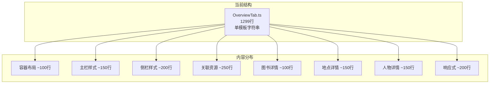
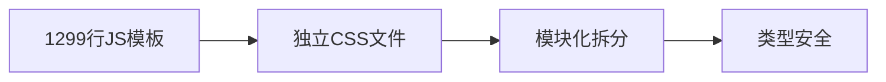

# OverviewTab.ts (CSS 模板字符串) 重构方案

## 一、文件概况

| 指标 | 数值 |
|------|------|
| **文件路径** | `src/styles/features/details/OverviewTab.ts` |
| **当前行数** | 1299 行 |
| **文件大小** | 32KB |
| **风险等级** | 中 |

## 二、问题分析

### 2.1 代码结构分析



### 2.2 具体问题

1. **模板字符串过大**：1299 行 CSS 全在一个 JS 模板字符串中
2. **无语法高亮**：模板字符串中的 CSS 无法获得 IDE 支持
3. **无样式复用**：大量重复的选择器前缀
4. **维护困难**：修改样式需要在 JS 文件中操作
5. **类型不安全**：CSS 类名没有类型检查

## 三、重构目标



## 四、重构方案

### 4.1 目标目录结构

```
src/styles/features/details/
├── OverviewTab/
│   ├── index.css               # 主入口 (~50行)
│   ├── _variables.css          # 局部变量 (~30行)
│   ├── layout/
│   │   ├── _container.css      # 容器布局 (~100行)
│   │   ├── _main-column.css    # 主栏样式 (~150行)
│   │   └── _sidebar.css        # 侧栏样式 (~200行)
│   ├── sections/
│   │   ├── _book-hero.css      # 图书 Hero (~100行)
│   │   ├── _place-hero.css     # 地点 Hero (~150行)
│   │   ├── _person-hero.css    # 人物 Hero (~150行)
│   │   └── _metadata.css       # 元数据样式 (~80行)
│   ├── cards/
│   │   ├── _related-card.css   # 关联资源卡片 (~250行)
│   │   ├── _relation-group.css # 关系分组 (~150行)
│   │   └── _recommend-item.css # 推荐项 (~100行)
│   └── responsive/
│       └── _breakpoints.css    # 响应式样式 (~200行)
└── index.css                    # 总入口
```

### 4.2 主入口文件重构

#### 4.2.1 新的 CSS 模块化入口 (index.css)

```css
/* ========================================
   OverviewTab 样式模块
   ======================================== */

/* 局部变量 */
@import './_variables.css';

/* 布局 */
@import './layout/_container.css';
@import './layout/_main-column.css';
@import './layout/_sidebar.css';

/* 区块 */
@import './sections/_book-hero.css';
@import './sections/_place-hero.css';
@import './sections/_person-hero.css';
@import './sections/_metadata.css';

/* 卡片 */
@import './cards/_related-card.css';
@import './cards/_relation-group.css';
@import './cards/_recommend-item.css';

/* 响应式 */
@import './responsive/_breakpoints.css';
```

#### 4.2.2 原文件重构 (OverviewTab.ts)

```typescript
/**
 * OverviewTab 样式导出
 *
 * 从独立 CSS 文件导入样式
 */

// 导入 CSS 模块
import styles from './OverviewTab/index.css?inline'

// 导出样式字符串（保持向后兼容）
export default styles

// 或者：使用 CSS 类名映射
export const OVERVIEW_TAB_CLASSES = {
  container: 'yale-overview-tab',
  main: 'yale-overview-tab__main',
  sidebar: 'yale-overview-tab__sidebar',
  // ...
} as const
```

### 4.3 局部变量提取 (_variables.css)

```css
/* ========================================
   OverviewTab 局部变量
   依赖全局变量，扩展页面级变量
   ======================================== */

:root {
  /* ===== 侧栏配置 ===== */
  --overview-sidebar-width: 360px;
  --overview-sidebar-gap: var(--yale-spacing-module);

  /* ===== 卡片圆点颜色 ===== */
  --overview-relation-warm: #8b6914;
  --overview-relation-teal: #1a7a6e;
  --overview-relation-green: #2e7d32;
  --overview-relation-blue: var(--yale-primary);

  /* ===== 经典金色 ===== */
  --overview-gold: #c9a227;
}
```

### 4.4 布局模块拆分

#### 4.4.1 容器布局 (_container.css)

```css
/* ========================================
   OverviewTab 容器 - 两栏布局
   ======================================== */

.yale-overview-tab {
  display: grid;
  grid-template-columns: 1fr var(--overview-sidebar-width);
  gap: var(--yale-spacing-module);
  align-items: stretch;
}

/* ===== 页面类型变体 ===== */
.yale-overview-tab--person {
  grid-template-columns: minmax(0, 1fr) 380px;
  gap: 2rem;
}

.yale-overview-tab--book {
  grid-template-columns: minmax(0, 1fr) 360px;
  gap: 1.15rem;
}

.yale-overview-tab--place {
  grid-template-columns: minmax(0, 1fr) 340px;
  gap: 1.2rem;
}
```

#### 4.4.2 侧栏布局 (_sidebar.css)

```css
/* ========================================
   OverviewTab 侧栏（右侧）
   ======================================== */

.yale-overview-tab__sidebar {
  display: flex;
  flex-direction: column;
  gap: var(--overview-sidebar-gap);
  position: sticky;
  top: 1rem;
  max-height: calc(100vh - 2rem);
  overflow-y: auto;
}

/* 侧栏子项禁止被 flex 压缩 */
.yale-overview-tab__sidebar > * {
  flex-shrink: 0;
}

/* 侧栏标题 - 金色下划线装饰 */
.yale-overview-tab__sidebar-title {
  font: var(--yale-font-h3);
  color: var(--yale-primary);
  margin: 0;
  padding-bottom: 0.5rem;
  border-bottom: 2px solid var(--overview-gold);
  position: relative;
}

.yale-overview-tab__sidebar-title::after {
  content: '';
  position: absolute;
  bottom: -2px;
  left: 0;
  width: 30px;
  height: 2px;
  background: var(--yale-primary);
}
```

### 4.5 卡片模块拆分

#### 4.5.1 关联资源卡片 (_related-card.css)

```css
/* ========================================
   关联资源卡片样式 - 金色装饰
   ======================================== */

.yale-overview-tab__related-card {
  background-color: var(--yale-white);
  border: 1px solid var(--yale-border);
  border-radius: var(--yale-radius-md);
  overflow: hidden;
  position: relative;
}

/* 金色顶部装饰线 */
.yale-overview-tab__related-card::before {
  content: '';
  position: absolute;
  top: 0;
  left: 0;
  right: 0;
  height: 2px;
  background: var(--overview-gold);
}

/* 卡片头部 */
.yale-overview-tab__related-header {
  display: flex;
  align-items: flex-start;
  justify-content: space-between;
  padding: 0.75rem 1rem;
  background-color: var(--yale-light);
  border-bottom: 1px solid var(--yale-border);
  cursor: pointer;
  transition: background-color 0.2s ease;
}

.yale-overview-tab__related-header:hover {
  background-color: rgba(201, 162, 39, 0.1);
}

/* ... 更多样式 */
```

#### 4.5.2 关系分组 (_relation-group.css)

```css
/* ========================================
   关联人物卡片样式 - 按关系类型分组
   ======================================== */

/* 分组内容容器 */
.yale-overview-tab__related-content--grouped {
  display: flex;
  flex-direction: column;
  gap: 0.6rem;
}

/* 单个关系类型分组 */
.yale-overview-tab__relation-group {
  border-radius: var(--yale-radius-sm);
  overflow: hidden;
  border: 1px solid var(--yale-border);
  background: rgba(255, 255, 255, 0.6);
}

/* ===== 颜色主题变体 ===== */

/* 温暖色：父、母、师、徒 - 琥珀金 */
.yale-overview-tab__relation-group--warm {
  background: linear-gradient(135deg, rgba(193, 152, 73, 0.08) 0%, rgba(255, 248, 235, 0.6) 100%);
  border-color: rgba(193, 152, 73, 0.25);
}

/* 青绿色：友、诗友、友人 */
.yale-overview-tab__relation-group--teal {
  background: linear-gradient(135deg, rgba(32, 139, 127, 0.06) 0%, rgba(240, 250, 248, 0.6) 100%);
  border-color: rgba(32, 139, 127, 0.2);
}

/* ... 更多变体 */
```

### 4.6 响应式拆分 (_breakpoints.css)

```css
/* ========================================
   响应式设计
   ======================================== */

/* ===== 大屏幕调整 ===== */
@media (max-width: 1024px) {
  .yale-overview-tab {
    grid-template-columns: 1fr 320px;
  }

  .yale-overview-tab--place {
    grid-template-columns: minmax(0, 1fr) 300px;
  }
}

/* ===== 平板布局 ===== */
@media (max-width: 768px) {
  .yale-overview-tab {
    grid-template-columns: 1fr;
  }

  .yale-overview-tab--book .yale-overview-tab__main {
    order: 2;
  }

  .yale-overview-tab--book .yale-overview-tab__sidebar {
    order: 1;
  }

  .yale-overview-tab__sidebar {
    position: static;
    max-height: none;
    overflow-y: visible;
  }

  /* ... 更多样式 */
}

/* ===== 移动端布局 ===== */
@media (max-width: 480px) {
  .yale-overview-tab {
    gap: var(--yale-spacing-card);
  }

  .yale-overview-tab__section {
    padding: var(--yale-padding-sm);
    border-radius: var(--yale-radius-sm);
  }

  /* ... 更多样式 */
}
```

## 五、实施步骤

### 阶段一：创建 CSS 目录结构（0.5小时）
1. 创建 `OverviewTab/` 目录
2. 创建 `_variables.css`
3. 创建 `index.css` 入口

### 阶段二：提取布局模块（1小时）
1. 提取容器布局
2. 提取主栏样式
3. 提取侧栏样式

### 阶段三：提取区块和卡片模块（1.5小时）
1. 提取 Hero 区块
2. 提取关联资源卡片
3. 提取关系分组

### 阶段四：提取响应式（0.5小时）
1. 提取响应式断点
2. 整理媒体查询

### 阶段五：重构 TS 文件和验证（1小时）
1. 重写 OverviewTab.ts
2. 验证样式完整性
3. 测试所有页面变体

## 六、类型安全增强

### 6.1 CSS 类名类型定义

```typescript
// types/styles.d.ts
declare module '*.css?inline' {
  const content: string
  export default content
}

// types/overview-tab-classes.ts
export interface OverviewTabClasses {
  container: string
  main: string
  sidebar: string
  section: string
  // ...
}

declare const OVERVIEW_TAB_CLASSES: OverviewTabClasses
export default OVERVIEW_TAB_CLASSES
```

### 6.2 在组件中使用

```typescript
// OverviewTab.tsx
import styles from '@/styles/features/details/OverviewTab/index.css'

// 方式1：通过 injectStyles 注入
import { injectStyles } from '@/lib/dom/injectStyles'
useEffect(() => {
  const cleanup = injectStyles(styles, 'overview-tab-styles')
  return cleanup
}, [])

// 方式2：使用 CSS Modules
import styles from './OverviewTab.module.css'
// <div className={styles.container}>
```

## 七、风险评估

| 风险项 | 影响程度 | 缓解措施 |
|--------|----------|----------|
| 样式加载顺序 | 中 | 保持导入顺序 |
| 类名冲突 | 低 | 使用 BEM 命名规范 |
| 构建配置变更 | 低 | 更新 Vite 配置 |
| 运行时注入 | 中 | 确保样式在渲染前注入 |

## 八、预期收益

| 指标 | 重构前 | 重构后 |
|------|--------|--------|
| 主文件行数 | 1299 | ~50 |
| CSS 模块最大行数 | 1299 | ~250 |
| IDE 支持 | 无 | 完整 |
| 类型安全 | 无 | 有 |
| 可维护性 | 困难 | 容易 |
| 样式复用 | 低 | 高 |

## 九、时间估算

| 阶段 | 工作量 |
|------|--------|
| 阶段一 | 0.5小时 |
| 阶段二 | 1小时 |
| 阶段三 | 1.5小时 |
| 阶段四 | 0.5小时 |
| 阶段五 | 1小时 |

**总计：约 4.5 小时**

## 十、参考

- [CSS 模块化最佳实践](https://css-tricks.com/css-modules-part-1-need/)
- [BEM 命名规范](https://getbem.com/)
- [Vite CSS 处理](https://vitejs.dev/guide/features.html#css)

---

*创建时间: 2026年*
*状态: 待评审*
