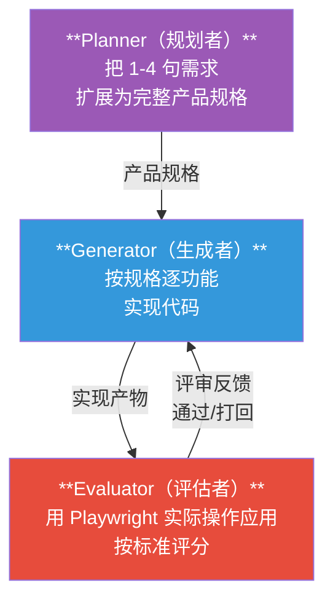
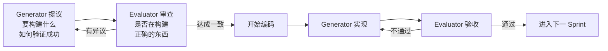
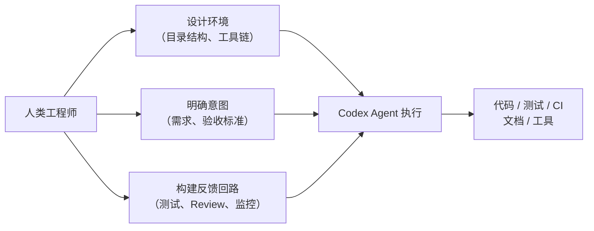
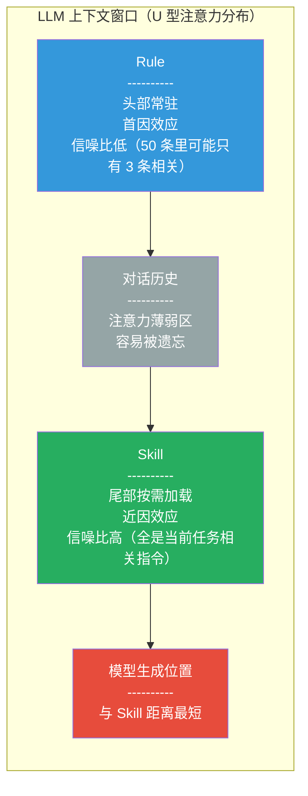
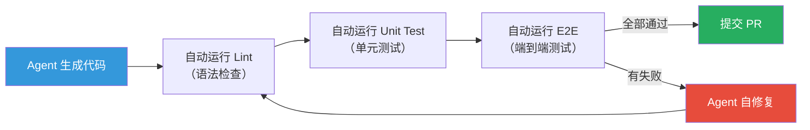
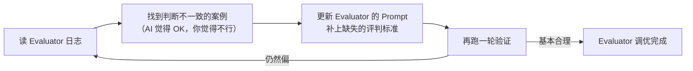
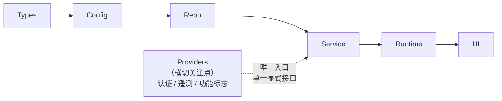
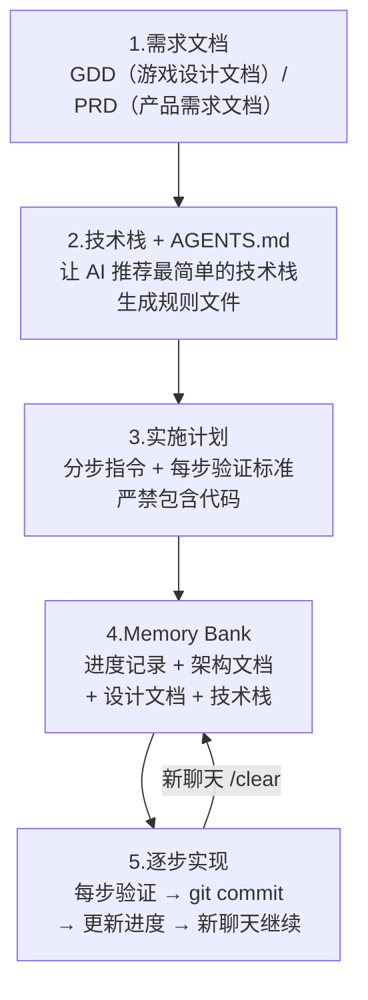
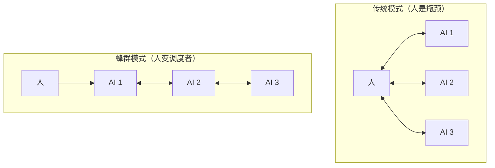
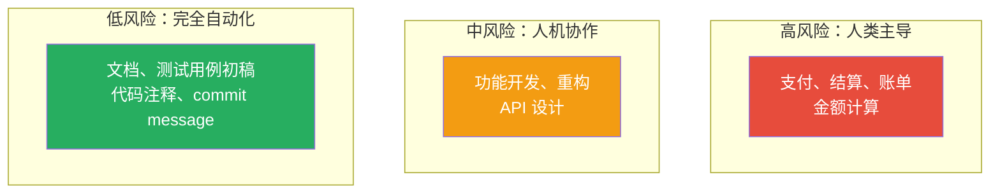

# Agent 开发实践指南

> 综合自 Anthropic Harness Design、OpenAI Harness Engineering、yousali.com AI Coding 效率研究、vibe-coding-cn 社区实践

---

## 核心概念速查表

阅读本文前，先过一遍这些反复出现的关键术语。遇到不清楚的地方，可以随时回来查阅。

| 术语 | 一句话解释 | 来源 |
|------|-----------|------|
| **Harness** | 给 AI Agent 套上的「脚手架」，包含规划、执行、验证等环节的编排结构 | Anthropic / OpenAI |
| **Agent** | 能自主完成多步骤任务的 AI 程序，不只是问答，还能操作工具、读写文件、运行命令 | 通用 |
| **Context Window** | 模型一次能「看到」的文本总量上限，超出后需要压缩或清空重来 | 通用 |
| **Spec** | 业务知识文档 —— 描述「做什么」「当前系统长什么样」 | yousali.com |
| **Rule** | 工程规范清单 —— 短小明确的约束，始终加载在上下文头部（300-500 行） | yousali.com |
| **Skill** | 按需加载的工作流 —— 回答「怎么一步步做」，用完即释放 | yousali.com / vibe-coding-cn |
| **Sprint Contract** | Generator 和 Evaluator 在编码前协商的「完成标准」 | Anthropic |
| **Evaluator** | 独立的评审 Agent，用 Playwright 等工具实际操作应用，按标准评分 | Anthropic |
| **Generator** | 负责生成代码的 Agent，接受 Evaluator 反馈后迭代改进 | Anthropic |
| **安灯绳** | 源自丰田生产系统：发现问题就停线修复。在 Agent 中指自动化的验证闭环 | yousali.com |
| **WIP 限制** | Work In Progress 限制，控制同时进行中的任务数量，防止下游堆积 | 精益生产 |
| **SDLC** | Software Development Life Cycle，软件开发生命周期：从需求到上线的完整流程 | 软件工程 |
| **DORA 指标** | Google Cloud 的 DevOps 效能衡量标准：部署频率、前置时间、MTTR、变更失败率 | Google |
| **Load-bearing** | 「承重的」—— 指 Harness 中去掉就会导致性能下降的关键组件 | Anthropic |
| **渐进式披露** | 不一次性把所有信息塞给 Agent，而是从小入口开始，按需引导它去查看详情 | OpenAI |
| **胶水编程** | Glue Coding —— 不造轮子，只写「连接代码」把成熟模块粘在一起 | vibe-coding-cn |
| **Vibe Coding** | 以自然语言驱动 AI 生成代码的开发方式，由 Andrej Karpathy 提出 | 社区 |

---

## 一、核心认知：效率悖论与真正的杠杆点

> **这一章回答一个问题**：为什么用了 AI 写代码，团队交付速度并没有变快？

### 1.1 AI 编码的效率悖论

METR（一家专注于 AI 模型能力评估的研究机构）做了一个目前唯一一项**预注册随机对照实验**（RCT）—— 16 名资深开源开发者，在自己最熟悉的代码库上工作。

> **什么是「预注册 RCT」？** 预注册意味着实验设计提前锁定、不能事后改假设；随机对照意味着有控制组和实验组，不是自选分组。这是科学实验的金标准。

结果揭示了一个反直觉的结论：

| 指标 | 数据 | 含义 |
|------|------|------|
| 客观完成时间 | 慢了 19% | 计时器不会骗人 |
| 主观感受速度 | 快了 20% | 开发者「觉得」快了 |
| 主客观偏差 | 39 个百分点 | 自我感觉和实际表现严重脱节 |

Faros AI 对 10,000+ 开发者的遥测数据进一步印证：个体任务完成数 +21%，PR 合并数 +98%，但组织级 **DORA 四大交付指标**（部署频率、前置时间、MTTR、变更失败率）无一改善。

> **什么是 DORA 指标？** Google Cloud 旗下的 DevOps 研究团队提出的四个衡量软件交付效能的核心指标。简单说就是：你多快能发布？从写代码到上线要多久？出了问题多久能恢复？发布有多少比例会出问题？

**根因分析**：PR 体积 +154%，评审时间 +91%。AI 帮你写了两倍的代码，打包成两倍大的 PR，扔给了同一个 reviewer。reviewer 的带宽没有翻倍，评审时间自然翻倍。**上游加速产生的所有增量，被下游瓶颈原封不动地吃掉了。**

### 1.2 约束理论的启示

> **什么是约束理论？** 1984 年，以色列物理学家 Eliyahu Goldratt 在商业小说《目标》中提出：系统的产出由瓶颈决定，不由最快的环节决定。他举了一个经典案例 —— 一家工厂引进了效率提升 36% 的数控机器人，但整体交付周期反而恶化了，因为瓶颈在另一台热处理炉上。

把这个理论套到软件开发上：

> 绿色 = AI 加速的环节，红色 = 实际瓶颈。加速非瓶颈环节，唯一的效果是下游堆积。

**核心定律**：局部效率的提升，如果不在瓶颈上，对系统产出为零甚至为负。AI Coding 的真正红利不在加速编码，而在重新定义「做什么」和「怎么做」的边界。

### 1.3 正确的定位：洗衣机洗衣服，你去读书

> **洗衣机悖论**：20 世纪美国家庭陆续添置了洗衣机、吸尘器等省力设备，但主妇每周的家务时间几乎没有减少。原因：有了洗衣机，衣服从一周洗一次变成穿一次就洗。效率提升被更高的标准吃掉了。

映射到 AI Coding 上：你用 AI 写代码更快了，老板看到你这周产出了 5 个 feature，下周给你排了 8 个。你并没有更轻松，你在洗更多衣服。

**正确的做法**：

| 错误定位 | 正确定位 |
|----------|----------|
| 让 AI 替你写更多代码 | 用省出的时间做以前做不到的事 |
| 效率提升（线性回报） | 能力进化（复利回报） |
| 同样的事做得更快 | 重新定义做什么和怎么做的边界 |

---

## 二、架构设计：多 Agent 系统的 Harness 模式

> **这一章回答一个问题**：怎样组织多个 AI Agent 协作，才能让它们完成单个 Agent 做不到的事？

### 2.1 什么是 Harness？

> **Harness（脚手架/线束）**：不是 AI 模型本身，而是围绕模型搭建的工程结构 —— 包括任务拆分、上下文管理、验证反馈、Agent 间通信等。类比：模型是发动机，Harness 是整辆车的底盘、转向和刹车系统。发动机再强，没有 Harness 也跑不起来。

### 2.2 Anthropic 的三 Agent 架构

受**生成对抗网络（GAN）**的启发，Anthropic 设计了 Generator-Evaluator 对抗架构：

> **GAN 是什么？** 一种 AI 训练方法，包含两个网络：生成器（造假钞）和判别器（验钞）。生成器不断提高造假水平，判别器不断提高验钞能力，双方对抗下共同进化。Anthropic 把这个思路搬到了代码生成上。

后来演进为三 Agent 系统：

| 角色 | 职责 | 关键约束 |
|------|------|----------|
| **Planner** | 将 1-4 句需求扩展为完整产品规格 | 聚焦产品上下文与高层技术设计，**不深入实现细节**（避免错误级联） |
| **Generator** | 按规格逐功能实现，自我评估后交付 QA | 每次只做一个功能（Sprint），有 git 版本控制 |
| **Evaluator** | 用 Playwright 逐点测试，按评分标准验收 | **独立于 Generator**，评分不通过则打回重做 |

> **Playwright 是什么？** 一个浏览器自动化测试工具，能让 AI 像真实用户一样点击、输入、截图，实际「体验」自己生成的应用。

**实测效果**（以「2D 复古游戏制作器」为例）：

| 模式 | 耗时 | 成本 | 产出质量 |
|------|------|------|----------|
| 单 Agent（无 Harness） | 20 分钟 | $9 | 界面浪费空间、工作流死板、**核心游戏功能损坏** |
| 三 Agent Harness | 6 小时 | $200 | 功能完整、UI 精致、AI 集成、**核心玩法可运行** |

虽然贵了 20 倍，但单 Agent 的核心功能根本不能跑，Harness 版本的实际可用。

### 2.3 Sprint Contract 机制

> **Sprint Contract（冲刺合约）**：在开始编码之前，Generator 和 Evaluator 先就「什么算做完」达成书面协议。类似于装修前先签合同约定验收标准，而不是装修完了再吵。

流程如下：

这个机制解决了一个常见问题：产品规格是高层级的，但实现需要可测试的具体标准。Sprint Contract 就是两者之间的桥梁。

### 2.4 两个关键失败模式及解法

> **什么是「失败模式」？** 系统在特定条件下会犯的系统性错误。不是偶然的 bug，而是结构性的缺陷。

| 失败模式 | 表现 | 解法 |
|----------|------|------|
| **上下文焦虑** | 模型感觉自己快到上下文窗口上限了，就开始草草收尾 | **上下文重置**：清空窗口，通过结构化文件把进度交接给下一个 Agent |
| **自我评估偏袒** | Agent 对自己写的代码过度自信，明明有问题也觉得「挺好的」 | **分离 Generator 和 Evaluator**，让独立的 Evaluator 来评判 |

> **上下文焦虑 vs 压缩（Compaction）的区别**：压缩是在原地将旧对话摘要，Agent 还在同一个窗口里继续工作，焦虑感可能还在。上下文重置是彻底清空窗口、开一个新 Agent，通过交接文件传递状态 —— 给它一个干净的大脑，代价是交接文件必须足够完整。

### 2.5 OpenAI 的全 Agent 生产线

OpenAI 更激进：整个产品（约 100 万行代码、1,500 个 PR）**全部由 Codex Agent 编写，人类零行代码**。3 名工程师的核心工作从写代码变成了：

**关键数据**：

| 指标 | 数据 |
|------|------|
| 代码规模 | 约 100 万行 |
| PR 数量 | 约 1,500 个 |
| 工程师团队 | 3 人（后扩展到 7 人） |
| 人均每日 PR | 3.5 个 |
| 单次 Codex 运行时长 | 可超过 6 小时 |
| 相对手工编码的效率 | 约 1/10 时间 |

---

## 三、上下文工程：给 Agent 一张地图，而非一本百科全书

> **这一章回答一个问题**：怎么组织信息，让 Agent 看到该看的、不看不该看的？

### 3.1 Spec / Rule / Skill 三层分离

这是所有主流 AI Coding 框架（OpenSpec、Superpowers、BMAD、Spec Kit）最终收敛到的底层模式。搞混三者的代价很大 —— 大量团队的 Rule 文件动辄上千行，里面既有业务背景、编码规范、还塞了完整工作流程，这不是 Rule，这是大杂烩。

> **一个类比帮你记住**：Spec 是**教材**（学什么知识），Rule 是**考场纪律**（不能作弊、不能交头接耳），Skill 是**解题方法**（这道题分五步做）。三样东西性质不同，不能混在一起。

| 维度 | Spec（规格） | Rule（规则） | Skill（技能） |
|------|-------------|-------------|--------------|
| **本质** | 业务知识 | 工程规范 | 工作流 |
| **回答的问题** | 做什么 | 约束是什么 | 怎么一步步做 |
| **类比** | 函数的参数 | 全局常量 / 考场纪律 | 模块化的 import |
| **加载方式** | 被 Skill 消费（作为输入数据） | 始终加载在上下文**头部** | 按需加载到上下文**尾部** |
| **长度上限** | 视业务复杂度 | **300-500 行**（超出模型开始遗忘） | 不受限 |
| **生命周期** | 随业务迭代更新 | 相对稳定 | 按需加载，用完释放 |

### 3.2 为什么 Skill 的指令遵循性比 Rule 好？

> **Lost in the Middle 现象**（Liu et al. 2023, 发表于 TACL 2024）：LLM 对上下文的利用呈 **U 型曲线** —— 开头和结尾的信息被最好地利用，中间位置的性能下降超过 20 个百分点。

这意味着：

**Rule 是全局变量，Skill 是模块化 import。**

你的 Rule 文件有 50 条规则，正在让 AI 写一个 React 组件。50 条里可能有 Go 的命名规范、Python 的类型标注、数据库迁移注意事项。真正相关的只有 3 条。剩下 47 条是**噪声**。Skill 不一样 —— 触发「写 React 组件」的 Skill 时，上下文中只出现相关指令。信噪比从 3/50 变成接近 1:1。

### 3.3 AGENTS.md 作为「内容目录」

> **AGENTS.md**：AI Agent 进入代码仓库时首先读取的文件，相当于 Agent 的「入职手册」。各家做法不同，但 OpenAI 的实践尤其值得关注。

OpenAI 的核心观点：**AGENTS.md 不应是百科全书，而应是内容目录（Table of Contents）**。

| 做法 | 原因 |
|------|------|
| 控制在约 **100 行** | 大指令文件挤掉任务、代码和相关文档的上下文空间 |
| 指向 `docs/` 目录 | 详细知识库位于结构化目录中，Agent 按需去读 |
| **渐进式披露** | Agent 从小而稳定的切入点开始，被指导「下一步去哪里看」 |

> **渐进式披露**：就像餐厅菜单不会把所有菜品的原料、产地、做法全印在第一页，而是分成「今日推荐 → 主菜 → 甜点」逐步展开。Agent 也一样 —— 先看 100 行的目录，需要时再深入具体文档。

OpenAI 还用 **CI 强制验证**文档质量：linter 和 CI 作业会检查知识库是否更新、交叉链接是否有效。甚至有一个「文档园丁」Agent 定期扫描过时文档，自动发起修复 PR。

### 3.4 最小可行 Spec

不需要每次都写完整设计文档。**最小可行的 Spec 只需回答四个问题**：

| 序号 | 问题 | 为什么重要 |
|------|------|-----------|
| 1 | 现在的行为是什么？ | 让 AI 知道基线在哪里 |
| 2 | 期望改成什么？ | 明确目标 |
| 3 | 哪些行为必须保持不变？ | 防止改一处坏两处 |
| 4 | 边界条件有哪些？ | AI 最容易猜错的地方 |

> 这四个问题你做方案时脑子里本来就会过一遍，写下来只是十几分钟的事。但如果不写，AI 就只能「面对代码猜意图」。

**什么时候不需要 Spec？** 全新项目没有历史包袱、探索性 spike 本身就是在试错、极小改动上下文一目了然 —— 这些场景可以省略。Spec 真正值钱的地方是**存量系统、多接口兼容、业务规则复杂**的场景。

---

## 四、验证闭环：给 Agent 一根安灯绳

> **这一章回答一个问题**：怎么让 AI 自己发现问题、停下来修复，而不是持续生产有缺陷的代码？

### 4.1 安灯绳原则

> **安灯绳（Andon Cord）**：源自丰田生产系统。装配线上每个工位旁悬挂一根绳子，任何工人发现质量问题都可以拉动它，生产线亮起信号灯。如果问题无法在节拍时间内解决，**整条生产线停止**。丰田的逻辑是：现在花 100 万修复，好过把缺陷传递到下游花 1000 万。

AI 生成代码就像高速运转的织布机 —— 速度极快，但不会自己发现缝针断了。给它加上 Lint + Unit Test + E2E 验证，就是给它装安灯绳。

**验证闭环**：`Generate → Verify → Fix → Verify → ...`

### 4.2 瑞士奶酪模型：多层纵深防御

> **瑞士奶酪模型**（James Reason, 1990）：每一层防御都有漏洞，就像瑞士奶酪上的孔。但只要层数够多、孔不对齐，错误就穿不透。航空业用这个模型把致命事故率从每百万航班 6 次降到了 0.5 次以下。

| 层次 | 拦截目标 | 类比 |
|------|----------|------|
| **Lint** | 语法格式错误 | 拼写检查器 |
| **Unit Test** | 边界条件、逻辑分支 | 课后习题 |
| **Code Review** | 架构疏漏、设计不当 | 同行评审 |
| **E2E / QA** | 用户流程断裂 | 模拟考试 |
| **人类判断** | 深层设计合理性 | 终审委员会 |

**核心思想**：每一层都有漏网之鱼，四层叠加后穿透率极低。信任不是给人的，是给机制的。

> **但验证不是万能的**。Lint 只能捕获格式错误，Unit Test 只能验证你已经想到的行为，E2E 只能覆盖预设的用户路径。真正棘手的逻辑缺陷、架构不当、性能退化，大部分不在自动验证的覆盖范围内。验证闭环的价值在于：**把低级错误从人工发现变成自动发现，释放你的精力去关注那些自动验证覆盖不到的深层问题。**

### 4.3 评分标准设计（Anthropic 实践）

Anthropic 为前端设计评估制定了四个维度。关键在于：权重不等，且明确惩罚 AI 默认模式。

| 评分维度 | 权重 | 判定标准 | 为什么这样设权重？ |
|----------|------|----------|-------------------|
| **设计质量** | 高 | 整体是否协调一致，是否创造了独特的视觉身份 | Claude 默认产出偏 bland（平庸），需要重点拉高 |
| **原创性** | 高 | 是否有刻意的设计决策，还是模板/AI 默认值 | 明确惩罚「紫色渐变 + 白色卡片」等 AI slop 模式 |
| **工艺** | 中 | 排版层级、间距一致性、色彩和谐度 | Claude 在这方面默认就做得不错，不需要额外强调 |
| **功能性** | 中 | 用户能否理解界面、找到主要操作、完成任务 | 技术能力基本到位，不是瓶颈 |

> **AI slop**：AI 生成的千篇一律的内容痕迹。在设计领域表现为：紫色渐变、白色卡片、圆角阴影、无个性化的模板感。

### 4.4 Evaluator 的调优心得

Anthropic 的原话：

> "开箱即用，Claude 是一个糟糕的 QA Agent。它会识别出合理的问题，然后**说服自己这些问题没什么大不了**，照样批准交付。"

这说明了为什么 Evaluator 必须独立于 Generator，而且需要专门调优。调优方法是一个迭代闭环：

---

## 五、架构约束：通过不变量而非微观管理

> **这一章回答一个问题**：怎么管住 Agent，让它不会越写越乱？

### 5.1 核心原则

> **不变量（Invariant）**：无论实现怎么变，永远必须成立的规则。例如「金额字段必须用 Decimal 类型」—— 不管你怎么实现，这条不能变。微观管理则是规定「你必须用这个库、这样写代码」。

**OpenAI 的做法**：强制执行不变量，但在不变量之内允许 Agent 自由发挥。就像高速路上设护栏和限速，但不规定你开什么车、听什么歌。

### 5.2 严格分层架构（OpenAI 实践）

每个业务域划分为固定的层，依赖方向严格单向：

**规则**：代码只能「向前」依赖。横切关注点（认证、遥测、功能标志）通过单一显式接口进入。其他任何跨越层级的依赖，都会被自动化工具拦截。

> **为什么 Agent 特别需要这种约束？** 人类开发者有直觉和经验来维持架构一致性，Agent 没有。在 100 人团队里可能要到 500 行代码时才需要这种严格分层，但对于 Agent 团队，这是**从第一天就必须建立的前提条件**：有了约束，速度才不会下降，架构才不会漂移。

**执行方式**：自定义 linter + 结构测试机械地强制执行。而且 linter 的错误信息会**注入修复指令**，让 Agent 看到报错就知道怎么改。

### 5.3 品味不变式

> **品味不变式（Taste Invariants）**：带有主观意见的机械规则，目的是保持代码库对 Agent 的可读性。例如：倾向共享工具包而非手写辅助函数；不做「YOLO 式」数据探测，验证边界或依赖类型化 SDK。

OpenAI 编码到工具中的规则示例：

| 规则 | 为什么 |
|------|--------|
| 倾向共享工具包而非手写辅助函数 | 集中管理不变量，Agent 不会各写各的版本 |
| 不做 YOLO 式数据探测 | 防止 Agent 猜测数据结构然后基于错误假设构建 |
| 错误信息中注入修复指令 | Agent 看到报错就知道怎么改，不用猜 |

### 5.4 垃圾回收式技术债管理

> **AI 残渣**：Agent 会复制代码仓库中已存在的模式，包括那些不理想或不够好的模式。久而久之，这些不良模式在代码库中传播扩散。

OpenAI 团队过去每周五花 20% 的时间手动清理 AI 残渣。后来他们把「黄金原则」编码到代码库中，建立了循环清理流程。这就像**垃圾回收（GC）**：技术债像高息贷款，不断以小额偿还，总比让债务累积后痛苦地一次解决要好。

---

## 六、并发策略：从执行者到调度员

> **这一章回答一个问题**：单任务变慢了，怎么通过并行来弥补？

### 6.1 一个类比：马士基的慢船策略

2008 年金融危机后，航运巨头马士基做了一个反直觉的决定：让船开慢一点。航速降 20%，但省下的钱部署更多船只，更密集的班次。**单艘船变慢了，但整个航运网络的总吞吐量反而更大了。**

这就是并发的逻辑：同时洗衣烧水做饭，总时间等于最长的那个单任务。

### 6.2 核心公式

假设按完整 SDLC 流程走，单任务比手写慢 50%：

| 并发度 | 计算方式 | 总产出（相对手写） | 收益判断 |
|--------|---------|-------------------|----------|
| 1（串行） | 1 / 1.5 | 0.67x | 负收益 |
| 2 | 2 / 1.5 | 1.33x | 盈亏线附近 |
| 3 | 3 / 1.5 | 2x | 明确正收益 |

> **实际可行的并发度**：Anthropic 2026 年 1 月的报告显示，能完全托管给 AI 的任务占比只有 0-20%。实践中可行的并发度大概是 **2-3**。但只要并发度 >= 2，在单任务慢 50% 的情况下，你依然是正收益。

### 6.3 先建闭环，再开并发（顺序不可逆）

你敢同时开 5 个任务不盯着，前提是每个任务跑完之后你能快速判断它对不对。如果没有自动验证，你得逐个打开代码仔细读，那并发就毫无意义 —— 你的 Review 带宽成了新的瓶颈。

### 6.4 WIP 限制

> **WIP（Work In Progress）限制**：控制同时处于「进行中」状态的工作数量。来自精益生产的核心理念。

并发不是无脑开更多窗口。你同时开 5 个 session，产出 5 个 PR，reviewer 的队列立刻爆满，又回到了第一章说的下游堆积问题。

**并发 + WIP 的配合**：

- 并发加速**生成端**（你写更多代码）
- WIP 限制保护**Review 端**（不让 PR 堆积）
- 两者配合，系统吞吐才真的提升

---

## 七、Vibe Coding 实战工作流

> **这一章回答一个问题**：日常开发中，具体怎么落地？

### 7.1 标准开发循环

基于 vibe-coding-cn 社区（2.6 万 Star）的实践总结：

> **Memory Bank**：存放在项目根目录 `memory-bank/` 下的文件集合，包含设计文档、技术栈、实施计划、进度记录、架构说明。它是对话之间传递上下文的「交接棒」。每次新对话开始时，让 AI 先读所有 Memory Bank 文件。

### 7.2 关键原则

| 原则 | 说明 | 为什么重要 |
|------|------|-----------|
| **先结构后代码** | 明确数据结构、接口、模块关系再实现 | 防止 AI 在没有全局观的情况下乱写 |
| **文档即上下文** | 文档不是事后补，是给 Agent 的导航地图 | Agent 看不到你脑子里的知识 |
| **明确写清边界** | 能改什么、不能改什么，用约束清单 | 防止 AI 「顺手」改了不该改的东西 |
| **Debug 最小复现** | 只给：预期 vs 实际 + 最小复现步骤 | 大段报错信息会淹没关键线索 |
| **AI 犯错即经验** | 持久化存储错误模式，构建防错知识库 | 同一个错不犯第二次 |

### 7.3 胶水编程（Glue Coding）

> **胶水编程**：Vibe Coding 的终极进化形态。核心理念是「能抄不写，能连不造，能复用不原创」。不是让你写更多代码，而是让你只写「连接代码」—— 把成熟的模块粘在一起。

| 问题 | 胶水编程解法 |
|------|-------------|
| AI 幻觉（编造不存在的 API） | 只使用已验证的成熟代码，零幻觉 |
| 复杂性爆炸 | 每个模块都是久经考验的轮子 |
| 门槛过高 | 只需描述「连接方式」，不用从零造 |

### 7.4 AI 蜂群协作

> **蜂群协作**：让多个 AI Agent 互相感知、协作、分工，人从瓶颈变为调度者。基于 tmux（终端复用工具）实现。

实现方式：tmux + `capture-pane`（读取任意终端内容）+ `send-keys`（向任意终端发送命令）+ 共享状态文件。

---

## 八、Harness 的迭代精简

> **这一章回答一个问题**：模型在进步，Harness 也要跟着变。怎么知道哪些组件该保留、哪些该删掉？

### 8.1 Anthropic 的精简路径

随着模型从 Opus 4.5 升级到 Opus 4.6，Anthropic 逐步移除了 Harness 中不再起关键作用的组件：

| 阶段 | 架构 | 变化 | 原因 |
|------|------|------|------|
| **V1**（Opus 4.5） | Planner + **Sprint** Generator + Sprint Evaluator | 完整三 Agent + Sprint 分解 | 4.5 需要 Sprint 拆分来保持连贯性 |
| **V2**（Opus 4.6） | Planner + **Continuous** Generator + End Evaluator | 移除 Sprint 拆分，Evaluator 改为末尾单次评估 | 4.6 能在 2 小时内连贯工作，不需要拆分了 |

> **Load-bearing（承重的）**：一个组件是否「承重」，取决于去掉它之后系统性能是否下降。Evaluator 不是固定的是/否决策 —— 它值得成本的前提是**任务超出了当前模型独立完成的可靠范围**。随着模型变强，这个边界在移动。

### 8.2 每个组件都编码了一个假设

> **Anthropic 的原话**："Harness 中的每个组件都编码了一个关于模型自身做不到什么的假设，这些假设值得压力测试 —— 因为它们可能是不正确的，而且随着模型改进会**迅速过时**。"

**精简方法论**：

1. 不要一次性大幅精简（Anthropic 试过，无法复现原性能）
2. **逐个移除组件**，每次观察对最终结果的影响
3. 保留仍然 load-bearing 的，删除已经不再起作用的
4. 新模型发布后，重新审视整个 Harness

### 8.3 一个值得记住的观点

> Harness 的有趣组合空间不会随着模型改进而缩小。它会**移动**。AI 工程师的有趣工作，就是不断找到下一个新颖的组合。
>
> —— Anthropic Labs

---

## 九、可观测性与 Agent 能力扩展

> **这一章回答一个问题**：怎么让 Agent 不只读写代码，还能「看到」运行中的系统？

### 9.1 让 Agent 直接感知运行时状态

> **可观测性（Observability）**：通过日志、指标、追踪等手段，了解系统内部状态的能力。对人类来说是监控面板，对 Agent 来说是它能查询的数据接口。

OpenAI 的做法是把一切 Agent 需要判断的信息，都变成它可以直接查询的格式：

| 能力 | 实现方式 | Agent 能做什么 |
|------|----------|---------------|
| **UI 验证** | Chrome DevTools 协议接入 Agent 运行时 | 复现 Bug、验证修复、截图对比 |
| **应用隔离** | 基于 git worktree 启动独立实例 | 每次变更在完全隔离环境中测试，互不干扰 |
| **日志查询** | LogQL + 临时可观测性堆栈 | 判断「服务启动是否在 800ms 内」 |
| **指标监控** | PromQL 查询 | 验证「关键用户旅程的延迟不超过 2 秒」 |

> **LogQL / PromQL**：分别是 Loki（日志系统）和 Prometheus（监控系统）的查询语言。OpenAI 把这些工具接入 Agent 运行时，让 Agent 能直接用自然语言描述性能要求，然后翻译成查询语句来验证。

### 9.2 Agent 端到端能力

给定一个提示，成熟的 Agent 系统可以完成整个闭环：

> **注意**：OpenAI 明确指出，这种端到端能力**高度依赖于代码库的具体结构和工具投入**，不应在没有类似投入的情况下假定可以泛化。

---

## 十、甜点区：风险分级决策框架

> **这一章回答一个问题**：如果你只打算做一个改变，做什么？

### 10.1 三档风险模型

按照「出错的影响面」分三档，每档对应不同的 AI 参与策略：

| 风险档 | 典型场景 | 策略 | 出错代价 |
|--------|----------|------|----------|
| **高风险** | 支付、结算、账单、金额计算 | 不让 AI 独立完成，人类主导 | 一次出错 > AI 省的所有时间之和 |
| **中风险** | 功能开发、重构、API 设计 | 人机协作：Spec 先行 + 验证闭环 | 可回滚，但需要仔细 Review |
| **低风险** | 文档、测试用例初稿、commit message | 完全自动化，best-of-N 策略 | 容错率高，不直接影响生产 |

> **best-of-N 策略**：让 AI 生成 N 个版本，挑最好的。对于低风险任务（如文档），这个策略既简单又有效。

### 10.2 自动化的最佳候选

日常苦差事是自动化的最佳切入点。算一笔账：每天省 10 分钟，200 个工作日，一年省 33 个小时 —— 够精读 5-6 篇论文。

| 候选任务 | 自动化方式 | 省时效果 |
|----------|-----------|---------|
| **Git Commit** | AI 读 diff，生成规范 commit message | 每次 2-3 分钟，一天 5-10 次 |
| **日报/站会** | 从 git log + 任务状态自动聚合 | 每天 5-10 分钟 |
| **文档同步** | 定期 Agent 扫描过时文档，发起修复 PR | 每周 30-60 分钟 |

---

## 十一、经验清单

### 11.1 做的事

- [x] **Spec 先行**：先理解现有业务状态、梳理接口依赖再让 AI 输出方案
- [x] **Rule 控制在 300-500 行**：超出后模型开始「忘记」中间的规则
- [x] **Skill 按需加载**：利用尾部位置的注意力优势，提高指令遵循性
- [x] **验证闭环接入工作流**：测试成为生成之后的自动步骤，而非想起来才手动跑
- [x] **AGENTS.md 当地图不当百科**：100 行以内，指向更深层信息源
- [x] **Sprint Contract**：实现前先协商「完成」的标准
- [x] **Evaluator 独立于 Generator**：避免自我评估偏袒
- [x] **架构约束机械执行**：用 linter 而非文档强制分层和依赖方向
- [x] **垃圾回收式技术债管理**：不断小额偿还，不让债务累积
- [x] **上下文重置**：长任务定期清空上下文，通过结构化文件交接状态

### 11.2 不做的事

- [ ] 不要在 Rule 里塞业务背景、工作流程（那是 Spec 和 Skill 的活）
- [ ] 不要只写线性 SOP，丢掉 explore/Brainstorm 的发散思考能力
- [ ] 不要让 Generator 自己评价自己（必然过度自信）
- [ ] 不要在 AGENTS.md 里堆 1000 行指令（模型会遗漏中间部分）
- [ ] 不要无脑并发不设 WIP 限制（下游堆积会更严重）
- [ ] 不要盲目追求 Harness 复杂度（随模型升级定期精简）

---

## 参考来源

| 来源 | 核心贡献 |
|------|----------|
| [Anthropic - Harness Design for Long-Running Apps](https://www.anthropic.com/engineering/harness-design-long-running-apps) | 三 Agent 架构、GAN 启发的评估闭环、Sprint Contract、Harness 精简方法论 |
| [OpenAI - Harness Engineering](https://openai.com/zh-Hans-CN/index/harness-engineering/) | 全 Agent 生成实践、AGENTS.md 作为目录、渐进式披露、架构约束执行、可观测性集成 |
| [yousali.com - AI Coding 效率悖论](https://yousali.com/posts/20260303-ai-coding-efficiency-to-evolution/) | Spec/Rule/Skill 三层分离、约束理论分析、验证闭环、并发策略、甜点区框架 |
| [vibe-coding-cn 社区](https://github.com/tukuaiai/vibe-coding-cn) | Vibe Coding 工作流、胶水编程、AI 蜂群协作、Skills 体系、实战经验汇总 |
