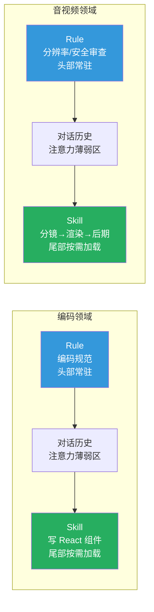
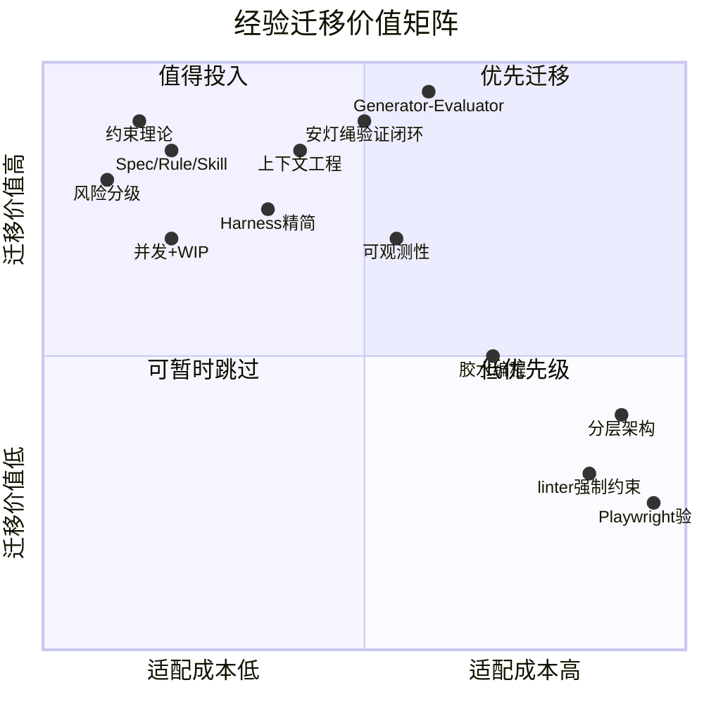

# Agent 开发实践经验的跨领域迁移分析

> 基于 `agent-development-practice-guide.md` 的经验，分析其在 AI 音视频生成等不同 AI 应用领域的可迁移性。

---

## 一、总体结论

源文档的经验大约 **70% 可迁移**，按迁移难度分为三层：

| 层次 | 占比 | 特征 |
|------|------|------|
| **直接迁移** | ~40% | 底层方法论与领域无关 |
| **需要适配** | ~30% | 核心模式可迁移，具体实现需调整 |
| **领域特定** | ~30% | 深度依赖编码领域的工具链 |

---

## 二、直接迁移（几乎无需改动）

这些经验来自精益生产、系统工程、约束理论，是比「编码」更高层级的方法论。

### 2.1 效率悖论与约束理论

**源文档核心观点**：局部加速非瓶颈环节 = 零收益。上游加速产生的增量被下游瓶颈吃掉。

**音视频领域映射**：

| 原领域现象 | 音视频映射 |
|-----------|-----------|
| AI 写代码更快，但 PR 体积翻倍、评审时间翻倍 | AI 视频生成速度提升 10x，但后期剪辑/审核环节没变 |
| 瓶颈在 Code Review，不在编码 | 瓶颈在叙事一致性和风格对齐，不在生帧速度 |
| PR 体积 +154%，评审时间 +91% | 视频产量 +N 倍，人工审核队列爆满 |

**结论**：加速生帧而不解决叙事连贯性，只是生产更多废片。

### 2.2 Spec / Rule / Skill 三层分离

**源文档核心观点**：业务知识（Spec）、工程约束（Rule）、工作流（Skill）性质不同，不能混在一起。

**音视频领域映射**：

| 维度 | 编码领域 | 音视频领域 |
|------|----------|-----------|
| **Spec** | 业务需求文档 | 分镜脚本 + 风格参考 + 叙事大纲 |
| **Rule** | 编码规范（300-500 行） | 分辨率/帧率/安全审查/品牌规范（硬约束） |
| **Skill** | 「写 React 组件」工作流 | 「生成关键帧 → 插值 → 后处理」工作流 |
| **类比** | 教材 / 考场纪律 / 解题方法 | 导演手册 / 技术规范 / 制作流程 |

**Rule 长度限制同样适用**：音视频领域的硬约束清单也应控制在 300-500 行以内，超出后模型开始遗忘。

### 2.3 风险分级决策框架

**源文档三档模型直接套用**：

| 风险档 | 编码场景 | 音视频场景 | 策略 |
|--------|---------|-----------|------|
| **高风险** | 支付、结算 | 品牌广告片、公开发布会视频 | 人类主导，不让 AI 独立完成 |
| **中风险** | 功能开发、重构 | 社交媒体内容、产品宣传片 | 人机协作，Spec 先行 + 验证闭环 |
| **低风险** | 文档、commit message | 内部草稿、概念验证、分镜初稿 | 完全自动化，best-of-N 策略 |

### 2.4 并发 + WIP 限制

**核心逻辑不变**：并发生成但控制审批队列。

- 同时跑 5 个视频生成任务（并发）
- 但人工审核带宽有限，必须设 WIP 上限
- 并发加速**生成端**，WIP 保护**审核端**，两者配合系统吞吐才真正提升

### 2.5 垃圾回收式技术债管理

AI 生成的视频素材库中，过时的模板/预设会像「AI 残渣」一样扩散。需要定期清理：


---

## 三、需要适配（核心模式可迁移，具体实现要改）

### 3.1 Generator-Evaluator 对抗架构

这是源文档中最具迁移价值的架构模式。


**角色映射**：

| 角色 | 编码领域 | 音视频领域 |
|------|----------|-----------|
| **Planner** | 1-4 句需求 → 产品规格 | 创意简报 → 分镜脚本 + 风格定义 |
| **Generator** | 按规格写代码 | 按分镜生成画面/音频（Sora/Runway/Kling 类工具） |
| **Evaluator** | Playwright 操作 UI 验证 | 逐帧检测（穿帧、肢体扭曲、口型不同步） |

**Sprint Contract 迁移**：实现前先协商「完成标准」。

| 编码领域完成标准 | 音视频领域完成标准 |
|----------------|------------------|
| 测试用例全部通过 | 关键帧质量评分 ≥ 阈值 |
| UI 截图符合设计稿 | 叙事连贯性通过检测 |
| Lint 无错误 | 音视频同步误差 < 阈值 |

**关键原则不变**：Evaluator 必须独立于 Generator。源文档指出「开箱即用，Claude 是一个糟糕的 QA Agent，它会说服自己问题没什么大不了」。AI 视频生成工具同样倾向于「觉得自己生成的画面挺好的」，需要独立的评估机制。

### 3.2 上下文工程

**U 型注意力分布同样适用**，但「上下文窗口」的概念需要扩展：



**适配要点**：

- 音视频的「上下文」不仅是 LLM 的 token 窗口，还包括参考图片/视频的**视觉上下文**
- Skill 的「信噪比优势」更加显著：正在生成动画时，不需要加载音频混音的规则
- **最小可行 Spec 的四问**同样适用：当前风格是什么？期望改成什么？哪些元素必须保持一致？边界条件有哪些？

### 3.3 安灯绳原则（验证闭环）

编码领域的 `Lint → Unit Test → E2E` 三层映射到音视频：

| 层次 | 编码领域 | 音视频领域 | 拦截目标 |
|------|----------|-----------|----------|
| **第一层** | Lint（语法格式检查） | 格式检查（分辨率/帧率/编码格式/码率） | 技术规格不合规 |
| **第二层** | Unit Test（函数级逻辑验证） | 单帧质量检测（肢体扭曲、面部变形、文字乱码、色块伪影） | 生成质量问题 |
| **第三层** | E2E（用户流程测试） | 完整播放审查（叙事连贯、音频同步、转场自然、节奏合理） | 用户体验问题 |
| **第四层** | Code Review（架构疏漏） | 创意评审（情感传达、品牌调性、艺术风格） | 创意表达问题 |

**瑞士奶酪模型完全适用**：每一层都有漏网之鱼，多层叠加后穿透率极低。

### 3.4 Harness 精简方法论

**源文档核心观点**：Harness 中的每个组件都编码了一个关于模型自身做不到什么的假设，这些假设随模型改进会迅速过时。

**迁移分析**：

| 当前 AI 视频做不到的 | 对应的 Harness 组件 | 未来可能过时 |
|---------------------|-------------------|------------|
| 叙事连贯性 | 人工叙事审查环节 | 当模型理解叙事逻辑后 |
| 物理一致性 | 逐帧物理检测 | 当模型内化物理规则后 |
| 细粒度风格控制 | 风格参考图/LoRA 调参 | 当模型理解自然语言风格描述后 |

**精简方法论不变**：逐个移除组件，观察影响，保留仍然 load-bearing 的。

### 3.5 可观测性

源文档让 Agent 能「看到」运行中的系统。音视频领域等价需求：

| 编码领域能力 | 音视频领域能力 |
|------------|-------------|
| Chrome DevTools 验证 UI | 逐帧回放 + 质量指标可视化 |
| LogQL 查询日志 | 渲染日志 + GPU 利用率监控 |
| PromQL 查询指标 | 生成质量评分趋势 + 异常帧统计 |
| git worktree 隔离测试 | 并行渲染环境隔离（不同参数对比） |

---

## 四、领域特定（难以直接迁移）

### 4.1 严格分层架构

**源文档做法**：Types → Config → Repo → Service → Runtime → UI，代码只能「向前」依赖。

**不可迁移原因**：这是软件代码的组织约束。音视频的「代码」是素材/模型/参数，分层逻辑完全不同。音视频领域的组织方式更接近：

```
素材层（原始视频/图片/音频）
  ↓
处理层（剪辑/特效/调色）
  ↓
合成层（多轨合成/字幕/水印）
  ↓
输出层（编码/分发）
```

这个分层有自己的规律，不能直接套用编码领域的分层。

### 4.2 linter 强制执行架构约束

**不可迁移原因**：代码有 AST（抽象语法树）可以静态分析，视频没有等价的结构化中间表示。无法用类似 linter 的工具自动检测「视频的架构是否合理」。

**部分替代方案**：可以建立元数据驱动的规则检查（如视频时长、分辨率、编码格式），但这远不如代码 linter 的深度。

### 4.3 git 版本控制 + Sprint 分解

**不可迁移原因**：

- 视频素材的版本管理和代码的 git diff 机制差异很大
- 二进制文件的 diff 不像文本文件那样有语义意义
- 冲突解决方式完全不同

**部分替代方案**：LFS（Large File Storage）+ 自定义元数据管理，但体验远不如 git 对代码的管理。

### 4.4 Playwright 作为 Evaluator 工具

**不可迁移原因**：浏览器自动化是编码特有的验证手段。视频领域需要完全不同的评估工具链（逐帧分析、波形对比、口型同步检测等）。

**但设计意图可迁移**：Playwright 的核心价值是「让 Agent 能像真实用户一样体验产品」。音视频领域需要等价的「让 Agent 能像真实观众一样体验视频」的工具。

### 4.5 胶水编程

**部分迁移**：「连接成熟模块」的思路可以迁移，但音视频领域的「成熟模块」定义不同：

| 编码领域的「成熟模块」 | 音视频领域的「成熟模块」 |
|---------------------|----------------------|
| npm 包、开源库 | 预训练模型、特效模板、LUT |
| API 接口 | 渲染管线、编码器 |
| 框架（React/Vue） | 工作流引擎（ComfyUI/DaVinci Resolve API） |

---

## 五、迁移价值矩阵



**优先迁移清单**（按投入产出比排序）：

1. **Generator-Evaluator 对抗架构** — 迁移价值最高，需要投入但回报最大
2. **约束理论 + WIP 限制** — 几乎零成本直接套用
3. **Spec/Rule/Skill 三层分离** — 概念迁移简单，实践效果显著
4. **安灯绳验证闭环** — 三层检测体系映射直观
5. **上下文工程** — U 型注意力分布跨领域通用
6. **风险分级** — 决策框架直接套用
7. **Harness 精简** — 长期维护方法论，随模型进化持续适用

---

## 六、核心洞察

### 6.1 可迁移的是「元模式」，不是具体做法

最值得迁移的不是具体工具或流程，而是源文档中反复出现的元模式：

| 元模式 | 在源文档中的体现 | 在任何 AI 应用中的体现 |
|--------|----------------|---------------------|
| **分离关注点** | Spec/Rule/Skill 三层 | 任何复杂系统都需要分层管理关注点 |
| **对抗评估** | Generator vs Evaluator | 任何 AI 生成都需要独立验证 |
| **不变量约束** | linter 强制架构规则 | 任何系统都需要不可违反的底线 |
| **渐进式披露** | AGENTS.md 作为目录 | 任何信息架构都应从小入口开始 |
| **闭环验证** | 安灯绳 + 瑞士奶酪模型 | 任何生产流程都需要多层防御 |

### 6.2 这些元模式本身就是跨领域迁移的产物

源文档的经验并非编码领域原创：

- 安灯绳 → 丰田生产系统（制造业）
- 瑞士奶酪模型 → 航空业安全工程
- 约束理论 → Eliyahu Goldratt（物流管理）
- 慢船策略 → 马士基（航运业）
- WIP 限制 → 精益生产

它们已经证明了一次跨领域迁移的有效性，再次迁移到音视频领域有充分的理论基础。

### 6.3 AI 音视频领域的时机优势

AI 音视频生成目前正处于编码领域 2-3 年前的阶段：单工具为主，缺乏 Harness。提前借鉴编码领域的 Harness 经验，可以：

- 避免「效率悖论」的坑（加速了生成但没加速交付）
- 提前建立 Generator-Evaluator 分离的意识
- 在工具链还不成熟时，先建立方法论框架

---

## 参考来源

| 来源 | 说明 |
|------|------|
| `docs/reference/agent-development-practice-guide.md` | 本分析的源文档 |
| Anthropic - Harness Design for Long-Running Apps | 三 Agent 架构、GAN 启发的评估闭环 |
| OpenAI - Harness Engineering | 全 Agent 生成实践、渐进式披露 |
| yousali.com - AI Coding 效率悖论 | 约束理论分析、验证闭环、并发策略 |
| vibe-coding-cn 社区 | Vibe Coding 工作流、胶水编程 |
