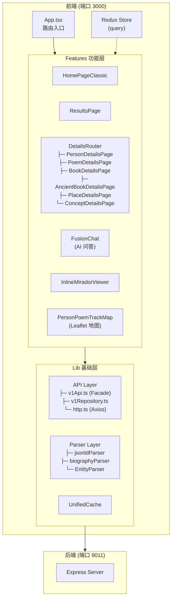

## 4.2.3 交互层设计 - 信息采集问题清单

### 一、整体架构与技术栈

1. **前端技术选型**
   - 交互层采用了什么前端框架?(如 React、Vue、Angular 等)
   - 使用了哪些主要的 UI 组件库设计系统?
   - 项目的构建工具和打包方案是什么?(如 Vite、Webpack 等)
   - 是否采用了 TypeScript?如果是,类型系统如何组织?

   > **【代码库答案】**
   >
   > | 类别 | 技术选型 | 版本 |
   > |------|----------|------|
   > | **UI 框架** | React | 18.3.1 |
   > | **构建工具** | Vite | 5.4.21 |
   > | **语言** | TypeScript | 5.7.2 |
   > | **路由** | React Router DOM | 6.30.4 |
   >
   > **UI 组件库：**
   > - **主 UI 框架**: Material UI (MUI) 7.3.7
   > - **样式方案**: @emotion/react + @emotion/styled 11.x
   > - **辅助 UI**: Bootstrap 5.3.3
   > - **图标**: Bootstrap Icons 1.11.3 + @mui/icons-material
   > - **CSS-in-JS**: @emotion/react + @emotion/styled 11.x
   >
   > **TypeScript 配置** (`tsconfig.json`):
   > ```json
   > {
   >   "compilerOptions": {
   >     "target": "ES2022",
   >     "module": "ES2022",
   >     "strict": true,
   >     "baseUrl": ".",
   >     "paths": { "@/*": ["src/*"] }  // 路径别名
   >   }
   > }
   > ```
   >
   > **类型系统组织**：
   > - `src/types/` - 全局类型定义
   > - 各功能模块内部定义局部类型（如 `src/features/details/types/`）

2. **应用架构模式**
   - 前端采用了什么架构模式?(如 SPA 单页应用、SSR 服务端渲染、SSG 静态生成等)
   - 路由管理方案是什么?有哪些主要路由页面?
   - 状态管理采用了什么方案?(如 Redux、Zustand、Pinia 等)

   > **【代码库答案】**
   >
   > **架构模式**: SPA（单页应用）
   >
   > **路由管理** (`src/app/App.tsx`):
   > ```typescript
   > const APP_ROUTES = [
   >   { path: '/', element: <HomePageClassic /> },      // 首页
   >   { path: '/results', element: <ResultsPage /> },   // 搜索结果
   >   { path: '/chat', element: <FusionChatPage /> },   // AI 问答
   >   { path: '/details', element: <DetailsRouter /> }, // 实体详情
   >   { path: '/iiif', element: <IiifPage /> },         // IIIF 浏览器
   >   { path: '/mirador', element: <IiifPage /> },      // IIIF 别名
   > ]
   > ```
   >
   > **状态管理**: Redux Toolkit 2.3.0（极简状态，仅存储 `query` 字符串）
   > ```typescript
   > // src/redux/slices/appSlice.ts
   > interface AppState {
   >   query: string
   > }
   > ```

### 二、核心交互界面设计

3. **主要页面/视图组件**
   - 平台包含哪些主要页面?(如首页、搜索页、人物详情页、诗文详情页、地图页等)
   - 每个页面的核心组件结构是什么?
   - 页面之间的导航逻辑如何设计?

   > **【代码库答案】**
   >
   > **主要页面** (`src/features/`):
   > | 页面 | 路径 | 组件位置 |
   > |------|------|----------|
   > | 首页 | `/` | `features/home/` |
   > | 搜索结果 | `/results` | `features/results/` |
   > | AI 问答 | `/chat` | `features/fusion/` |
   > | 实体详情 | `/details?type=xxx&id=xxx` | `features/details/` |
   > | IIIF 浏览器 | `/iiif` 或 `/mirador` | `features/iiif/` |
   >
   > **详情页子类型** (`src/features/details/pages/`):
   > | 页面组件 | 资源类型 |
   > |----------|----------|
   > | `PersonDetailsPage.tsx` | 人物 |
   > | `PoemDetailsPage.tsx` | 诗文 |
   > | `BookDetailsPage.tsx` | 图书 |
   > | `AncientBookDetailsPage.tsx` | 古籍 |
   > | `PlaceDetailsPage.tsx` | 地点 |
   > | `ConceptDetailsPage.tsx` | 概念 |
   >
   > **功能模块结构**:
   > ```
   > src/features/
   > ├── common/     # Header、Breadcrumb、Loading 等通用组件
   > ├── details/    # 实体详情页（人物、诗文、古籍、地点、概念）
   > ├── fusion/     # AI 融合问答功能
   > ├── home/       # 首页
   > ├── iiif/       # IIIF 浏览器集成
   > └── results/    # 搜索结果页
   > ```
   >
   > **导航逻辑**: 通过 `DetailsRouter.tsx` 根据 URL 参数 `type` 动态分发到对应详情页
   > ```typescript
   > function renderDetailsPageByType(type: DetailResourceType): JSX.Element {
   >   switch (type) {
   >     case 'poem': return <PoemDetailsPage />
   >     case 'person': return <PersonDetailsPage />
   >     // ...其他类型
   >   }
   > }
   > ```

4. **检索交互设计**
   - 搜索框组件的实现方式是什么?(位置、样式、交互反馈)
   - 是否支持搜索建议/自动补全功能?如何实现?
   - 检索结果的展示方式是什么?(列表、卡片、表格等)
   - 结果列表支持哪些筛选和排序功能?

   > **【代码库答案】**
   >
   > **搜索框组件** (`src/features/home/`):
   > - 位于首页中央位置
   > - 使用 MUI 组件构建
   > - 搜索触发后跳转到 `/results` 页面
   >
   > **搜索建议/自动补全**: 代码库中未见专门的自动补全功能实现
   >
   > **检索结果展示** (`src/features/results/`):
   > - 展示方式：卡片列表（Card 形式）
   > - 结果按实体类型分组显示
   >
   > **API 层** (`src/lib/api/v1Api.ts`):
   > - `searchUnified()` - 统一搜索（带缓存和降级策略）
   > - 支持多种实体类型的联合检索

5. **人物详情页交互**
   - 人物详情页包含哪些信息模块?(基本信息、生平、作品、关系网络等)
   - 关联推荐功能如何在界面上呈现?
   - 是否有关系图谱的可视化展示?使用了什么图可视化库?

   > **【代码库答案】**
   >
   > **人物详情页信息模块** (`src/features/details/pages/PersonDetailsPage.tsx`):
   > - 基本信息展示
   > - 生平轨迹（地图可视化）
   > - 作品列表
   > - **注意**: 代码库中未见关系网络模块和关系图谱可视化
   >
   > **时空轨迹可视化组件** (`src/features/details/components/PersonPoemTrackMap/`):
   > - 使用 **Leaflet + 开源瓦片服务**（动态加载）
   > - 墨色配色方案（中国古典水墨风格）
   > - 底部时间轴联动控制
   >
   > **组件架构**:
   > ```
   > PersonPoemTrackMap/
   > ├── PersonPoemTrackMap.tsx  # 主组件
   > ├── hooks/
   > │   ├── useLazyLoad.ts      # 懒加载 Hook
   > │   └── useTrackData.ts     # 数据管理 Hook
   > ├── services/
   > │   ├── mapLoader.ts        # Leaflet 与瓦片资源动态加载
   > │   └── markerBuilder.ts    # 标记点构建
   > └── styles/
   >     └── inkColors.ts        # 墨色配色方案
   > ```

### 三、特色功能的交互实现

6. **时空轨迹可视化**
   - 地图组件使用了什么地图库?(如 Leaflet、Mapbox 等)
   - 时间轴控件如何实现?(滑块、时间选择器等)
   - 地图标记点的交互设计是什么?(点击、悬停、聚合等)
   - 如何处理同一地点多个事件的展示?

   > **【代码库答案】**
   >
   > **地图库**: **Leaflet + 开源瓦片服务**（通过动态脚本加载）
   >
   > **时间轴控件**: **vis-timeline** 8.5.0
   >
   > **组件位置**: `src/features/details/components/PersonPoemTrackMap/`
   >
   > **技术实现**:
   > ```typescript
   > // services/mapLoader.ts - Leaflet 与瓦片资源动态加载
   > export function loadMapJsApi(): Promise<MapNamespace>
   >
   > // hooks/useLazyLoad.ts - 视口懒加载
   > // 仅当组件进入视口时才加载地图数据和资源
   > ```
   >
   > **墨色配色方案** (`styles/inkColors.ts`):
   > - 采用中国古典水墨风格
   > - 自定义标记点样式
   >
   > **标记点交互**:
   > - 点击显示详情
   > - 与底部时间轴联动

7. **IIIF 古籍浏览器**
   - 使用了什么 IIIF 浏览器组件?(如 Mirador、Universal Viewer、OpenSeadragon 等)
   - 浏览器支持哪些交互功能?(缩放、翻页、标注等)
   - 如何将 IIIF Manifest 数据传递给浏览器组件?

   > **【代码库答案】**
   >
   > **IIIF 浏览器**: **Mirador** 4.0.0
   >
   > **组件位置** (`src/features/iiif/`):
   > | 文件 | 功能 |
   > |------|------|
   > | `InlineMiradorViewer.tsx` | 内嵌 Mirador 查看器 |
   > | `IiifPage.tsx` | IIIF 独立页面 |
   > | `manifestResolver.ts` | Manifest URL 解析器 |
   >
   > **动态加载方式**:
   > ```typescript
   > // InlineMiradorViewer.tsx
   > const module = await import('mirador')
   > module.viewer({
   >   id: containerId,
   >   windows: [{ manifestId: resolvedManifestUrl, canvasId }],
   > })
   > ```
   >
   > **Manifest 传递**: 通过 URL 参数传入，由 `manifestResolver.ts` 解析

8. **AI 问答交互**
   - 问答界面的设计形式是什么?(对话框、侧边栏、独立页面等)
   - 如何展示问答的加载状态和流式响应?
   - 答案中的引用来源如何呈现?是否支持点击跳转?
   - 是否支持多轮对话?对话历史如何管理?

   > **【代码库答案】**
   >
   > **界面形式**: **独立页面** (`/chat` 路由)
   >
   > **核心组件** (`src/features/fusion/`):
   > - `FusionChat.tsx` - 主对话组件
   > - 使用 **@assistant-ui/react** 0.12.15 UI 组件库
   >
   > **流式响应实现** (SSE):
   > ```typescript
   > async function streamFusionQuery(
   >   params: FusionQueryParamsV1,
   >   handlers: FusionStreamHandlers,
   >   signal: AbortSignal,
   > ): Promise<void> {
   >   const response = await fetch('/api/v1/fusion/stream', {
   >     method: 'POST',
   >     headers: { Accept: 'text/event-stream' },
   >     body: JSON.stringify(params),
   >     signal,
   >   })
   >   // 解析 SSE 事件流
   > }
   > ```
   >
   > **SSE 事件类型**:
   > | 事件 | 功能 |
   > |------|------|
   > | `status` | 状态更新 |
   > | `evidence` | 检索证据（实体、引用、IIIF 匹配） |
   > | `chunk` | 文本片段 |
   > | `done` | 完成 |
   > | `error` | 错误 |
   >
   > **多轮对话**: 通过事件处理器管理对话状态

### 四、前后端交互机制

9. **API 通信设计**
   - 前端如何与服务层 API 通信?(RESTful、GraphQL 等)
   - 使用了什么 HTTP 客户端库?(如 axios、fetch 等)
   - API 请求的错误处理和重试机制是什么?
   - 是否有 API 响应的缓存策略?

   > **【代码库答案】**
   >
   > **通信协议**: **RESTful API**
   >
   > **HTTP 客户端**: **Axios** 1.7.7
   >
   > **API 分层架构** (`src/lib/api/`):
   > ```
   > api/
   > ├── http.ts              # Axios 实例配置
   > ├── v1Api.ts             # V1 API 外观层（Facade）
   > ├── repositories/
   > │   └── v1Repository.ts  # 数据仓库层
   > └── services/
   >     ├── detailService.ts   # 详情服务
   >     ├── searchService.ts   # 搜索服务
   >     ├── poemTrackService.ts # 轨迹服务
   >     └── isbnCoverService.ts # 封面服务
   > ```
   >
   > **HTTP 客户端配置** (`src/lib/api/http.ts`):
   > ```typescript
   > export const http = axios.create({
   >   baseURL: resolveBaseUrl(),  // 环境变量或兜底 http://127.0.0.1:9011/
   >   timeout: TIMEOUT.HTTP_DEFAULT_MS, // 20000ms
   > })
   > ```
   >
   > **缓存策略**: `UnifiedCache` 类实现内存缓存
   >
   > **V1 API 主要函数** (`v1Api.ts`):
   > | 函数 | 功能 |
   > |------|------|
   > | `fetchPersons()` | 获取人物列表 |
   > | `fetchPersonById()` | 获取人物详情 |
   > | `fetchPoems()` | 获取诗文列表 |
   > | `fetchPoemById()` | 获取诗文详情 |
   > | `searchUnified()` | 统一搜索（带缓存和降级策略） |
   > | `fetchEntityCounts()` | 获取实体统计 |
   >
   > **Vite 代理配置** (`vite.config.ts`):
   > ```typescript
   > server: {
   >   port: 3000,
   >   proxy: {
   >     '/api': 'http://127.0.0.1:9011',
   >     '/ml': 'http://127.0.0.1:9011',
   >     '/stats': 'http://127.0.0.1:9011',
   >   }
   > }
   > ```

10. **数据流管理**
    - 从服务层获取的 JSON-LD 数据如何在前端处理和转换?
    - 组件之间如何共享和传递数据?
    - 是否有数据预加载或懒加载的优化策略?

   > **【代码库答案】**
   >
   > **JSON-LD 数据处理** (`src/lib/parsers/`):
   > - `jsonldParser` - JSON-LD 解析器
   > - `biographyParser` - 传记数据解析
   > - `EntityParser` - 实体解析器
   >
   > **组件数据传递**:
   > - Props 传递（父子组件）
   > - Redux 全局状态（仅 `query` 字段，极简）
   > - 自定义 Hooks 封装数据逻辑
   >
   > **懒加载策略**:
   > - 地图组件: `useLazyLoad.ts` - 视口检测后加载
   > - Mirador: 动态 `import('mirador')`
   > - IIIF 页面: 懒加载 Viewer 组件

### 五、用户体验优化

11. **响应式设计**
    - 平台是否支持移动端访问?
    - 响应式布局采用了什么方案?(媒体查询、Flex、Grid 等)
    - 不同设备上的交互差异是什么?

   > **【代码库答案】**
   >
   > **移动端支持**: 代码库中未见明确的移动端适配方案
   >
   > **响应式布局方案**:
   > - CSS 变量定义 (`src/styles/_variables.css`)
   > - Flex/Grid 布局（通过 MUI 组件默认支持）
   > - 媒体查询（在 `src/styles/` 中定义）
   >
   > **样式文件结构**:
   > ```
   > src/styles/
   > ├── global.css          # 全局样式入口
   > ├── _reset.css          # 重置样式
   > ├── _variables.css      # CSS 变量
   > ├── _layout.css         # 布局样式
   > ├── _components.css     # 组件样式
   > ├── _pages.css          # 页面样式
   > ├── _utilities.css      # 工具类
   > └── features/           # 功能模块样式
   > ```

12. **性能优化**
    - 采用了哪些前端性能优化措施?(代码分割、懒加载、虚拟滚动等)
    - 图片资源如何优化加载?(懒加载、CDN、WebP 等)
    - 是否有首屏加载时间的优化策略?

   > **【代码库答案】**
   >
   > **性能优化措施**:
   > | 策略 | 实现位置 |
   > |------|----------|
   > | **代码分割** | Vite 默认支持（动态 import） |
   > | **懒加载** | `useLazyLoad.ts` Hook |
   > | **动态导入** | Mirador `import('mirador')` |
   > | **缓存** | `UnifiedCache` 内存缓存 |
   > | **按需加载** | 地图组件视口检测后加载 |
   >
   > **图片优化**: 代码库中未见专门的图片优化策略（如 WebP 转换、CDN 配置）

13. **可访问性设计**
    - 是否考虑了无障碍访问(ARIA 标签、键盘导航等)?
    - 界面的语义化 HTML 结构如何设计?

   > **【代码库答案】**
   >
   > **无障碍访问**: 使用 MUI 组件自带的基础无障碍支持
   > - MUI 组件内置 ARIA 属性
   > - 键盘导航由组件库默认支持
   >
   > **语义化 HTML**: 通过 MUI 组件的语义化结构实现
   > - `Typography` 组件使用正确的标题层级
   > - `Card`、`List` 等组件具有语义化结构

### 六、视觉设计与交互规范

14. **设计系统**
    - 平台的色彩方案和视觉风格是什么?
    - 是否定义了统一的设计规范或组件库?
    - 排版系统(字体、字号、行距等)如何设计?

   > **【代码库答案】**
   >
   > **视觉风格**: 中国古典水墨风格（墨色配色方案）
   >
   > **设计规范**:
   > - **主 UI 框架**: Material UI (MUI) 7.3.7
   > - **CSS 变量**: `src/styles/_variables.css` 定义主题色
   > - **墨色配色**: `PersonPoemTrackMap/styles/inkColors.ts`
   >
   > **主要使用的 MUI 组件**:
   > | 组件 | 用途 |
   > |------|------|
   > | `Box`, `Card`, `CardContent` | 布局容器 |
   > | `Typography` | 文字排版 |
   > | `Chip` | 标签 |
   > | `CircularProgress` | 加载指示 |
   > | `Alert` | 警告/错误提示 |
   > | `ListItemButton`, `ListItemText` | 列表项 |
   > | `Divider` | 分隔线 |
   > | `@mui/icons-material/*` | 图标 |
   >
   > **样式方案**:
   > - CSS Modules/全局 CSS
   > - CSS-in-JS: @emotion
   > - MUI sx prop: 内联样式

15. **交互反馈**
    - 用户操作的反馈机制有哪些?(加载动画、Toast 提示、进度条等)
    - 错误状态如何向用户展示?
    - 空状态页面如何设计?

   > **【代码库答案】**
   >
   > **加载状态**:
   > - `CircularProgress` (MUI) - 加载动画
   > - 骨架屏（部分页面）
   >
   > **错误状态**:
   > - `Alert` (MUI) - 错误提示
   > - 错误边界组件
   >
   > **空状态**: 代码库中未见专门的空状态页面组件
   >
   > **通用组件** (`src/features/common/`):
   > - `Header` - 页面头部
   > - `Breadcrumb` - 面包屑导航
   > - `Loading` - 加载组件

---

## 架构总览



---

## 关键文件路径索引

| 功能 | 文件路径 |
|------|----------|
| 应用入口 | `src/main.tsx` |
| 路由配置 | `src/app/App.tsx` |
| Redux Store | `src/redux/store.ts` |
| HTTP 客户端 | `src/lib/api/http.ts` |
| V1 API | `src/lib/api/v1Api.ts` |
| 详情页路由 | `src/features/details/DetailsRouter.tsx` |
| 地图组件 | `src/features/details/components/PersonPoemTrackMap/PersonPoemTrackMap.tsx` |
| IIIF 浏览器 | `src/features/iiif/InlineMiradorViewer.tsx` |
| AI 问答 | `src/features/fusion/FusionChat.tsx` |
| 常量配置 | `src/lib/config/constants.ts` |
| 全局样式 | `src/styles/global.css` |

