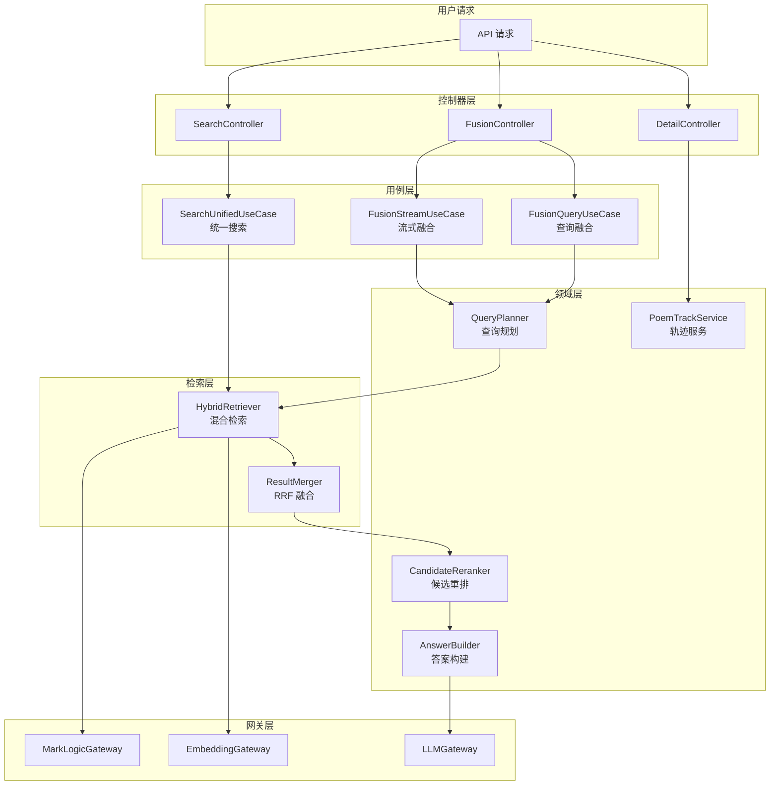

## 针对 4.2.2 服务层的关键问题

### 一、混合检索服务

1. **检索架构**:混合检索的双路召回(关键词检索+向量检索)是在后端并行执行的吗?代码中是如何组织这两条检索路径的?

   > **【代码库答案】**
   >
   > **架构设计**：双路召回在 `HybridRetriever` 中**并行执行**。
   >
   > **文件位置**：`server/src/infra/retrievers/hybridRetriever.js`
   >
   > ```mermaid
   > flowchart TD
   >     subgraph "HybridRetriever"
   >         KR[KeywordRetriever<br/>关键词检索]
   >         VR[VectorRetriever<br/>向量检索]
   >         RM[ResultMerger<br/>RRF 融合]
   >     end
   >
   >     KR --> |Promise.all| RM
   >     VR --> |Promise.all| RM
   > ```
   >
   > **检索路径组织**：
   > - `KeywordRetriever`：调用 `marklogicGateway` 执行全文检索
   > - `VectorRetriever`：调用 `embeddingService` 获取向量 → `mlVectorSearch` 执行向量检索
   > - `ResultMerger`：RRF 融合两路结果

2. **关键词检索实现**:关键词检索使用的是什么算法或库?是简单的字符串匹配,还是使用了 BM25、TF-IDF 等算法?

   > **【代码库答案】**
   >
   > **实现方式**：使用 **MarkLogic 内置的全文检索**能力。
   >
   > **文件位置**：`server/src/infra/retrievers/keywordRetriever.js`
   >
   > **实体源映射**（第77-114行）：
   > | 实体类型 | 目录路径 | 集合路径 |
   > |---------|---------|---------|
   > | person | `/processed/json-ld/person/` | `/heluo/persons` |
   > | poem | `/processed/json-ld/poem/set/` | `/heluo/poems-set` |
   > | book | `/processed/json-ld/book/` | `/heluo/books` |
   > | ancient_book | `/processed/json-ld/ancient_book/ancient_book_set/book_entry/` | `/heluo/ancient-book-sets` |
   > | place | `/processed/json-ld/place/` | `/heluo/places` |
   > | concept | `/processed/json-ld/concept/` | `/heluo/concepts` |
   >
   > **核心逻辑**：
   > ```javascript
   > // 多目录/集合搜索并合并
   > const data = await this.searchWithFallback({
   >   query, pageLength,
   >   directories: source.directories,
   >   collections: source.collections,
   >   directoryMode: scope === 'poem' ? 'first_non_empty' : 'all',
   > })
   > ```

3. **向量检索实现**:向量检索使用的 embedding 模型是什么?向量相似度计算用的是余弦相似度还是其他距离度量?

   > **【代码库答案】**
   >
   > **Embedding 模型**：`text2vec-base-chinese`（768 维）
   >
   > **文件位置**：`server/src/services/embeddingService.js`
   >
   > **配置**：
   > | 参数 | 值 |
   > |------|-----|
   > | 服务地址 | `http://127.0.0.1:8080/embed` |
   > | 向量维度 | 768 |
   > | 缓存 | LRU，最大 10000 条，TTL 3600 秒 |
   > | 归一化 | L2 归一化 |
   >
   > **相似度计算**：**余弦相似度**
   > ```javascript
   > // embeddingService.js 第263-287行
   > cosineSimilarity(vec1, vec2) {
   >   let dotProduct = 0, norm1 = 0, norm2 = 0
   >   for (let i = 0; i < vec1.length; i++) {
   >     dotProduct += vec1[i] * vec2[i]
   >     norm1 += vec1[i] * vec1[i]
   >     norm2 += vec2[i] * vec2[i]
   >   }
   >   return dotProduct / (Math.sqrt(norm1) * Math.sqrt(norm2))
   > }
   > ```

4. **RRF 融合算法**:倒数排名融合(RRF)算法的具体实现是怎样的?代码中是如何计算排名倒数并合并结果的?

   > **【代码库答案】**
   >
   > **文件位置**：`server/src/domain/retrieval/resultMerger.js`
   >
   > **RRF 公式**：`score = 1 / (k + rank)`，其中 `k = 60`（经验值）
   >
   > ```javascript
   > // 第154-234行
   > export function mergeHybridRowsByRrf(keywordRows, vectorRows, pageLength, scope) {
   >   const safeRrfK = Math.max(1, searchConfig.hybridRrfK) // 默认 60
   >
   >   // 1. 处理关键词结果
   >   keywordRows.forEach((row, index) => {
   >     const rank = index + 1
   >     const rrf = 1 / (safeRrfK + rank)  // RRF 分数
   >     // ...累加到合并映射
   >   })
   >
   >   // 2. 处理向量结果（同一结果时累加 RRF 分数）
   >   vectorRows.forEach((row, index) => {
   >     const rrf = 1 / (safeRrfK + rank)
   >     // ...累加到合并映射
   >   })
   >
   >   // 3. 按累加后的 RRF 分数排序
   >   return Array.from(merged.values())
   >     .sort((a, b) => b.rrfScore - a.rrfScore)
   >     .slice(0, pageLength)
   > }
   > ```
   >
   > **混合评分公式**（`server/src/search/hybridSearchUtils.js`）：
   > ```
   > finalScore = 0.55 * vector + 0.25 * lexical + 0.15 * exact + 0.05 * prefix
   > ```

5. **关联推荐机制**:当用户查看某个实体详情时,系统是如何自动生成"相关推荐"的?是实时计算向量相似度,还是预先计算并缓存?

   > **【代码库答案】**
   >
   > **实现方式**：**实时计算**，通过 `CandidateReranker` 进行候选重排。
   >
   > **文件位置**：`server/src/domain/fusion/candidateReranker.js`
   >
   > **作用域加权**：
   > ```javascript
   > const boosts = computeFusionScopeBoostMap(rawQuery)
   > // 示例：poem 查询时
   > // boosts.poem = 2.2, boosts.person = 1.15, boosts.book = 0.9
   > ```
   >
   > **槽位匹配加分**：
   > | 槽位 | 加分值 |
   > |------|--------|
   > | who（人物匹配） | +0.16 |
   > | when（时间匹配） | +0.08 |
   > | where（地点匹配） | +0.08 |
   > | topic（主题匹配） | +0.05 |
   > | title（标题精确匹配） | +0.30 |

---

### 二、诗文时空轨迹服务

1. **时空数据提取**:诗文的创作时间和地点信息是如何从 Linked Art 数据中提取的?代码中有专门的解析逻辑吗?

   > **【代码库答案】**
   >
   > **文件位置**：`server/src/domain/track/poemTrackService.js`
   >
   > **时间提取逻辑**（第67-83行）：
   > ```javascript
   > function extractYear(timespan) {
   >   // 优先从 _label 解析（如 "754年"）
   >   if (timespan._label) {
   >     const match = timespan._label.match(/(\d{3,4})/)
   >     if (match) return parseInt(match[1], 10)
   >   }
   >
   >   // 从 begin_of_the_begin 解析（如 "0754-01-01T00:00:00Z"）
   >   if (timespan.begin_of_the_begin) {
   >     const match = timespan.begin_of_the_begin.match(/(\d{4})/)
   >     if (match) return parseInt(match[1], 10)
   >   }
   >   return null
   > }
   > ```
   >
   > **历史地名提取**（第225-237行）：
   > ```javascript
   > function extractHistoricalNames(doc) {
   >   const attributedBy = doc.attributed_by || []
   >   return attributedBy.map(item => ({
   >     name: pickNodeLabel(item),
   >     period: item.timespan ? pickNodeLabel(item.timespan) : ''
   >   }))
   > }
   > ```

2. **地理坐标映射**:历史地名到现代地理坐标的映射关系存储在哪里?是静态配置文件,还是存储在数据库中?

   > **【代码库答案】**
   >
   > **存储方式**：存储在 **MarkLogic 数据库**的地点文档中。
   >
   > **坐标格式**：**WKT POINT 格式**
   >
   > **解析逻辑**（`poemTrackService.js` 第91-99行）：
   > ```javascript
   > function parseWktPoint(wkt) {
   >   const match = wkt.match(/POINT\s*\(\s*([\d.-]+)\s+([\d.-]+)\s*\)/i)
   >   if (!match) return null
   >   return {
   >     lng: parseFloat(match[1]),  // 经度
   >     lat: parseFloat(match[2])   // 纬度
   >   }
   > }
   > ```
   >
   > **数据流**：诗文文档 → `carried_out_by` → 地点 ID → 查询地点文档 → 解析 WKT 坐标

3. **时空筛选逻辑**:当用户拖动时间轴时,后端是如何进行时间范围筛选并返回对应地点标记的?查询性能如何优化?

   > **【代码库答案】**
   >
   > **筛选逻辑**：在 `poemTrackService` 中，时间筛选在**数据聚合阶段**进行。
   >
   > **性能优化 - 并发控制**（第115-133行）：
   > ```javascript
   > async function withConcurrency(items, asyncFn, concurrency = 50) {
   >   const results = []
   >   const executing = new Set()
   >
   >   for (const item of items) {
   >     const promise = asyncFn(item).then(result => {
   >       executing.delete(promise)
   >       return result
   >     })
   >     results.push(promise)
   >     executing.add(promise)
   >
   >     if (executing.size >= concurrency) {
   >       await Promise.race(executing)  // 等待任一完成
   >     }
   >   }
   >   return Promise.all(results)
   > }
   > ```
   >
   > **性能提升**：
   > | 操作 | 串行耗时 | 并发耗时 |
   > |------|---------|---------|
   > | 诗文查询 | 75 秒 | 2-5 秒 |
   > | 地点查询 | 2.5 秒 | 100-300ms |

---

### 三、AI 问答服务

1. **RAG 架构实现**:检索增强生成(RAG)的完整流程是怎样的?从用户提问到答案生成,代码中经过了哪些处理步骤?

   > **【代码库答案】**
   >
   > ```mermaid
   > flowchart TD
   >     subgraph "1. 查询理解"
   >         QP[QueryPlanner<br/>查询规划]
   >         SE[SlotExtractor<br/>槽位提取]
   >     end
   >
   >     subgraph "2. 检索增强"
   >         HR[HybridRetriever<br/>混合检索]
   >         CR[CandidateReranker<br/>候选重排]
   >     end
   >
   >     subgraph "3. 生成"
   >         PB[PromptBuilder<br/>提示词构建]
   >         LLM[LLM Client<br/>大模型调用]
   >         COV[PoemCoverage<br/>诗词覆盖检查]
   >     end
   >
   >     QP --> SE
   >     SE --> HR
   >     HR --> CR
   >     CR --> PB
   >     PB --> LLM
   >     LLM --> COV
   > ```
   >
   > **核心文件**：
   > | 步骤 | 文件 |
   > |------|------|
   > | 流式入口 | `server/src/usecases/fusionStreamUseCase.js` |
   > | 查询规划 | `server/src/domain/fusion/queryPlanner.js` |
   > | 混合检索 | `server/src/infra/retrievers/hybridRetriever.js` |
   > | 候选重排 | `server/src/domain/fusion/candidateReranker.js` |
   > | 答案构建 | `server/src/domain/fusion/answerBuilder.js` |
   > | LLM 调用 | `server/src/services/llm/client.js` |

2. **查询理解**:用户自然语言问题的结构化信息提取(实体、时间、地点、意图等)是如何实现的?使用了 NER 模型还是 LLM 直接提取?

   > **【代码库答案】**
   >
   > **实现方式**：**预定义词库匹配**（非 NER 模型）
   >
   > **文件位置**：`server/src/domain/fusion/queryPlanner.js`
   >
   > **槽位提取**（第135-203行）：
   > ```javascript
   > function extractFusionSlots(rawQuery, entities) {
   >   const who = new Set()    // 人物
   >   const where = new Set()  // 地点
   >   const when = new Set()   // 时间
   >   const what = new Set()   // 主题
   >   const how = new Set()    // 视角
   >   const title = new Set()  // 诗题
   >
   >   // 从预定义词库匹配
   >   FUSION_PERSON_HINTS.forEach(name => {
   >     if (text.includes(name)) who.add(name)
   >   })
   >   // 支持时间线索：'早年', '开元', '天宝', '唐代'...
   > }
   > ```
   >
   > **意图推断**（第469-479行）：
   > ```javascript
   > function inferFusionPreferredScope(rawQuery) {
   >   if (/诗|诗歌|诗词|诗句|诗风|格律|意象/.test(text)) return 'poem'
   >   if (/谁|生平|人物|关系|传记|年谱/.test(text)) return 'person'
   >   if (/图书|著作|版本|文献/.test(text)) return 'book'
   >   if (/古籍|卷|册|部/.test(text)) return 'ancient_book'
   >   if (/地点|地理|在哪里|何处/.test(text)) return 'place'
   >   if (/概念|术语|主题|范畴/.test(text)) return 'concept'
   > }
   > ```

3. **检索召回**:RAG 中的检索召回是调用混合检索服务吗?还是有独立的检索逻辑?召回的文档片段是如何切分和排序的?

   > **【代码库答案】**
   >
   > **调用方式**：**复用混合检索服务** `HybridRetriever`
   >
   > **切分策略**：按**实体粒度**召回，不做文档切片
   >
   > **排序逻辑**：
   > 1. RRF 融合分数（关键词 + 向量）
   > 2. 候选重排（作用域加权 + 槽位匹配加分）
   > 3. 截断到 Top-K（默认 10-20 条）

4. **提示词设计**:注入到大语言模型的提示词结构是怎样的?包含哪些部分(角色定义、上下文、约束指令等)?

   > **【代码库答案】**
   >
   > **文件位置**：`server/src/services/llm/prompts/index.js`
   >
   > **系统提示词**（第12-36行）：
   > ```javascript
   > const RAG_SYSTEM_PROMPT = `【角色】
   > 你是"河洛"，一个专注中国古典文学、历史、地理和哲学的知识问答助手。
   >
   > 【规则】
   > 1) 优先依据已提供的参考材料作答，禁止编造不存在的细节。
   > 2) 当参考材料不足时，可基于通识知识补充，但必须明确标注。
   > 3) 输出纯文本，不要使用 Markdown 标记。
   > 4) 先对候选材料做相关性筛选，只能使用与问题直接相关的材料。
   > 5) 若问题要求列举作品，需在材料范围内逐首全量列出。
   > 6) 回答先给结论，再给简要解释。`
   > ```
   >
   > **用户提示词模板**（第114-132行）：
   > ```javascript
   > const userPrompt = `【输入】
   > 参考材料：
   > ${evidenceBlock}  // 实体证据 + 引用证据 + IIIF 证据
   >
   > 用户问题： ${query}
   >
   > 【输出】
   > 请直接输出最终答案正文。`
   > ```

5. **答案生成与引用**:生成的答案是如何与检索召回的文档片段建立引用关系的?前端展示的"来源引用"是如何生成的?

   > **【代码库答案】**
   >
   > **文件位置**：`server/src/domain/fusion/answerBuilder.js`
   >
   > **引用构建**（第197-215行）：
   > ```javascript
   > function buildFusionSidebarItems(citations, iiifMatches) {
   >   const citationItems = citations.slice(0, 6).map((item, index) => ({
   >     itemId: `citation-${index + 1}`,
   >     itemType: 'citation',
   >     title: item.title,
   >     snippet: item.snippet,
   >     link: createFusionDetailLink(item.uri, '')  // 详情页链接
   >   }))
   >
   >   const iiifItems = iiifMatches.slice(0, 3).map((item, index) => ({
   >     itemId: `iiif-${index + 1}`,
   >     itemType: 'iiif',
   >     title: item.canvasLabel,
   >     link: item.openUrl  // IIIF 查看器链接
   >   }))
   > }
   > ```
   >
   > **引用类型**：
   > | 类型 | 数量限制 | 链接目标 |
   > |------|---------|----------|
   > | citation | 最多 6 条 | 实体详情页 |
   > | iiif | 最多 3 条 | Mirador 查看器 |

6. **多轮对话支持**:多轮对话的上下文是如何管理的?是存储在服务端的会话状态中,还是每次请求都由前端传递完整历史?

   > **【代码库答案】**
   >
   > **管理方式**：**前端传递完整历史**（无服务端会话）
   >
   > **文件位置**：`server/src/domain/fusion/queryPlanner.js`
   >
   > **对话历史解析**（第307-327行）：
   > ```javascript
   > function parseFusionConversationHistory(rawHistory) {
   >   const maxMessages = 12      // 最大保留消息数
   >   const maxContentLength = 500 // 单条消息最大长度
   >
   >   // 规范化并截断
   >   normalizedMessages.push({
   >     role,  // 'user' | 'assistant'
   >     content: content.slice(0, maxContentLength)
   >   })
   >
   >   // 只保留消息列表末尾的若干项
   >   if (normalizedMessages.length > maxMessages)
   >     return normalizedMessages.slice(-maxMessages)
   > }
   > ```
   >
   > **注入到提示词**（`fusionStreamUseCase.js` 第136-139行）：
   > ```javascript
   > const messages = buildRagPrompt({
   >   query, entities, citations, iiifMatches,
   >   conversationHistory  // 注入多轮历史
   > })
   > ```

---

### 四、IIIF 古籍浏览服务

1. **IIIF 服务端**:IIIF Image API 服务端是自建的还是使用了现成的 IIIF Server(如 Cantaloupe、IIPImage)?

   > **【代码库答案】**
   >
   > **实现方式**：**自建 IIIF Manifest 生成服务**，图像托管在外部服务。
   >
   > **Manifest 生成**：`server/src/domain/detail/ancientBook/manifestResolver.js`

2. **Manifest 访问**:当用户触发古籍浏览时,前端是如何获取 IIIF Manifest URI 的?是从 Linked Art 数据中提取,还是有独立的 API 端点?

   > **【代码库答案】**
   >
   > **文件位置**：`server/src/domain/detail/ancientBook/manifestResolver.js`
   >
   > **Manifest URI 构建**（第19-25行）：
   > ```javascript
   > function buildAncientBookCollectionManifestUri(bookId, origin) {
   >   return `${origin}/iiif/manifests/${bookId}/manifest.json`
   > }
   > ```
   >
   > **URI 规范化**（第56-86行）：
   > ```javascript
   > function normalizeAncientBookManifestUri(uri, bookId) {
   >   // 匹配 V3 格式
   >   const v3Match = uri.match(/\/iiif\/3\/manifest\/ancientBook\/(\d+)\/([^/?#]+)/i)
   >   if (v3Match) {
   >     return `${origin}/iiif/3/manifest/ancientBook/${bookId}/${tail}`
   >   }
   > }
   > ```

3. **全文检索集成**:古籍的 OCR 文本是如何与 IIIF 图像关联的?搜索结果的页面定位是如何实现的?

   > **【代码库答案】**
   >
   > **文件位置**：`server/src/domain/detail/ancientBook/textExtractor.js`
   >
   > **文本提取**（第21-61行）：
   > ```javascript
   > function collectNestedTextFragments(raw, output, depth, visited) {
   >   // 优先处理文本字段
   >   const preferredKeys = [
   >     'text_norm_zh', 'text_norm', 'text', 'content',
   >     '@value', 'value', 'description', 'note', '_label'
   >   ]
   >
   >   // 跳过 URI 和纯数字
   >   if (text.startsWith('http://') || /^[\d._/-]+$/.test(text)) return
   > }
   > ```
   >
   > **卷文本解析**（第124-177行）：
   > ```javascript
   > async function resolveAncientBookVolumeText(uri, doc, volumeMeta) {
   >   // 1. 从当前文档提取
   >   // 2. 从向量索引搜索
   >   const txtVolumeSearch = await mlSearchByDirectory(
   >     '/processed/json-ld/ancient-book/text/volume/',
   >     query, 20
   >   )
   > }
   > ```
   >
   > **Canvas 元数据解析**（`server/src/domain/detail/iiifExtractor.js`）：
   > ```javascript
   > function extractVolumeHeadsFromIiifManifest(manifestDoc) {
   >   // 匹配"卷一"、"卷二十三"等格式
   >   const match = canvasLabel.match(/卷[〇零一二三四五六七八九十百千万]+/u)
   > }
   > ```

---

### 五、智能辅助解读服务

1. **解读触发机制**:诗文和人物的智能解读是预先生成并存储的,还是用户访问时实时调用 LLM 生成的?

   > **【代码库答案】**
   >
   > **触发机制**：**实时调用 LLM 生成**（无预存储）
   >
   > **调用入口**：`server/src/services/llm/prompts/index.js`

2. **结构化数据注入**:代码中是如何将诗文或人物的结构化数据(元数据、生平事件等)注入到 LLM 提示词中的?

   > **【代码库答案】**
   >
   > **文件位置**：`server/src/domain/fusion/answerBuilder.js`
   >
   > **诗文上下文构建**（第147-166行）：
   > ```javascript
   > function buildFusionPoemContext(row) {
   >   const output = {}
   >   if (rawPoemText) output.poemText = trimFusionTextForLlm(rawPoemText, 1600)
   >   if (rawPoemAuthor) output.poemAuthor = trimFusionTextForLlm(rawPoemAuthor, 80)
   >   if (rawPoemDynasty) output.poemDynasty = trimFusionTextForLlm(rawPoemDynasty, 40)
   >   if (rawPoemIntro) output.poemIntro = trimFusionTextForLlm(rawPoemIntro, 400)
   >   return output
   > }
   > ```
   >
   > **文本截断**（第99-104行）：
   > ```javascript
   > function trimFusionTextForLlm(value, maxLength = 1200) {
   >   if (text.length <= maxLength) return text
   >   return `${text.slice(0, maxLength)}……`  // 省略号截断
   > }
   > ```

3. **解读维度实现**:针对诗文的四维度解读(意象解析、创作背景、情感基调、艺术手法),提示词是如何设计的?是一次性生成还是分步骤生成?

   > **【代码库答案】**
   >
   > **文件位置**：`server/src/services/llm/prompts/index.js`
   >
   > **诗文分析提示词**（第162-208行）：
   > ```javascript
   > function buildPoemAiAnalysisPrompt(input) {
   >   const systemPrompt = `【角色】
   > 你是一个中国古典诗文解读助手，负责输出面向普通读者的赏析文本。
   >
   > 【规则】
   > 1) 严格依据输入材料作答，不允许编造作者生平、创作背景或典故；
   > 2) 输入信息不足时，必须明确指出不确定性；
   > 3) 必须使用简体中文输出，禁止夹杂英文单词。
   >
   > 【输入】
   > 诗题、作者、朝代、创作时间线索、地理线索、正文和可选背景信息。
   >
   > 【输出】
   > 输出 2 到 4 段赏析正文，覆盖主旨情感、关键意象、表达手法与可读性总结。`
   > }
   > ```
   >
   > **生成方式**：**一次性生成**（非分步骤）

4. **幻觉抑制策略**:除了注入结构化数据,代码中还采用了哪些策略来抑制 LLM 的幻觉(如温度参数设置、约束指令等)?

   > **【代码库答案】**
   >
   > **文件位置**：`server/src/services/llm/config.js`
   >
   > **LLM 配置**（第11-58行）：
   > ```javascript
   > {
   >   temperature: Number(process.env.LLM_TEMPERATURE || 0.4),  // 低温度参数
   >   maxTokens: Number(process.env.LLM_MAX_TOKENS) || null,
   >   timeout: Number(process.env.LLM_TIMEOUT || 30000),
   >   fallbackModels: [...],  // 模型降级序列
   > }
   > ```
   >
   > **约束指令**（在提示词中）：
   > | 约束规则 | 说明 |
   > |---------|------|
   > | 禁止编造 | 不允许编造不存在的细节 |
   > | 不确定性标注 | 输入信息不足时必须明确指出 |
   > | 材料依据 | 优先依据已提供的参考材料作答 |
   > | 全量列举 | 诗词列表类问题需完整列出 |
   >
   > **降级策略**（`server/src/services/llm/fallback/fusionFallback.js`）：
   > ```javascript
   > // 诗词覆盖检查（确保"有哪些诗"类问题完整）
   > function ensurePoemListCoverage({ query, entities, citations, answerText }) {
   >   // 如果问题是诗词列表类，但 LLM 遗漏了部分诗词
   >   // 则在答案末尾补充完整的诗词列表
   > }
   > ```

---

## 核心数据流总结



---

## 关键文件索引

| 服务模块 | 核心文件 | 功能描述 |
|---------|---------|---------|
| **混合检索** | `server/src/infra/retrievers/hybridRetriever.js` | RRF 融合检索 |
| | `server/src/domain/retrieval/resultMerger.js` | 结果合并算法 |
| | `server/src/search/hybridSearchUtils.js` | 混合评分公式 |
| **向量检索** | `server/src/services/embeddingService.js` | 文本向量化 |
| | `server/src/infra/gateways/embeddingGateway.js` | Embedding 网关 |
| **RAG 问答** | `server/src/usecases/fusionStreamUseCase.js` | 流式问答 |
| | `server/src/domain/fusion/queryPlanner.js` | 查询规划/槽位提取 |
| | `server/src/services/llm/prompts/index.js` | 提示词设计 |
| | `server/src/services/llm/client.js` | LLM 客户端 |
| **时空轨迹** | `server/src/domain/track/poemTrackService.js` | 诗文轨迹服务 |
| **IIIF 浏览** | `server/src/domain/detail/ancientBook/manifestResolver.js` | Manifest 解析 |
| | `server/src/domain/detail/ancientBook/textExtractor.js` | 文本提取 |
| | `server/src/domain/detail/iiifExtractor.js` | Canvas 解析 |
