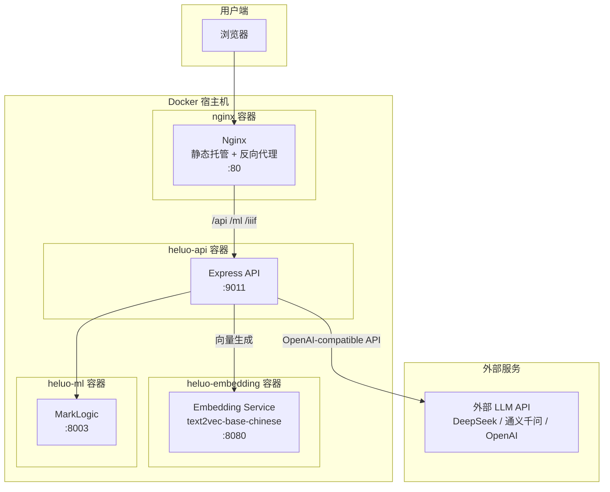
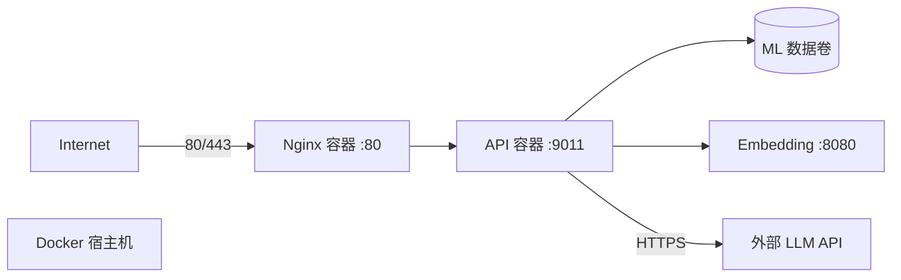

# 河洛古籍知识平台 部署计划

> **版本**: v2.0 | **更新**: 2026-05-15
> **项目**: heluo-react-fullstack
> **部署方式**: Docker 全容器化 | **LLM**: 外部 API

---

## 1. 系统架构概览



### 容器清单

| 容器 | 镜像 | 内部端口 | 外部端口 | 依赖 |
|------|------|----------|----------|------|
| `heluo-nginx` | nginx:alpine | 80 | 80 | 无 |
| `heluo-api` | node:20-alpine | 9011 | (不暴露) | MarkLogic, Embedding |
| `heluo-embedding` | python:3.11-slim | 8080 | (不暴露) | 无 |
| `heluo-ml` | marklogic:latest | 8000-8003 | 8003 (管理用) | 无 |

> 外部 LLM API（如 DeepSeek、通义千问）不占用本地容器资源，仅需 API Key 和网络可达。

---

## 2. 硬件配置要求

### 2.1 最小配置（开发/演示）

| 资源 | 规格 | 说明 |
|------|------|------|
| CPU | 4 核 x86_64 | 需支持 AVX2（MarkLogic 硬性要求） |
| 内存 | **16 GB** | MarkLogic 8G + Embedding 2G + 其他服务 2G |
| 存储 | **150 GB SSD** | 系统 30G + MarkLogic 数据 80G + Embedding 模型 1.5G + 镜像 10G |
| GPU | 不需要 | LLM 使用外部 API，无需本地推理 |
| 网络 | 1 Gbps | 需可访问外部 LLM API |

> 相比本地 LLM 方案，**内存门槛从 32GB 降到了 16GB**，去掉 GPU 需求，大幅降低基础设施成本。

### 2.2 推荐配置（生产）

| 资源 | 规格 | 说明 |
|------|------|------|
| CPU | 8 核 x86_64 | 支持 AVX2 |
| 内存 | **32 GB** | MarkLogic 16G + Embedding 4G + 其余 4G |
| 存储 | **500 GB NVMe SSD** | 考虑 MarkLogic 数据增长 |
| GPU | 不需要 | |
| 网络 | 1 Gbps | |

### 2.3 云服务器参考规格

| 环境 | 云平台 | 实例类型 | 预估月费（参考） |
|------|--------|----------|-----------------|
| 开发 | 阿里云 | ecs.g7.2xlarge (8C 16G) | ~1200 元 |
| 生产 | 阿里云 | ecs.g7.4xlarge (16C 32G) | ~2500 元 |
| 开发 | AWS | c6i.2xlarge (8C 16G) | ~$250 |
| 生产 | AWS | c6i.4xlarge (16C 32G) | ~$550 |

---

## 3. 宿主机软件要求

宿主机只需要安装 Docker 和 Docker Compose，无需直接安装 Node.js / Python / MarkLogic。

| 软件 | 版本要求 | 安装验证 |
|------|----------|----------|
| **Docker** | >= 24.x | `docker --version` |
| **Docker Compose** | >= 2.20 | `docker compose version` |
| **Git** | >= 2.x | `git --version` |

---

## 4. 外部 LLM API

### 4.1 支持的 LLM 提供商

后端 LLM 客户端兼容 OpenAI Chat Completions 格式（参见 `server/src/services/llm/client.js`），以下提供商均可使用：

| 提供商 | API 地址 | 推荐模型 | 备注 |
|--------|----------|----------|------|
| **DeepSeek** | `https://api.deepseek.com` | `deepseek-chat` | 性价比高 |
| **通义千问** | `https://dashscope.aliyuncs.com/compatible-mode/v1` | `qwen-plus` | 国内访问稳定 |
| **OpenAI** | `https://api.openai.com/v1` | `gpt-4o-mini` | 海外部署适用 |
| **Moonshot** | `https://api.moonshot.cn/v1` | `moonshot-v1-8k` | 国内可用 |
| **任意兼容服务** | 自定义 | 自定义 | 支持流式和非流式 |

### 4.2 配置方式

```bash
LLM_ENABLED=true
LLM_BASE_URL=https://api.deepseek.com
LLM_MODEL=deepseek-chat
LLM_API_KEY=sk-your-api-key-here
LLM_PROVIDER=openai
LLM_MAX_TOKENS=2048
# LLM_CHAT_PATH=/v1/chat/completions   # 默认就是此路径，通常无需修改
```

---

## 5. Docker 镜像构建

### 5.1 Dockerfile 清单

#### Dockerfile.nginx — Nginx 前端托管

```dockerfile
# ==========================================
# 阶段一：构建前端
# ==========================================
FROM node:20-alpine AS builder

WORKDIR /app
COPY package*.json ./
RUN npm ci
COPY . .
RUN npm run build

# ==========================================
# 阶段二：Nginx 运行
# ==========================================
FROM nginx:alpine

COPY --from=builder /app/dist /usr/share/nginx/html
COPY deploy/nginx.conf /etc/nginx/conf.d/default.conf

EXPOSE 80
CMD ["nginx", "-g", "daemon off;"]
```

#### Dockerfile.api — Express 后端

```dockerfile
FROM node:20-alpine

WORKDIR /app

COPY package*.json ./
RUN npm ci --production && npm cache clean --force

COPY server/ server/

EXPOSE 9011
CMD ["node", "server/src/index.js"]
```

#### Dockerfile.embedding — Embedding 服务

```dockerfile
FROM python:3.11-slim

WORKDIR /app

# 安装 PyTorch（CPU 版本，无需 CUDA）
RUN pip install --no-cache-dir torch>=2.0.0 --index-url https://download.pytorch.org/whl/cpu

COPY server/embedding-service/requirements.txt .
RUN pip install --no-cache-dir -r requirements.txt

COPY server/embedding-service/ .

EXPOSE 8080
CMD ["python", "server.py"]
```

### 5.2 Nginx 配置

```nginx
# deploy/nginx.conf
server {
    listen 80;
    server_name _;
    client_max_body_size 50M;

    # 前端静态资源
    root /usr/share/nginx/html;
    index index.html;

    location /assets/ {
        expires 1y;
        add_header Cache-Control "public, immutable";
    }

    # SPA 路由回退
    location / {
        try_files $uri $uri/ /index.html;
    }

    # API 反向代理
    location /api/ {
        proxy_pass http://heluo-api:9011;
        proxy_http_version 1.1;
        proxy_set_header Host $host;
        proxy_set_header X-Real-IP $remote_addr;
        proxy_set_header X-Forwarded-For $proxy_add_x_forwarded_for;
    }

    location /ml/ {
        proxy_pass http://heluo-api:9011;
    }

    location /iiif/ {
        proxy_pass http://heluo-api:9011;
    }

    location /stats/ {
        proxy_pass http://heluo-api:9011;
    }

    location /env {
        proxy_pass http://heluo-api:9011;
    }
}
```

---

## 6. Docker Compose 编排

### 6.1 核心编排文件

```yaml
# docker-compose.yml
services:

  # ---- MarkLogic 数据库 ----
  heluo-ml:
    image: marklogicdb/marklogic-db:11.0
    container_name: heluo-ml
    hostname: heluo-ml
    environment:
      MARKLOGIC_INIT: "true"
      MARKLOGIC_ADMIN_USER: admin
      MARKLOGIC_ADMIN_PASSWORD: "${MARKLOGIC_PASSWORD:-admin}"
    volumes:
      - ml-data:/var/opt/MarkLogic
    ports:
      - "8003:8003"      # REST 端口，仅管理需要时可暴露
    # 8000 管理控制台, 8001 管理 API — 生产不暴露
    restart: unless-stopped
    healthcheck:
      test: ["CMD", "curl", "-f", "http://localhost:8002/manage/v2"]
      interval: 30s
      timeout: 10s
      retries: 6
      start_period: 120s

  # ---- Embedding 服务 ----
  heluo-embedding:
    build:
      context: .
      dockerfile: deploy/Dockerfile.embedding
    container_name: heluo-embedding
    environment:
      EMBEDDING_MODEL_PATH: /models/text2vec-base-chinese
      EMBEDDING_SERVICE_PORT: 8080
    volumes:
      - embedding-models:/models
    expose:
      - "8080"
    restart: unless-stopped
    healthcheck:
      test: ["CMD", "curl", "-f", "http://localhost:8080/health"]
      interval: 30s
      timeout: 10s
      retries: 10
      start_period: 180s  # 模型首次加载需要较长时间

  # ---- Express 后端 API ----
  heluo-api:
    build:
      context: .
      dockerfile: deploy/Dockerfile.api
    container_name: heluo-api
    environment:
      NODE_ENV: production
      PORT: 9011
      MARKLOGIC_BASE_URL: "http://heluo-ml:8003"
      MARKLOGIC_USER: "${MARKLOGIC_USER:-admin}"
      MARKLOGIC_PASSWORD: "${MARKLOGIC_PASSWORD:-admin}"
      HELUO_SEARCH_MODE: "${HELUO_SEARCH_MODE:-hybrid}"
      VECTOR_SEARCH_ENABLED: "${VECTOR_SEARCH_ENABLED:-true}"
      LLM_ENABLED: "${LLM_ENABLED:-true}"
      LLM_BASE_URL: "${LLM_BASE_URL}"
      LLM_MODEL: "${LLM_MODEL:-deepseek-chat}"
      LLM_API_KEY: "${LLM_API_KEY}"
      LLM_MAX_TOKENS: "${LLM_MAX_TOKENS:-2048}"
      LLM_TIMEOUT: "${LLM_TIMEOUT:-30000}"
      EMBEDDING_BASE_URL: "http://heluo-embedding:8080"
    depends_on:
      heluo-ml:
        condition: service_healthy
    expose:
      - "9011"
    restart: unless-stopped
    healthcheck:
      test: ["CMD", "curl", "-f", "http://localhost:9011/env/health"]
      interval: 30s
      timeout: 5s
      retries: 3

  # ---- Nginx 前端 ----
  heluo-nginx:
    build:
      context: .
      dockerfile: deploy/Dockerfile.nginx
    container_name: heluo-nginx
    ports:
      - "80:80"
    depends_on:
      heluo-api:
        condition: service_healthy
    restart: unless-stopped
    healthcheck:
      test: ["CMD", "curl", "-f", "http://localhost/"]
      interval: 30s
      timeout: 5s
      retries: 3

volumes:
  ml-data:
    driver: local
  embedding-models:
    driver: local
```

### 6.2 环境变量文件

```bash
# .env — 与 docker-compose.yml 同目录

# MarkLogic
MARKLOGIC_USER=admin
MARKLOGIC_PASSWORD=your_secure_password

# 搜索模式
HELUO_SEARCH_MODE=hybrid
VECTOR_SEARCH_ENABLED=true

# 外部 LLM API
LLM_ENABLED=true
LLM_BASE_URL=https://api.deepseek.com
LLM_MODEL=deepseek-chat
LLM_API_KEY=sk-your-api-key-here
LLM_MAX_TOKENS=2048
LLM_TIMEOUT=30000
```

### 6.3 目录结构

```
project-root/
├── deploy/
│   ├── Dockerfile.nginx       # 前端构建 + Nginx 托管
│   ├── Dockerfile.api         # Express 后端
│   ├── Dockerfile.embedding   # Embedding 服务
│   └── nginx.conf             # Nginx 配置
├── docker-compose.yml         # 服务编排
├── .env                       # 环境变量（不提交 Git）
├── .env.example               # 环境变量模板（提交 Git）
├── src/                       # 前端源码
├── server/                    # 后端源码
│   └── embedding-service/     # Embedding 服务
└── tests/                     # 测试
```

---

## 7. 部署流程

### 7.1 首次部署

```bash
# 1. 克隆代码
git clone <仓库URL> /opt/heluo
cd /opt/heluo

# 2. 配置环境变量
cp .env.example .env
# 编辑 .env 填入真实配置：密码、API Key 等
vi .env

# 3. 启动全部服务
docker compose up -d

# 4. 查看启动状态
docker compose ps
docker compose logs -f

# 5. 验证部署
curl http://localhost/api/search?q=李白
curl http://localhost/env/health
```

### 7.2 更新部署

```bash
cd /opt/heluo

# 拉取最新代码（仅更新配置和 Dockerfile 时才需重建镜像）
git pull

# 重新构建并启动变更的服务
docker compose up -d --build

# 清理旧镜像（可选）
docker image prune -f
```

### 7.3 日常运维命令

```bash
# 查看所有服务状态
docker compose ps

# 查看日志
docker compose logs -f
docker compose logs -f heluo-api      # 只看后端
docker compose logs -f heluo-nginx    # 只看 Nginx

# 重启单个服务
docker compose restart heluo-api

# 停止所有服务
docker compose down

# 停止并删除数据卷（danger！会丢失 MarkLogic 数据）
docker compose down -v
```

---

## 8. 部署模式配置

| 模式 | `HELUO_SEARCH_MODE` | `VECTOR_SEARCH_ENABLED` | `LLM_ENABLED` | 启动容器数 |
|------|---------------------|------------------------|---------------|-----------|
| **A: 最小搜索** | `keyword` | `false` | `false` | 3（nginx + api + ml） |
| **B: 向量搜索** | `vector` | `true` | `false` | 4（+ embedding） |
| **C: 融合问答** | `hybrid` | `true` | `true` | 4（+ embedding，LLM 用外部 API） |

模式 A 只需要 MarkLogic + 后端 + Nginx 三个容器，适合资源有限的场景。修改 `.env` 中的配置后 `docker compose up -d` 即可切换。

---

## 9. 存储空间估算

| 类别 | 占用 |
|------|------|
| Docker 镜像（nginx + node + python + marklogic） | ~6 GB |
| Embedding 模型（text2vec-base-chinese） | ~1.5 GB |
| MarkLogic 应用数据 | 50-500 GB（取决于数据量） |
| MarkLogic 日志与森林合并临时空间 | 10-30 GB |
| Docker 数据卷元数据 | ~1 GB |
| **总计（不含 ML 数据）** | **~8-10 GB** |
| **总计（含典型数据集）** | **~100-200 GB** |

> 相比本地 LLM 方案，**节省了 ~8GB LLM 模型文件**和 **~3GB Python+PyTorch 的 llm-service 依赖**。

---

## 10. 网络拓扑



### 防火墙规则

| 方向 | 源 | 目标 | 端口 | 说明 |
|------|----|------|------|------|
| 入站 | Internet | 宿主机 | 80/443 | 用户 HTTP 访问 |
| 出站 | API 容器 | 外部 | HTTPS | LLM API 调用 |
| 出站 | 宿主机 | 外部 | HTTPS | Docker 拉取镜像 |

> 仅暴露 80/443 端口，所有内部服务通过 Docker 内部网络通信。

---

## 11. 验证检查清单

### 11.1 部署后验证

```bash
# 容器状态
docker compose ps

# 后端健康检查
curl http://localhost/env/health

# 搜索验证
curl "http://localhost/api/search?q=李白"

# Embedding 服务
curl http://localhost:8080/health

# 前端可访问
curl -I http://localhost/ | grep "200 OK"

# LLM 连接测试
curl http://localhost/env/health
# 在返回中确认 llm 状态为 enabled
```

### 11.2 浏览器验证

- [ ] 访问 `http://<服务器IP>/` 看到首页
- [ ] 搜索关键词返回正常结果
- [ ] 点击搜索结果进入详情页
- [ ] 融合问答功能正常
- [ ] SPA 刷新页面不走 404

---

## 12. 运维与监控

### 12.1 资源监控

```bash
# 容器资源使用
docker stats

# 磁盘使用
docker system df
```

### 12.2 日志管理

```yaml
# 在 docker-compose.yml 中添加日志限制，防止日志撑满磁盘
services:
  heluo-api:
    logging:
      driver: "json-file"
      options:
        max-size: "10m"
        max-file: "3"

  heluo-ml:
    logging:
      driver: "json-file"
      options:
        max-size: "20m"
        max-file: "3"
```

### 12.3 数据备份

```bash
# MarkLogic 数据卷备份
docker run --rm -v ml-data:/data -v /backup:/backup alpine \
  tar czf /backup/ml-data-$(date +%Y%m%d).tar.gz -C /data .

# 恢复
docker run --rm -v ml-data:/data -v /backup:/backup alpine \
  tar xzf /backup/ml-data-20260515.tar.gz -C /data
```

---

## 13. 性能基线

| 指标 | 预期 |
|------|------|
| 页面加载 | < 1s |
| 关键词搜索 | < 500ms |
| 向量搜索 | < 2s |
| 融合问答（含外部 LLM） | 3-5s（取决于 API 响应速度）|
| 详情页加载 | < 1s |
| Embedding 单次推理 | < 500ms |

---

## 14. 常见问题

### Q: Embedding 模型首次启动很慢？

首次启动时，容器需要从 HuggingFace 下载 text2vec-base-chinese 模型（~1.3GB），可能耗时 2-5 分钟。模型会缓存到 `embedding-models` 数据卷中，后续启动无需重复下载。也可以在构建镜像时预下载模型。

### Q: MarkLogic 容器可以商用吗？

MarkLogic 官方提供 Docker 镜像，但需要有效的 MarkLogic 许可证。请与 MarkLogic 销售确认容器部署的许可条款。如需试用，可从 developer.marklogic.com 获取开发版镜像。

### Q: Docker 部署的性能有损耗吗？

MarkLogic 在容器中运行会有一定性能损耗（主要是 IOPS），生产环境建议：
- 将 MarkLogic 数据卷映射到宿主机高性能 SSD 目录
- 使用 `--volume-driver=local` 避免远程存储的延迟

### Q: 外部 LLM API 的容错如何？

后端 LLM 客户端已内置**模型回退机制**（参见 `server/src/services/llm/client.js:48-61`），可以通过 `LLM_FALLBACK_MODELS` 配置备选模型。当前模型调用失败时自动切换到备选。

### Q: HTTPS 如何配置？

推荐在 Docker 宿主机前加一层反向代理（如阿里云 SLB、AWS ALB、Nginx 等）终结 TLS。如果需要在容器内配置 HTTPS，可以在 `heluo-nginx` 容器上挂载证书并修改 Nginx 配置。

---

## 15. 维护计划

| 频率 | 任务 |
|------|------|
| 每日 | `docker compose ps` 检查所有容器运行状态，查看错误日志 |
| 每周 | `docker system df` 检查磁盘使用，清理无用镜像和卷 |
| 每月 | MarkLogic 备份验证，Docker 镜像安全更新 |
| 每季 | 基础镜像更新（`docker compose build --no-cache`），主机安全补丁 |
| 按需 | Embedding 模型更新，API Key 轮换，数据重索引 |
