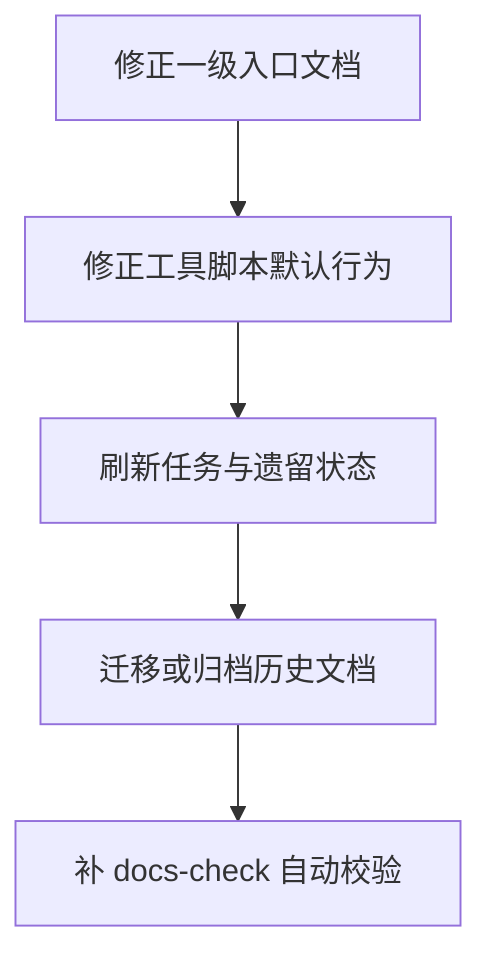

# 文档审计基线报告（2026-04-10）

- 审计分支: `chore/doc-gardening`
- 审计范围: 一级入口文档、任务文档、文档导航、文档脚本入口
- 审计方式: 以代码、真实路径、真实命令、真实测试基线为准

## 当前基线

| 项目 | 当前事实 |
| --- | --- |
| 文档顶层目录数 | `11` 个 |
| 实际文档顶层目录 | `方案`、`analysis`、`design`、`openclaw`、`paper`、`prototype-design`、`qa`、`question`、`refactor`、`reference`、`tasks` |
| 任务板真实路径 | `docs/tasks/todo.md` |
| `tasks/todo.md` 是否存在 | 不存在 |
| `tasks/lessons.md` 是否存在 | 不存在 |
| 详情热点组件行数 | `OverviewTabView.tsx = 660`，`FusionChat.tsx = 639` |
| 后端热点用例行数 | `getDetailUseCase.js = 880` |
| 主工作区测试基线 | `51` 个测试文件、`416` 个测试通过 |

## 高优先级发现

| ID | 状态 | 文档/脚本 | 证据 | 风险 | 处理建议 |
| --- | --- | --- | --- | --- | --- |
| A1 | `conflict` | `AGENTS.md` | 文档要求把计划写入 `tasks/todo.md`、把教训写入 `tasks/lessons.md`，但当前真实存在的是 `docs/tasks/todo.md`，`tasks/lessons.md` 不存在 | 智能体和人类会被引导到不存在路径，任务流直接失真 | 统一改为 `docs/tasks/` 或正式补齐 `tasks/` 目录 |
| A2 | `conflict` | `docs/README.md` | 文档声明 `docs/` 已按 `analysis / architecture / implementation / reports / ui / archive ...` 标准化，但当前实际顶层目录为 `11` 个，且缺少 `architecture`、`implementation`、`reports`、`ui`、`archive` 等关键目录 | 导航文档与仓库结构不符，继续误导后续归档和新建文档行为 | 更新导航文档，或分阶段把目录真正整理到目标结构 |
| A3 | `conflict` | `README.md` | 仍在说明 `/api/mvp/search`、`/api/mvp/detail`、`/api/mvp/fusion`，而当前真实路由和测试均使用 `/api/v1/*` | 外部接入、联调和新人理解都会被带偏 | 先把 README 改到当前 `v1` 口径 |
| A4 | `conflict` | `scripts/commands.ps1` | `docs-init` 仍默认把分析文档生成为 `docs/<name>.md` 顶层文件，与 `docs/README.md` 中“不再新增顶层散落文档”的约定冲突 | 工具会持续制造新的结构漂移 | 把 `docs-init` 改成必须带子目录，或默认写入 `docs/analysis/` |
| A5 | `stale` | `docs/tasks/todo.md` | 文档仍记录“10 个预先存在的测试失败”，但当前主工作区测试基线已经是 `51` 文件、`416` 测试全部通过 | 任务看板会放大不存在的风险，影响优先级判断 | 重新核对并改写遗留问题区 |
| A6 | `stale` | `docs/tasks/todo.md` | 文档中仍引用历史体量，例如 `OverviewTabView.tsx` 记为 `1145` 行、`getDetailUseCase.js` 记为 `977` 行；当前实际分别为 `660` 和 `880` 行 | 重构优先级虽然未必错误，但量化依据已失准 | 把数字改为当前值，并注明历史变化只作为背景 |

## 详细说明

### A1. 任务路径与教训路径失真

`AGENTS.md` 中的任务管理和自我改进规则仍在引用 `tasks/todo.md` 与 `tasks/lessons.md`。当前仓库只有 `docs/tasks/todo.md`，并没有 `tasks/` 目录承载这些文件。

这类问题危险性很高，因为它不是“说明写错一点”，而是会直接把执行流程带到不存在路径上。

### A2. 文档导航已经失去“导航”功能

`docs/README.md` 当前更像一份“目标结构宣言”，而不是“当前结构地图”。如果导航文档不能反映当前结构，它本身就会变成需要绕开的噪音。

建议先决定策略：

1. 要么以当前结构为准，修正文档。
2. 要么以目标结构为准，开始分批迁移目录。

在这两个动作完成前，不宜继续把它当作权威入口。

### A3. README 中的接口说明落后于实际接口版本

当前代码库已明显迁移到 `/api/v1/*` 体系，但 `README.md` 仍保留 `/api/mvp/*` 示例。对外部读者而言，这种失真会直接导致错误请求和错误心智模型。

### A4. 脚本会继续制造新漂移

当前最典型的问题不是单份文档过期，而是工具本身还在持续生成与规范不一致的文件。`docs-init` 如果不改，即使人手清了一轮目录，后续也会重新出现顶层散落文档。

### A5. 任务文档中的测试状态已经失真

任务文档中“10 个预先存在的测试失败”这一结论已经不再反映当前事实。即使后续仍有测试噪音需要治理，它也不应该再以“失败用例”形式存在。

### A6. 任务文档中的规模数据已需要刷新

文件体量是判断是否需要拆分的重要依据，但只要文件已经经历过多轮重构，这些数字就必须刷新。否则任务仍可能正确，论据却已经过时。

## 建议的处理顺序

## 下一步执行建议

- [ ] 先修 `AGENTS.md` 中的任务与教训路径
- [ ] 再修 `README.md` 中的接口版本说明
- [ ] 修 `docs/README.md`，让它描述当前真实结构
- [ ] 修 `docs/tasks/todo.md` 的测试状态与文件体量
- [ ] 最后调整 `scripts/commands.ps1` 的 `docs-init` 默认输出位置

## 备注

- 审计 worktree 当前未包含未跟踪的 `node_modules`，因此运行性基线从主工作区取证。
- 该事实不影响文档审计结论，但后续若要在此分支执行前端测试，需要额外准备依赖环境。
